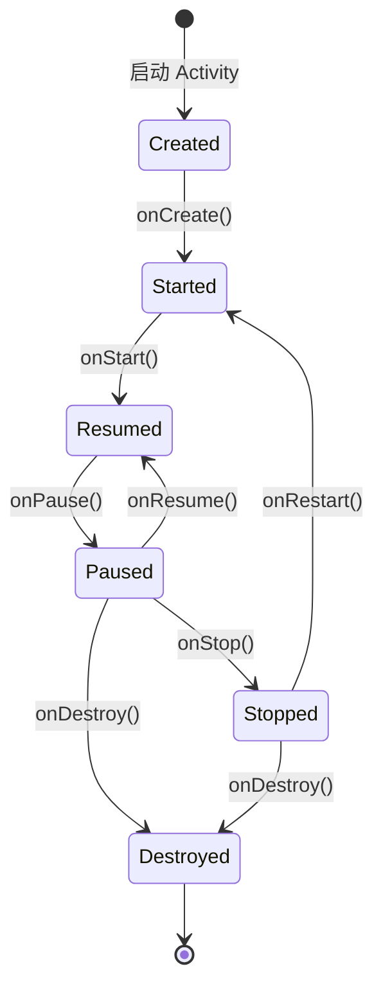

## 创建与注册

Activity是Android应用开发中使用到的**最普遍**、**最基础**的组件。任何新建的项目，只要没有选择“No Activity”之类的选项，都会自带一个MainActivity。Activity同时也是UI界面展示的基础，没有Activity也就不会有应用界面可以展示。

### 创建方式

Activity的创建方式主要有两种：

1. 通过Android Studio的`File`➡`New`➡`Activity`的途径，配置和创建Activity；
2. 手动创建继承`AppCompatActivity`的子类，**并且要在AndroidManifest文件中手动注册该Activity**。

在实际开发中，一般更推荐使用第一种方式，因为手动创建既麻烦，又容易忘记注册Activity导致应用崩溃。

## 基本使用

Activity通过在`onCreate()`方法中调用`setContentView()`来设置对应的布局文件（有关布局文件的内容会在==UI界面==部分进行详细阐述），进而实现界面的展示。同时，`onCreate()`以及其他主要方法也是<u>实现许多业务逻辑</u>的重点所在。

### 界面组件与 View Binding

在Activity里拿到布局控件的引用，先后有过三种写法：

| 写法 | 现状 |
|:--|:--|
| `findViewById()` | 原生API，仍然可用，每个控件一行 |
| `kotlinx.android.synthetic.*` | Kotlin Android Extensions 的语法糖，**Kotlin 1.8 起插件已被移除**，写不出来了 |
| **View Binding** | 当前官方推荐方案，编译期生成绑定类 |

`findViewById()` 的写法：

```kotlin
// 有一个控件就调用一次，返回类型由泛型指定
val control = findViewById<Button>(R.id.xxx)
```

例如界面上的Button组件，在Activity取得其引用之后，就可以调用`setOnClickListener`来监听点击动作，并在里面编写业务代码，点击后就会执行某些任务。其他组件也有自己的监听方法可以调用，此处不作赘述。

这种写法有两个代价：

+ **样板代码多**：布局上有多少个控件，就要写多少行；
+ **不做类型检查**：泛型与实际类型不一致时编译期不报错，运行期抛`ClassCastException`；漏写赋值则是`NullPointerException`。

`synthetic`省掉了这些行，代价却更大：它按id直接解析，**不检查控件归属**。引用别的布局里的同名控件，编译期照样通过，运行期直接崩溃。这正是 View Binding 被设计出来的原因；曾经常用的第三方方案 [ButterKnife](https://github.com/JakeWharton/butterknife) 也已在 README 里注明停止开发，并直接指向 View Binding。

#### 启用

View Binding 随 AGP 提供，不需要额外依赖，按模块开关：

```kotlin
android {
    buildFeatures {
        viewBinding = true
    }
}
```

Groovy DSL 的等价写法是`android.buildFeatures.viewBinding = true`；更早的`viewBinding { enabled = true }`已被`buildFeatures`取代。

#### 在 Activity 中使用

```kotlin
private lateinit var binding: ActivityMainBinding

override fun onCreate(savedInstanceState: Bundle?) {
    super.onCreate(savedInstanceState)
    binding = ActivityMainBinding.inflate(layoutInflater)
    setContentView(binding.root)

    binding.title.text = "首页"
    binding.submit.setOnClickListener { /* TODO */ }
}
```

三步固定：`inflate()`创建绑定对象 → `binding.root`交给`setContentView()` → 之后直接用`binding.<控件id>`访问。控件字段在绑定对象创建时就已完成查找与类型转换，后面每一次访问都不再有`findViewById()`的开销。

> Fragment 里 binding 的生命周期与 Activity 不同（视图会比实例先销毁），写法见[[8. Fragment#用 View Binding 绑定视图]]。

#### 绑定类的生成规则

| 布局文件 | 生成的绑定类 |
|:--|:--|
| `activity_main.xml` | `ActivityMainBinding` |
| `dialog_confirm.xml` | `DialogConfirmBinding` |
| `item_user_card.xml` | `ItemUserCardBinding` |

规则是把文件名转成 PascalCase，再拼上`Binding`。每个绑定类只有两部分内容：`root`（根视图）和**所有带`android:id`的子视图**——没有id的视图不生成字段，也就无法通过 binding 访问。

绑定类生成在模块的`build/generated`下，包名为模块包名加`.databinding`。

#### 几个边界

+ **布局文件一个字都不用改**。不需要在根节点套`<layout>`标签，原样保留即可；在根视图上加`tools:viewBindingIgnore="true"`可以让该布局不生成绑定类（纯容器、只被`include`的布局常用）。
+ **布局已经膨胀过时用`bind()`**。例如 RecyclerView 的`onCreateViewHolder`已经拿到了`View`，此时调用`ItemUserCardBinding.bind(view)`，而不是`inflate()`；自定义View里也是同样的道理（见[[9. UI 开发#组合式：继承 ViewGroup|自定义 View]]）。
+ **`<include>`要访问子布局内部的控件，必须给 include 标签一个 id**，生成的字段类型是子布局的绑定类；不给 id 就没有这个入口。
+ **根节点是`<merge>`时没有`root`**，只能用`inflate(inflater, parent)`或`bind(view)`，且必须挂到父容器上。
+ **开关改动后要 Rebuild**。viewBinding 影响的是编译期生成的类，增量编译有时会残留旧绑定类，表现为“找不到类”或字段对不上。

### Toast

Toast用于展示内容较少的提示信息，不仅会自动消失，而且不需要在布局文件上编写专门的组件。其具体使用方式为：

```kotlin
// 参数依次为：上下文、提示内容、展示时长
Toast.makeText(context, "已保存", Toast.LENGTH_SHORT).show()
```

通过调用`makeText()`来设置上下文Context、提示内容Content以及展示时长Duration，最后调用`show()`来展示Toast。

### Menu

Menu分为布局文件和业务逻辑两部分，布局文件的内容详见==UI界面==，这里主要介绍如何在Activity中设置和使用Menu。

设置Menu需要重写`onCreateOptionsMenu()`方法，例如：

```kotlin
override fun onCreateOptionsMenu(menu: Menu?): Boolean {
    // menuInflater 是 Activity 自带的属性
    menuInflater.inflate(R.menu.xxx, menu)
    return true
}
```

`menuInflater.inflate()`的作用和`setContentView()`类似，都是要设置对应的布局文件。

重写完成并且编译运行之后，应用界面右上角就会出现Menu的图标，但是此时点击Menu的具体项目还不会有响应，因此需要重写`onOptionsItemSelected()`，例如：

```kotlin
override fun onOptionsItemSelected(item: MenuItem): Boolean {
    when (item.itemId) {
        R.id.action_settings -> { /* TODO */ }
        R.id.action_about -> { /* TODO */ }
        else -> return super.onOptionsItemSelected(item)
    }
    return true
}
```

## Activity间跳转

Activity间依靠Intent实现跳转，根据是否指明目标Activity，可以分为显式Intent和隐式Intent。

+ **显式Intent**

显式Intent需要指定目标Activity：

```kotlin
val intent = Intent(this, SomeActivity::class.java)
startActivity(intent)
```

显示Intent的优势在于简单明确，跳转动作不会发生混淆。但是这种跳转方式**只适用于目标Activity可以被直接引用的情形**。最典型的例子是，在多模块依赖的项目中，平行层级模块间的Activity是不可能直接相互引用的，同样地，被依赖的模块也不可能直接引用到依赖该模块的模块中的Activity。

+ **隐式Intent**

隐式Intent则是指定一系列**抽象的action和category信息**，只要项目中有Activity在AndroidManifest文件中设置了对应的\<action>和\<category>标签内容，那么它就可以被跳转到。使用隐式Intent的优势在于，调用`startActivity()`方法的一方**根本不需要了解目标Activity叫什么、有哪些属性、在项目中处于什么层次以及能不能被引用等等**，这在多模块依赖的大型项目中尤为有用。

隐式Intent的使用方式如下：

```kotlin
val intent = Intent("ActionTag")
intent.addCategory("CategoryTag")
startActivity(intent)
```

AndroidManifest的设置：

```xml
<activity
    android:name=".SomeActivity"
    android:exported="false">

    <intent-filter>
        <action android:name="ActionTag" />
        <category android:name="android.intent.category.DEFAULT" />
        <!-- action 只能有一个，category 可以有多个 -->
    </intent-filter>

</activity>
```

> 关于`DEFAULT`类别：`startActivity()`会把所有隐式Intent视为已经声明了`android.intent.category.DEFAULT`，因此**intent-filter中必须包含这一项**，否则隐式跳转匹配不到。自定义category需要在代码里`addCategory("CategoryTag")`显式添加，而`DEFAULT`不必手动添加——系统已经隐式带上了。

> 关于`android:exported`：自 **Android 12（API 31）** 起，凡是声明了intent-filter的activity、service、receiver都必须显式写出`android:exported`，**漏写会导致应用无法在Android 12及以上设备安装**。含`LAUNCHER`类别的设为`true`（供桌面启动），仅供应用内跳转的设为`false`（阻断外部应用调用）。

Intent还有许多属性和用法，以下再介绍两个常用的重要用法。

+ **传递数据**

利用Intent传递数据需要调用`putExtra()`方法，其具体的做法如下：

```kotlin
// 传递方
val intent = Intent(this, TargetActivity::class.java).apply {
    putExtra("key", value)
}
startActivity(intent)

// 接收方：Activity 自带 intent 属性，按数据类型选用 getXxxExtra
val received = intent.getStringExtra("key")
```

> 传参有容量上限：Intent中的额外数据随Binder事务传递，而Binder事务缓冲区大小固定（约1MB，且在同一进程内共享），超出上限会抛`TransactionTooLargeException`。因此`putExtra()`只适合传标识、短字符串、小对象这类轻量数据；Bitmap、大段JSON、文件内容应当通过`ViewModel`共享、数据库、临时文件或URI传递。自定义对象需要实现`Parcelable`（推荐）或`Serializable`。

+ **返回结果**

请求结果的经典写法是`startActivityForResult()`配合`onActivityResult()`，这两个方法自 **API 30（Android 11）** 起已废弃。现行方案是**Activity Result API**，它把“发起请求”与“接收结果”拆成两个对象：`ActivityResultContract`定义输入与输出类型，`ActivityResultLauncher`负责发起请求。

返回结果的一方不需要改动，仍然是`setResult()`配合`finish()`：

```kotlin
val resultIntent = Intent().apply {
    putExtra("key", value)
}
setResult(RESULT_OK, resultIntent)   // 只使用 RESULT_OK 或 RESULT_CANCELED
finish()
```

请求结果的一方改为“先注册、后启动”：

```kotlin
// 必须在 Activity 创建阶段无条件注册（字段初始化或 onCreate 中）
private val pickResult = registerForActivityResult(
    ActivityResultContracts.StartActivityForResult()
) { result ->
    if (result.resultCode == RESULT_OK) {
        val value = result.data?.getStringExtra("key")
        // TODO
    }
}

// 发起请求：不再需要 requestCode
pickResult.launch(Intent(this, PickerActivity::class.java))
```

> 两个约束必须遵循。第一，`registerForActivityResult()`**必须在Activity进入STARTED之前调用**，通常写在字段声明处或`onCreate()`里，放到`onStart()`之后会抛`IllegalStateException`。第二，注册必须**无条件执行**，不能写进“用户点了按钮才需要结果”的分支——进程被回收重建时，系统依赖这份注册关系把结果送回。

内置契约已覆盖常见场景，如`StartActivityForResult`、`RequestPermission`、`TakePicture`、`PickContact`，省掉了手写Intent与解析返回值的模板代码。

## 销毁

要销毁单个Activity，只需要在合适的位置调用`finish()`即可。而如果要统一销毁多个Activity，可以使用一个集合进行管理，示例如下：

```kotlin
object ActivitiesCollector {
    private val activities = mutableListOf<Activity>()

    fun addActivity(activity: Activity) {
        activities.add(activity)
    }

    fun removeActivity(activity: Activity) {
        activities.remove(activity)
    }

    fun finishAll() {
        for (activity in activities) {
            if (!activity.isFinishing) {
                activity.finish()
            }
        }
        activities.clear()
    }
}
```

> 这段工具有两个前提：静态集合持有Activity引用会延长实例生命周期，必须在`onDestroy()`中调用`removeActivity()`，否则集合本身就是泄漏源；此外，现代项目多以单Activity配合Navigation（或Compose Navigation）组织页面，“一次性关闭多个页面”的需求已很少见，这段代码主要适用于存量的多Activity项目。

## 生命周期

Activity的生命周期包括：`onCreate()`、`onStart()`、`onResume()`、`onPause()`、`onStop()`、`onRestart()`以及`onDestroy()`。具体调用时机如下图所示：



由上图可以获得Activity的三种生存期：

+ **完整生存期**：从`onCreate()`到`onDestroy()`。前者多进行**初始化**操作，后者多进行**内存释放**操作
+ **可见生存期**：从`onStart()`到`onStop()`。前者多进行**资源加载**操作，后者多进行**资源释放**操作
+ **前台生存期**：从`onResume()`到`onPause()`。这一阶段Activity位于前台并且**可以与用户交互**；`onPause()`之后它可能仍然可见（被透明主题的Activity或对话框遮挡、处于多窗口模式），因此**不要**在`onPause()`里做重量级的资源释放，那是`onStop()`的职责。

## 状态保存与恢复

Activity可能在用户毫无感知的情况下被销毁——后台内存不足时被系统回收，或者因配置变更被重建——回到前台时必须让界面恢复原样。这靠三套机制配合：

| 机制 | 触发/销毁时机 | 配置变更后 | 进程被杀后 | 适合存什么 |
|:--|:--|:--:|:--:|:--|
| `onSaveInstanceState(Bundle)` | 系统即将回收界面时回调 | 保留 | **保留** | 轻量UI状态：草稿文本、滚动位置、选中项 |
| `ViewModel` | `onCleared()` | **保留** | 丢失 | 页面数据、网络请求结果 |
| `SavedStateHandle` | 随`ViewModel` | 保留 | **保留** | 需要跨进程重建的关键参数（ID、筛选条件） |

```kotlin
// 保存：系统在 onStop() 前后调用，不要在这里做耗时操作
override fun onSaveInstanceState(outState: Bundle) {
    super.onSaveInstanceState(outState)
    outState.putString("draft", binding.editText.text.toString())
}

// 恢复：savedInstanceState 为 null 说明没有可恢复的状态（通常是首次创建）
override fun onCreate(savedInstanceState: Bundle?) {
    super.onCreate(savedInstanceState)
    setContentView(R.layout.activity_main)
    val draft = savedInstanceState?.getString("draft").orEmpty()
}
```

> 两条边界。第一，`onSaveInstanceState()`承载的Bundle同样走Binder事务，只适合放**轻量数据**，塞Bitmap会触发`TransactionTooLargeException`；业务数据交给`ViewModel`，需要跨进程重建的放`SavedStateHandle`。第二，恢复不一定走`onRestoreInstanceState()`（它只在存在保存状态时、于`onStart()`之后调用），在`onCreate()`里用`savedInstanceState != null`判断更直观。

配置变更（旋转屏幕、切换深色模式、修改系统字号）默认会**销毁并重建**Activity，这正是`ViewModel`存在的主要理由之一——它在这类重建中存活，而Activity实例不会。在manifest里用`android:configChanges="orientation|screenSize"`可以阻止重建，但代价是所有适配逻辑都要自己处理，除特殊场景外不推荐。

## 返回键处理

`onBackPressed()`自**API 33（Android 13）**起废弃，现行做法是向`OnBackPressedDispatcher`注册回调：

```kotlin
// onCreate 中注册；传入 this 作为 LifecycleOwner，随生命周期自动注销
onBackPressedDispatcher.addCallback(this) {
    if (drawerLayout.isDrawerOpen(GravityCompat.START)) {
        drawerLayout.closeDrawer(GravityCompat.START)
    } else {
        // 关闭自身拦截，交还系统执行默认返回
        isEnabled = false
        onBackPressedDispatcher.onBackPressed()
    }
}
```

Compose项目使用`BackHandler {}`，它是同一套回调的Compose封装，用法见[[3. Activity：Compose场景#返回处理|第三篇的返回处理]]。

> 系统自Android 13起引入**预测性返回手势**（Predictive Back）：滑动返回时先展示目标页面的预览，确认后才真正返回。它需要在`<application>`上声明`android:enableOnBackInvokedCallback="true"`开启，Android 14起还支持应用内的返回动画。自定义返回逻辑必须走`OnBackPressedCallback`，重写`onBackPressed()`在新模型下不会生效。
