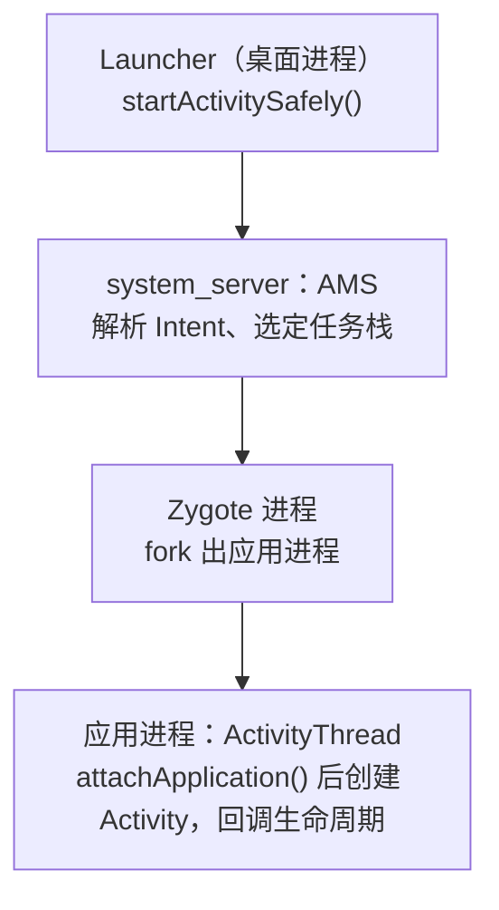
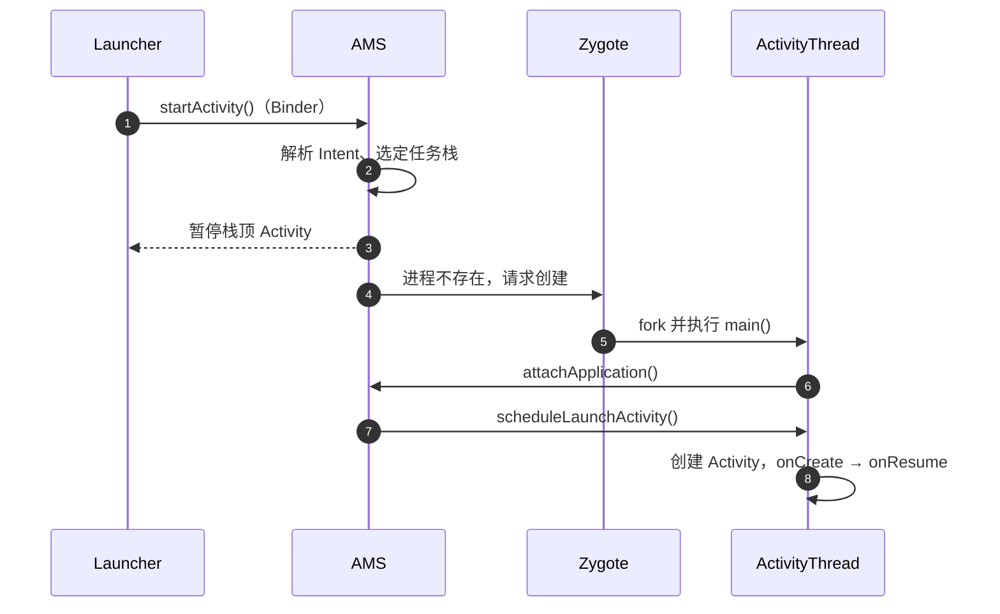
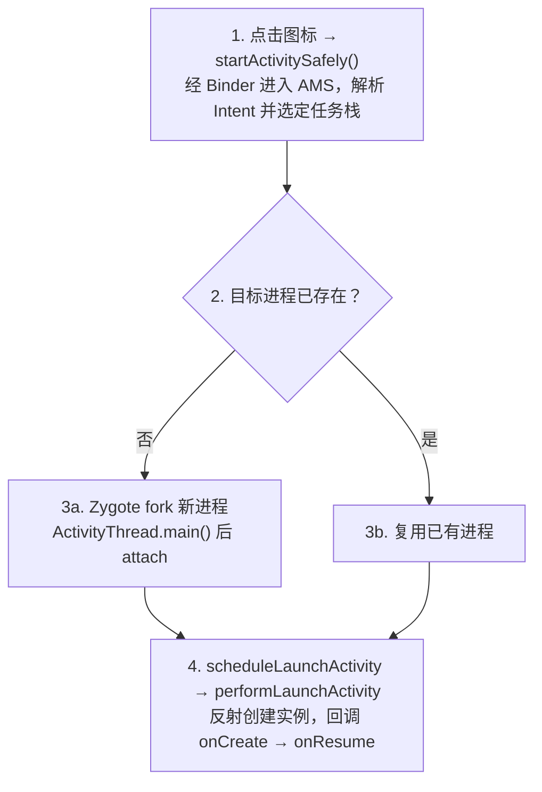
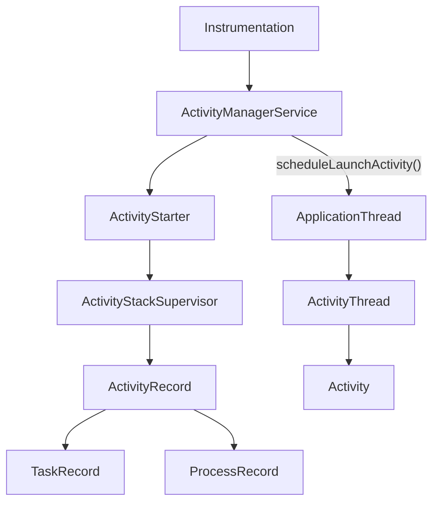
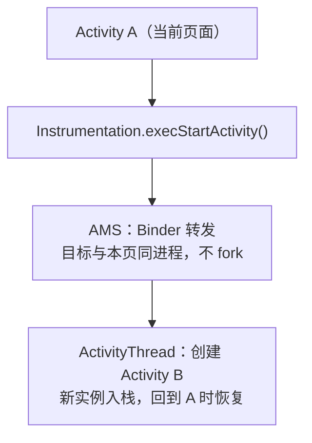
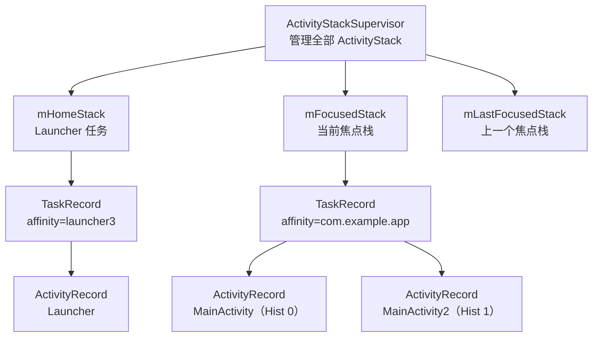
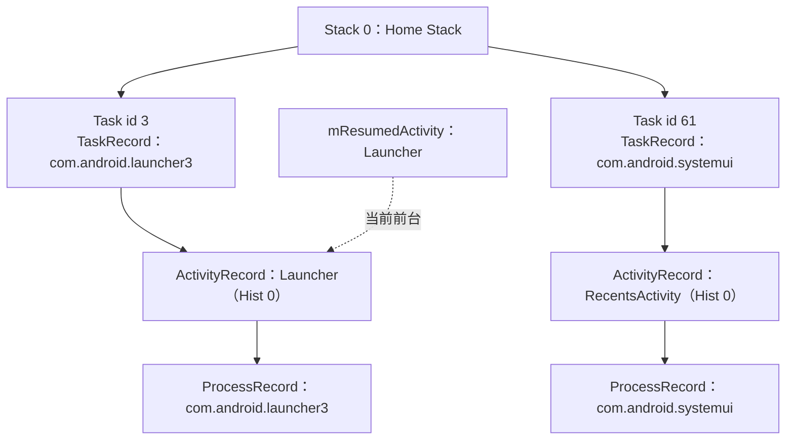
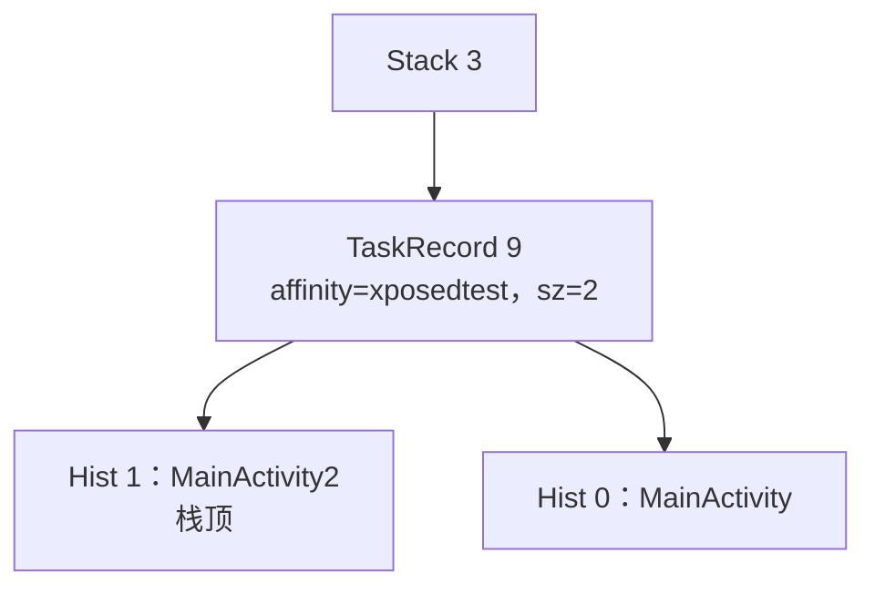

## 启动流程与系统进程

> 版本说明：本节与下一节的任务栈分析基于**Android 8.0/9.0**的AMS实现。Android 10（Q）之后系统重构了窗口与任务容器，`ActivityStack`、`ActivityStackSupervisor`、`TaskRecord`等类陆续被`RootWindowContainer`、`RootTask`、`Task`取代，按文中的类名在新版本源码中检索会找不到。**任务栈的原理（ActivityRecord与Task的从属关系、affinity如何决定入栈）依然成立，类名与层级需按新版本对照。**

Framework层包含三大进程：Zygote进程、System Server进程以及Media Server进程。Activity的启动与Zygote进程和System Server进程紧密相关。

Zygote进程是Android系统的首个Java进程，也是所有Java进程的父进程。System Server进程由前者孵化而来，用于管理整个Java framework层，包含ActivityManager，PowerManager等各种系统服务。

以**用户点击桌面图标启动应用**为例，在这一过程中，Activity的启动流程如下。

图1中的Launcher进程是Android系统启动之后的第一个应用程序，它的作用有两个：

1. 作为Android系统的==**启动器**==，用于启动应用程序
2. 作为Android系统的==**桌面**==，用于显示和管理其他应用程序的快捷图标和桌面组件

Launcher作为一个应用程序，本身有包含Activity，因此它的启动过程自然也会有和其他应用程序相似甚至相同的地方。



**<center>图1. 根Activity启动过程示意图</center>**



**<center>图2. 根Activity启动时的调用时序图</center>**

当用户点击桌面上的应用图标时，就会调用Launcher的startActivitySafely方法，随后就如图3 所示，进入后续的启动流程。



**<center>图3. 根Activity启动流程</center>**



**<center>图4. 涉及到的关键类与方法</center>**

如果是**从一个应用进程中的Activity启动另一个Activity**，因为不涉及到Launcher创建应用进程，所以大概的过程如下图所示：



**<center>图5. 普通Activity启动示意图</center>**

## 任务栈

### 任务栈模型

如图6 所示，Activity任务栈主要由三种重要的数据结构组成：ActivityStack、TaskRecord以及ActivityRecord。Activity的栈管理就是建立在这个模型的基础之上。



**<center>图6. Activity任务栈模型</center>**

### 三种数据结构解析

+ **ActivityRecord**

ActivityRecord类用来记录一个Activity的所有信息，描述一个Activity。一个ActivityRecord只能对应一个Activity，而一个Activity根据启动模式的不同，可能有多个ActivityRecord（比如standard模式的Activity可能会被重复创建）。它的部分重要成员变量如下表所示：

| 名称                | 类型                   |                        说明                         |
| :------------------ | :--------------------- | :-------------------------------------------------: |
| service             | ActivityManagerService |                      AMS的引用                      |
| info                | ActivityInfo           | Activity中的代码和AndroidManifest文件设置的节点信息 |
| launchedFromPackage | String                 |                 启动Activity的包名                  |
| taskAffinity        | String                 |              Activity希望归属的任务栈               |
| task                | TaskRecord             |           ActivityRecord所在的TaskRecord            |
| app                 | ProcessRecord          |          ActivityRecord所在的应用程序进程           |
| state               | ActivityState          |                  当前Activity状态                   |
| icon                | int                    |               Activity图标资源标识符                |
| theme               | int                    |               Activity主题资源标识符                |

ActivityRecord通过task与TaskRecord建立联系。

在AndroidManifest文件中设置taskAffinity，可以指定Activity希望归属的任务栈。taskAffinity通常以下述两种方式使用：

（1）当taskAffinity与FLAG_ACTIVITY_NEW_TASK或singleTask配合使用时，只要Activity的taskAffinity和任务栈的taskAffinity相同，就加入该栈，否则创建新栈；

（2）当taskAffinity与allowTaskReparenting配合使用时，若allowTaskReparenting设置为true，则Activity具有转移的能力，亦即启动该Activity时，会优先加入包含该Activity的应用（具有相同taskAffinity）所在的任务栈。

+ **TaskRecord**

TaskRecord用来表示Activity的任务栈（这个才是真正意义上的任务栈），管理ActivityRecord（Activity）。它的部分重要成员变量如下表所示：

| 名称            | 类型                        |             说明             |
| :-------------- | :-------------------------- | :--------------------------: |
| taskID          | int                         |      任务栈的唯一标识符      |
| affinity        | String                      |    该Task中第一个Activity    |
| intent          | Intent                      |    启动这个任务栈的Intent    |
| mActivities     | ArrayList\<ActivityRecord> | 按历史顺序排列的Activity记录 |
| mStack          | ActivityStack               |   当前归属的ActivityStack    |
| mService        | ActivityManagerService      |          AMS的引用           |
| mCallingPackage | String                      |         调用者的包名         |

一般情况下，在启动App的第一个Activity时，AMS为其创建一个TaskRecord，当然启动后也可能创建新的TaskRecord,比如启动一个指定了不同taskAffinity的singleTask类型的Activity，这时候也会创建一个新的TaskRecord，因此一个App是可能有多个TaskRecord存在的，这取决于应用的使用场景和需求。

当启动模式设定为singleTask后，通过findTaskLocked来为启动的Activity寻找TaskRecord，如果找到则返回它顶部的Activity所对应的ActivityRecord。在findTaskLocked中，会比较要启动的Activity和Task的affinity，如果匹配就返回TaskRecord顶部的ActivityRecord，如果最终没找到则返回null。如果返回值intentActivity为null，那么
addingToTask和reuseTask都不会设置，这时候会通过createTaskRecord创建TaskRecord并设置到ActivityRecord之中。在大多数情况下，Activity都会复用TaskRecord,也就是说Activity会添加到相同的TaskRecord之中，除了应用第一次启动或者taskAffinity不同之外。如果上一步中通过findTaskLocked返回的intentActivity不为空，这表示为singleTask类型的activity找到了一个可复用的TaskRecord。

+ **ActivityStack**

ActivityStack是一个用于管理系统所有的Activity的堆栈机制，由ActivityStackSupervisor进行管理。ActivityStack在ActivityStackSupervisor中有以下几种重要实例：

+ `mHomeStack`：存储Launcher的所有Activity
+ `mFocusedStack`：当前正在接收输入或启动下一个Activity的所有Activity（非Launcher）
+ `mLastFocusedStack`：之前接收输入的所有Activity

## 五种启动模式

Activity提供五种启动模式：

| 模式 | 含义 | 起始版本 |
|:--|:--|:--:|
| `standard` | 标准：每次启动都新建实例并压栈 | API 1 |
| `singleTop` | 栈顶复用：栈顶已是该实例则直接复用 | API 1 |
| `singleTask` | 栈内复用：栈中已有则复用，并清空它上面的所有页面 | API 1 |
| `singleInstance` | 单实例：独占一个任务栈，栈中只有它自己 | API 1 |
| `singleInstancePerTask` | 栈内单实例：只能作栈根，但可在多个任务栈各存一个 | API 31 |

启动模式可以在AndroidManifest中用`launchMode`声明，也可以在Intent上通过`addFlags()`指定，两者的作用范围不同：`launchMode`是该Activity的**默认行为**，对它所有的启动都生效；flags是**单次启动的要求**，只影响这一次。同一行为存在两套写法（例如`singleTop`对应`FLAG_ACTIVITY_SINGLE_TOP`），同时设置时按flag的具体语义生效，不存在笼统的“谁覆盖谁”。此外还可以用`taskAffinity`指定Activity希望归属的任务栈，但它对`singleInstance`无效。除`standard`之外，其余四种模式都是为了解决**如何避免同一Activity重复创建多个实例**的问题。

### standard模式

standard模式是启动Activity的默认模式，没有任何特殊配置的Activity，会默认以standard模式启动。在这种模式下，每当启动一个Activity，系统就会创建一个新的实例，并将其压入任务栈的栈顶，而不管该Activity是否已经存在于任务栈中。standard模式的好处就是不用特意配置，直接上手就能用，但缺点是浪费系统资源。

### singleTop模式

singleTop是这样一种模式：当启动一个Activity时，若任务栈的栈顶已经存在该Activity的实例，那么该实例将直接被复用，否则系统就创建新的实例。这个模式只考虑任务栈的**栈顶**是否存在待启动的Activity实例，如果待启动的Activity实例存在但不是位于栈顶，那么就会转变成standard模式，同样会造成资源浪费。因此从实际开发的角度来讲，这种“半吊子节约”的启动模式并没有太大的使用价值。

### singleTask模式

singleTask比SingleTop更进一步，只要任务栈中存在待启动Activity的实例，那么就直接复用，并且把该Activity之前的其他Activity（如果存在的话）全部出栈，使之位于栈顶。

### singleInstance模式

singleInstance使用一个任务栈来单独管理指定为该模式的Activity，无论有哪些应用程序访问该Activity，都只会共用这个任务栈，因此可以实现Activity实例的共享。根据Google官方开发文档的介绍，系统不会将任何其他Activity启动到包含该实例的任务栈中，该Activity始终是其任务栈中**唯一**的成员；由该Activity启动的任何Activity都会在其他的任务栈中打开。在这种情况下，Activity的出栈顺序取决于它们所在任务栈的顺序，只有最先出栈的Activity所在的任务栈完全出栈后，才会切换到其他的任务栈，并进行后续的出栈步骤。

### singleInstancePerTask模式

`singleInstancePerTask`是`singleTask`的变体：以该模式启动的Activity只能作为任务栈的**根Activity**，每个任务栈中只存在一个实例，这一点与`singleTask`相同。区别在于，当配合`FLAG_ACTIVITY_MULTIPLE_TASK`或`FLAG_ACTIVITY_NEW_DOCUMENT`时，它可以在**不同的任务栈**中同时存在多个实例，而`singleTask`做不到。文档编辑器同时打开多份文档、浏览器开出多个独立窗口这类场景依赖的就是它。

### 用Intent Flags控制启动行为

| Flag | 作用 |
|:--|:--|
| `FLAG_ACTIVITY_NEW_TASK` | 在新的任务栈中启动；若已存在该Activity所属的任务栈，则把整个栈带到前台 |
| `FLAG_ACTIVITY_SINGLE_TOP` | 目标实例已在栈顶时复用，不重建 |
| `FLAG_ACTIVITY_CLEAR_TOP` | 目标实例已在栈中时，把它上面的Activity全部出栈 |
| `FLAG_ACTIVITY_CLEAR_TASK` | 先清空目标任务栈再启动，必须与`NEW_TASK`配合 |
| `FLAG_ACTIVITY_NO_HISTORY` | 启动后不留在任务栈中，用户离开即销毁 |
| `FLAG_ACTIVITY_REORDER_TO_FRONT` | 实例已在栈中时把它移到栈顶，而不是重建 |
| `FLAG_ACTIVITY_MULTIPLE_TASK` | 允许同一Activity存在于多个任务栈，需与`NEW_TASK`配合，通常交给`singleInstancePerTask`或`documentLaunchMode`使用 |

```kotlin
// 回到首页并复用已有实例：清掉它上面的所有页面，且不重建首页
val intent = Intent(this, MainActivity::class.java).apply {
    addFlags(Intent.FLAG_ACTIVITY_CLEAR_TOP or Intent.FLAG_ACTIVITY_SINGLE_TOP)
}
startActivity(intent)
```

### onNewIntent：复用实例时接收新意图

当目标Activity因`singleTop`、`singleTask`、`singleInstance`或对应flag被复用时，`onCreate()`不会重新执行，新的Intent通过`onNewIntent()`送达：

```kotlin
override fun onNewIntent(intent: Intent?) {
    super.onNewIntent(intent)
    setIntent(intent)      // 让后续 getIntent() 返回最新的Intent
    handleIntent(intent)
}
```

> 如果只重写`onNewIntent()`而忘记调用`setIntent()`，`getIntent()`仍会返回最初那次启动的Intent，这类问题在深链跳转中很常见。

## 用 dumpsys 查看任务栈

将设备与Android Studio通过ADB连接进行调试，在Terminal中输入`adb shell dumpsys activity`，即可打印显示当前任务栈情况（但是位置比较靠后）。常见的情况有以下几种：

> 下述输出取自**Android 6.0与9.0**。Android 10起该命令的结构改为`RootTask`/`Task`层级，不再出现`Stack #`，字段名也有变化；但阅读方式一致——**排在最前面的在栈顶，`Hist`按入栈先后编号**。

### （1）停留桌面：

```text
ACTIVITY MANAGER ACTIVITIES (dumpsys activity activities)
Display #0 (activities from top to bottom):
  Stack #0:
    Task id #3
      TaskRecord{cf56b0f #3 I=com.android.launcher3/.Launcher U=0 sz=1}
      Intent { act=android.intent.action.MAIN cat=[android.intent.category.HOME] flg=0x10000000 cmp=com.android.launcher3/.Launcher }
        Hist #0: ActivityRecord{703d70b u0 com.android.launcher3/.Launcher t3}
          Intent { act=android.intent.action.MAIN cat=[android.intent.category.HOME] flg=0x10000000 cmp=com.android.launcher3/.Launcher }
          ProcessRecord{90a4323 2993:com.android.launcher3/u0a9}
    Task id #61
      TaskRecord{ec2ceb8 #61 A=com.android.systemui U=0 sz=1}
      Intent { act=com.android.systemui.recents.SHOW_RECENTS flg=0x10804000 cmp=com.android.systemui/.recents.RecentsActivity bnds=[72,2125][1369,3422] }
        Hist #0: ActivityRecord{681dea8 u0 com.android.systemui/.recents.RecentsActivity t61}
          Intent { act=com.android.systemui.recents.SHOW_RECENTS flg=0x10804000 cmp=com.android.systemui/.recents.RecentsActivity bnds=[72,2125][1369,3422] }
          ProcessRecord{6dc41ef 5068:com.android.systemui/u0a15}

    Running activities (most recent first):
      TaskRecord{cf56b0f #3 I=com.android.launcher3/.Launcher U=0 sz=1}
        Run #1: ActivityRecord{703d70b u0 com.android.launcher3/.Launcher t3}
      TaskRecord{ec2ceb8 #61 A=com.android.systemui U=0 sz=1}
        Run #0: ActivityRecord{681dea8 u0 com.android.systemui/.recents.RecentsActivity t61}

    mResumedActivity: ActivityRecord{703d70b u0 com.android.launcher3/.Launcher t3}
```

在上述调试信息中展示的任务栈层级和对应的数据结构是这样的：



可以看到Stack #0表示的是负责管理Launcher的栈，也就是所谓的Home Stack。所有编号非0的Stack都是用于管理非Launcher应用的。最后的mResumedActivity表示当前正在运行的Activity。至少在原生的Android 6.0中，尽管桌面的Activity和近期任务的Activity分属于不同的进程，但它们都被放到同一个ActivityStack中（可能是设置了taskAffinity的缘故）。**如果是一些定制的Android系统，就会把二者放到不同的ActivityStack**，比如MuMu模拟器把近期任务去掉，导致ActivityStack中只有Launcher的Activity：

```text
ACTIVITY MANAGER ACTIVITIES (dumpsys activity activities)
Display #0 (activities from top to bottom):
  Stack #0:
    Task id #80
      TaskRecord{7239cf1 #80 A=com.mumu.launcher U=0 sz=1}
      Intent { act=android.intent.action.MAIN cat=[android.intent.category.HOME] flg=0x10000000 cmp=com.mumu.launcher/.Launcher }
        Hist #0: ActivityRecord{c956587 u0 com.mumu.launcher/.Launcher t80}
          Intent { act=android.intent.action.MAIN cat=[android.intent.category.HOME] flg=0x10000000 cmp=com.mumu.launcher/.Launcher }
          ProcessRecord{adc8051 891:com.mumu.launcher/1000}

    Running activities (most recent first):
      TaskRecord{7239cf1 #80 A=com.mumu.launcher U=0 sz=1}
        Run #0: ActivityRecord{c956587 u0 com.mumu.launcher/.Launcher t80}

    mResumedActivity: ActivityRecord{c956587 u0 com.mumu.launcher/.Launcher t80}
```

还有基于Android 9.0的MIUI 11，就很明显地展示出二者分开的情况：

```text
ACTIVITY MANAGER ACTIVITIES (dumpsys activity activities)
Display #0 (activities from top to bottom):

  Stack #0: type=home mode=fullscreen
  isSleeping=false
  mBounds=Rect(0, 0 - 0, 0)
    Task id #1
    ···
        Hist #0: ActivityRecord{7820f0d u0 com.miui.home/.launcher.Launcher t1}
          Intent { act=android.intent.action.MAIN cat=[android.intent.category.HOME] flg=0x10800100 cmp=com.miui.home/.launcher.Launcher }
          ProcessRecord{13a4108 1501:com.miui.home/u0a47}

    Running activities (most recent first):
      TaskRecord{71620fd #1 I=com.miui.home/.launcher.Launcher U=0 StackId=0 sz=1}
        Run #0: ActivityRecord{7820f0d u0 com.miui.home/.launcher.Launcher t1}

    mResumedActivity: ActivityRecord{7820f0d u0 com.miui.home/.launcher.Launcher t1}

  Stack #1: type=recents mode=fullscreen
  isSleeping=false
  mBounds=Rect(0, 0 - 0, 0)

    Task id #1734
    ···
        Hist #0: ActivityRecord{693b6e1 u0 com.android.systemui/.recents.RecentsActivity t1734}
          Intent { flg=0x10804000 cmp=com.android.systemui/.recents.RecentsActivity }
          ProcessRecord{1321af 1214:com.android.systemui/1000}

    Running activities (most recent first):
      TaskRecord{32751f2 #1734 A=com.android.systemui U=0 StackId=1 sz=1}
        Run #0: ActivityRecord{693b6e1 u0 com.android.systemui/.recents.RecentsActivity t1734}
```

如先前所述，桌面是一个Activity（Launcher），当用户查看后台运行的应用程序——或者说近期任务时，就会切换到另一个Activity，它通常被命名为“RecentsActivity”：

```text
ACTIVITY MANAGER ACTIVITIES (dumpsys activity activities)
Display #0 (activities from top to bottom):
  Stack #0:
    Task id #61
      TaskRecord{ec2ceb8 #61 A=com.android.systemui U=0 sz=1}
      Intent { act=com.android.systemui.recents.SHOW_RECENTS flg=0x10804000 cmp=com.android.systemui/.recents.RecentsActivity bnds=[72,2125][1369,3422] }
        Hist #0: ActivityRecord{681dea8 u0 com.android.systemui/.recents.RecentsActivity t61}
          Intent { act=com.android.systemui.recents.SHOW_RECENTS flg=0x10804000 cmp=com.android.systemui/.recents.RecentsActivity bnds=[72,2125][1369,3422] }
          ProcessRecord{6dc41ef 5068:com.android.systemui/u0a15}
    Task id #3
      TaskRecord{cf56b0f #3 I=com.android.launcher3/.Launcher U=0 sz=1}
      Intent { act=android.intent.action.MAIN cat=[android.intent.category.HOME] flg=0x10000000 cmp=com.android.launcher3/.Launcher }
        Hist #0: ActivityRecord{703d70b u0 com.android.launcher3/.Launcher t3}
          Intent { act=android.intent.action.MAIN cat=[android.intent.category.HOME] flg=0x10000000 cmp=com.android.launcher3/.Launcher }
          ProcessRecord{90a4323 2993:com.android.launcher3/u0a9}

    Running activities (most recent first):
      TaskRecord{ec2ceb8 #61 A=com.android.systemui U=0 sz=1}
        Run #1: ActivityRecord{681dea8 u0 com.android.systemui/.recents.RecentsActivity t61}
      TaskRecord{cf56b0f #3 I=com.android.launcher3/.Launcher U=0 sz=1}
        Run #0: ActivityRecord{703d70b u0 com.android.launcher3/.Launcher t3}

    mResumedActivity: ActivityRecord{681dea8 u0 com.android.systemui/.recents.RecentsActivity t61}
```

可以看到，哪个Activity处于正被用户使用（可见）的状态，哪个Activity就会位于栈顶，从而在调试信息中处于第一的位置，这一点将会在后面得到不断的验证。

### （2）从桌面启动多个不同应用：

在Redmi 6A（MIUI 11，基于Android 9.0）中先后启动相机和浏览器两个应用，查看任务栈的情况（只列出重要调试信息）：

```text
ACTIVITY MANAGER ACTIVITIES (dumpsys activity activities)
Display #0 (activities from top to bottom):

  Stack #1239: type=standard mode=fullscreen
  isSleeping=false
  mBounds=Rect(0, 0 - 0, 0)
    Task id #2959
    ···
    Running activities (most recent first):
      TaskRecord{e8a2748 #2959 A=com.android.chrome U=0 StackId=1239 sz=1}
        Run #0: ActivityRecord{71e51be u0 com.android.chrome/com.google.android.apps.chrome.Main t2959}

    mResumedActivity: ActivityRecord{71e51be u0 com.android.chrome/com.google.android.apps.chrome.Main t2959}

  Stack #0: type=home mode=fullscreen
  isSleeping=false
  mBounds=Rect(0, 0 - 0, 0)

    Task id #1
    ···
        Hist #0: ActivityRecord{7820f0d u0 com.miui.home/.launcher.Launcher t1}
          Intent { act=android.intent.action.MAIN cat=[android.intent.category.HOME] flg=0x10800100 cmp=com.miui.home/.launcher.Launcher }
          ProcessRecord{13a4108 1501:com.miui.home/u0a47}

    Running activities (most recent first):
      TaskRecord{71620fd #1 I=com.miui.home/.launcher.Launcher U=0 StackId=0 sz=1}
        Run #0: ActivityRecord{7820f0d u0 com.miui.home/.launcher.Launcher t1}

  Stack #1: type=recents mode=fullscreen
  isSleeping=false
  mBounds=Rect(0, 0 - 0, 0)

    Task id #1734
    ···
    Running activities (most recent first):
      TaskRecord{32751f2 #1734 A=com.android.systemui U=0 StackId=1 sz=1}
        Run #0: ActivityRecord{693b6e1 u0 com.android.systemui/.recents.RecentsActivity t1734}

  Stack #1238: type=standard mode=fullscreen
  isSleeping=false
  mBounds=Rect(0, 0 - 0, 0)

    Task id #2958
    ···
    Running activities (most recent first):
      TaskRecord{27ad9e1 #2958 A=com.android.camera U=0 StackId=1238 sz=1}
        Run #0: ActivityRecord{a42c583 u0 com.android.camera/.Camera t2958}
```

如果不考虑桌面和近期任务这两个Activity，可以看到，在通常情况下，**不同的应用程序会启动不同的ActivityStack对其任务栈进行管理**。

### （3）standard模式从一个Activity启动另一个Activity：

以一个demo应用为例，在MuMu模拟器上运行并打印查看任务栈信息如下：

```text
ACTIVITY MANAGER ACTIVITIES (dumpsys activity activities)
Display #0 (activities from top to bottom):
  Stack #3:
    Task id #9
      TaskRecord{9308be5 #9 A=com.example.xposedtest U=0 sz=2}
      Intent { act=android.intent.action.MAIN cat=[android.intent.category.LAUNCHER] flg=0x10000000 cmp=com.example.xposedtest/.MainActivity }
        Hist #1: ActivityRecord{88da353 u0 com.example.xposedtest/.MainActivity2 t9}
          Intent { cmp=com.example.xposedtest/.MainActivity2 }
          ProcessRecord{c6986ba 1706:com.example.xposedtest/u0a24}
        Hist #0: ActivityRecord{ef8ab93 u0 com.example.xposedtest/.MainActivity t9}
          Intent { act=android.intent.action.MAIN cat=[android.intent.category.LAUNCHER] flg=0x10000000 cmp=com.example.xposedtest/.MainActivity }
          ProcessRecord{c6986ba 1706:com.example.xposedtest/u0a24}

    Running activities (most recent first):
      TaskRecord{9308be5 #9 A=com.example.xposedtest U=0 sz=2}
        Run #1: ActivityRecord{88da353 u0 com.example.xposedtest/.MainActivity2 t9}
        Run #0: ActivityRecord{ef8ab93 u0 com.example.xposedtest/.MainActivity t9}

    mResumedActivity: ActivityRecord{88da353 u0 com.example.xposedtest/.MainActivity2 t9}
```

上述信息展现的是这样一种结构：



在Standard模式下，由于没有对每个Activity的taskAffinity进行设置，因此默认由同一个ActivityStack和TaskRecord对它们进行管理。

### （4）singleInstance模式从一个Activity启动另一个Activity

还是以刚才的demo应用为例，将其中一个Activity改为singleInstance模式启动，然后查看打印的任务栈信息：

```text
ACTIVITY MANAGER ACTIVITIES (dumpsys activity activities)
Display #0 (activities from top to bottom):
  Stack #5:
    Task id #15
      TaskRecord{2a8f024 #15 A=com.example.xposedtest U=0 sz=1}
      Intent { flg=0x10000000 cmp=com.example.xposedtest/.MainActivity2 }
        Hist #0: ActivityRecord{da08191 u0 com.example.xposedtest/.MainActivity2 t15}
          Intent { flg=0x10000000 cmp=com.example.xposedtest/.MainActivity2 }
          ProcessRecord{af1678d 2298:com.example.xposedtest/u0a24}
    Task id #14
      TaskRecord{a643d42 #14 A=com.example.xposedtest U=0 sz=1}
      Intent { act=android.intent.action.MAIN cat=[android.intent.category.LAUNCHER] flg=0x10000000 cmp=com.example.xposedtest/.MainActivity }
        Hist #0: ActivityRecord{29faae9 u0 com.example.xposedtest/.MainActivity t14}
          Intent { act=android.intent.action.MAIN cat=[android.intent.category.LAUNCHER] flg=0x10000000 cmp=com.example.xposedtest/.MainActivity }
          ProcessRecord{af1678d 2298:com.example.xposedtest/u0a24}

    Running activities (most recent first):
      TaskRecord{2a8f024 #15 A=com.example.xposedtest U=0 sz=1}
        Run #1: ActivityRecord{da08191 u0 com.example.xposedtest/.MainActivity2 t15}
      TaskRecord{a643d42 #14 A=com.example.xposedtest U=0 sz=1}
        Run #0: ActivityRecord{29faae9 u0 com.example.xposedtest/.MainActivity t14}

    mResumedActivity: ActivityRecord{da08191 u0 com.example.xposedtest/.MainActivity2 t15}
```

可以看到，尽管两个Activity都属于同一个应用程序。但是正如前面所言，被指定为singleInstance模式的Activity在启动时，会启用一个新的任务栈来进行管理。而且在这一过程中，用户可以明显地感受到创建新任务栈时所带来的**应用切换**效果。

### （5）singleTask模式从一个Activity启动另一个Activity

编写一个包含两个Activity的demo，启动时进入的Activity使用standard模式，由该Activity启动的另一个应用在AndroidManifest文件中设置其launchMode为singleTask。

demo刚启动时的任务栈信息：

```text
ACTIVITY MANAGER ACTIVITIES (dumpsys activity activities)
Display #0 (activities from top to bottom):

  Stack #1243: type=standard mode=fullscreen
  isSleeping=false
  mBounds=Rect(0, 0 - 0, 0)
    Task id #2963
    ···
        Hist #0: ActivityRecord{aa5a94f u0 com.gradletest.activitytest/.MainActivity t2963}
          Intent { act=android.intent.action.MAIN cat=[android.intent.category.LAUNCHER] flg=0x10200000 cmp=com.gradletest.activitytest/.MainActivity bnds=[30,765][152,887] (has extras) }
          ProcessRecord{622b696 2340:com.gradletest.activitytest/u0a358}

    Running activities (most recent first):
      TaskRecord{c2b61b1 #2963 A=com.gradletest.activitytest U=0 StackId=1243 sz=1}
        Run #0: ActivityRecord{aa5a94f u0 com.gradletest.activitytest/.MainActivity t2963}

    mResumedActivity: ActivityRecord{aa5a94f u0 com.gradletest.activitytest/.MainActivity t2963}
```

切换到另一个Activity后：

```text
ACTIVITY MANAGER ACTIVITIES (dumpsys activity activities)
Display #0 (activities from top to bottom):

  Stack #1243: type=standard mode=fullscreen
  ···
        Hist #0: ActivityRecord{aa5a94f u0 com.gradletest.activitytest/.MainActivity t2963}
          Intent { act=android.intent.action.MAIN cat=[android.intent.category.LAUNCHER] flg=0x10200000 cmp=com.gradletest.activitytest/.MainActivity bnds=[30,765][152,887] (has extras) }
          ProcessRecord{622b696 2340:com.gradletest.activitytest/u0a358}

    Running activities (most recent first):
      TaskRecord{c2b61b1 #2963 A=com.gradletest.activitytest U=0 StackId=1243 sz=2}
        Run #1: ActivityRecord{c5d07ff u0 com.gradletest.activitytest/.MainActivity2 t2963}
        Run #0: ActivityRecord{aa5a94f u0 com.gradletest.activitytest/.MainActivity t2963}

    mResumedActivity: ActivityRecord{c5d07ff u0 com.gradletest.activitytest/.MainActivity2 t2963}
```

从当前Activity再返回初始的Activity：

```text
ACTIVITY MANAGER ACTIVITIES (dumpsys activity activities)
Display #0 (activities from top to bottom):

  Stack #1243: type=standard mode=fullscreen
  ···
        Hist #2: ActivityRecord{4258aa6 u0 com.gradletest.activitytest/.MainActivity t2963}
          Intent { cmp=com.gradletest.activitytest/.MainActivity }
          ProcessRecord{622b696 2340:com.gradletest.activitytest/u0a358}
        Hist #1: ActivityRecord{c5d07ff u0 com.gradletest.activitytest/.MainActivity2 t2963}
          Intent { flg=0x10000000 cmp=com.gradletest.activitytest/.MainActivity2 }
          ProcessRecord{622b696 2340:com.gradletest.activitytest/u0a358}
        Hist #0: ActivityRecord{aa5a94f u0 com.gradletest.activitytest/.MainActivity t2963}
          Intent { act=android.intent.action.MAIN cat=[android.intent.category.LAUNCHER] flg=0x10200000 cmp=com.gradletest.activitytest/.MainActivity bnds=[30,765][152,887] (has extras) }
          ProcessRecord{622b696 2340:com.gradletest.activitytest/u0a358}

    Running activities (most recent first):
      TaskRecord{c2b61b1 #2963 A=com.gradletest.activitytest U=0 StackId=1243 sz=3}
        Run #2: ActivityRecord{4258aa6 u0 com.gradletest.activitytest/.MainActivity t2963}
        Run #1: ActivityRecord{c5d07ff u0 com.gradletest.activitytest/.MainActivity2 t2963}
        Run #0: ActivityRecord{aa5a94f u0 com.gradletest.activitytest/.MainActivity t2963}

    mResumedActivity: ActivityRecord{4258aa6 u0 com.gradletest.activitytest/.MainActivity t2963}
```

可以看到，被设置为standard模式的初始Activity（/.MainActivity）在上述过程中被创建了两次。如果这时候再进入singleTask模式的Activity（/.MainActivity2），则任务栈情况如下：

```text
ACTIVITY MANAGER ACTIVITIES (dumpsys activity activities)
Display #0 (activities from top to bottom):

  Stack #1243: type=standard mode=fullscreen
  ···
        Hist #1: ActivityRecord{c5d07ff u0 com.gradletest.activitytest/.MainActivity2 t2963}
          Intent { flg=0x10000000 cmp=com.gradletest.activitytest/.MainActivity2 }
          ProcessRecord{622b696 2340:com.gradletest.activitytest/u0a358}
        Hist #0: ActivityRecord{aa5a94f u0 com.gradletest.activitytest/.MainActivity t2963}
          Intent { act=android.intent.action.MAIN cat=[android.intent.category.LAUNCHER] flg=0x10200000 cmp=com.gradletest.activitytest/.MainActivity bnds=[30,765][152,887] (has extras) }
          ProcessRecord{622b696 2340:com.gradletest.activitytest/u0a358}

    Running activities (most recent first):
      TaskRecord{c2b61b1 #2963 A=com.gradletest.activitytest U=0 StackId=1243 sz=2}
        Run #1: ActivityRecord{c5d07ff u0 com.gradletest.activitytest/.MainActivity2 t2963}
        Run #0: ActivityRecord{aa5a94f u0 com.gradletest.activitytest/.MainActivity t2963}

    mResumedActivity: ActivityRecord{c5d07ff u0 com.gradletest.activitytest/.MainActivity2 t2963}
```

按照先前所述，singleTask模式的Activity在启动时，若任务栈中已经存在其实例，就会先将排在它之前的Activity全部出栈，使得该实例位于栈顶。上述过程验证了这一启动模式的特点。
