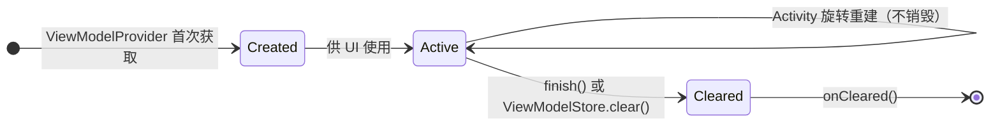

`ViewModel`是Jetpack对MVVM中ViewModel层的具体实现：**它负责持有界面状态，并在配置变更（旋转屏幕、切换深色模式）后继续存活**。

要分清它不做什么：它不碰 View，不做持久化，也不等于数据层。它的生命周期比 Activity 长一点，但不比进程长——进程被杀，`ViewModel`照样没了（这一点由`SavedStateHandle`补位）。



## 生命周期与作用域

`ViewModel`由`ViewModelStore`持有，`ViewModelStore`由`ViewModelStoreOwner`持有（`ComponentActivity`、`Fragment`、`NavBackStackEntry`都实现了这个接口）。链条是：

```text
ViewModelStoreOwner  →  ViewModelStore  →  ViewModel
```

### 为什么旋转屏幕后还在

配置变更会销毁并重建 Activity，但**不是结束页面**。销毁前`ComponentActivity`在`onRetainNonConfigurationInstance()`里把`ViewModelStore`交给系统保管，重建时再通过`getLastNonConfigurationInstance()`取回——Activity 对象是新的，`ViewModelStore`还是原来那个，所以里面的`ViewModel`实例没变。

### 什么时候真正销毁

只有 owner **永久结束**（调用`finish()`、Fragment 出栈且不在返回栈中）时才会清理：

```kotlin
// ComponentActivity 初始化时注册的观察者（只保留与 ViewModel 相关的部分）
lifecycle.addObserver(LifecycleEventObserver { _, event ->
    if (event == Lifecycle.Event.ON_DESTROY) {
        // 判断写在 Activity 里，不在 ViewModelStore 里
        if (!isChangingConfigurations) {
            viewModelStore.clear()
        }
    }
})
```

`ViewModelStore.clear()`本身的实现非常简单——清空 Map 并逐个调用`ViewModel.clear()`，**它不判断配置变更**。是否属于配置变更，是由上面的`isChangingConfigurations`决定的。

由此得到一个常见结论：**`onCleared()`不是每次`onDestroy()`都会触发**。旋转屏幕时 Activity 走了`onDestroy()`，但`ViewModel`活着，`onCleared()`也不会执行；只有页面真正结束才会回调。

## 定义与获取

### 定义

继承`ViewModel`，唯一通常要重写的是`onCleared()`：

```kotlin
class MyViewModel : ViewModel() {

    override fun onCleared() {
        super.onCleared()
        // 释放这个 ViewModel 独占的资源
    }
}
```

### 获取实例

```kotlin
// 1. 显式获取
val vm: MyViewModel = ViewModelProvider(this)[MyViewModel::class.java]

// 2. 属性委托（需 activity-ktx / fragment-ktx）——最常用
private val vm: MyViewModel by viewModels()

// 3. Fragment 中拿到宿主 Activity 作用域的同一个实例
private val sharedVm: MyViewModel by activityViewModels()

// 4. Compose
val vm: MyViewModel = viewModel()
```

作用域决定是否获得同一个实例：

| 获取方式 | 作用域 |
|:--|:--|
| `by viewModels()`（Activity 中） | 该 Activity |
| `by viewModels()`（Fragment 中） | **该 Fragment 自己**，与 Activity 的不是同一个 |
| `by activityViewModels()` | 宿主 Activity |
| `by viewModels({ requireParentFragment() })` | 父 Fragment |
| `viewModel()`（Compose） | 最近的`ViewModelStoreOwner` |

> `ViewModel`**不是单例**。同一作用域内只会创建一个实例并缓存，跨作用域（比如 Activity 与其内部 Fragment）拿到的就是两个对象。这也是“两个 Fragment 数据不同步”的常见原因——改用`activityViewModels()`即可。

### 带构造参数的 ViewModel

`ViewModel`虽然可以直接构造，但只有交给`ViewModelStore`持有的实例才能跨配置变更存活。工厂负责“怎么造”，“怎么留”由系统完成。

现代写法是`viewModelFactory {}` DSL：

```kotlin
class MyViewModel(private val repository: Repository) : ViewModel()

val factory = viewModelFactory {
    initializer {
        // this 是 CreationExtras，可以取到 Application 等上下文
        val app = checkNotNull(this[ViewModelProvider.AndroidViewModelFactory.APPLICATION_KEY])
        MyViewModel(Repository(app))
    }
}

private val vm: MyViewModel by viewModels { factory }
```

如果项目里还在用旧式工厂，它是这个样子的（功能等价，只是啰嗦）：

```kotlin
class MyFactory(private val repository: Repository) : ViewModelProvider.Factory {

    @Suppress("UNCHECKED_CAST")
    override fun <T : ViewModel> create(modelClass: Class<T>): T {
        if (modelClass.isAssignableFrom(MyViewModel::class.java)) {
            return MyViewModel(repository) as T
        }
        throw IllegalArgumentException("Unknown ViewModel class: ${modelClass.name}")
    }
}
```

> 构造参数里**不能放 Activity / Fragment / View**。它们会被`ViewModel`持有，而`ViewModel`比它们活得久，必然泄漏。需要上下文时用`AndroidViewModel`的`Application`，或注入`ApplicationContext`。

### AndroidViewModel

`AndroidViewModel`是`ViewModel`的子类，构造参数固定为`Application`，用于在不持有界面上下文的前提下访问全局资源：

```kotlin
class MyAndroidViewModel(application: Application) : AndroidViewModel(application) {

    private val prefs = application.getSharedPreferences("settings", Context.MODE_PRIVATE)
}
```

**不需要自己传工厂**。`ComponentActivity`提供的默认工厂（`SavedStateViewModelFactory`）会检测到`AndroidViewModel`，并自动用`Application`构造它：

```kotlin
// 直接取即可，显式传 AndroidViewModelFactory 是多余的
val vm: MyAndroidViewModel = ViewModelProvider(this)[MyAndroidViewModel::class.java]
```

### viewModelScope

`viewModelScope`是绑定到`ViewModel`生命周期的`CoroutineScope`，在`onCleared()`时自动取消。异步任务都应该放在这里面：

```kotlin
class MyViewModel(private val repository: Repository) : ViewModel() {

    private val _uiState = MutableStateFlow<UiState>(UiState.Loading)
    val uiState: StateFlow<UiState> = _uiState.asStateFlow()

    fun load() {
        viewModelScope.launch {
            _uiState.value = UiState.Loading
            runCatching { repository.load() }
                .onSuccess { _uiState.value = UiState.Success(it) }
                .onFailure { _uiState.value = UiState.Error(it) }
        }
    }
}
```

> 它默认使用`Dispatchers.Main.immediate`，但**不会**自动切到 IO。耗时操作要自己`withContext(Dispatchers.IO)`，或者交给 Repository 内部处理。页面销毁时协程随之取消，所以不要在`onCleared()`里再做“取消”动作。

### SavedStateHandle

`ViewModel`扛得住配置变更，扛不住进程被杀。需要跨进程重建保留的数据，交给`SavedStateHandle`：

```kotlin
class DetailViewModel(
    private val handle: SavedStateHandle
) : ViewModel() {

    // 进程重建后依然能拿到
    val id: String = checkNotNull(handle["id"])

    // 也可以直接暴露成 StateFlow / LiveData
    val keyword: StateFlow<String> = handle.getStateFlow("keyword", "")
}
```

`SavedStateHandle`的数据最终写进 Bundle，**只适合轻量内容**（ID、筛选条件、草稿文本），不要塞大对象。

## LiveData

`LiveData`是 Jetpack 提供的**生命周期感知的可观察数据容器**，最常见的用法是作为`ViewModel`向 UI 暴露状态的手段。

### 三个特性

+ **生命周期感知**：观察者绑定到`LifecycleOwner`后，只有 owner 处于 STARTED 或 RESUMED 时才收到更新；owner 被销毁时观察者自动移除，不会泄漏；
+ **可观察**：容器里的值变化时通知所有活跃观察者，这正是数据驱动 UI 的基础；
+ **数据容器**：可以存放任意类型，`LiveData<T>`本身只读，写入要靠子类`MutableLiveData`。

### 读写分离

标准写法是内部用`MutableLiveData`读写、外部只暴露`LiveData`：

```kotlin
class MyViewModel : ViewModel() {

    // 内部可写，private 保证外部拿不到写入口
    private val _count = MutableLiveData(0)

    // 外部只读
    val count: LiveData<Int> get() = _count

    fun increase() {
        _count.value = (_count.value ?: 0) + 1
    }

    fun increaseAsync() {
        // 子线程更新
        _count.postValue((_count.value ?: 0) + 1)
    }
}
```

`value`才是被传递的数据，容器本身用`val`修饰即可，不需要重新赋值。

### setValue 与 postValue

| 方法 | 线程要求 | 行为 |
|:--|:--|:--|
| `setValue()` | **必须在主线程** | 立即通知观察者 |
| `postValue()` | 任意线程 | 投递到主线程，**多次调用可能只保留最后一次** |

`postValue()`的合并语义是常见问题：连续调用三次，观察者可能只收到最后一个值。需要每个值都不丢时，改用`Channel`或`SharedFlow`。

### 观察

```kotlin
viewModel.count.observe(this) { count ->
    // this 是 LifecycleOwner，通常就是 Activity / Fragment
    textView.text = count.toString()
}
```

owner 进入 DESTROYED 后观察者会自动移除，这是`LiveData`相对手写回调最大的价值。

### 粘性：状态与事件要分开

`LiveData`会保留最后一个值，**新观察者一注册就会立刻收到它**，这叫粘性。对“状态”（当前登录用户、当前列表）这是优点；对“一次性事件”（弹 Toast、跳转页面）就是灾难——旋转屏幕后会再弹一次。

正确做法是把两者分开：

| 类型 | 承载方式 |
|:--|:--|
| 状态（订阅即得当前值） | `LiveData` / `StateFlow` |
| 一次性事件（只消费一次） | `SharedFlow(replay = 0)` 或`Channel` |

不要用`SingleLiveEvent`：它靠`setValue(null)`复位，多观察者时只有一个能收到，本质上是在绕开`LiveData`的语义。

### 变换

```kotlin
// map：一对一转换
val name: LiveData<String> = userLiveData.map { it.name }

// switchMap：源变化时切换数据源，旧源自动断开
val result: LiveData<List<Repo>> = queryLiveData.switchMap { query ->
    repository.search(query)
}

// distinctUntilChanged：值真的变了才通知，LiveData 默认不去重
val stable: LiveData<String> = nameLiveData.distinctUntilChanged()
```

这两个是`LiveData`的扩展函数。Java 风格的`Transformations.map(...)`重载已被标记废弃，Kotlin 里直接写`liveData.map { }`即可。

多个数据源合并用`MediatorLiveData`：任意一个源变化都会触发它重新计算。

```kotlin
class MyViewModel : ViewModel() {

    private val mediator = MediatorLiveData<UiState>()
    val uiState: LiveData<UiState> get() = mediator

    init {
        mediator.addSource(userLiveData) { user ->
            mediator.value = buildState(user)
        }
        mediator.addSource(configLiveData) { config ->
            mediator.value = buildState(config)
        }
    }
}
```

`MediatorLiveData`继承自`MutableLiveData`，所以可读可写；它的数据类型也不必与数据源一致。

### liveData {} 构建器

需要在产生数据时执行挂起函数，用`liveData {}`：

```kotlin
val result: LiveData<Result> = liveData {
    emit(Loading)
    emit(repository.load())          // 挂起调用，随 LiveData 失活自动取消
}
```

这是公开 API；内部的`CoroutineLiveData`是`internal`的，不需要也不应该直接引用。

### observeForever 的代价

```kotlin
val observer = Observer<Int> { value -> /* ... */ }
liveData.observeForever(observer)
// 必须手动移除，否则永久泄漏
liveData.removeObserver(observer)
```

它不感知生命周期，只适合确实没有`LifecycleOwner`的场景。

> `ViewModel`内部不要用`observeForever()`去“观察”自己的`LiveData`。它本身就是数据的写入方，读当前值直接用`.value`；一旦用了`observeForever()`，就必须成对调用`removeObserver()`，否则泄漏。

## LiveData 的局限与替代

`LiveData`没被废弃，但它的能力边界很明确：

| 能力 | LiveData | StateFlow |
|:--|:--|:--|
| 初始值 | 可以没有（值可空） | **必须有** |
| 相同值去重 | 不去重，每次 set 都通知 | 按`equals`去重 |
| 粘性 | 天然粘性，不可配置 | 由`replay`控制 |
| 操作符 | 仅`map`/`switchMap`/`distinctUntilChanged`等少数几个 | 全套 Flow 操作符 |
| 背压 | 不支持 | 支持 |
| 线程 | `setValue`限主线程 | 任意线程 |
| 生命周期 | **自带** | 需配合`repeatOnLifecycle` |

两者可以互转：

```kotlin
// Flow → StateFlow（推荐给 Compose / 新代码）
val state: StateFlow<UiState> = flow.stateIn(
    scope = viewModelScope,
    started = SharingStarted.WhileSubscribed(5_000),
    initialValue = UiState.Loading
)

// Flow → LiveData（给仍在用 View 体系的界面）
val live: LiveData<UiState> = flow.asLiveData()

// LiveData → Flow
val fromLive: Flow<UiState> = liveData.asFlow()
```

官方口径需要分清两层：

+ **LiveData 文档**：如果要在应用的其他层使用数据流，请改用 Kotlin Flow，然后在 ViewModel 里用`asLiveData()`转成 LiveData 供 UI 观察；
+ **架构指南的状态生成**：界面状态的输出推荐`StateFlow`或 Compose 的`State`。

结论是：**Kotlin 新项目直接用`StateFlow`；Java 项目、存量项目、以及“界面只在活跃时需要数据”这类简单场景，`LiveData`仍然合适**，它的生命周期感知是`StateFlow`需要额外代码才能达到的。

## 使用边界

+ **不持有 View、Activity、Fragment、View 的 Context**——`ViewModel`比它们活得久，持有就是泄漏；
+ **不把`ViewModel`当全局单例**——不同作用域是不同实例；
+ **不在`onCleared()`之外的地方手动清理**——它只在页面真正结束时调用一次；
+ **Fragment 间共享数据用`activityViewModels()`**，而不是各自`viewModels()`；
+ **一次性事件不要塞进状态容器**，用`SharedFlow`/`Channel`。

## 测试

`ViewModel`不依赖 Android 框架（`AndroidViewModel`除外），可以直接构造，不需要 Robolectric：

```kotlin
@Test
fun `increase 之后 count 变为 1`() {
    val vm = MyViewModel(FakeRepository())
    vm.increase()
    assertEquals(1, vm.count.value)
}
```

涉及`viewModelScope`的用例，用`runTest`配合`Dispatchers.setMain(StandardTestDispatcher())`替换主线程调度器，避免依赖真实 Looper。
