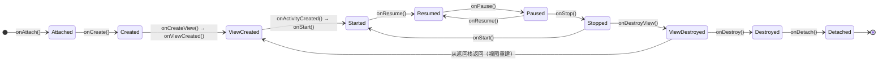

Fragment作为Activity的一部分，本应该合并到[[1. Activity：基础使用|Activity]]当中介绍，但它已经发展成一个独立的 UI 复用单元，因此单独成篇。

它的定位是**Activity 内部的可复用界面模块**：

+ 必须依附 Activity 存在，不能独立运行；
+ 一个 Activity 可以持有多个 Fragment，一个 Fragment 也能被多个 Activity 复用；
+ 有自己的生命周期，能独立接收输入事件；
+ 运行期可以动态添加、替换、移除。

带来的好处是模块化、可复用、可适配（同一份代码适配手机与平板的不同布局）。代价是多了一层生命周期和一套返回栈，问题基本都集中在“视图什么时候被销毁”和“事务什么时候入栈”这两件事上。

## 生命周期



Fragment 的生命周期比 Activity 多三个与**视图**相关的回调，这也是绝大多数问题的来源：

| 回调 | 时机 | 该做什么 |
|:--|:--|:--|
| `onCreateView()` | 创建视图层次 | **只 inflate 布局并返回根 View**，不要在这里碰控件或导航 |
| `onViewCreated()` | 视图已创建、状态已恢复 | 初始化控件、注册监听、`observe` 数据 |
| `onDestroyView()` | 视图即将销毁（**实例可能还活着**） | 释放与视图绑定的资源，把 binding 置空（见[[#用 View Binding 绑定视图]]） |

Fragment 的五个状态与 Activity 的对应关系：

| 状态 | 含义 |
|:--|:--|
| INITIALIZED | 实例已创建，尚未 attach |
| CREATED | `onCreate()` 已执行；视图可能尚未创建，也可能已被销毁（如被`replace`且已入栈） |
| STARTED | 可见但不可交互（例如被半透明页面遮挡） |
| RESUMED | 可见且可交互 |
| DESTROYED | 实例被销毁，不会再回到前台 |

> **`viewLifecycleOwner` 是 Fragment 里最容易被忽略的东西。** 观察 LiveData / Flow 时传给`observe`的`lifecycleOwner`，必须用`viewLifecycleOwner`而不是`this`。`this`的生命周期到`onDestroy()`才结束，而视图在`onDestroyView()`就没了——用`this`会让观察者在视图销毁后继续收到回调，更新一个已经不在界面上的 View。

## 创建 Fragment

和创建 Activity 类似，通过`File`➡`New`➡`Fragment`➡`Fragment (Blank)`即可，IDE 会同时生成类文件与布局文件。

![[nav_1.png]]

创建后把布局根节点换成`ConstraintLayout`（或`LinearLayout`）更便于排版。控件操作写在 Fragment 自己的源文件里，**不要写进宿主 Activity**：

+ Activity 的布局里没有 Fragment 的控件，在 Activity 中`findViewById`拿不到，强行引用只能得到空值，运行时空指针；
+ Activity 里的逻辑会作用于挂载到它的所有 Fragment，职责就混了。

## 用 Navigation 组织页面（推荐）

多个 Fragment 之间的跳转，Google 推荐用 Navigation 组件而不是手工事务。先在`res`下新建`Resource type = Navigation`的资源文件（文件名只允许小写字母与下划线），IDE 会提示添加依赖。

![[nav_2.png]]

在图形编辑器里把目标布局拖进画布，用箭头连接表示导航方向。先拖入的默认为起始页，右键可选`Set as Start Destination`。

![[nav_3.png]]

![[nav_4.png]]

接着在`activity_main.xml`里放入`NavHostFragment`（`Containers`面板），选择刚才的导航资源，再加约束即可。

![[nav_6.png]]

跳转代码只有一行：

```kotlin
// onViewCreated() 中
requireView().findViewById<Button>(R.id.btn).setOnClickListener {
    findNavController().navigate(R.id.action_aFragment_to_bFragment)
}
```

> `findNavController()`必须在**视图已创建之后**调用，所以放在`onViewCreated()`里，不能放`onCreateView()`——那时视图还没 attach 到 NavHost，会抛`IllegalStateException`。

转场动画在导航动作的属性面板里配置，也可以引用自定义的 Animation 资源。

![[nav_7.png]]

## 手动管理事务

不用 Navigation 时，直接用`FragmentManager`。容器推荐`FragmentContainerView`（继承自`FrameLayout`，但为 Fragment 事务做了专门处理，也重写了`onApplyWindowInsets`）：

```xml
<androidx.fragment.app.FragmentContainerView
    android:id="@+id/fragment_container"
    android:layout_width="match_parent"
    android:layout_height="match_parent" />
```

一次事务的标准写法：

```kotlin
supportFragmentManager.commit {
    setReorderingAllowed(true)                     // 每个事务都应该加，见下文
    replace(R.id.fragment_container, DetailFragment())
    addToBackStack("detail")                       // 需要返回时入栈
}
```

常用操作：

| 操作 | 效果 |
|:--|:--|
| `add(id, fragment)` | 添加，原 Fragment 保留（可能叠在一起） |
| `replace(id, fragment)` | 先移除容器内所有 Fragment，再添加 |
| `remove(fragment)` | 移除指定 Fragment |
| `show(fragment)` / `hide(fragment)` | 只切换可见性，**不销毁视图**，适合频繁切换的 Tab |
| `attach()` / `detach()` | 视图销毁但实例保留，介于 add 与 remove 之间 |

### 提交方式

| 方法 | 同步性 | 能否配合`addToBackStack` |
|:--|:--|:--:|
| `commit()` | 异步，排队到主线程执行 | 可以 |
| `commitNow()` | 同步，立即执行 | **不可以** |
| `commit()` + `executePendingTransactions()` | 提交后强制立刻执行 | 可以 |

`commitNow()`与`addToBackStack()`不兼容是官方明确的限制；需要在提交后立刻拿到 Fragment 时，用`executePendingTransactions()`。绝大多数场景`commit()`就够了。

`commit()`是异步的，所以**提交后立刻`findFragmentById()`可能拿到 null**——事务还没执行。

### 状态丢失

`onSaveInstanceState()`之后再`commit()`会抛：

```text
java.lang.IllegalStateException: Can not perform this action after onSaveInstanceState
```

这通常发生在异步回调里（网络返回后直接提交事务）。正确做法是用`isStateSaved`判断，或把提交时机挪到生命周期安全的位置；`commitAllowingStateLoss()`只是**放弃状态保存**来避免崩溃，并不修复问题，慎用。

## 返回栈

这是 Fragment 最容易出错的部分，值得单独讲。

### 入栈

```kotlin
supportFragmentManager.commit {
    setReorderingAllowed(true)
    replace(R.id.fragment_container, DetailFragment())
    addToBackStack("detail")        // 参数是这一笔事务的名字，可传 null
}
```

`addToBackStack()`的名字只用于**按名弹出**，不参与业务逻辑；传`null`也可以，但之后就失去了`popBackStack(name, ...)`这种精确控制。

### 栈里存的是什么

**存的是`FragmentTransaction`（一组操作），不是 Fragment 实例。** 出栈时的动作是“把这一组操作**原子地反向执行一遍**”：

+ 事务里`add`了 A → 出栈时`remove` A；
+ 事务里`remove`了 A → 出栈时把 A 加回来；
+ 事务里`replace`了 A → 出栈时先移除 B，再把 A 恢复。

所以“返回”不是“显示上一个 Fragment”，而是“撤销上一次操作”。这也解释了两个现象：

+ 一个事务里可以同时操作多个容器、多个 Fragment，出栈时它们一起还原；
+ 如果在`popBackStack()`之前提交了**没有入栈**的其他事务，这些操作不会被撤销（官方文档明确提醒：不要在一个`FragmentTransaction`里混着放入栈和不入栈的操作）。

每个`FragmentManager`有自己的返回栈：`supportFragmentManager`、`parentFragmentManager`、`childFragmentManager`互不共享。

### 入栈与否对生命周期的影响

这是“Fragment 数据还在不在”的关键：

| 场景 | 离开的 Fragment 会走到的回调 | 实例是否存活 |
|:--|:--|:--:|
| `replace` / `remove` **且调用**`addToBackStack` | `onPause` → `onStop` → `onDestroyView` | **存活** |
| `replace` / `remove` **且不调用**`addToBackStack` | 上面三个 → `onDestroy` → `onDetach` | 销毁 |
| 从返回栈`pop`回来 | `onCreateView` → `onViewCreated` → `onStart` → `onResume` | 复用原实例，**不再走`onCreate`** |

由此得到两条实践结论：

1. **入栈只保证实例活着，不保证视图状态。** 视图已经被销毁重建过一次，滚动位置、输入框内容这类状态要放进`ViewModel`或`arguments`，不能指望 Fragment 的字段（进程被杀时字段同样会丢）。
2. **视图初始化必须放在`onCreateView` / `onViewCreated`**。放在`onCreate`里的代码在 pop 回来时不会重新执行，容易漏初始化；而放在`onCreateView`里的代码每次回来都会执行，不能有“只做一次”的假设。

### 弹出

| 方法 | 行为 |
|:--|:--|
| `popBackStack()` | 异步弹出栈顶一个事务 |
| `popBackStackImmediate()` | 同步弹出，返回是否真的弹出了 |
| `popBackStack(name, flags)` | 弹到名为`name`的事务。`flags = 0`保留它，`POP_BACK_STACK_INCLUSIVE`连它一起弹 |
| `popBackStack(id, flags)` | 按 entry id 弹，语义同上 |
| `clearBackStack(name)` | 丢弃**已保存**的返回栈（配合多返回栈使用），见后文 |

获取栈信息：

```kotlin
// 当前栈里有几笔事务
val count = supportFragmentManager.backStackEntryCount

// 栈顶那笔事务的名字
val name = supportFragmentManager.getBackStackEntryAt(count - 1).name
```

> 名字要唯一。同一个`name`被多次入栈时，`popBackStack(name, 0)`只会弹到**最近的那一笔**，容易和预期不符。

### 返回键

`FragmentActivity`已经把系统返回键接到了 FragmentManager 上：栈里有事务时自动弹栈，栈空时才交给 Activity 处理。所以**大多数情况下不需要额外写代码**。

只有需要“弹栈之前先做点别的”时才注册回调：

```kotlin
requireActivity().onBackPressedDispatcher.addCallback(viewLifecycleOwner) {
    if (someCondition) {
        // 自定义处理，比如先关闭抽屉
        closeDrawer()
    } else {
        // 关闭自身拦截，交还给系统（FragmentManager 会继续弹栈）
        isEnabled = false
        requireActivity().onBackPressedDispatcher.onBackPressed()
    }
}
```

传入`viewLifecycleOwner`，回调会随视图销毁自动注销。

### 监听栈变化

```kotlin
supportFragmentManager.addOnBackStackChangedListener {
    val count = supportFragmentManager.backStackEntryCount
    // 更新标题栏、显示/隐藏返回按钮等
}
```

### 多返回栈

底部导航那种“每个 Tab 各自保留一条返回栈”的需求，有两种实现：

+ **Navigation 组件**：`popUpTo(...) { saveState = true }` + `restoreState = true`，由 NavController 管理；
+ **FragmentManager 原生**：`saveBackStack(name)`会像`popBackStack`一样退出，但**保留 Fragment 状态**；`restoreBackStack(name)`按原状态恢复；`clearBackStack(name)`才真正丢弃。三者都是异步的。

### 常见问题

| 问题 | 原因 |
|:--|:--|
| 崩溃`Fragment already added` | 同一个实例被`add`两次；需要复用就改用`show()`，见[[#实例复用与内存泄漏]] |
| 出栈后界面没变 | 事务没有`addToBackStack`，或`pop`的是另一个`FragmentManager` |
| 出栈后数据丢了 | 视图被销毁重建，状态放在了 Fragment 字段而不是 ViewModel |
| 动画异常、生命周期抖动 | 没加`setReorderingAllowed(true)` |
| `commitNow`报错 | 与`addToBackStack`同时使用 |
| 事务对象被复用 | 一个`FragmentTransaction`只能提交一次，出栈后要重新`beginTransaction` |

`setReorderingAllowed(true)`不是可选项：它让 FragmentManager 把一次事务里的多个操作合并执行，中间态 Fragment 不会走一遍生命周期、也不会跑动画；**入栈与出栈的行为都依赖它**。为了兼容老版本，该标志默认关闭，所以必须手动打开。

## 实例复用与内存泄漏

### 重复创建的成本

每次`replace(R.id.container, DetailFragment())`都要走一遍：新建实例 → inflate 布局 → 新建整棵 View 树。视图挂在窗口上，于是形成一条完整的强引用链：

```text
Fragment 实例 → 视图树 → Activity → Window → DecorView → 所有 ImageView 持有的 Bitmap
```

实例本身很轻，重的是它拖着的这条链。所以风险从来不是“创建得多”，而是**创建了却没释放**：旧实例被任何一处强引用，整条链都会活下来。反复进出同一个页面 N 次，堆里就有 N 份这样的链，占用线性上涨，最后抛`OutOfMemoryError`。

链上最占内存的通常是 Bitmap：一张未按目标尺寸采样的相机大图就是几 MB，泄漏一次等于把它一直钉在堆里。所以图片密集的页面既要防泄漏，也要在加载时做采样与复用。

### 该复用还是该重建

| 场景 | 做法 | 理由 |
|:--|:--|:--|
| 单页面栈式导航（列表 → 详情） | `replace()` + `addToBackStack()` | 旧页面视图就该销毁，只需把状态交给 ViewModel |
| 底部 / 顶部 Tab 来回切换 | `add()` + `show()`/`hide()` | 保住滚动位置与输入内容，代价是视图常驻 |
| 要保住实例但想省视图内存 | `attach()`/`detach()` | 视图销毁、实例保留，回来时状态还在 |
| 配置变更、进程重建 | 无法避免，用`ViewModel`+`arguments` | 系统用无参构造重建，字段本来就保不住 |

三种方式的取舍：

| 操作 | 实例 | 视图 | 生命周期落点 | 内存 |
|:--|:--:|:--:|:--|:--:|
| `show()`/`hide()` | 保留 | **保留** | 停在 RESUMED | 最高 |
| `attach()`/`detach()` | 保留 | 销毁 | 退到 CREATED | 中 |
| `remove()`/`replace()`（未入栈） | 销毁 | 销毁 | 走到 DESTROYED | 最低 |

### 用 tag 查找，而不是每次 new

同一个容器里反复`add`新实例，是“页面越切越多”的最常见来源。正确做法是先按 tag 找：

```kotlin
private fun switchTo(tag: String, create: () -> Fragment) {
    supportFragmentManager.commit {
        setReorderingAllowed(true)
        supportFragmentManager.fragments.forEach { hide(it) }      // 先隐藏其余页面
        val existing = supportFragmentManager.findFragmentByTag(tag)
        if (existing == null) {
            add(R.id.fragment_container, create(), tag)             // 只有第一次创建
        } else {
            show(existing)                                          // 之后只切换可见性
        }
    }
}
```

三条要点：

+ 同一个实例被`add`两次会直接抛`IllegalStateException: Fragment already added`（`FragmentStore.addFragment()`里的`mAdded.contains`判断）；
+ tag 是查找的唯一依据，`add(id, fragment)`不传 tag，之后就用`findFragmentByTag`找不回来；
+ `hide()`不销毁视图，页面多了照样吃内存。Tab 超过三四个时，改用`detach()`，或者干脆用 Navigation 的多返回栈。

如果 Fragment 必须注入依赖，**不要加带参构造函数**：系统重建时只能反射调用无参构造，拿不到就抛`Fragment.InstantiationException: ... could not find Fragment constructor`。参数走`arguments`，构造逻辑走自定义`FragmentFactory`（`supportFragmentManager.fragmentFactory = ...`）。

### ViewPager2 已经替你回收

用`ViewPager2`+`FragmentStateAdapter`时**不要自己缓存 Fragment**，adapter 已经处理：

+ 超出`offscreenPageLimit`的页面会被`remove()`，销毁前先存下`SavedState`，滑回来时重建；
+ 非当前页的 Fragment 生命周期被压到`STARTED`（源码里是`setMaxLifecycle(fragment, STARTED)`），视图还在但不会 RESUMED——把动画、相机、定位这类只该在可见时跑的逻辑放在`onResume`里，就不会在后台页偷偷耗资源；
+ `offscreenPageLimit`默认是`OFFSCREEN_PAGE_LIMIT_DEFAULT`（-1），交给 RecyclerView 的缓存策略，通常只留当前页与相邻预取页。显式调大（比如 3）会让两侧页面全部保持活跃，页数一多就是 OOM 的常见来源。

反面的例子是已废弃的`FragmentPagerAdapter`：它的`destroyItem()`用的是`detach()`而不是`remove()`，**所有页面的实例都留在内存里**，页数一多就危险。

### 真正导致泄漏的引用

创建本身不泄漏，**没断掉的引用**才泄漏。Fragment 上最常见的六处：

| 引用 | 典型写法 | 处理 |
|:--|:--|:--|
| 视图 | `binding`在`onDestroyView()`没置空 | 置空，见上一节 |
| 静态 / 单例 | `companion object`里存 Fragment，或单例持有它 | 不存；必须存就存`WeakReference` |
| 未注销的监听 | `BroadcastReceiver`、`EventBus`、`SensorManager`、`ContentObserver` | 在`onDestroyView()`/`onDestroy()`里成对注销 |
| 匿名内部类 | 匿名`Runnable`、`Handler`、`Timer`隐式持有外部 Fragment | 改用`viewLifecycleOwner.lifecycleScope` |
| 协程 | 用了`lifecycleScope`而不是`viewLifecycleOwner.lifecycleScope` | 后者在`onDestroyView()`取消 |
| 适配器 | `RecyclerView.adapter`持有 Fragment 或 Activity | `onDestroyView()`里`binding.recycler.adapter = null` |

```kotlin
override fun onViewCreated(view: View, savedInstanceState: Bundle?) {
    super.onViewCreated(view, savedInstanceState)
    // 随视图销毁自动取消，不需要手动 cancel
    viewLifecycleOwner.lifecycleScope.launch {
        viewModel.state.collect { render(it) }
    }
}
```

> `lifecycleScope`（不带`viewLifecycleOwner`）要到`onDestroy()`才取消。用它启动的协程会比视图多活一段时间，回调里再碰`binding`就是空指针，协程本身也一直被 Fragment 持有着。

### 排查

1. **LeakCanary**：`debugImplementation("com.squareup.leakcanary:leakcanary-android:2.14")`，不需要初始化，发生泄漏时直接给出引用链（稳定线仍是 2.x，3.0 目前在 alpha）。
2. **Android Studio Profiler**：Memory → 触发 GC → Heap Dump → 按类名过滤`Fragment`，看同一类的实例数是否随进出页面单调上涨——上涨且不回落，就是没释放。
3. **不要用`largeHeap`掩盖**：它只是抬高堆上限，泄漏的增长趋势不变，只是崩得晚一点。

## 协程与 Flow

### 两个作用域，取消时机不同

Fragment 里有两种作用域可用，差别只在“什么时候取消”：

| 作用域 | 取消时机 | 用在哪 |
|:--|:--|:--|
| `lifecycleScope` | `onDestroy()` | 与视图无关、需要活到 Fragment 销毁的任务 |
| `viewLifecycleOwner.lifecycleScope` | `onDestroyView()` | **几乎所有与界面相关的任务** |

Fragment 的实例比视图活得久，所以碰界面的协程一律用`viewLifecycleOwner.lifecycleScope`。用错的那个，视图销毁后协程还在跑，回调里一碰`binding`就是空指针，协程本身也一直被 Fragment 持有着。

> `viewLifecycleOwner`本身只能在`onViewCreated()`之后访问：在`onCreateView()`之前或`onDestroyView()`之后取它会抛`IllegalStateException: Can't access the Fragment View's LifecycleOwner ... when getView() is null`。

### 收集 Flow 要用 repeatOnLifecycle

```kotlin
override fun onViewCreated(view: View, savedInstanceState: Bundle?) {
    super.onViewCreated(view, savedInstanceState)

    viewLifecycleOwner.lifecycleScope.launch {
        viewLifecycleOwner.repeatOnLifecycle(Lifecycle.State.STARTED) {
            viewModel.uiState.collect { state -> render(state) }
        }
    }
}
```

这段代码的语义（按源码注释）：

+ 生命周期达到`STARTED`时启动 block，**降到`STARTED`以下就取消**；再回到`STARTED`是**重新启动**，不是恢复；
+ 每次重启都是新的协程，上游 Flow 会重新收集：冷流从头再发一遍，`SharedFlow(replay = 0)`在停止期间发出的事件收不到（区别见[[8. Kotlin协程：进阶部分#StateFlow 与 SharedFlow]]）；
+ 同一个`repeatOnLifecycle`的多次执行是**串行**的，上一次 block 没结束不会启动下一次；
+ block 固定跑在`Dispatchers.Main.immediate`，外面换了 dispatcher 也一样；
+ 传`INITIALIZED`会抛`IllegalArgumentException`；传`DESTROYED`不报错，但会立刻返回、block 不执行。

> `repeatOnLifecycle`只停了**收集端**。要让上游也停，ViewModel 里的热流得用`stateIn(viewModelScope, SharingStarted.WhileSubscribed(5_000), 初始值)`——订户归零 5 秒后自动停掉上游。两端配合，退到后台才是真的不耗电。

只在页面真正可见时才该跑的东西（动画、相机预览、传感器）把状态改成`Lifecycle.State.RESUMED`；其余用`STARTED`就够。

### 为什么不用 launchWhenStarted

`launchWhenStarted`只是**挂起**协程，不取消。页面退到后台，协程还活着，`callbackFlow`里的位置监听、数据库观察、网络轮询一个都没停——这正是它被废弃的原因。`repeatOnLifecycle`是取消加重建，上游会被真正关掉。

### 多个流要分开收集

一个 block 里顺序`collect`两个流，第二个永远等不到第一个结束。`repeatOnLifecycle`的 block 本身是`CoroutineScope`，各开一个`launch`：

```kotlin
viewLifecycleOwner.lifecycleScope.launch {
    viewLifecycleOwner.repeatOnLifecycle(Lifecycle.State.STARTED) {
        launch { viewModel.uiState.collect { render(it) } }
        launch { viewModel.events.collect { handle(it) } }
    }
}
```

block 结束时这些子协程一起取消。官方在`flowWithLifecycle`的注释里也给了同样的建议：多个流用`repeatOnLifecycle`分别启动，比给每个流套一层`flowWithLifecycle`更省资源。

### 单条流可以用 flowWithLifecycle

```kotlin
viewModel.uiState
    .flowWithLifecycle(viewLifecycleOwner.lifecycle, Lifecycle.State.STARTED)
    .onEach { render(it) }
    .launchIn(viewLifecycleOwner.lifecycleScope)
```

它的表观行为与`repeatOnLifecycle`一致：低于目标状态停止发射，回来重新收集。区别在于它是一个操作符，会创建一个**只在 lifecycle 销毁或收集者取消时才关闭的热流**，而下游在这期间仍然活着——所以放在`combine`前后结果不同：

+ `a.flowWithLifecycle(lifecycle).combine(b)`：停止期间组合仍在跑，只是`a`不再发新值；
+ `a.combine(b).flowWithLifecycle(lifecycle)`：整条组合流一起停。

### 一次性任务放哪

点击后发起请求这类短任务，直接放在`viewLifecycleOwner.lifecycleScope`里即可：

```kotlin
binding.submit.setOnClickListener {
    viewLifecycleOwner.lifecycleScope.launch {
        viewModel.submit()               // suspend 函数
    }
}
```

需要跨视图销毁继续的任务（上传、写库、轮询）不能挂在界面作用域上——转屏就取消了。它们属于`viewModelScope`或 WorkManager：

| 放哪 | 负责什么 |
|:--|:--|
| `viewModelScope` | 业务请求、数据变换，配置变更后要继续的工作 |
| `viewLifecycleOwner.lifecycleScope` | 收集 UI 状态、动画、与 View 绑定的短任务 |
| WorkManager | 进程被杀也要继续的任务 |

测试写法（`runTest` + `Dispatchers.setMain`）见[[9. Kotlin协程：测试与调试]]。

## 数据传递

### arguments（推荐）

```kotlin
// 发送方
val fragment = DetailFragment().apply {
    arguments = bundleOf("id" to 42L)
}
supportFragmentManager.commit {
    setReorderingAllowed(true)
    replace(R.id.fragment_container, fragment)
    addToBackStack(null)
}

// 接收方
private val id: Long by lazy { requireArguments().getLong("id") }
```

`arguments`随`savedInstanceState`一起保存，进程被杀后重建也能恢复，这是它优于“直接给字段赋值”的原因。

用 Navigation 时可以在图形界面里给 action 或目标 Fragment 配置参数默认值，效果相同。

![[nav_8.png]]

![[nav_9.png]]

> Navigation 2.8 起支持**类型安全路由**：用`@Serializable`数据类声明参数，`navigate(DetailArgs(42))`、`toRoute<DetailArgs>()`读取，编译期就能校验参数类型，不用再拼字符串键。

### Fragment Result API

Fragment 之间传结果**不要再用**`setTargetFragment()`（已废弃）。标准做法是：

```kotlin
// 请求方：注册监听（用 viewLifecycleOwner，随视图销毁自动注销）
parentFragmentManager.setFragmentResultListener("pick", viewLifecycleOwner) { key, bundle ->
    val id = bundle.getString("id")
}

// 提供方：回传结果
parentFragmentManager.setFragmentResult("pick", bundleOf("id" to "42"))
```

两条必须知道的语义：

+ **结果只消费一次**。内部在回调触发后立刻`clearFragmentResult`，同一个结果不会被重复投递；
+ **回调在 STARTED 时才触发**。提供方先回传、请求方还没起来时，结果会暂存，等请求方进入 STARTED 再交付。

双方必须使用**同一个`FragmentManager`**。如果两个 Fragment 是父子关系，要用`childFragmentManager`，否则收不到。

### 共享 ViewModel

同一 Activity 内的多个 Fragment 共享数据，最省事的是 Activity 作用域的 ViewModel：

```kotlin
// Fragment A 与 Fragment B 拿到的是同一个实例
private val sharedViewModel: SharedViewModel by activityViewModels()
```

原理与作用域的关系见[[7. ViewModel#获取实例]]。注意`by viewModels()`（不加`activity`前缀）拿到的是**当前 Fragment 自己**的实例，两者不要混。

### 通信方式怎么选

| 场景 | 方案 |
|:--|:--|
| Fragment → Activity | 接口回调，或直接`requireActivity() as Listener` |
| Fragment → Fragment（一次性结果） | **Fragment Result API** |
| 多个 Fragment 共享状态 | Activity 作用域的 ViewModel |
| 跳转并带参数 | `arguments` / Navigation 类型安全路由 |

## 已废弃的写法

| 旧写法 | 状态 | 替代 |
|:--|:--|:--|
| `onActivityCreated()` | 已废弃 | 视图相关放`onViewCreated()`，其余放`onCreate()` |
| `setTargetFragment()` / `getTargetFragment()` | 已废弃 | Fragment Result API |
| `setRetainInstance(true)` | 已废弃 | 用 ViewModel 持有需要跨配置变更的状态 |
| Fragment 里的`onActivityResult()` | 已废弃 | Activity Result API（`registerForActivityResult`） |
| `FragmentPagerAdapter` / `FragmentStatePagerAdapter` | 已废弃 | `ViewPager2` + `FragmentStateAdapter` |
| `setUserVisibleHint()` | 已废弃 | `setMaxLifecycle()` 或 `viewLifecycleOwner` 判断可见性 |
| `launchWhenStarted()` 收集 Flow | 已废弃 | `repeatOnLifecycle()`，见「协程与 Flow」 |

## 几个容易踩的细节

### 用 View Binding 绑定视图

启用方式与绑定类的命名规则见[[1. Activity：基础使用#界面组件与 View Binding]]，这里只讲 Fragment 特有的部分。

`inflate()`的三个参数都要用对：

```kotlin
_binding = FragmentHomeBinding.inflate(inflater, container, false)
```

+ `inflater`：用系统传进来的那个，不要自己`LayoutInflater.from(context)`——自己造的可能拿不到宿主当前的主题与配置；
+ `container`：父容器，作用是解析根视图的`layout_width`/`layout_height`等布局参数。传`null`会让这些参数丢失，根视图的高度可能直接塌成 0；
+ `attachToRoot`：必须传`false`。传`true`会立刻把视图附加到容器上，接下来`return binding.root`就会因为“已有父视图”抛`IllegalStateException`。

#### 实例比视图活得久

`replace`入栈后，实例还在返回栈里，视图却已经销毁。此时字段若还持有 binding，就等于持有一棵已脱离窗口的视图树，泄漏由此产生。所以 binding 必须可置空：

```kotlin
private var _binding: FragmentHomeBinding? = null
private val binding get() = _binding!!

override fun onCreateView(
    inflater: LayoutInflater,
    container: ViewGroup?,
    savedInstanceState: Bundle?
): View {
    _binding = FragmentHomeBinding.inflate(inflater, container, false)
    return binding.root
}

override fun onViewCreated(view: View, savedInstanceState: Bundle?) {
    super.onViewCreated(view, savedInstanceState)
    binding.title.text = "详情"          // 视图相关的操作放这里
}

override fun onDestroyView() {
    super.onDestroyView()
    _binding = null                       // 视图没了，引用也要跟着断
}
```

两种“更省事”的写法在这里都会出问题：

| 写法 | 问题 |
|:--|:--|
| `private lateinit var binding` | 无法再赋成`null`，视图销毁后引用还在，必然泄漏 |
| `private val binding by lazy { ... }` | 只初始化一次，`onDestroyView()`没有重置的机会；pop 回来重建视图时拿到的还是旧 binding |

getter 里的`!!`是为了把错误暴露在调用点：视图已销毁却仍访问 binding 时立刻崩，而不是静默操作一棵不在界面上的视图树。

#### 构造函数指定了布局时用 bind()

Fragment 也可以用构造函数指定布局（`class HomeFragment : Fragment(R.layout.fragment_home)`）。这时默认的`onCreateView()`已经把布局膨胀好了，在`onViewCreated()`里只能`bind()`，再`inflate()`一次会得到两棵树：

```kotlin
private var _binding: FragmentHomeBinding? = null
private val binding get() = _binding!!

override fun onViewCreated(view: View, savedInstanceState: Bundle?) {
    super.onViewCreated(view, savedInstanceState)
    _binding = FragmentHomeBinding.bind(view)      // 布局已膨胀，只能 bind
    binding.title.text = "详情"
}

override fun onDestroyView() {
    super.onDestroyView()
    _binding = null
}
```

> 只有一两个控件时，`findViewById()`也完全够用。binding 的价值在于控件多、又要反复访问的场景，不必为了统一风格强行引入。

### 其他

+ **`getContext()` / `getView()`可能为 null**。用`requireContext()`、`requireActivity()`、`requireView()`能尽早暴露问题，但不要在`onAttach`之前调用；
+ **不要持有 Activity 的强引用**。Fragment 被重建时旧 Activity 可能已经销毁，持有引用会泄漏；
+ **`show()`/`hide()`不销毁视图，也不改变生命周期状态**。被 hide 的 Fragment 仍停留在 RESUMED，不会走`onPause`/`onStop`；要感知可见性变化得重写`onHiddenChanged()`，或用`setMaxLifecycle()`限制它的状态。

> Google 现在的长期方向是 Compose + Navigation。Fragment 仍是 View 体系的主力，存量项目绕不开；新项目若全面采用 Compose，本笔记的返回栈部分会被 `NavController` 的返回栈取代。
