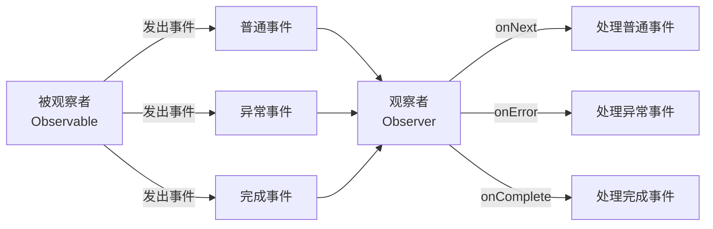
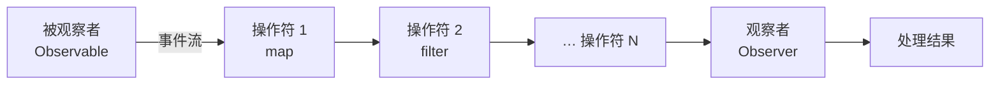

[RxJava](https://github.com/ReactiveX/RxJava)是一个非常出名的开源库，按照官方的说法：

>RxJava is a Java VM implementation of Reactive Extensions: a library for composing asynchronous and event-based programs by using observable sequences.
>
>RxJava是响应式扩展——一个使用可观察序列的组合异步、基于事件程序的库——在Java虚拟机上的一种实现。

换句话说，RxJava就是一个用Java语言实现了响应式扩展的库，其核心是[响应式编程](https://zh.wikipedia.org/wiki/%E5%93%8D%E5%BA%94%E5%BC%8F%E7%BC%96%E7%A8%8B)，所要针对的是**异步任务**，在这一点上，RxJava跟同样实现观察者模式的[[11. EventBus]]是存在区别的，二者的应用场景也因此有很大的不同。

## 响应式扩展

所谓响应式扩展（Reactive Extensions，Rx名称由来），实际上是一种对[[行为型设计模式#七、Observer|观察者模式]]进行大量拓展的编程模型。Rx关注数据流并对数据的改变做出响应和分发，它将数据流称为被观察者（Observable），而订阅（subscribe）数据并在数据到来时做出响应的部分被称作观察者（Observer）。

Rx模型中的可观察序列代表事件流或其他数据源。通过将可观察序列与LINQ（language-integrated query，语言集成查询）库提供的查询操作符（组合器）拼接起来，就组成了异步程序。

Rx最先由Microsoft的架构师Erik Meijer领导的团队开发，在2012年11月开源，如今已成为一种跨语言通用的设计思想和模型。因此，用哪种语言来实现这一编程模型，就在哪种语言的前面加上一个Rx前缀，比如RxJava、RxJS、RxPHP以及RxPython等等。

## 基本使用

### 依赖导入

在Android项目中使用RxJava，需要通过Gradle导入相关依赖：

```groovy
dependencies {
    //使用RxJava 2
    implementation "io.reactivex.rxjava2:rxjava:$specific_version"
    implementation "io.reactivex.rxjava2:rxandroid:$specific_version" //Android项目通常需要导入该依赖库

    //使用RxJava 3
    implementation "io.reactivex.rxjava3:rxjava:$specific_version"
    implementation "io.reactivex.rxjava3:rxandroid:$specific_version" //Android项目通常需要导入该依赖库
}
```

>注意，RxJava 2自2021年2月28日起，已经全面停止后续的开发维护工作，因此后面介绍的内容主要基于RxJava 3。
>
> 注：RxJava 4 目前仍处于 alpha 阶段（截至 2026-11-22，最新预发布为 4.0.0-alpha-22，2026-11-19 发布），正式版尚未发布，生产环境建议继续使用 RxJava 3。

### 从Hello World开始

RxJava的开发团队在GitHub上提供了一个简单的示例：

```java
package rxjava.examples;

import io.reactivex.rxjava3.core.*;

public class HelloWorld {
    public static void main(String[] args) {
        Flowable.just("Hello world").subscribe(System.out::println);
    }
}
```

在上面的示例代码中，可以找出RxJava实现响应式扩展的四个基本要素：

+ **被观察者**：`Flowable`
+ **观察者**：`System.out::println`
+ **事件**：`just("Hello world")`
+ **订阅操作**：`subscribe()`

**被观察者产生了事件（`Flowable.just("Hello world")`），观察者订阅了事件（`subscribe(System.out::println)`），最后事件被观察者处理掉（打印出Hello world）**，整个程序的执行逻辑即如上所述，而使用RxJava编写的所有业务逻辑，基本上也在这个框架之内。


当然，上面只是一个简单的示例，在实际开发中更多按下述三个步骤让 RxJava 执行任务：

> *步骤一：创建被观察者，并产生事件*

```kotlin
val observable = Observable.create<SomeType> { it:ObservableEmitter<SomeType>!
    it.apply {
        onNext(···)
        onError(···)
        onComplete()
    }
}
```

由`Observable.create()`方法创建的Observable类型对象，可以通过ObservableEmitter对象发送三类事件：`onNext`对应的普通事件，`onError`对应的异常事件以及`onComplete`对应的完成事件。

注意到`Observable.create()`是一个泛型方法，而ObservableEmitter是一个抽象泛型类，因此开发者可以传入自己想要的类型。

此外，被观察者并非只有Observable类型，在后面的内容中还会引入另一种，即Flowable。

> *步骤二：创建观察者，并处理事件*

```kotlin
val observer = object :Observer<SomeType> {
    override fun onSubscribe(d: Disposable?) {
        //TODO
    }

    override fun onNext(t: SomeType?) {
        //TODO
    }

    override fun onError(e: Throwable?) {
        //TODO
    }

    override fun onComplete() {
        //TODO
    }
}
```

Observer是一个泛型接口，因此需要以匿名内部类的方式对其进行实例化并重写相关的方法。其中，`onSubscribe()`会在观察者接收被观察者的事件（建立连接）之前就调用一次，`onNext()`、`onError()`以及`onComplete()`会分别在接收到普通事件、异常事件和完成事件时调用。

> *步骤三：观察者订阅事件*

```kotlin
observable.subscribe(observer)
```

这里的代码编写方式跟实际逻辑有比较大的差异。如果按照实际逻辑，应该是由Observer对象调用`subscribe()`方法，然后把Observable对象产生的事件传进去进行处理。然而，RxJava采用这种形式的写法，恰恰符合三步实现的总体逻辑：**以被观察者产生事件为起点，以观察者处理事件为终点**。如下图所示，既然观察者处于数据流的末端，那么这样写就是理所当然的了。



为了简化写法，上述三个步骤还可以合到一起，如下述代码所示：

```kotlin
Observable.create<SomeType> { it:ObservableEmitter<SomeType>!
    it.apply {
        onNext(···)
        onError(···)
        onComplete()
    }
}.subscribe(object :Observer<SomeType> {
            
    override fun onSubscribe(d: Disposable?) {
        //TODO
    }

    override fun onNext(t: SomeType?) {
        //TODO       
    }

    override fun onError(e: Throwable?) {
        e?.printStackTrace()
        //TODO
    }

    override fun onComplete() {
        //TODO
    }
})
```

至此，RxJava的基本使用方式就介绍完毕了。

## 进阶学习

RxJava支持流式操作。所谓流式操作，本质上就是一种基于事件流的各个方法的[[创建型设计模式#Builder|链式调用]]。在前面的内容当中，Observable连续调用`create()`和`subscribe()`方法将三步实现简化为一个整体。事实上，RxJava提供的方法远不止这两个，把这些方法有机组合起来进行链式调用，就能让RxJava发挥出极大的作用——尤其是在异步任务方面，如下面这张图所示。



要了解可调用的方法、调用方式与调用时机，见下文。

### 关键类

#### Observable

Observable是被观察者的一种类型，官方对其描述为：

>0..N flows, no backpressure

这段描述的含义是，Observable对象可以产生0到N个事件流，但是不支持背压——所谓背压，是指在**异步**场景中，被观察者发送事件的速度**远快于**观察者的处理速度的情况下，一种告诉上游的被观察者降低发送速度的策略。背压机制的出发点就是进行流速控制，避免事件太多来不及处理引发内存溢出、程序崩溃等问题。

Observable是RxJava中最为重要的核心类，它是一个泛型抽象类，提供了各类工厂方法和中间操作符，负责消费同步或者异步的数据流。

更多内容详见[官方对Observable的说明](http://reactivex.io/RxJava/3.x/javadoc/io/reactivex/rxjava3/core/Observable.html)。

#### Flowable

Flowable是被观察者的另一种类型，官方对其描述为：

>0..N flows, supporting Reactive-Streams and backpressure

这段描述的含义是，Flowable对象可以产生0到N个事件流，且支持响应式流和背压。

Flowable和Observable一样也是一个泛型抽象类，它跟Observable的主要区别在于，它实现了Publisher接口，采用的是响应式流发布者模式。除了提供各类工厂方法和中间操作符以外，还负责消费响应式数据流。

更多内容详见[官方对Flowable的说明](http://reactivex.io/RxJava/3.x/javadoc/io/reactivex/rxjava3/core/Flowable.html)。

#### Single

Single是一种实现**单值响应**模式的类，官方对其描述为：

>a flow of exactly 1 item or an error

这段描述的含义是，Single只会产生一个事件流，而这个事件流只有两种类型，要么表示成功（有内容返回），要么表示失败（返回一个错误）。

更多内容详见[官方对Single的说明](http://reactivex.io/RxJava/3.x/javadoc/io/reactivex/rxjava3/core/Single.html)。

#### Completable

Completable是一个实现CompletableSource接口的泛型抽象类，官方对其描述为：

>a flow without items but only a completion or error signal

这段描述的含义是，Completable只会产生一个提示完成或异常，且不带任何返回值的事件流。

Completable在行为上跟Observable有些相似，但它只会发送完成事件和异常事件，并不像其他类那样还发送普通事件或成功事件。

更多内容详见[官方对Completable的说明](http://reactivex.io/RxJava/3.x/javadoc/io/reactivex/rxjava3/core/Completable.html)。

#### Maybe

Maybe是一个实现了MaybeSource接口的泛型抽象类，官方对其描述为：

>a flow with no items, exactly one item or an error

这段描述的含义是，Maybe只会产生一个没有返回值，或仅有一个返回值，亦或是返回一个异常的事件流。

更多内容详见[官方对Maybe的说明](http://reactivex.io/RxJava/3.x/javadoc/io/reactivex/rxjava3/core/Maybe.html)。

#### Disposable

Disposable是一个接口，主要定义有`dispose()`、`isDisposed()`、`disposed()`以及`fromXXX()`等方法。Disposable对象常见于观察者的实现方法中，主要用于调用`dispose()`方法中断事件流的处理，从外面看就是程序被中断直接跳到执行完毕的环节了。

Disposable对象可以中断Observable、Completable以及Maybe等类型对象的产生的事件流。

更多内容详见[官方对Disposable的说明](http://reactivex.io/RxJava/3.x/javadoc/io/reactivex/rxjava3/disposables/Disposable.html)。

### 操作符

RxJava的操作符（operators）实际上就是一系列可供调用的方法，它们承担着不同的任务，发挥着不同的作用。按照这些操作符的作用，大致可以划分为这几类：

+ 创建操作符
+ 延时操作符
+ 条件操作符
+ 过滤操作符
+ 转换操作符
+ 其他操作符

操作符所处的位置，就是在“事件传递过程”当中，主要负责按照开发者的需要对事件进行加工处理。

#### 创建操作符

常用的创建操作符有：`create()`、`just()`、`fromXXX()`、`empty()`、`error()`以及`never()`等。

|操作符|用途|说明|
|:--|:--|:--|
|`create()`|创建一个被观察者对象||
|`just()`|创建一个被观察者对象并直接发送事件|最多传入10个参数，可自动推断类型|
|`fromXXX()`|创建一个被观察者对象并直接发送事件|所发送的事件需要以一定形式组织起来，如数组、集合等|
|`empty()`|创建一个被观察者对象并发送完成事件|观察者接收后直接调用`onComplete()`|
|`error()`|创建一个被观察者对象并发送异常事件|观察者接收后直接调用`onError()`|
|`never()`|创建一个被观察者对象，但不发送任何事件|观察者接收后什么方法都不会调用|

#### 延时操作符

常用的延时操作符有：`delay()`、`defer()`、`timer()`、`interval()`、`intervalRange()`、`range()`以及`rangeLong()`等。

|操作符|用途|说明|
|:--|:--|:--|
|`delay()`|被观察者延迟一段时间再发送事件||
|`defer()`|直到有观察者订阅时，才动态创建被观察者并发送事件||
|`timer()`|创建一个被观察者对象并在一段时间后发送一个数值0||
|`interval()`|创建一个被观察者对象并且每隔一段时间就发送事件||
|`intervalRange()`|创建一个被观察者对象并且每隔一段时间就发送事件|可指定范围|
|`range()`|创建一个被观察者对象并连续发送一个事件序列|同上|
|`rangeLong()`|创建一个被观察者对象并连续发送一个事件序列|同上|

#### 条件操作符

常用的条件操作符有：`single()`、`singleOrDefault()`、`all()`、`amb()`、`ambWith()`、`contains()`、`exists()`、`isEmpty()`、`defaultIfEmpty()`、`switchIfEmpty()`、`sequenceEqual()`、`skipUntil()`、`skipWhile()`、`takeUntil()`以及`takeWhile()`等。

|操作符|用途|说明|
|:--|:--|:--|
|`single()`|检测被观察者产生的事件是否只有一个，否则报错||
|`singleOrDefault()`|||
|`all()`|如果原被观察者正常终止且每一个时间都满足条件则返回true，否则返回false|接收一个函数参数，创建并返回一个单布尔值的被观察者|
|`amb()`|对于给定的多个被观察者，只发送首先发送事件的那个被观察者的所有数据||
|`ambWith()`|||
|`contains()`|接收一个特定值作为参数，判定原被观察者是否发送该值|内部调用了`exists()`，默认不在任何特定调度器上执行|
|`exists()`|接受一个函数参数，在函数中，对原被观察者发送的数据，设定比对条件并做判断||
|`isEmpty()`|判定原始被观察者是否有发送数据||
|`defaultIfEmpty()`|接受一个备用数据，若原被观察者没有发送任何数据便正常终止，则以备用数据创建一个被观察者并发送事件||
|`switchIfEmpty()`|若原始被观察者正常终止后仍未发送任何数据，就调用备用被观察者发送数据||
|`sequenceEqual()`|接收两个被观察者和一个函数参数，在函数参数中，比较两个被观察者发送的数据是否相同|默认不在任何特定的调度器上执行|
|`skipUntil()`|在观察者订阅原被观察者时，忽略原被观察者发送的数据，直到第二个被观察者发送一项数据时，才开始发送原观察者已经发送的数据|同上|
|`skipWhile()`|忽略原被观察者发送的数据，直到这些数据不满足一个指定的条件时才开始发送原被观察者发送的数据|同上|
|`takeUntil()`|与`skipUntil()`相反|同上|
|`takeWhile()`|与`skipWhile()`相反|同上|

#### 过滤操作符

常用的过滤操作符有：`take()`、`takeLast()`、`skip()`、`skipLast()`、`first()`、`last()`、`filter()`、`ofType()`、`elementAt()`、`elementAtOrError()`、`firstElement()`、`lastElement()`、`ignoreElements()`、`distinct()`、`distinctUntilChanged()`、`timeout()`、`debounce()`以及`throttleWithTimeout()`等。

|操作符|用途|说明|
|:--|:--|:--|
|`take()`|只发送前 n 项数据||
|`takeLast()`|只发送最后 n 项数据|同上|
|`skip()`|跳过前 n 项数据不发送||
|`skipLast()`|跳过最后 n 项数据，其余数据全部发送||
|`first()`|只发送第一项数据|不满足发送条件就抛异常|
|`last()`|只发送最后一项数据|同上|
|`first(defaultItem)`|只发送满足条件的第一项数据，否则就发送默认值||
|`last(defaultItem)`|只发送满足条件的最后一项数据，否则就发送默认值||
|`filter()`|过滤掉不满足发送条件的事件|过滤条件可自定义|
|`ofType()`|过滤指定类型的事件||
|`elementAt()`|发送处于某个范围/位置的数据|内部通过`OperatorElementAt()`过滤|
|`elementAt(index, defaultItem)`|发送指定位置的数据，超出范围就发送默认值|同上|
|`elementAtOrError()`|发送指定位置的数据，超出范围就抛异常|同上|
|`firstElement()`|仅选取第一个数据||
|`lastElement()`|仅选取最后一个数据||
|`ignoreElements()`|丢弃所有数据，只发射错误或正常终止的通知|内部通过`OperatorIgnoreElements()`实现|
|`distinct()`|过滤重复数据|内部通过`OperatorDistinct()`实现|
|`distinctUntilChanged()`|过滤掉连续重复的数据|内部通过`OperatorDistinctUntilChanged()`实现|
|`timeout()`|如果原被观察者在指定时间内未发送任何数据，就发送一个异常或者使用备用被观察者||
|`debounce()`|根据指定的时间间隔进行限流||
|`throttleWithTimeout()`|根据指定的时间间隔进行限流|若两次发送的时间间隔小于指定时间就丢弃前一次数据，直到指定时间内没有新数据发送，才会发送后一次的数据|

#### 转换操作符

常用的变换操作符有：`map()`、`flatMap()`、`concatMap()`、`switchMap()`、`cast()`、`concat()`、`merge()`、`zip()`、`reduce()`、`collect()`、`startWith()`以及`compose()`等。

|操作符|用途|说明|
|:--|:--|:--|
|`map()`|将被观察者发送的事件转换为其他任意类型的事件||
|`flatMap()`|对被观察者发送的数据都应用一个函数，该函数返回一个被观察者对象，合并这些被观察者并发送出去|新合并生成的事件序列顺序是无序的，即与旧序列发送事件的顺序无关|
|`concatMap()`|同`flatMap()`|新合并生成的事件序列顺序是有序的|
|`switchMap()`|当原被观察者发送一个新事件时，若旧事件订阅未完成，就取消对它的订阅和监听，转向监听新事件||
|`cast()`|将原被观察者发送的每项数据都强制转换为指定类型，然后再发送|所相互转换的类之间需要存在某种关系，如继承和实现|
|`concat()`|组合多个被观察者一起发送数据，合并后按发送顺序串行执行||
|`merge()`|组合多个被观察者一起发送数据，合并后按时间线并行执行||
|`zip()`|合并多个被观察者发送的事件，生成一个新的事件序列再发送|事件会严格按照原先事件序列进行对位合并，最终合并的事件数量等于被观察者当中最少的那个|
|`reduce()`|把被观察者需要发送的事件聚合成一个事件后再发送|自定义聚合条件，前两个数据聚合得到结果后再与第三个数据聚合，以此类推|
|`collect()`|将被观察者发送的事件收集到一个数据结构里||
|`startWith()`|在一个被观察者发送事件前，追加发送一些数据或一个新的被观察者||
|`compose()`|执行包含线程切换逻辑的lambda表达式|如果有大量相同重复的线程切换逻辑需要执行，可以通过使用该操作符减少重复代码|

#### 其他操作符

其他操作符中比较常用的有：`retry()`、`retryUntil()`、`retryWhen()`、`repeat()`、`repeatWhen()`、`count()`、`subscribeOn()`、`unsubscribeOn()`以及`observeOn()`等。

|操作符|用途|说明|
|:--|:--|:--|
|`retry()`|当出现错误时，让被观察者重新发送事件||
|`retryUntil()`|出现错误后，判断是否需要重新发送数据||
|`retryWhen()`|遇到错误时，将发生的错误传递给一个新的被观察者，并决定是否需要重新订阅原始被观察者发送的事件||
|`repeat()`|被观察者重复发送事件|重载方法可设置重复次数|
|`repeatWhen()`|被观察者在满足一定条件时重复发送事件||
|`count()`|统计被观察者发送事件的数量||
|`subscribeOn()`|被观察者指定发送事件的线程|在同一调用链内多次调用该操作符时，只有第一次调用生效|
|`unsubscribeOn()`|取消被观察者指定线程的操作||
|`observeOn()`|观察者指定监听事件的线程|同一调用链内多次调用该操作符时，每次调用均会生效并切换至指定线程|

### 异步任务

正如前文所述，RxJava要针对的是异步任务，确切地说是异步条件下的代码逻辑简洁性问题。异步任务最令人头疼的地方便是线程切换和回调地狱，大量的判断、嵌套以及缩进会急剧降低代码的可读性。为了解决这一问题，RxJava提供了`subscribeOn()`和`observeOn()`这两个重要的操作符。

`subscribeOn()`已经提到过，专门用于被观察者指定发送事件的线程，且仅在首次设置生效；`observeOn()`则用于观察者指定监听事件的线程，可以多次指定，并且每指定一次就会切换一次线程。它们的典型使用方式如下：

```kotlin
observable.subscribeOn(···) //指定被观察者产生事件的线程
          .observeOn(···)  //指定观察者监听事件的线程
          .subscribe(observer)
```

上述两个操作符都需要传入Scheduler类型的对象，在通常情况下，RxJava为开发者提供了几个固定专用的Scheduler进行线程调度：

+ **`Schedulers.io()`**

用于IO密集型**任务，如读写SD卡文件、查询数据库以及访问网络等。具有**线程缓存**机制，CoreSize为1。在接收到任务后，先检查线程缓存池中是否有空闲的线程，若有则复用，否则就创建新线程，并加入到线程池中。如果每次都没有空闲线程使用，可以无上限地创建新线程。

+ **`Schedulers.computation()`**

用于CPU密集型==任务，即不会被I/O等操作限制性能的耗时操作，例如xml和json文件的解析，Bitmap图片的压缩取样等。具有固定线程池，大小为CPU的核数。

+ **`Schedulers.newThread()`**

每执行一个任务就创建一个新线程，不具有线程缓存机制，执行效率也没有`Schedulers.io()`高。

+ **`Schedulers.single()`**

拥有一个线程单例，所有的任务都在这一个线程中执行，当此线程中有任务执行时，其他任务将会按照先进先出的队列顺序依次执行。

+ **`Schedulers.trampoline()`**

在当前线程**立即执行**任务，如果当前线程有任务在执行，则会先将其暂停，待插入的任务执行完毕后，再将未完成的任务接着执行。

+ **`AndroidSchedulers.mainThread()`**

在Android UI线程中执行任务，为Android开发定制，使用MainLooper实现。要使用该调度器，必须在项目中添加`rxandroid`的依赖。

除了上述的六个固定调度器，RxJava还提供了`Schedulers.from()`方法，接收Executor类型对象来创建自定义线程和调度器。固定调度器能够满足大部分的开发需求，因此通常情况下，开发者并不需要过于深入地研究如何构建自定义调度器。

#### RxJava线程切换原理

前文已经介绍过，RxJava通过`subscribeOn()`和`observeOn()`这两个操作符来实现线程切换。RxJava 内部实现原理如下。

`subscribeOn()`和`observeOn()`在RxJava内部都是通过**装饰器（Decorator）模式**包装原始Observable来实现的，前者对应`ObservableSubscribeOn`，后者对应`ObservableObserveOn`。

`subscribeOn()`影响的是**订阅（subscribe）流程**以及**上游数据源发射事件**所在的线程。订阅发生时，`ObservableSubscribeOn`会把`upstream.subscribe(observer)`这个动作包装成一个Runnable提交给指定Scheduler的线程池执行，于是上游事件的产生就发生在了目标线程上。由于RxJava的订阅过程是**自下而上**（由最外层操作符逐层向数据源方向进行）的，因此**只有最靠近数据源（即第一次调用）的那个`subscribeOn()`才会生效**，后面的`subscribeOn()`在订阅流程上会先被最外层"劫持"，从而失去作用。

`observeOn()`影响的是**数据下发（发射）流程**，即它**之后**的下游操作符和最终Observer接收事件所在的线程。当上游事件到达`ObservableObserveOn`时，它并不会立即调用下游的`onNext()`/`onError()`/`onComplete()`，而是把这些事件包装成任务提交给指定Scheduler的Worker线程，由Worker从队列中取出任务后再真正调用下游方法。因此`observeOn()`**每次调用都会切换一次线程**，可以在调用链中多次使用。

简单总结线程切换的规则：

+ `subscribeOn()`指定的是**上游（数据源及其之前的操作符）**的运行线程，且仅第一次调用生效；
+ `observeOn()`指定的是**下游（它之后的操作符和最终Observer）**的运行线程，可多次调用、每次切换；
+ 二者混合使用时，事件流会按"`subscribeOn()`决定起点、`observeOn()`分段切换"的方式在多个线程之间流转。

### 背压机制（Backpressure）

背压（Backpressure）用于解决**异步**场景下被观察者发送事件速度**远快于**观察者处理速度时，事件来不及消费而导致内存暴涨甚至OOM的问题。RxJava中只有`Flowable`支持背压，`Observable`不支持。

`Flowable`默认内置一个大小为**128**的事件缓冲区。当缓冲区写满而下游仍未消费时，需要按指定的`BackpressureStrategy`（背压策略）来处理溢出的事件：

|策略|行为|适用场景|
|:--|:--|:--|
|`BackpressureStrategy.ERROR`|缓冲区溢出时抛出`MissingBackpressureException`（**默认策略**）|希望尽早暴露问题、便于排查|
|`BackpressureStrategy.BUFFER`|把缓冲区扩展到无限大，全部缓存|数据量可控、不可能无限增长|
|`BackpressureStrategy.DROP`|丢弃超出缓冲区的新事件|只关心可处理的部分数据|
|`BackpressureStrategy.LATEST`|类似DROP，但始终额外保留最新一条事件|只关心最新状态（如进度、坐标）|
|`BackpressureStrategy.MISSING`|不做任何背压处理，完全交由下游自行处理|配合下游`request(n)`手动拉取|

背压策略在`Flowable.create()`的第二个参数中指定：

```kotlin
val flowable = Flowable.create<Int>({ emitter ->
    for (i in 0 until 1_000_000) {
        emitter.onNext(i)
    }
    emitter.onComplete()
}, BackpressureStrategy.DROP)
```

此外，下游还可以通过`Subscription.request(n)`主动控制一次最多接收多少个事件，实现"响应式拉取"：订阅方在`onSubscribe()`里调用`request(n)`，上游通过`FlowableEmitter.requested()`获取当前剩余可发送的数量，二者配合即可精确控制流速。如果使用`DisposableSubscriber`，其`onSubscribe()`内部已默认调用`request(Long.MAX_VALUE)`，无需额外处理。

### 错误处理

RxJava的错误一旦发生，默认会立即终止事件流并回调`onError()`。若希望在流内部**就地消化错误**而不是直接抛出，可以使用以下操作符：

+ `onErrorReturnItem(item)`：捕获任意错误后，发射一个指定的默认值，让事件流以正常完成收尾；
+ `onErrorReturn(function)`：捕获错误后，根据异常计算出一个默认值再发射；
+ `onErrorResumeNext(observable)`：捕获错误后，切换到一个备用的被观察者继续发射事件；
+ `onExceptionResumeNext(observable)`：同`onErrorResumeNext`，但只捕获`Exception`、不捕获`Error`（如`OutOfMemoryError`），避免掩盖严重错误；
+ `retry(n)`：遇到错误后自动重新订阅上游，最多重试n次；
+ `retry(BiPredicate)`：根据已尝试次数和异常类型，自行判断是否需要重试，可实现指数退避等策略。

典型用法如下：

```kotlin
api.getData()
    .subscribeOn(Schedulers.io())
    .retry(3)                       // 失败自动重试 3 次
    .onErrorReturnItem(emptyData)   // 仍失败则返回兜底数据
    .observeOn(AndroidSchedulers.mainThread())
    .subscribe(observer)
```

### Disposable 与生命周期管理

RxJava的订阅会返回一个`Disposable`对象。如果不在合适的时机调用`dispose()`中断订阅，就可能在Activity/Fragment销毁后仍持有其引用，引发**内存泄漏**。

实际开发中通常把多个订阅统一收集到一个`CompositeDisposable`里，在界面销毁时一次性释放：

```kotlin
class MainActivity : AppCompatActivity() {
    private val compositeDisposable = CompositeDisposable()

    override fun onCreate(savedInstanceState: Bundle?) {
        super.onCreate(savedInstanceState)
        compositeDisposable.add(
            api.getData()
                .subscribeOn(Schedulers.io())
                .observeOn(AndroidSchedulers.mainThread())
                .subscribe(
                    { data -> /* 处理数据 */ },
                    { e -> /* 处理错误 */ }
                )
        )
    }

    override fun onDestroy() {
        compositeDisposable.clear() // 统一释放所有订阅，避免内存泄漏
        super.onDestroy()
    }
}
```

`CompositeDisposable`的`clear()`会中断并清空所有已添加的订阅（对象仍可复用），`dispose()`则会中断订阅并同时将自身标记为已销毁状态。

## 选型与定位

### 现状：仍在维护，但已非首选

RxJava 3.x目前仍在维护（最新稳定版3.1.12，2025年9月发布），但需要正视的现实是：随着Kotlin协程与Flow成为语言基建级的能力，RxJava在Android新项目中的地位已被大幅取代。

这一趋势并非偶然。协程 + Flow由Kotlin官方提供、Google官方强推，具备RxJava难以企及的优势：

+ **结构化并发、生命周期安全**：协程作用域（`viewModelScope`/`lifecycleScope`）自动取消，从机制上杜绝泄漏；RxJava需手动管理`Disposable`；
+ **命令式、易读**：`suspend`函数让异步代码像同步一样直白，学习曲线远低于RxJava的操作符链；
+ **轻量、低开销**：协程挂起而非阻塞线程，无RxJava操作符链带来的对象创建/GC压力；
+ **官方生态**：与ViewModel、Compose、Room、Retrofit等Jetpack组件深度集成。

### Kotlin 协程 / Flow 对 RxJava 的替代映射

RxJava的典型用法基本都能用原生Kotlin能力替代：

|RxJava|Kotlin原生替代|
|:--|:--|
|`Single` / 单次异步|`suspend` 函数|
|`Observable` / 数据流|`Flow`（冷流）|
|`BehaviorSubject` / 状态|`StateFlow`|
|`PublishSubject` / 事件|`SharedFlow` / `Channel`|
|`Flowable` + 背压|`Flow` + `buffer()`/`conflate()`|
|`subscribeOn`/`observeOn`|`flowOn` + `Dispatchers`|
|`Disposable` 管理|协程作用域 + 结构化并发|

### RxJava 的剩余用武之地

客观而言，RxJava并非没有价值，在以下场景仍有其不可替代的优势：

1. **极其复杂的数据流编排**：RxJava拥有数百个成熟、久经考验的操作符，在多源合并、实时事件聚合、去抖/限流/重试等复杂组合上仍比Flow更强大——Flow的部分复杂操作符（如`groupBy`）仍需自行扩展；
2. **精细的背压控制**：`Flowable` + `BackpressureStrategy`提供显式、精细的背压策略，Flow的背压相对简单（需手动`buffer`/`conflate`）；
3. **存量RxJava项目**：已有成熟Rx代码库的项目，大规模迁移成本高、收益有限，可继续维护，必要时通过`kotlinx-coroutines-rx3`与协程互操作；
4. **纯Java项目**：未引入Kotlin的项目无法使用协程，RxJava仍是响应式编程的首选；
5. **跨语言团队**：Rx是一套跨语言规范（RxJava/RxJS/RxSwift等），多语言团队可共享同一套响应式心智模型。

### 选型建议

+ **新Kotlin项目：默认协程 + Flow**，除非遇到Flow确实难以表达的复杂流编排，才针对性引入RxJava；
+ **已有RxJava项目：渐进迁移**——新模块用协程/Flow，存量代码通过互操作库逐步替换，而非一次性重写；
+ **纯Java或跨语言团队：RxJava仍值得选**，其成熟的响应式范式无可替代。

> 需要提醒的是：不应为了"用RxJava"而用RxJava。如果只是简单的异步调用或普通数据流，`suspend` + `Flow`已经足够，引入RxJava只会徒增复杂度与学习成本。
