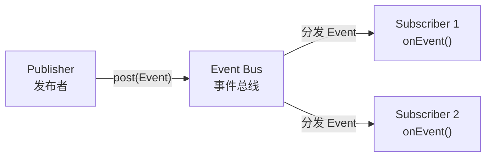

## 基本概念

EventBus（事件总线）是[[行为型设计模式#七、Observer|观察者/发布-订阅模式]]的一种实现，也是一种集中式事件处理机制，它允许不同组件之间进行彼此通信而又不需要相互依赖，从而达到解耦的目的。EventBus同时也是一个开源库，其项目地址为：[https://github.com/greenrobot/EventBus](https://github.com/greenrobot/EventBus)

EventBus主要由以下几个部分组成：

+ **Event**：事件，可以是任意类型
+ **Subscriber**：订阅者，接收事件通知
+ **Publisher**：发布者，发送事件通知

这三个部分之间的交互示意图如下：



在Android项目中使用EventBus需要通过Gradle导入依赖：

```groovy
implementation 'org.greenrobot:eventbus:$specific_version'
```

> 注：EventBus 最新版本为 3.3.1（2021 年 12 月发布），greenrobot 已基本停止其活跃开发（处于维护模式）。

普通的Java/Kotlin项目则通过Maven导入：

```xml
<dependency>
    <groupId>org.greenrobot</groupId>
    <artifactId>eventbus</artifactId>
    <version>specific_version</version>
</dependency>
```

## 基本使用

### 线程模型

EventBus有四种线程模型：

+ **POSTING**

默认使用的线程模型，表示事件处理函数的线程跟发布事件的线程在同一个线程。

+ **MAIN**

表示事件处理函数的线程在主线程(UI线程)，因此在这里不能进行耗时操作。

+ **BACKGROUND**

表示事件处理函数的线程在后台线程，不能进行UI操作。如果发布事件的线程是主线程(UI线程)，那么事件处理函数将会开启一个后台线程；如果发布事件的线程是在后台线程，那么事件处理函数就使用该线程。

+ **ASYNC**

表示无论事件发布的线程是哪一个，事件处理函数始终会新建一个子线程运行，同样不能进行UI操作。

### 定义事件类

事件类在本质上就是一个POJO（Plain Ordinary Java Object），里面封装了真正需要进行通信和传递的对象，在Kotlin中可以用Data类来代替：

```kotlin
data class EventMessage(
    val realObject: SomeType
)
```

### 事件注册与注销

官方建议EventBus的注册在Activity的`onStart()`中进行，而注销则在`onStop()`中进行：

```kotlin
override fun onStart() {
    super.onStart()
    EventBus.getDefault().register(this) //注册EventBus
}

override fun onStop() {
    super.onStop()
    if (EventBus.getDefault().isRegistered(this)) { //注销EventBus
        EventBus.getDefault().unregister(this)
    }
}
```

在上面的示例代码中，EventBus对象是通过默认单例来创建的，如果要创建自定义EventBus对象，那么就需要调用`builder()`和`build()`等方法进行链式配置。

### 事件发送与处理

事件的发送是在Publisher一侧进行的：

```kotlin
EventBus.getDefault().post(Message(···))
```

而事件的处理则在Subscriber一侧进行：

```kotlin
@Subscribe(threadMode = ThreadMode.MAIN)
fun onMessageEvent(message: Message) {
    //TODO：调用传入的Message对象的get方法拿到订阅信息，之后再进行其他处理
}
```

注意到`onMessageEvent()`使用了一个注解，它是在EventBus 3.0阶段加入的一项功能——编译时注解处理，同时也是整个EventBus的**核心**。在3.0之前，EventBus利用Java反射机制，采用的是运行时注解方案，而这就会在性能上带来损耗。

此外，被@Subscribe所注解的方法完全是由开发者编写的，EventBus并没有对此提出什么要求，只要能完成事件的处理即可。而且处理多少种不同类型的事件，就要跟着编写多少个类似的方法。

### 粘性事件

所谓粘性事件（sticky events），是指发送了之后再订阅依然能够接收到的事件。使用粘性事件需要在两处地方进行修改：

```kotlin
//Subscriber
@Subscribe(threadMode = ThreadMode.MAIN,sticky = true)
fun onMessageEvent(message: Message) {
    //TODO：调用传入的Message对象的get方法拿到订阅信息，之后再进行其他处理
}

//Publisher
EventBus.getDefault().postSticky(Message(···))
```

### 优先级

@Subscribe注解当中还有一个属性`priority`，用于指定订阅方法的优先级，它只接收整数，且数字越大，优先级越高。另外需要注意的是，只有当两个订阅方法使用相同的`ThreadMode`参数的时候，它们的优先级才会与`priority`指定的值一致，只有当某个订阅方法的`ThreadMode`参数为POSTING的时候，它才能停止该事件的继续分发。

## 现状与定位

### 维护现状

EventBus曾是Android社区风靡一时的事件总线框架（一度有超过25%的顶级应用使用），但如今已明显式微：

+ **版本停滞**：最新版本3.3.1发布于2021年12月，此后近5年（截至2026年11月）没有任何新版本发布；
+ **维护重心转移**：开发方greenrobot已将重心转移到数据库框架ObjectBox上，EventBus事实上已停止活跃开发；
+ **官方态度转变**：Google当前的架构指南已不再把"全局事件总线"作为组件通信的默认方案，而是推荐基于ViewModel + Flow的状态驱动方案。

### 被 Kotlin Flow / Channel 取代的原因

随着Kotlin协程与Flow成为语言基建级的组件，EventBus的诸多固有缺陷愈发突出，而这些缺陷恰好是Flow/Channel天然规避的：

+ **隐式依赖、难以追踪**：EventBus的订阅/发布关系散落各处，调用链无法静态追踪；Flow的收集关系则显式、可定位；
+ **易内存泄漏**：忘记`unregister()`是EventBus的常见翻车点；Flow配合`lifecycleScope`/`repeatOnLifecycle`会随生命周期自动取消，从机制上杜绝泄漏；
+ **生命周期不感知**：EventBus可能在组件不可见时仍派发事件；Flow的收集可精确绑定到`Lifecycle.State`；
+ **类型安全弱**：早期EventBus依赖反射，重构时IDE无法静态检查。

### 现代替代方案

Kotlin官方文档明确指出，`SharedFlow`可用于"把应用内发生的事件广播给随时加入/离开的订阅者"，并直接给出了用`MutableSharedFlow`封装一个事件总线的示例。因此在现代Kotlin项目中，EventBus的典型场景几乎都能被原生组件替代：

|场景|EventBus旧方案|现代替代方案|
|:--|:--|:--|
|UI状态更新|`EventBus.post(StateEvent)`|`StateFlow` + 收集|
|Fragment间通信|`EventBus.post` / `@Subscribe`|共享`ViewModel`（`activityViewModels()`）|
|一次性事件（Toast/导航）|`EventBus.post(NavEvent)`|`SharedFlow` 或 `Channel`|
|全局登录/用户状态|本地广播 / EventBus|`Repository` + `StateFlow`|
|Service通知UI|本地广播 / EventBus|注入`Repository` + `StateFlow`|
|跨进程/跨应用|（滥用）|系统`BroadcastReceiver`|

客观而言，EventBus并非完全没有价值，但适用范围已大幅收窄：

1. **存量老项目**：已在用EventBus的项目，若无重构计划可继续维护，但要留意其已停止更新、缺乏对较新Android版本与工具链的适配；
2. **纯Java项目（未引入Kotlin/协程）**：EventBus 3.x支持纯Java，在无法使用Flow的环境中仍是一种可用选择；
3. **极简的全局事件分发**：如果只是极少量、对生命周期与类型安全要求不高的场景，EventBus仍能胜任。

但需要强调的是：**在新Kotlin项目中，已没有理由引入EventBus**。即便确实需要"全局事件总线"式的分发，也应当用`SharedFlow`自建（几行代码即可），而不是引入一个已停止维护的三方库。

> 提示：有一种常见误区是"用Flow仿造一个全局EventBus"。如果仍然创建一个`GlobalEventBus.post(MyEvent())`式的全局单例，哪怕底层换成Flow，也只是换汤不换药——隐式耦合与不可追踪的问题依旧存在。正确的做法是让事件归属到明确的ViewModel/Repository边界内。
