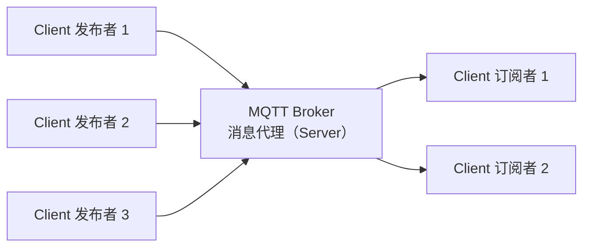
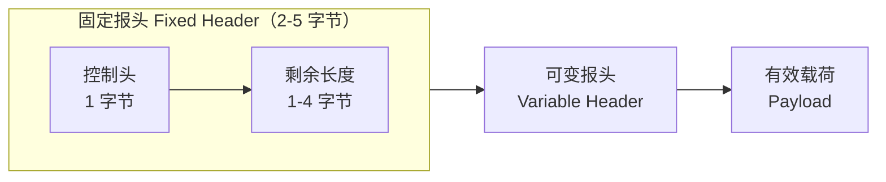
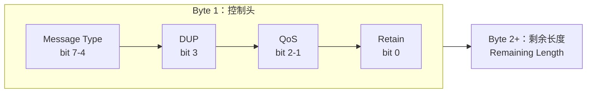

## 何为MQTT

[MQTT](https://mqtt.org)（Message Queuing Telemetry Transport，消息队列遥测传输协议）是一种基于`发布/订阅`（publish/subscribe）模式的“轻量级”通讯协议，构建于TCP/IP协议上，由IBM在1999年发布。目前MQTT的最新版本为OASIS（Organization for the Advancement of Structured Information Standards，结构化信息标准促进组织）于2019年发布的[MQTT 5.0](https://docs.oasis-open.org/mqtt/mqtt/v5.0/mqtt-v5.0.html)，但以下要介绍的 MQTT 框架仍仅支持 2014 年发布的[MQTT 3.1.1](http://docs.oasis-open.org/mqtt/mqtt/v3.1.1/os/mqtt-v3.1.1-os.html)，因此下文的内容以3.1.1版本为准。除了5.0和3.1.1版本之外，MQTT还有一个简化版的[MQTT-SN](https://www.oasis-open.org/committees/document.php?document_id=66091&wg_abbrev=mqtt)（MQTT for Sensor Networks），这里限于篇幅不做展开。

MQTT在物联网领域的应用十分广泛，以至于MQTT官网将其称为“The Standard for IoT Messaging”。其最大优点在于，**用极少的代码和有限的带宽，为连接远程设备提供实时可靠的消息服务**。MQTT的通信模式是Client-Server模式，其中Client主要负责订阅消息（因为一个Client也可以作为其他Client的Server），而Server只能发布消息，不能订阅消息。以下为 MQTT 通信方式示意图：



在上图中，位于中心的MQTT Broker（MQTT代理）就是Server，发布消息的Client并不能直接把消息发送给其他订阅消息的Client（点对点通信），而是先将消息传递给Server，再由Server统一推送给所有订阅消息的Client（一对多通信）。

> 注意，发布消息的Client将消息传递给Server，不代表Server“订阅”了消息，因此跟上面“Server只能发布消息，不能订阅消息”的说法并不矛盾。

### 主题

接收消息的 Client 使用“订阅”一词描述其行为，原因在于 Server 发布推送的大量消息各自归属于不同的“主题（Topic）”。从实际角度来说，接收消息的终端往往只应该关注自己“感兴趣”的消息，否则对 Server 发布的全部消息均全盘接收，会使 MQTT 采用的 C/S 通信模式失去意义——若终端需接收处理所有消息，则无需专门设立 Server 增加中转环节，点对点直接通信更为简便。另外，终端要接收处理所有消息，对硬件和带宽的要求也必然不会很低，这与MQTT自身定位和实际使用场景也是有冲突的。因此，MQTT要求每个消息都要带有特定主题，终端只能订阅某个主题下的消息。在MQTT中，主题的作用就是过滤出终端真正需要接收到的消息。

主题是一串分层划分的UTF-8字符串，不同的主题级别用斜杠`/`作为分隔符号，比如`一级主题/二级主题/三级主题`；如果需要订阅某一级别主题下的所有消息，那么就要将当前级别主题的**下一级**主题标记为`#`。例如，一个 Client 订阅的主题为`一级主题/二级主题/三级主题`，那么它只会收到归属于三级主题的消息，而其他与三级主题平级的主题消息就接收不到。若Client订阅的主题为`一级主题/二级主题/#`，那么就会接收到所有二级主题下的消息，不但包括原来的三级主题，还包括与三级主题平级的其他主题，以及比它们更下级的主题。

### 服务质量

服务质量（Quality of Service levels，QoS）是MQTT的一个重要特性。尽管在使用TCP/IP时，通信连接已经在一定程度上受到保护，但是在无线网络中，中断和干扰很频繁，所以MQTT需要在这里提供帮助，以避免信息丢失及保证其服务质量水平。在MQTT中，QoS有以下三个等级：

+ **QoS 0**

    消息至多传送一次，开销最小，但是可靠性最低，因为完全依赖底层TCP/IP网络，会发生消息丢失（但不会重复）。通常适用于Server推送比较频繁，偶尔丢失或重复信息也不会引发严重问题的场景，比如温度传感器隔一段时间上报温度。

+ **QoS 1**

    消息至少传送一次，可靠性较高，可能会多次推送以确保消息能够到达终端（除非网络被完全切断），因此会出现消息重复的情况。适用于丢失信息会带来严重后果，但是重复传送影响不大的场景，比如考勤系统的考勤记录信息在传输过程中发生丢失会导致没有考勤记录，而重复传送可以在应用层面过滤处理，确保考勤记录存在、有效。

+ **QoS 2** 

    消息只传送一次，开销最大，可靠性最高，因为每个消息都带有唯一ID，并且会分别在发送者和接收者存储，并且发送者和接收者之间需要建立两个流传输数据。仅适用于重复推送或丢失会带来较大影响的场景，比如计费系统就需要确保一次消费只产生一条消费记录，如果重复推送会导致多扣款，而消息丢失会导致有消费但是没扣款。

### MQTT报文结构

MQTT报文由三部分组成：固定报头（Fixed Header）、可变报头（Variable Header）以及有效载荷（Payload）。具体如下图所示：



+ **固定报头**

固定头存在于所有MQTT报文中，由控制头和剩余长度两个部分组成：控制头固定为1字节，剩余长度字段采用变长编码、占用1~4字节，因此固定头总长度为2~5字节，如下图所示：



在控制头中，消息类型是4位的无符号值，总计有16种，具体类型可以参考[MQTT标准文档](http://docs.oasis-open.org/mqtt/mqtt/v3.1.1/os/mqtt-v3.1.1-os.html#_Toc398718021)；副本标识位用于控制报文是否需要重复分发，目前只有PUBLISH类型消息会用到；服务质量标识位从00到10，由低到高分别对应三种服务质量级别（剩下一个11是预留的），同样只在`PUBLISH`类型中使用；保留标识位用于控制服务器是否保留此次推送的报文，目前只用在`PUBLISH`类型消息，如果启用该标识位，服务器在推送时会保留报文，有新的订阅者出现时就推送，没有就直接释放。

剩余长度用来表示当前报文剩余部分的**字节数**，包括可变报头和有效载荷。剩余长度**不包括**用于编码剩余长度字段本身的字节数。剩余长度这一字节可以扩展，前7位用于保存长度，后1位用做标识。当最后一位非0时，表示长度不足，需要使用下一字节继续表示剩余长度，由此可以推导出，理论上一个控制报文最长可以到256MB。但是MQTT报文是不支持分包处理的，因此不适用于数据量大的场景（如视频直播），这也是MQTT主要用于物联网领域的重要原因。

+ **可变报头**

可变报头的内容因报文类型而不同，较常的应用是作为报文的标识。许多类型报文的可变报头都是2字节长度的报文标识字段，包括`PUBLISH (QoS > 0)`、`PUBACK`、`PUBREC`、`PUBREL`、`PUBCOMP`、`SUBSCRIBE`、`SUBACK`、`UNSUBSCRIBE`以及`UNSUBACK`类型的报文。更多有关可变报头的详细说明，可以参考[MQTT标准文档](http://docs.oasis-open.org/mqtt/mqtt/v3.1.1/os/mqtt-v3.1.1-os.html#_Toc398718025)。

+ **有效载荷**

有效载荷即为应用消息，在MQTT 3.1.1中，`CONNECT`、`SUBSCRIBE`、`SUBACK`和`UNSUBSCRIBE`这四种类型报文要求必须携带有效载荷，而`PUBLISH`类型报文可带可不带。下表列出了这些报文需要携带什么样的有效载荷：

|报文类型|有效载荷内容|
|:-----:|:-----:|
|`CONNECT`|客户端的ClientID、订阅的Topic、Message以及用户名和密码等信息|
|`SUBSCRIBE`|一系列的要订阅的Topic以及QoS|
|`SUBACK`|服务器对于`SUBSCRIBE`报文所申请的Topic及QoS进行确认和回复|
|`UNSUBSCRIBE`|要订阅的Topic|
|`PUBLISH`|与业务相关的通信内容|

## Android MQTT框架

Android开发最常用的MQTT框架是Eclipse基金会开源的[Eclipse Paho](https://www.eclipse.org/paho/)框架。根据Eclipse官方的文档，Eclipse Paho目前只在Java、Python、C和C++这四种语言开发的程序上支持MQTT 5.0，而Android等开发领域仅支持到MQTT 3.1.1。

Eclipse Paho for Android的GitHub仓库地址为[https://github.com/eclipse/paho.mqtt.android](https://github.com/eclipse/paho.mqtt.android)。作为一个官方库，Eclipse Paho for Android在多数情况下是足够使用的，但问题在于，Eclipse官方对这个库的开发维护趋于停滞（2022年8月在[Maven Center](https://mvnrepository.com/artifact/org.eclipse.paho/org.eclipse.paho.android.service)查到的最新版本为1.1.1），也没有适配到Android 12或更高版本（详见[MQTT Exception not supported on Android 12](https://github.com/eclipse/paho.mqtt.android/issues/482)），因此会对未来的开发使用带来许多不便。

按照部分开发者的指引，目前比较值得使用的MQTT框架是基于Eclipse Paho for Android改进的[MQTT Android Service](https://github.com/hannesa2/paho.mqtt.android)，该框架虽然和官方库一样只支持到MQTT 3.1.1，但是开发维护较为活跃，并且使用了Kotlin语言，还适配了Android 12，因此在可预见的一段时期内，这个第三方库都是值得集成使用的。

### 依赖库导入

MQTT Android Service的导入方式为：

```groovy
allprojects {
    repositories {
      ...
      maven { url 'https://jitpack.io' }
    }
}

dependencies {
  implementation 'androidx.legacy:legacy-support-v4:1.0.0'
  implementation 'com.github.hannesa2:paho.mqtt.android:$latestVersion'
}
```

### 基本使用

MQTT Android Service的基本使用方式如下列代码所示：

```kotlin
// 获取MQTT Client
val client = MqttAndroidClient(context, uri, clientId).apply {
    if (Build.VERSION.SDK_INT >= Build.VERSION_CODES.O) {
        val id = random.nextInt()
        // 在Android 8.0及以上的高版本系统中，需要开启前台服务
        setForegroundService(createForegroundNotification(context, id), id)
    }
 }

// 设置MQTT追踪功能
client.setTraceEnabled(true)

// 设置MQTT通信回调
client.setCallback(object : MqttCallback {
    override fun connectionLost(cause: Throwable?) {
        // TODO: 失去连接时的回调逻辑
    }

    override fun messageArrived(topic: String?, message: MqttMessage?) {
        // TODO: MQTT报文送达时的回调逻辑
    }

    override fun deliveryComplete(token: IMqttDeliveryToken?) {
        // TODO: 携带有效载荷的MQTT报文送达时的回调逻辑
    }
})

// 配置MQTT连接选项
val options = MqttConnectOptions().apply {
                // 如果通信不需要用户名和密码，就不用配置userName和password
                userName = name
                password = pswd.toCharArray()
                isAutomaticReconnect = true
                isCleanSession = true
                connectionTimeout = 30
            }

// 设置MQTT连接回调监听器
val listener = object : IMqttActionListener {
                override fun onSuccess(asyncActionToken: IMqttToken?) {
                    // QoS是枚举类，包含QoS.AtMostOnce、QoS.AtLeastOnce和QoS.ExactlyOnce
                    // 只有执行该函数后，MQTT Client才真正开始订阅主题消息
                    client.subscribe(topic, QoS.value, context, null)
                }

                override fun onFailure(asyncActionToken: IMqttToken?, exception: Throwable?) {
                    // TODO: MQTT连接失败回调
                }

            }

// 尝试建立MQTT通信连接
client.connect(options, listener)
```

测试Android设备的MQTT通信，可使用HiveMQ官方提供的[MQTT CLI](https://hivemq.github.io/mqtt-cli/)命令行工具，配合免费的公共broker `broker.hivemq.com`（无需凭证，仅供学习测试）：

```bash
# 订阅主题
mqtt sub -h broker.hivemq.com -t "demo/topic"

# 发布消息
mqtt pub -h broker.hivemq.com -t "demo/topic" -m "hello"

# 测试 broker 支持的特性
mqtt test -h broker.hivemq.com
```

## 支持 MQTT 5.0 的主流框架

前文提到，Android领域常用的Paho系列仍停留在MQTT 3.1.1。若需使用 MQTT 5.0（2019 年发布的最新标准）的新特性——如共享订阅、消息过期、主题别名、请求-响应等——存在主流选择，且无需自行实现整套通信逻辑。

### HiveMQ MQTT Client（最推荐的现代选择）

[HiveMQ MQTT Client](https://github.com/hivemq/hivemq-mqtt-client)是一个同时兼容MQTT 3.1.1与MQTT 5.0的高性能Java客户端库，官方明确支持Android。相比Paho，它提供现代Fluent API、完全异步非阻塞（基于Netty）、内置自动重连（指数退避），并官方支持RxJava 2/3与Reactor等响应式集成，社区活跃、持续维护。

#### 集成

添加依赖（最新为1.3.x系列，具体版本以[Maven Central](https://central.sonatype.com/artifact/com.hivemq/hivemq-mqtt-client)为准）：

```kotlin
implementation("com.hivemq:hivemq-mqtt-client:${specified_version}")
```

由于HiveMQ内部基于Netty，而Netty携带了重复的`META-INF`元数据文件，在Android打包时需在`build.gradle`中排除，否则会报"more than one file was found"错误：

```kotlin
android {
    packaging {
        resources {
            excludes += setOf("META-INF/INDEX.LIST", "META-INF/io.netty.versions.properties")
        }
    }
}
```

相比Paho Android，HiveMQ只需声明一个网络权限：

```xml
<uses-permission android:name="android.permission.INTERNET" />
```

#### 构建与配置客户端

以MQTT 5.0客户端为例，用Builder构建客户端并配置连接参数：

```kotlin
val client = Mqtt5Client.builder()
    .identifier(clientId)                              // 唯一客户端 ID
    .serverHost(host)                                  // broker 主机
    .serverPort(port)                                  // 端口（默认 1883，TLS 用 8883）
    .simpleAuth()                                      // 可选：用户名/密码认证
    .username("admin")
    .password("password".toByteArray())
    .applySimpleAuth()
    .sslWithDefaultConfig()                            // 可选：启用 TLS
    .automaticReconnect()                              // 自动重连（指数退避）
    .initialDelay(1, TimeUnit.SECONDS)                 // 断线 1 秒后开始重连
    .maxDelay(32, TimeUnit.SECONDS)                    // 重连等待上限 32 秒
    .applyAutomaticReconnect()
    .build()                                           // 返回阻塞版 Mqtt5Client
```

几点说明：

+ `build()`返回**阻塞版**客户端，`buildAsync()`返回异步客户端（方法返回`CompletableFuture`），二者可通过`toAsync()`/`toBlocking()`互相切换；
+ 若只需默认重连策略，可用`automaticReconnectWithDefaultConfig()`一行代替上面的三段式配置；
+ 需要MQTT 3.1.1时，把`Mqtt5Client`换成`Mqtt3Client`、`MqttQos`换成`Mqtt3Qos`即可，API结构一致。

#### 最小可用示例

以下是一个完整的阻塞版最小示例，完成"连接 → 订阅 → 发布 → 接收"闭环：

```kotlin
import com.hivemq.client.mqtt.datatypes.MqttQos
import com.hivemq.client.mqtt.mqtt5.Mqtt5Client

// 1. 构建客户端（自动重连）
val client: Mqtt5Client = Mqtt5Client.builder()
    .identifier("android-" + UUID.randomUUID())
    .serverHost("broker.hivemq.com")
    .serverPort(1883)
    .automaticReconnectWithDefaultConfig()
    .build()

// 2. 连接
client.connectWith().cleanStart(true).send()

// 3. 订阅并处理消息
client.subscribeWith()
    .topicFilter("demo/topic")
    .qos(MqttQos.AT_LEAST_ONCE)
    .callback { publish ->
        val payload = String(publish.payloadAsBytes)
        println("收到消息 [${publish.topic}]：$payload")
    }
    .send()

// 4. 发布消息
client.publishWith()
    .topic("demo/topic")
    .qos(MqttQos.AT_LEAST_ONCE)
    .payload("Hello MQTT 5".toByteArray())
    .send()

// 5. 断开连接
client.disconnect()
```

需要说明的是：HiveMQ不内置Android后台Service，若应用退到后台仍需维持长连接，需自行以前台服务（Foreground Service）承载，并在服务中持有该`client`实例。

#### 异步版示例

`buildAsync()`返回`Mqtt5AsyncClient`，各操作返回`CompletableFuture`，可用`thenCompose`链式编排、`whenComplete`统一处理异常：

```kotlin
val client = Mqtt5Client.builder()
    .identifier("android-" + UUID.randomUUID())
    .serverHost("broker.hivemq.com")
    .serverPort(1883)
    .automaticReconnectWithDefaultConfig()
    .buildAsync()

client.connectWith().cleanStart(true)
    .thenCompose { connAck ->
        // 连接成功后订阅
        client.subscribeWith()
            .topicFilter("demo/topic")
            .qos(MqttQos.AT_LEAST_ONCE)
            .callback { publish ->
                println("收到：${String(publish.payloadAsBytes)}")
            }
            .send()
    }
    .thenCompose { subAck ->
        // 订阅成功后发布
        client.publishWith()
            .topic("demo/topic")
            .qos(MqttQos.AT_LEAST_ONCE)
            .payload("Hello from async".toByteArray())
            .send()
    }
    .whenComplete { _, error ->
        error?.printStackTrace()
    }
```

#### MQTT 5.0 特性示例

**遗嘱消息（Will Message）**：客户端异常断线时，broker会自动向遗嘱主题发布一条消息，常用于通知"设备已离线"：

```kotlin
val will = Mqtt5Publish.builder()
    .topic("device/state")
    .qos(MqttQos.AT_LEAST_ONCE)
    .payload("offline".toByteArray())
    .retain(true)
    .build()

client.connectWith()
    .cleanStart(true)
    .sessionExpiryInterval(3600L)  // 会话过期时间（秒），断线后会话保留 1 小时
    .willPublish(will)
    .send()
```

**共享订阅（Shared Subscription）**：用`$share/{组名}/{主题}`作为主题过滤器，同一组内的多个订阅者由broker轮流分发消息，实现负载均衡：

```kotlin
client.subscribeWith()
    .topicFilter("$share/workers/orders")   // workers 组的订阅者轮流接收
    .qos(MqttQos.AT_LEAST_ONCE)
    .callback { publish -> /* 处理订单 */ }
    .send()
```

**消息属性**：MQTT 5.0还可为单条消息设置内容类型、载荷格式、过期时间、用户属性等：

```kotlin
client.publishWith()
    .topic("demo/topic")
    .qos(MqttQos.AT_LEAST_ONCE)
    .payload("data".toByteArray())
    .contentType("application/json")                          // 内容类型
    .payloadFormatIndicator(Mqtt5PayloadFormatIndicator.UTF_8) // 载荷格式
    .messageExpiryInterval(120L)                              // 120 秒内未送达则过期
    .userProperties()
    .add("sender", "android")
    .applyUserProperties()
    .send()
```

### Eclipse Paho Java Client（MQTT 5.0 版）

Eclipse Paho官方也提供了支持MQTT 5.0的Java客户端：

```groovy
implementation 'org.eclipse.paho:org.eclipse.paho.mqttv5.client:${specified_version}'
```

它继承了Paho的老牌稳定性，但同样不是Android专用库，后台保活、生命周期管理等仍需自行处理。

### 选型小结

|需求|推荐|
|:--|:--|
|需要MQTT 5.0 + 现代API + 高性能|HiveMQ MQTT Client|
|需要MQTT 5.0 + 老牌Paho生态|Paho Java mqttv5 client|
|只需MQTT 3.1.1 + 现成Android后台Service|Paho Android（或hannesa2 fork）|

> 需要说明的现实是：Android专用框架（Paho Android及其fork）普遍仍停留在MQTT 3.1.1。若确实需要MQTT 5.0，主流做法是选择HiveMQ（或Paho Java mqttv5）等通用Java客户端，再自行以前台服务承载后台长连接——这并不属于自行实现整套 MQTT 业务逻辑，只需补充 Android 特有的后台保活。
