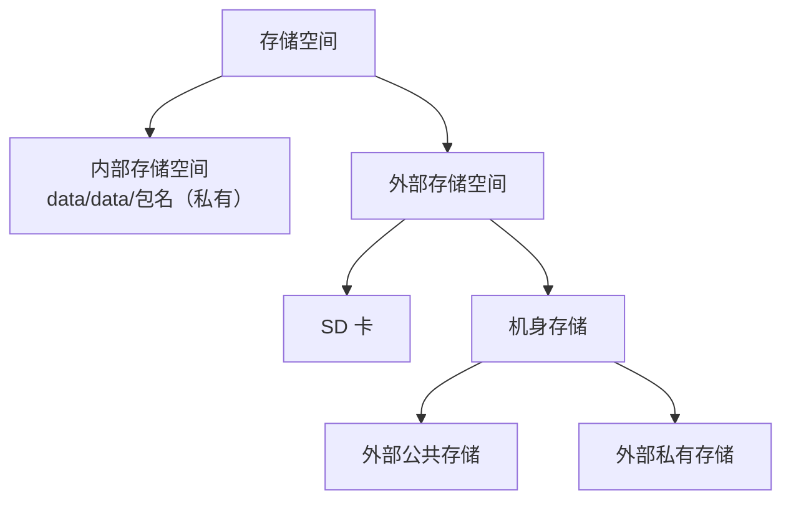

Android 的存储不是一个“硬盘”，而是按**谁能访问**切成几块。同一个文件放在不同区域，权限、生命周期、卸载后的去留都不一样。分区理解比 API 记忆更重要。

## 存储分区

| 区域 | 典型路径 | 需要权限 | 卸载后 | 其他应用 |
|:--|:--|:--:|:--:|:--|
| 内部私有 | `/data/user/0/<包名>` | 否 | 删除 | 不可访问 |
| 外部私有 | `/storage/emulated/0/Android/data/<包名>` | 否 | 删除 | Android 11 起不可访问 |
| 共享存储 | `/storage/emulated/0/` 下的公共目录 | 视版本与文件类型 | 保留 | 通过 MediaStore / SAF 访问 |
| 系统区 | `/system`、`/vendor` 等 | 不可写 | — | 只读挂载 |

`/data/data/<包名>` 是历史路径，现在指向 `/data/user/0/<包名>`（多用户下还有 `/data/user/10/...`）。编码时不应硬编码上述路径，应使用相应 API 获取。



Google 官方把前两块合称**应用专属存储（App-specific storage）**，第三块称为**共享存储（Shared storage）**。

### 内部存储

内部存储是应用私有的，路径由系统分配，**不需要任何权限**，其他应用和用户（未 root 时）都看不到。

```kotlin
val filesDir = context.filesDir            // /data/user/0/<包名>/files
val cacheDir = context.cacheDir            // /data/user/0/<包名>/cache
val noBackupDir = context.noBackupFilesDir // 不参与 Auto Backup 的目录
val customDir = context.getDir("custom", Context.MODE_PRIVATE)
```

几个要点：

+ **加密**：Android 7.0（API 24）起支持**文件级加密（FBE）**，凭据加密存储（Credential Encrypted）在用户首次解锁前不可读；这不是 Android 10 才有的。开发者侧无需额外代码，也不要试图绕过。
+ **卸载即删**：这里的数据只属于当前安装，卸载或清除数据都会消失。
+ **空间有限**：内部存储和系统分区共享容量，不适合放大量媒体文件。
+ **`cacheDir` 会被系统清理**：存储紧张时系统可以直接删除缓存目录里的内容，任何“必须保留”的数据都不能只放这里。

### 外部存储

外部存储在概念上是“可共享的那部分”，可以随设备挂载到电脑。现在绝大多数设备没有 SD 卡，所谓外部存储就是机身存储里划出来的一块。

#### 外部私有目录

```kotlin
val extFiles = context.getExternalFilesDir(null)              // .../Android/data/<包名>/files
val extPictures = context.getExternalFilesDir(Environment.DIRECTORY_PICTURES)
val extCache = context.getExternalCacheDir()                  // .../Android/data/<包名>/cache
val extMediaDirs = context.getExternalMediaDirs()             // 可被 MediaScanner 收录
```

特点：

+ **不需要权限**（API 19 起）；
+ 随应用卸载删除；
+ **Android 11（API 30）起，其他应用无法访问该应用的`Android/data/<包名>`**，即使它有 `READ_EXTERNAL_STORAGE`；
+ 目录是**第一次调用 API 时才创建**的，不要假设它天然存在；
+ 返回值为 `File?`——外部存储被移除或不可用时是 null，必须判空。

#### 共享存储

存放照片、音乐、下载文件等“属于用户”的内容，卸载应用不会删除。访问方式只有两条：

+ **MediaStore**：图片、音频、视频、下载文件；
+ **SAF（存储访问框架）**：文档和其他任意文件。

在 Android 10 之后，**不要再试图用`File`直接拼接共享目录的路径**：分区存储（Scoped Storage）下，没有权限的路径即使存在也读不到。

#### 判断外部存储状态

```kotlin
val state = Environment.getExternalStorageState()
if (state == Environment.MEDIA_MOUNTED) {
    // 可读写
}
```

不带参数的版本返回的是**主共享存储**（`/storage/emulated/0`）的状态，不是“外部私有目录”。常见的返回值：

| 常量 | 值 | 含义 |
|:--|:--|:--|
| `MEDIA_MOUNTED` | `mounted` | 已挂载，可读写 |
| `MEDIA_MOUNTED_READ_ONLY` | `mounted_ro` | 已挂载，只读 |
| `MEDIA_REMOVED` | `removed` | 介质已移除 |
| `MEDIA_UNMOUNTED` | `unmounted` | 存在但未挂载 |
| `MEDIA_CHECKING` | `checking` | 正在检查 |
| `MEDIA_NOFS` | `nofs` | 空白介质或不支持的文件系统 |
| `MEDIA_SHARED` | `shared` | 正通过 USB 共享给电脑 |
| `MEDIA_BAD_REMOVAL` | `bad_removal` | 未卸载就被拔出 |
| `MEDIA_UNMOUNTABLE` | `unmountable` | 无法挂载（文件系统损坏） |
| `MEDIA_EJECTING` | `ejecting` | 正在弹出 |
| `MEDIA_UNKNOWN` | `unknown` | 状态未知 |

只有`MEDIA_MOUNTED`能保证可写，`MEDIA_MOUNTED_READ_ONLY`只能读。

#### 标准目录

系统预置了一批公共目录，`Environment`里的常量就是它们的名字：

| 常量 | 实际目录名 | 用途 | 起始版本 |
|:--|:--|:--|:--:|
| `DIRECTORY_MUSIC` | `Music` | 音乐 | 1 |
| `DIRECTORY_PODCASTS` | `Podcasts` | 播客 | 1 |
| `DIRECTORY_RINGTONES` | `Ringtones` | 铃声 | 1 |
| `DIRECTORY_ALARMS` | `Alarms` | 闹钟音 | 1 |
| `DIRECTORY_NOTIFICATIONS` | `Notifications` | 通知音 | 1 |
| `DIRECTORY_PICTURES` | `Pictures` | 图片 | 1 |
| `DIRECTORY_MOVIES` | `Movies` | 视频 | 1 |
| `DIRECTORY_DOWNLOADS` | `Download`（**单数**） | 下载文件 | 1 |
| `DIRECTORY_DCIM` | `DCIM` | 相机拍摄 | 1 |
| `DIRECTORY_DOCUMENTS` | `Documents` | 文档 | 19 |
| `DIRECTORY_SCREENSHOTS` | `Screenshots` | 截图 | 29 |
| `DIRECTORY_AUDIOBOOKS` | `Audiobooks` | 有声书 | 29 |
| `DIRECTORY_RECORDINGS` | `Recordings` | 录音 | 31 |

名字以源码里的字符串为准：`Downloads`和`Notification`都是错的。

## 存储权限的演变

这一块是 Android 存储最容易过时的地方，按目标版本分档看：

| 场景 | Android 9 及以下 | Android 10（29） | Android 11（30）~12 | Android 13（33）+ |
|:--|:--|:--|:--|:--|
| 读写自己的应用专属目录 | 不需要权限 | 不需要 | 不需要 | 不需要 |
| 读其他应用的媒体文件 | `READ_EXTERNAL_STORAGE` | `READ_EXTERNAL_STORAGE` | `READ_EXTERNAL_STORAGE` | `READ_MEDIA_IMAGES` / `_VIDEO` / `_AUDIO` |
| 写其他应用的媒体文件 | `WRITE_EXTERNAL_STORAGE` | `WRITE_EXTERNAL_STORAGE`（作用受限） | 需用户逐次授权 | 需用户逐次授权 |
| 访问任意文档 | 需要存储权限 | 不可直接用`File` | 不可直接用`File` | 不可直接用`File` |

三条关键结论：

1. **`WRITE_EXTERNAL_STORAGE`从 Android 11 起完全失效**（targetSdk ≥ 30 时），声明了也不会获得任何额外写入能力；
2. **Android 10 起默认开启分区存储**，应用只能看到自己的专属目录和“自己创建的媒体”；
3. **Android 13 起媒体权限细分**，`READ_EXTERNAL_STORAGE` 不再能读其他应用的图片/视频/音频。

清单里按官方推荐写法声明，用`maxSdkVersion`把旧权限限制在旧系统：

```xml
<!-- Android 12 及以下 -->
<uses-permission android:name="android.permission.READ_EXTERNAL_STORAGE"
    android:maxSdkVersion="32" />
<!-- Android 9 及以下写共享存储才需要 -->
<uses-permission android:name="android.permission.WRITE_EXTERNAL_STORAGE"
    android:maxSdkVersion="29" />

<!-- Android 13 起，按需声明 -->
<uses-permission android:name="android.permission.READ_MEDIA_IMAGES" />
<uses-permission android:name="android.permission.READ_MEDIA_VIDEO" />
<uses-permission android:name="android.permission.READ_MEDIA_AUDIO" />

<!-- Android 14 起，支持“仅选中的照片” -->
<uses-permission android:name="android.permission.READ_MEDIA_VISUAL_USER_SELECTED" />
```

运行时权限用 Activity Result API 申请：

```kotlin
private val requestMedia = registerForActivityResult(
    ActivityResultContracts.RequestMultiplePermissions()
) { granted ->
    val hasImages = granted[Manifest.permission.READ_MEDIA_IMAGES] == true
}
```

`MANAGE_EXTERNAL_STORAGE`（所有文件访问权）只适用于文件管理器、备份、杀毒这类应用，上架 Google Play 需要单独审核，普通应用不要声明。

## 应用专属目录的读写

```kotlin
// 内部存储
val file = File(context.filesDir, "notes.txt")
file.writeText("hello")

// 外部私有存储（可能为 null）
val extDir = context.getExternalFilesDir(Environment.DIRECTORY_DOCUMENTS) ?: return
val report = File(extDir, "report.txt")
report.writeText("hello")
```

也可以用`Context`提供的流式 API，文件直接落在`filesDir`下：

```kotlin
context.openFileOutput("notes.txt", Context.MODE_PRIVATE).use { output ->
    output.write("hello".toByteArray())
}

context.openFileInput("notes.txt").bufferedReader().useLines { lines ->
    lines.forEach { line -> /* ... */ }
}
```

`MODE_PRIVATE`是`Context`的静态常量，Kotlin 里要写全`Context.MODE_PRIVATE`，不能像 Java 那样直接写`MODE_PRIVATE`。

### 缓存文件

```kotlin
// 系统生成随机后缀，避免重名
val temp = File.createTempFile("export-", ".txt", context.cacheDir)

// 固定文件名
val fixed = File(context.cacheDir, "draft.txt").apply {
    if (!exists()) createNewFile()
}
```

`createTempFile(prefix, suffix, directory)`的规则：

+ `suffix`传 null 时系统补`.tmp`；
+ 系统会在`prefix`后追加一串随机数字，文件名不可预期；
+ 需要精确控制文件名时，直接用`File(dir, name)`。

删除单个文件：

```kotlin
File(context.cacheDir, "draft.txt").delete()
context.deleteFile("notes.txt")        // 只删 filesDir 下的文件
```

`Context.deleteFile()`的作用范围是**`filesDir`**，不是整个应用专属存储，也删不到`cacheDir`里的文件。

清空缓存目录：

```kotlin
context.cacheDir.listFiles()?.forEach { it.deleteRecursively() }
```

> `ACTION_CLEAR_APP_CACHE`广播的接收权限是`signature|privileged`，第三方应用既发不出去也收不到，别指望用它清理别的应用缓存。

## 共享存储：MediaStore

分区存储之后，图片、音频、视频、下载文件统一通过`MediaStore`访问。它本质是一个 ContentProvider，用`ContentResolver`做增删查改。

### 查询

```kotlin
val projection = arrayOf(
    MediaStore.Images.Media._ID,
    MediaStore.Images.Media.DISPLAY_NAME,
    MediaStore.Images.Media.SIZE
)
val selection = "${MediaStore.Images.Media.SIZE} > ?"
val selectionArgs = arrayOf("1024")
val sortOrder = "${MediaStore.Images.Media.DATE_ADDED} DESC"

contentResolver.query(
    MediaStore.Images.Media.EXTERNAL_CONTENT_URI,
    projection, selection, selectionArgs, sortOrder
)?.use { cursor ->
    val idColumn = cursor.getColumnIndexOrThrow(MediaStore.Images.Media._ID)
    while (cursor.moveToNext()) {
        val id = cursor.getLong(idColumn)
        val uri = ContentUris.withAppendedId(
            MediaStore.Images.Media.EXTERNAL_CONTENT_URI, id
        )
        // 用 uri 加载图片
    }
}
```

`query()`的四个参数与 SQL 的`SELECT`一一对应，Cursor 用完必须关（`use`会自动关）。

### 添加

Android 10 起推荐“两段式写入”：先以`IS_PENDING = 1`占位，写完再置 0，避免半成品被其他应用看到。

```kotlin
val values = ContentValues().apply {
    put(MediaStore.Images.Media.DISPLAY_NAME, "photo.jpg")
    put(MediaStore.Images.Media.MIME_TYPE, "image/jpeg")
    put(
        MediaStore.Images.Media.RELATIVE_PATH,
        "${Environment.DIRECTORY_PICTURES}/MyApp"
    )
    put(MediaStore.Images.Media.IS_PENDING, 1)
}

val uri = contentResolver.insert(
    MediaStore.Images.Media.EXTERNAL_CONTENT_URI, values
) ?: return

contentResolver.openOutputStream(uri)?.use { output ->
    bitmap.compress(Bitmap.CompressFormat.JPEG, 90, output)
}

values.clear()
values.put(MediaStore.Images.Media.IS_PENDING, 0)
contentResolver.update(uri, values, null, null)
```

`RELATIVE_PATH`和`IS_PENDING`都是 Android 10（API 29）引入的；低版本只能落到默认目录、也没有 pending 机制。

### 修改与删除

自己创建的文件，直接改、直接删：

```kotlin
contentResolver.update(uri, ContentValues().apply {
    put(MediaStore.Images.Media.DISPLAY_NAME, "new-name.jpg")
}, null, null)

contentResolver.delete(uri, null, null)
```

**其他应用创建的文件，Android 11 起需要用户逐次授权**：

```kotlin
private val writeRequest = registerForActivityResult(
    ActivityResultContracts.StartIntentSenderForResult()
) { result ->
    if (result.resultCode == Activity.RESULT_OK) {
        // 用户同意，可以继续修改
    }
}

fun requestWrite(uri: Uri) {
    val sender = MediaStore.createWriteRequest(contentResolver, listOf(uri)).intentSender
    writeRequest.launch(IntentSenderRequest.Builder(sender).build())
}
```

删除对应`MediaStore.createDeleteRequest()`，逻辑相同。

### 权限与目录对照

| 内容 | 集合 | 说明 |
|:--|:--|:--|
| 图片 | `MediaStore.Images.Media` | 存在`Pictures/`、`DCIM/` |
| 视频 | `MediaStore.Video.Media` | 存在`Movies/`、`DCIM/` |
| 音频 | `MediaStore.Audio.Media` | 存在`Music/`、`Ringtones/`等 |
| 下载 | `MediaStore.Downloads` | Android 10 起；访问别人的下载文件必须走 SAF |
| 任意文件 | `MediaStore.Files` | 只能看到自己创建的文件（分区存储开启时） |

### 打开与显示

拿到`Uri`之后，用`ContentResolver`开流，不要试图把它转成文件路径：

```kotlin
contentResolver.openInputStream(uri)?.use { input ->
    val bitmap = BitmapFactory.decodeStream(input)
}
```

图片加载交给 Glide / Coil 更合适，它们能直接接收`Uri`并处理采样。

## 共享存储：SAF

存储访问框架（Storage Access Framework）用于访问**文档和其他任意文件**，用户通过系统文件选择器决定给哪个文件、哪个目录授权。应用不持有任何存储权限也能用。

### 创建文件

```kotlin
private val createDocument = registerForActivityResult(
    ActivityResultContracts.CreateDocument("application/pdf")
) { uri ->
    uri ?: return@registerForActivityResult
    contentResolver.openOutputStream(uri)?.use { output ->
        output.write(pdfBytes)
    }
}

// 触发：参数是建议的文件名，用户可以改
createDocument.launch("invoice.pdf")
```

需要指定初始目录时，用`Intent`版本并带上`DocumentsContract.EXTRA_INITIAL_URI`（Android 8.0 起）：

```kotlin
val intent = Intent(Intent.ACTION_CREATE_DOCUMENT).apply {
    addCategory(Intent.CATEGORY_OPENABLE)
    type = "application/pdf"
    putExtra(Intent.EXTRA_TITLE, "invoice.pdf")
    putExtra(DocumentsContract.EXTRA_INITIAL_URI, initialUri)
}
```

### 打开文件

```kotlin
private val openDocument = registerForActivityResult(
    ActivityResultContracts.OpenDocument()
) { uri ->
    uri ?: return@registerForActivityResult
    contentResolver.openInputStream(uri)?.use { input ->
        // 读取
    }
}

openDocument.launch(arrayOf("application/pdf", "text/plain"))
```

`OpenDocument`接收 MIME 类型数组，传`arrayOf("*/*")`表示不限类型。

### 修改、重命名与删除

拿到的`Uri`如果是 document URI，可以用`DocumentsContract`操作：

```kotlin
// 覆盖写入：模式 "wt" 会截断原内容
contentResolver.openOutputStream(uri, "wt")?.use { output ->
    output.write(newBytes)
}

// 重命名
DocumentsContract.renameDocument(contentResolver, uri, "new-name.pdf")

// 删除
DocumentsContract.deleteDocument(contentResolver, uri)
```

`"w"`模式在不同 provider 上行为不一致，可能从开头覆盖但不截断，**覆盖写一律用`"wt"`**。

### 持久化授权

默认授权只到进程结束。需要长期访问（比如用户选了一个目录作为导出位置），要主动持久化：

```kotlin
contentResolver.takePersistableUriPermission(
    uri,
    Intent.FLAG_GRANT_READ_URI_PERMISSION or Intent.FLAG_GRANT_WRITE_URI_PERMISSION
)
```

对应`ACTION_OPEN_DOCUMENT`返回的 Intent 必须带`FLAG_GRANT_PERSISTABLE_URI_PERMISSION`（系统文件选择器默认会给），否则`takePersistableUriPermission`抛`SecurityException`。释放用`releasePersistableUriPermission`。

> SAF 返回的是**内容 URI**，不是文件路径。`uri.path`看起来像路径，但不能传给`File`，也不要用它拼字符串——只能通过`ContentResolver`读写。

## 把文件分享给别的应用

Android 7.0 起，跨应用传`file://`会抛`FileUriExposedException`，必须用`content://`。标准做法是`FileProvider`：

```xml
<provider
    android:name="androidx.core.content.FileProvider"
    android:authorities="${applicationId}.fileprovider"
    android:exported="false"
    android:grantUriPermissions="true">
    <meta-data
        android:name="android.support.FILE_PROVIDER_PATHS"
        android:resource="@xml/file_paths" />
</provider>
```

```kotlin
val uri = FileProvider.getUriForFile(context, "${context.packageName}.fileprovider", file)
intent.putExtra(Intent.EXTRA_STREAM, uri)
intent.addFlags(Intent.FLAG_GRANT_READ_URI_PERMISSION)
```

完整配置见[[6. Content Provider#FileProvider：最常见的自定义 Provider|FileProvider]]。

## 存储空间

```kotlin
val stat = StatFs(context.filesDir.absolutePath)
val available = stat.availableBytes       // 当前可写空间
val total = stat.totalBytes

// 也可以直接问 File
val usable = context.filesDir.usableSpace
```

写大文件前先判断剩余空间，不要等抛`IOException`（`ENOSPC`）才发现。

## 常见问题

| 现象 | 原因 | 处理 |
|:--|:--|:--|
| 共享目录`File`能创建但读不到 | 分区存储下无权限 | 改用 MediaStore / SAF |
| `getExternalFilesDir()`返回 null | 外部存储不可用 | 判空并降级到内部存储 |
| 其他应用读不到自己`Android/data`下的文件 | Android 11 起禁止跨应用访问 | 需要共享就用 MediaStore 或 FileProvider |
| 拍照后相册没有 | 文件写到了应用专属目录，没插 MediaStore | 通过 MediaStore 插入或写到公共目录 |
| SAF 重启后没权限 | 没调`takePersistableUriPermission` | 持久化授权 |
| 覆盖写后末尾残留旧内容 | 用了`"w"`而不是`"wt"` | 覆盖写用`"wt"` |
| 把`Uri`当路径用 | SAF/MediaStore 的 URI 不是文件路径 | 一律走`ContentResolver` |
| Android 13 上申请存储权限无效 | 还在用`READ_EXTERNAL_STORAGE` | 换成`READ_MEDIA_*` |

> 键值对方案见[[15. 数据持久化：键值对存储]]，结构化数据见[[16. 数据持久化：数据库与Room]]；本篇只讨论文件。
