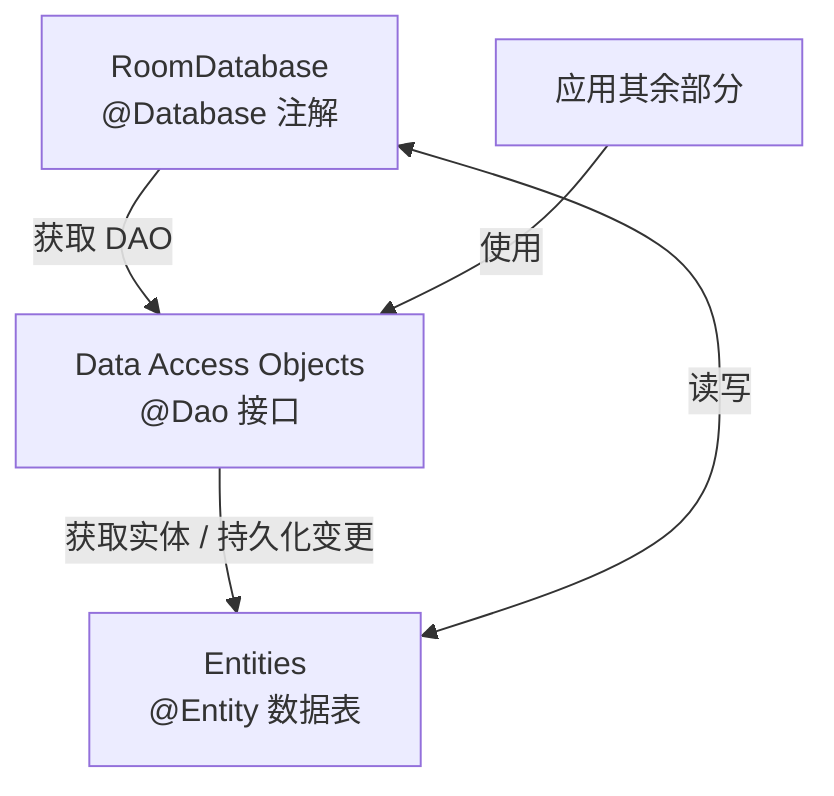

Jetpack 组件库中有这样一个数据库工具：Room。它是 Google 提供的 ORM 库，在 SQLite 的基础上提供了一层抽象，让开发者既能使用 SQLite 的能力，又能获得更健壮的数据库访问机制。**Google 官方建议使用 Room 而非直接使用 SQLite**，主要原因是：

1. SQLite 没有针对原始 SQL 查询的编译期验证，SQL 写错要到运行时才会暴露；
2. 开发者需要编写大量样板代码，在 `Cursor` 和 Java/Kotlin 对象之间手工转换；
3. Room 与协程、Flow、Paging 集成得更好，异步查询和可观察查询不需要自己封装。

## 版本与依赖

当前 Room 稳定版是 **2.8.5**（2026-09），minSdk 23。Room 2.7 起要求 Kotlin 2.0+；从 2.7 开始，通过 KSP 处理时默认生成 Kotlin 代码而不是 Java 代码。

另外，Room 3.0 已经发布稳定版（最新 3.0.3，2026-09-09），坐标改为 `androidx.room3:room3-*`，整体 API 与 2.x 有较大差异（Kotlin/KSP 路线更彻底）。已有 Android 项目继续用 2.8.x 即可，新项目或 KMP 项目再评估 Room 3，迁移前先看官方迁移指南。

### KSP，而不是 kapt

Room 的注解处理器以前常用 `kapt`，但 kapt 已进入维护模式，新项目应使用 **KSP**。Room 的 KSP 配置如下（模块级 `build.gradle.kts`）：

```kotlin
plugins {
    id("com.android.application")
    id("org.jetbrains.kotlin.android")
    id("com.google.devtools.ksp")   // 版本必须与 Kotlin 版本匹配
    id("androidx.room")             // Room Gradle 插件，推荐
}

room {
    schemaDirectory("$projectDir/schemas")
}

dependencies {
    val roomVersion = "2.8.5"

    implementation("androidx.room:room-runtime:$roomVersion")
    ksp("androidx.room:room-compiler:$roomVersion")

    // 可选：协程/Flow 扩展；官方依赖页仍列为可选
    implementation("androidx.room:room-ktx:$roomVersion")

    // 可选：Paging 3 集成（见后文分页一节）
    implementation("androidx.room:room-paging:$roomVersion")

    // 可选：迁移测试（MigrationTestHelper 需要仪器化测试）
    androidTestImplementation("androidx.room:room-testing:$roomVersion")
}
```

`schemaDirectory` 用于导出数据库 schema JSON。这些 JSON 要提交到版本库，自动迁移和迁移测试都依赖它们。如果不用 Room Gradle 插件，也可以改用 KSP 参数：

```kotlin
ksp {
    arg("room.schemaLocation", "$projectDir/schemas")
}
```

## Dao、Entity以及Database

Room 提供三大核心组件：

- **Database**：用 `@Database` 注解一个继承 `RoomDatabase` 的抽象类，负责创建数据库、持有 DAO。
- **Entity**：用 `@Entity` 注解实体类，`@Database` 通过 `entities` 属性引用它，Room 按字段创建表和列。
- **Dao**：用 `@Dao` 注解接口或抽象类，提供访问数据库的方法。

它们的关系如下图所示：



### Entity

Entity 对应数据库中的表。一个典型的 Entity 如下：

```kotlin
@Entity(
    tableName = "users",
    indices = [Index(value = ["email"], unique = true)]
)
data class User(
    @PrimaryKey(autoGenerate = true) val id: Long = 0,
    @ColumnInfo(name = "display_name") val displayName: String,
    val email: String,
    @Ignore val avatarUrl: String? = null
)
```

几个要点：

- `@PrimaryKey(autoGenerate = true)` 只适用于整数类型（`Long` / `Int`）。插入时把主键设为 `0`，Room 会把它当作“未赋值”并自动生成。
- 列名默认取属性名，需要改名时用 `@ColumnInfo(name = "...")`。
- 不参与持久化的字段加 `@Ignore`；`@Ignore` 字段需要有默认值或可空，否则 Room 无法构造实例。
- Kotlin 的 `val` 属性完全可用，不需要为每一列手写 `get`/`set`。Room 通过构造函数和字段访问属性，`data class` 是最省事的写法。
- 复合主键用 `@Entity(primaryKeys = ["firstName", "lastName"])`，此时不要再标 `@PrimaryKey`。
- 唯一索引、普通索引用 `indices = [Index(...)]`；外键列必须建索引，否则 Room 会给出警告。

### Dao

Dao 的全称是 Data Access Object（数据访问对象），专门提供访问数据库的方法。数据库的 CRUD 最终都通过 Dao 完成：

```kotlin
@Dao
interface UserDao {
    @Query("SELECT * FROM users ORDER BY display_name")
    fun observeAll(): Flow<List<User>>

    @Query("SELECT * FROM users WHERE id = :id")
    suspend fun findById(id: Long): User?

    @Insert(onConflict = OnConflictStrategy.REPLACE)
    suspend fun insert(user: User): Long

    @Upsert
    suspend fun upsert(user: User)

    @Delete
    suspend fun delete(user: User)
}
```

说明：

- `@Insert` 返回新行的 rowId（`Long`）；`@Update` 返回受影响行数；`@Delete` 也是受影响行数。
- `@Upsert` 在 Room 2.5+ 可用，先尝试插入，主键冲突时改为更新，比 `REPLACE` 更符合“有则更新、无则插入”的语义。
- 一次性查询用 `suspend`；需要持续观察数据变化时返回 `Flow<List<T>>`（也可以返回 `LiveData`，但新代码更推荐 Flow）。
- `@Query` 里用 `:参数名` 绑定方法参数，例如 `LIMIT :limit`。
- Dao 可以是接口，也可以是抽象类。需要把多个操作组合成一个事务时，用抽象类加 `@Transaction`：

```kotlin
@Dao
abstract class UserDao {
    @Query("SELECT * FROM users")
    abstract suspend fun findAll(): List<User>

    @Insert
    abstract suspend fun insertAll(users: List<User>)

    @Query("DELETE FROM users")
    abstract suspend fun deleteAll()

    @Transaction
    open suspend fun replaceAll(users: List<User>) {
        deleteAll()
        insertAll(users)
    }
}
```

`@Transaction` 保证 `deleteAll()` 和 `insertAll()` 要么全部成功，要么全部回滚；没有它，其他协程可能读到“已删除但还没插入”的中间状态。

> 注意：Dao 的抽象方法不需要写函数体，具体实现由 Room 在编译期生成。开发者仍然需要掌握基本的 SQL。

### Database

Database 的创建方式如下：

```kotlin
@Database(
    entities = [User::class, Pet::class],
    version = 2,
    exportSchema = true,
    autoMigrations = [AutoMigration(from = 1, to = 2)]
)
abstract class AppDatabase : RoomDatabase() {
    abstract fun userDao(): UserDao
    abstract fun petDao(): PetDao

    companion object {
        @Volatile
        private var instance: AppDatabase? = null

        fun get(context: Context): AppDatabase =
            instance ?: synchronized(this) {
                instance ?: Room.databaseBuilder(
                    context.applicationContext,
                    AppDatabase::class.java,
                    "app.db"
                )
                    .build()
                    .also { instance = it }
            }
    }
}
```

几个容易写错的地方：

- Database 类必须是 `abstract` 并继承 `RoomDatabase`。
- **每个 Dao 对应一个抽象 getter，getter 不能是 `suspend`，也不能带参数**。`suspend fun userDao(): UserDao` 是编译错误，因为 Room 需要在初始化阶段就拿到 Dao 实现。
- Dao 的数量与 Entity 的数量没有一一对应关系。一个 Dao 可以操作多张表，多个 Dao 也可以操作同一张 Entity；按业务边界划分即可。
- `exportSchema = true` 时要把 `schemas/` 目录提交到版本库，否则自动迁移和迁移测试没有依据。
- `allowMainThreadQueries()` 只适用于测试或临时脚本；正式代码里主线程查询会被 Room 直接抛异常，这是有意设计的保护。

多进程访问同一个数据库时，还需要在两端都调用 `enableMultiInstanceInvalidation()`，否则一个进程的修改不会通知另一个进程的 `Flow`。

## 关系与类型转换

### 一对多：@Embedded 与 @Relation

```kotlin
data class UserWithPets(
    @Embedded val user: User,
    @Relation(
        parentColumn = "id",
        entityColumn = "owner_id"
    )
    val pets: List<Pet>
)
```

`@Relation` 的查询需要 `@Transaction` 包一层，保证主表和子表读到的是一致快照：

```kotlin
@Transaction
@Query("SELECT * FROM users WHERE id = :id")
suspend fun findUserWithPets(id: Long): UserWithPets?
```

### 外键

```kotlin
@Entity(
    foreignKeys = [
        ForeignKey(
            entity = User::class,
            parentColumns = ["id"],
            childColumns = ["owner_id"],
            onDelete = ForeignKey.CASCADE
        )
    ],
    indices = [Index("owner_id")]
)
data class Pet(
    @PrimaryKey(autoGenerate = true) val id: Long = 0,
    @ColumnInfo(name = "owner_id") val ownerId: Long
)
```

外键默认不建索引，子表按 `owner_id` 查询或删除父行时会全表扫描，所以外键列要显式加 `@Index`。

### 类型转换：@TypeConverters

Room 只认识 SQLite 的基础类型。`Date`、枚举、`List` 等类型需要转换器：

```kotlin
class Converters {
    @TypeConverter
    fun fromTimestamp(value: Long?): Date? = value?.let(::Date)

    @TypeConverter
    fun dateToTimestamp(date: Date?): Long? = date?.time
}
```

在 Database 上注册：

```kotlin
@Database(entities = [User::class], version = 1)
@TypeConverters(Converters::class)
abstract class AppDatabase : RoomDatabase()
```

枚举通常转成 `name` 或 `ordinal`（更推荐 `name`，`ordinal` 在枚举顺序变化时会错位）；列表可以序列化成 JSON 字符串，但要接受“无法用 SQL 直接查询列表内部元素”的代价。

## 线程与事务

Room 默认禁止主线程查询。`suspend` 查询由 Room 的查询执行器调度，`Flow` 查询在收集时异步执行，都不会阻塞主线程。

多个写操作需要原子性时，除了在 Dao 里用 `@Transaction`，也可以在 Repository 层用 `RoomDatabase.withTransaction { ... }`（`room-ktx` 提供）。无论用哪种方式，都不要把长耗时逻辑塞进事务里——事务期间会持有数据库连接，拖长事务会放大锁竞争。

## 数据库版本迁移

当存储数据的表结构发生变化时，就需要进行数据库版本迁移。如果修改了 Entity 结构却不提升版本号、也不提供迁移，应用在已有旧数据库的设备上启动时就会抛 `IllegalStateException`。

### Schema 导出

`exportSchema = true` 时，Room 会把每个版本的 schema 导出到 `schemas/<数据库类全限定名>/<版本>.json`（例如 `schemas/com.example.AppDatabase/1.json`）。这些 JSON 要提交到版本库，用途有两个：

1. 自动迁移需要对比相邻版本的 schema；
2. `MigrationTestHelper` 用它们验证迁移结果。

### 手动迁移

提升 `version`，并提供从旧版本到新版本的 `Migration`：

```kotlin
val MIGRATION_2_3 = object : Migration(2, 3) {
    override fun migrate(db: SupportSQLiteDatabase) {
        db.execSQL("ALTER TABLE users ADD COLUMN nickname TEXT")
    }
}
```

在构造数据库时注册：

```kotlin
Room.databaseBuilder(context.applicationContext, AppDatabase::class.java, "app.db")
    .addMigrations(MIGRATION_2_3)
    .build()
```

同时把 `@Database(version = 3)` 改好。迁移里的 SQL 必须和 Entity 的新结构严格一致，否则 Room 在启动校验时会抛 `IllegalStateException`（schema 不匹配）。

### 自动迁移

如果只是加列、删列、改表名、改列名这类结构化变更，可以让 Room 生成迁移：

```kotlin
@Database(
    entities = [User::class],
    version = 3,
    autoMigrations = [AutoMigration(from = 2, to = 3)]
)
abstract class AppDatabase : RoomDatabase()
```

改列名需要告诉 Room 旧列名是什么，否则它会认为是“删一列、加一列”，数据会丢：

```kotlin
@RenameColumn(
    tableName = "users",
    fromColumnName = "name",
    toColumnName = "display_name"
)
class RenameDisplayName : AutoMigrationSpec

@Database(
    entities = [User::class],
    version = 3,
    autoMigrations = [
        AutoMigration(from = 2, to = 3, spec = RenameDisplayName::class)
    ]
)
abstract class AppDatabase : RoomDatabase()
```

自动迁移仍然依赖新旧两个版本的 schema JSON，所以 `exportSchema` 不能关。

### 破坏性迁移

如果确实不打算保留数据，可以让 Room 在找不到迁移时直接重建数据库：

```kotlin
Room.databaseBuilder(context.applicationContext, AppDatabase::class.java, "app.db")
    .fallbackToDestructiveMigration(dropAllTables = true)
    .build()
```

Room 2.7 起，无参的 `fallbackToDestructiveMigration()` 已废弃，应改用带 `dropAllTables` 的重载，官方建议传 `true`，否则表名或表是否存在发生变化时可能残留废弃数据。只想对特定旧版本放开破坏性迁移，用：

```kotlin
.fallbackToDestructiveMigrationFrom(true, 1, 2) // 第一个参数是 dropAllTables
```

这些 API 都会清空数据，只适合开发期或明确可丢弃的缓存库。

另一种“开发期办法”是卸载旧应用再安装新应用。卸载会删除 `/data/data/<包名>/databases/`，新安装会直接按新版本建库，迁移根本不会执行——这不是迁移方案，只是绕过了问题。

### 删除列

SQLite 3.35+ 支持 `ALTER TABLE ... DROP COLUMN`，但 Android 各版本内置的 SQLite 版本不同，不能假定所有设备都支持。可移植的做法仍然是重建表：

1. `CREATE TABLE` 创建一张删掉目标列后的新表；
2. `INSERT INTO ... SELECT ...` 把保留列的数据复制过去；
3. `DROP TABLE` 删除原表；
4. `ALTER TABLE ... RENAME TO ...` 把新表改成原表名。

自动迁移在遇到删列时，通常也是走这套重建流程，以兼容旧版 SQLite。

### 迁移测试

`room-testing` 提供 `MigrationTestHelper`：先按旧版本 schema 建库、插入数据，再执行迁移，最后用新版本 schema 校验表结构和数据。每个跨版本路径都应至少有一个测试，尤其是涉及删列、改列名、外键变更的迁移。

## Repository

Repository 不是 Jetpack 的组件，而是一种架构惯例：它负责访问多个数据源（数据库、网络、缓存），对外提供整洁的 API，并屏蔽数据来源的差异。

```kotlin
class UserRepository(private val dao: UserDao) {
    fun observeUsers(): Flow<List<User>> = dao.observeAll()

    suspend fun add(user: User): Long = dao.insert(user)
}
```

Repository 通常和 ViewModel 配合：Repository 提供业务级 API，ViewModel 调用它并把结果转成 UI 状态，UI 只依赖 ViewModel。

## 数据库的分页显示：Paging 3

Paging 用于按需分批加载数据。一次性把所有数据读进内存，会浪费流量、内存和电量，也会拉长首屏时间。

需要特别注意的是：`PagedList`、`PagedListAdapter`、`LivePagedListBuilder`、`DataSource.Factory` 属于 **Paging 2**，已经停止演进；Paging 3 的 API 与之不兼容，改用 `PagingSource`、`Pager`、`PagingData` 和 `PagingDataAdapter`。当前 Paging 稳定版是 **3.5.3**。

### 依赖

```kotlin
dependencies {
    val pagingVersion = "3.5.3"

    implementation("androidx.paging:paging-runtime:$pagingVersion")
    implementation("androidx.room:room-paging:2.8.5")

    // 可选：Compose 的 collectAsLazyPagingItems()
    implementation("androidx.paging:paging-compose:$pagingVersion")
}
```

### Dao 返回 PagingSource

```kotlin
@Query("SELECT * FROM users ORDER BY display_name")
fun pagingSource(): PagingSource<Int, User>
```

Room 会为这个查询生成 `LimitOffsetPagingSource`，按页读取数据库，不需要手写 `DataSource`。

### Repository 创建 Pager

```kotlin
fun users(): Flow<PagingData<User>> = Pager(
    config = PagingConfig(
        pageSize = 20,
        enablePlaceholders = false
    ),
    pagingSourceFactory = { userDao.pagingSource() }
).flow
```

`PagingConfig` 还可以设置 `prefetchDistance`、`initialLoadSize`、`maxSize`。`enablePlaceholders = false` 时，未加载的位置不会显示占位符，`itemCount` 只包含已加载的项，适合大多数 Room 列表。

### ViewModel 缓存

```kotlin
val users: Flow<PagingData<User>> = repository.users().cachedIn(viewModelScope)
```

`cachedIn` 让已加载的页在配置变更（如旋转屏幕）后复用，避免重新从数据库读取。

### Adapter

```kotlin
class UserAdapter : PagingDataAdapter<User, UserAdapter.ViewHolder>(DiffCallback) {

    override fun onCreateViewHolder(parent: ViewGroup, viewType: Int): ViewHolder {
        val view = LayoutInflater.from(parent.context)
            .inflate(R.layout.item_user, parent, false)
        return ViewHolder(view)
    }

    override fun onBindViewHolder(holder: ViewHolder, position: Int) {
        val item = getItem(position) ?: return
        holder.bind(item)
    }

    class ViewHolder(view: View) : RecyclerView.ViewHolder(view) {
        fun bind(user: User) {
            // 绑定视图
        }
    }

    object DiffCallback : DiffUtil.ItemCallback<User>() {
        override fun areItemsTheSame(oldItem: User, newItem: User): Boolean =
            oldItem.id == newItem.id

        override fun areContentsTheSame(oldItem: User, newItem: User): Boolean =
            oldItem == newItem
    }
}
```

`PagingDataAdapter` 内部已经用 `DiffUtil` 做局部更新，不需要再调用 `notifyDataSetChanged()`。`getItem(position)` 在占位符位置可能返回 `null`，所以要先判空。

### 提交数据

```kotlin
lifecycleScope.launch {
    repeatOnLifecycle(Lifecycle.State.STARTED) {
        viewModel.users.collectLatest { pagingData ->
            adapter.submitData(pagingData)
        }
    }
}
```

`submitData(pagingData)` 会挂起，直到这份 `PagingData` 失效；因此要用 `collectLatest`，新的 `PagingData` 到来时取消上一次提交。`repeatOnLifecycle` 保证界面退到后台时停止收集。

### 加载状态

```kotlin
adapter.addLoadStateListener { state ->
    progressBar.isVisible = state.refresh is LoadState.Loading
    retryButton.isVisible = state.refresh is LoadState.Error
    emptyView.isVisible =
        state.refresh is LoadState.NotLoading && adapter.itemCount == 0
}
```

`LoadState` 分为 `refresh`、`prepend`、`append` 三类；加载失败时调用 `adapter.retry()` 重试当前失败的那一次请求。

也可以给列表加 header/footer：`adapter.withLoadStateFooter(footer)` 返回一个 `ConcatAdapter`，其中 `footer` 需要自己实现 `LoadStateAdapter`——在 `onBindViewHolder` 里根据 `LoadState` 显示加载中或重试按钮，点击重试时调用 `adapter.retry()`。`LoadStateAdapter` 只负责把加载状态接到列表尾部，不提供现成的布局。

### 网络 + 数据库：RemoteMediator

如果数据来自网络、同时要缓存到 Room，用 `RemoteMediator<Int, User>`：它负责按页请求网络并写入数据库，UI 始终只观察 Room 的 `PagingSource`，从而保证“数据库是唯一数据源”。`RemoteMediator` 的 `load()` 返回 `MediatorResult.Success(endOfPaginationReached)` 或 `MediatorResult.Error`，`Pager` 构造时同时传入它和 `pagingSourceFactory`。

Paging 3 的分页逻辑集中在 `PagingSource` / `RemoteMediator`，Adapter 只负责展示；这与 Paging 2 把 `DataSource`、`PagedList`、`LivePagedListBuilder` 分散在各层的写法有本质区别。
