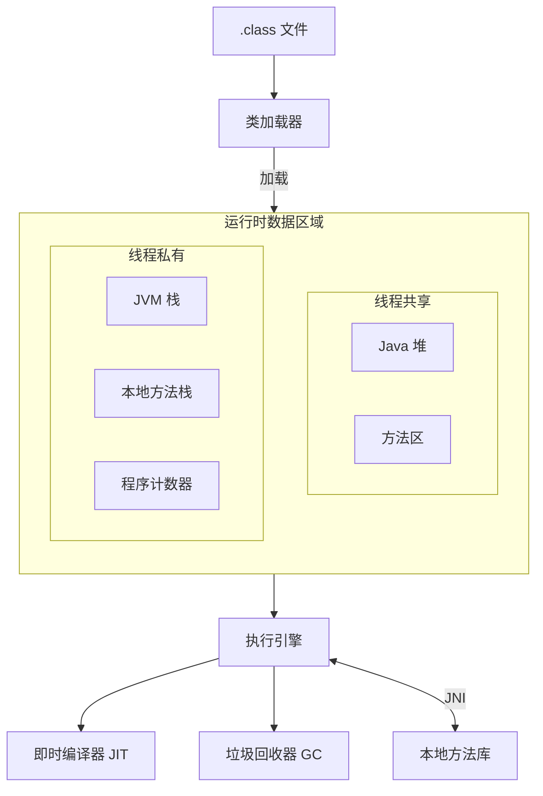
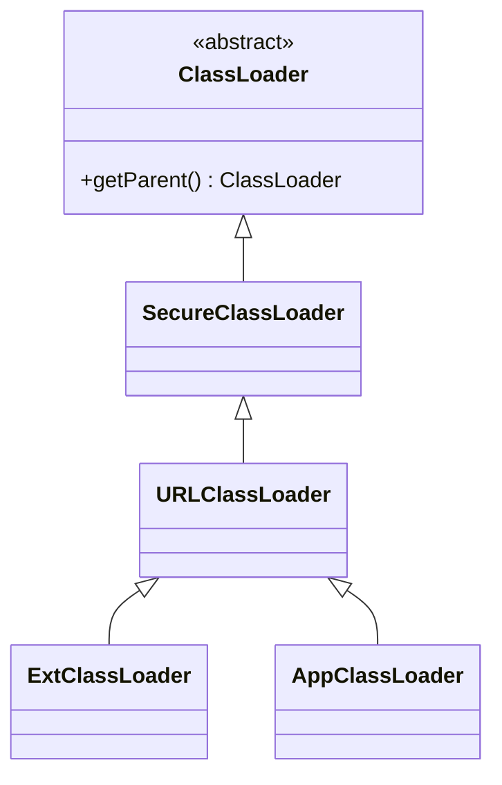
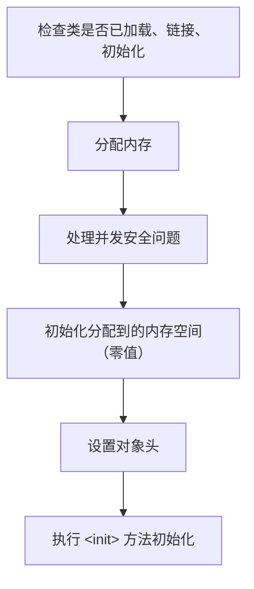
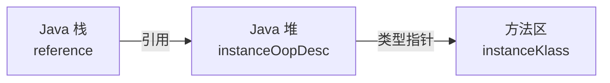

Java 的跨平台靠的是“中间语言 + 虚拟机”这条路线：源码先编译成与平台无关的字节码，再由各平台上的虚拟机翻译成机器码执行。C/C++ 走的是另一条——编译器直接为目标平台生成机器码，所以同一份源码要为每个平台各编一次。

## 跨平台原理

一门语言要实现跨平台，主流有两种做法：

- **编译器直出机器码**：针对每个平台各编一次，产物是本地可执行文件。C/C++ 属于这一类，性能最好，但分发时要为每个平台准备一份。
- **先编译成中间语言（Middle Language，ML），再由虚拟机在运行期翻译**：Java、C# 属于这一类。产物只有一份，代价是多了一层运行时。

Java 选的是后者。中间语言叫字节码，执行字节码的运行时叫 Java 虚拟机。

### Java虚拟机简介

Java 虚拟机（Java Virtual Machine，JVM）是解释执行字节码指令的运行时。它不是某一个具体实现，而是一个家族：HotSpot VM、OpenJ9（原 IBM J9）、Zing VM、GraalVM 等。日常讨论默认指 **HotSpot VM**——Oracle JDK 与 OpenJDK 用的都是它，所以“JVM 规范”与“HotSpot 的实现”经常被混着说，本笔记会尽量区分。

按 JVM 规范，抽象体系结构如下图：



蓝色部分是所有线程**共享**的区域，白色部分是线程**私有**的区域。

> 这张图描述的是规范层面的抽象模型，不是某个具体 JVM 的内存布局。HotSpot 的实际实现（尤其是方法区）换过好几代，见下文。

### 字节码简介

Java 的中间语言是字节码，它是一套运行在虚拟机上的指令集。软件指令集必须比硬件指令集更抽象，否则做不到跨平台。

字节码的载体是 `.class` 文件，一种与硬件、操作系统无关的二进制格式。Java、Kotlin、Groovy、Scala 编译后的最终产物都是它。每个操作码占 1 个字节，所以最多 256 个位置（实际定义约 200 个）。用十六进制编辑器打开 `.class`，开头一定是 `cafe babe` 这四个字节的魔数；IDE 会把它反汇编成接近源码的可读形式。

一个 `.class` 文件对应唯一一个类或接口的定义信息，但类不一定来自文件——类加载器也可以直接在内存里生成。

`.class` 文件的格式如下：

```text
ClassFile {
    u4             magic;                   // 魔数，固定为 0xCAFEBABE
    u2             minor_version;           // 副版本号
    u2             major_version;           // 主版本号
    u2             constant_pool_count;
    cp_info        constant_pool[...];      // 常量池
    u2             access_flags;            // 访问标志
    u2             this_class;              // 类索引
    u2             super_class;             // 父类索引
    u2             interfaces_count;
    u2             interfaces[...];         // 接口表
    u2             fields_count;
    field_info     fields[...];             // 字段表
    u2             methods_count;
    method_info    methods[...];            // 方法表
    u2             attributes_count;
    attribute_info attributes[...];         // 属性表
}
```

图中的 u4、u2 表示**无符号基本类型**，此外还有 u1 和 u8。`u` 表示无符号，后面的数字是字节长度。

Java 虚拟机与字节码指令集共同构成了 Java 跨平台的基石。Android 设备上跑的不是 JVM，应用也不产出 `.class`，但“中间产物 + 虚拟机”的思路完全一致——这也是理解 JVM 对 Android 开发仍有价值的原因。

## JVM工作原理

### 类加载器

#### 三代结构

类加载器的分层在 JDK 9 变过一次，这是很多旧资料的首要易错点：

| JDK | 引导层 | 中间层 | 应用层 |
| --- | --- | --- | --- |
| 8 及以前 | Bootstrap（C++ 实现） | Extension（`ExtClassLoader`） | Application（`AppClassLoader`） |
| 9 及以后 | Bootstrap（C++ 实现） | Platform（`PlatformClassLoader`） | Application（`AppClassLoader`） |

JDK 9 引入模块系统（JPMS）时一并做了三件事，导致老描述失效：

- `$JAVA_HOME/jre` 目录不再存在，核心类库收进 `lib/modules`（jimage 格式），不再是散装的 `rt.jar`；
- **Extensions ClassLoader 被 Platform ClassLoader 取代**，`java.ext.dir` 属性随之失效；
- **`-Xbootclasspath` 与 `-Xbootclasspath/p` 被移除**，只保留用于追加的 `-Xbootclasspath/a`。

三者职责：

1. **Bootstrap ClassLoader**：加载 JDK 自身的核心类（`java.lang.*` 等）。HotSpot 里由 C++ 实现，Java 代码拿不到它的引用，只能通过 `Class.getClassLoader()` 返回 `null` 反推“这个类由引导加载器加载”。
2. **Platform / Extension ClassLoader**：JDK 9 前加载 `jre/lib/ext` 与 `java.ext.dir` 下的扩展类；JDK 9 后加载平台模块（`java.sql`、`java.xml` 等）。
3. **Application ClassLoader**：也叫 System ClassLoader，加载 classpath 上的类，`ClassLoader.getSystemClassLoader()` 拿到的就是它。

#### 继承关系



上图是 **JDK 8 及以前**的继承关系：`ExtClassLoader` 与 `AppClassLoader` 都是 `Launcher` 的内部类，在 `Launcher` 初始化时创建。JDK 9 之后 `ExtClassLoader` 被 `PlatformClassLoader` 取代，层次结构与委派方向不变。

#### 双亲委派

双亲委派（parent delegation）是类加载器查找类的默认策略，正确流程是**先向上委派、再逐层向下尝试**：

1. 收到加载请求，先检查该类是否已被当前加载器加载过，已加载直接返回；
2. 否则把请求**委派给父加载器**，逐层向上直到 Bootstrap；
3. 父加载器无法完成（自己的搜索范围里没有），才由子加载器尝试自己的路径；
4. 一路到底都找不到，抛 `ClassNotFoundException`。

好处有两点：避免同一个类被重复加载；避免自定义的同名类替换掉核心类（比如自己写一个 `java.lang.String` 是加载不进来的）。

> “双亲”是翻译带来的误解，原文 parents 指的是“上一层”，并不是说有一对父母加载器。

双亲委派并非铁律，有些场景必须打破它：JDBC 的 `DriverManager` 由 Bootstrap 加载，却要加载各厂商驱动（由 Application 加载），于是引入**线程上下文类加载器**（`Thread.currentThread().getContextClassLoader()`）。Tomcat 的 Web 应用隔离、OSGi 的模块隔离也都是自定义委派顺序的例子。

#### 加载、链接与初始化

类的完整生命周期是**加载 → 验证 → 准备 → 解析 → 初始化 → 使用 → 卸载**，其中"链接"包含验证、准备、解析三步。最容易混的是准备与初始化：

- **准备**：给静态变量分配内存并赋**类型默认零值**（`int` 是 0，引用是 `null`）；
- **初始化**：执行 `<clinit>()`，把代码里写的显式值赋给静态变量、执行静态代码块。

所以 `static int a = 1;` 实际是"准备阶段 a=0，初始化阶段 a=1"两步。掌握该时序，即可解释静态变量的初始化顺序。

只有**主动引用**才触发初始化：`new` 对象、读写静态字段（`final` 常量除外）、调用静态方法、反射（`Class.forName` 默认初始化）、初始化子类前先初始化父类、启动类。**被动引用不触发**：访问 `final` 常量（编译期已进常量池）、通过子类引用父类静态字段（只初始化父类）、定义数组 `A[] a = new A[10];`。

> Android 上同一套流程，但"验证与部分解析"在安装期由 `dex2oat` 提前完成，运行期再做懒解析；`<clinit>` 在首次主动使用时同步执行且有锁，启动阶段大量类初始化会拉长首屏——启动优化里慎用反射、延迟初始化静态资源，就是基于这个。

### 运行时数据区域

JVM 在执行 Java 程序时把自己管理的内存划分成几个区域，仅概括为“堆和栈”会遗漏多个关键区域：

| 区域 | 归属 | 可能抛出的异常 |
| --- | --- | --- |
| 程序计数器 | 线程私有 | 无 |
| JVM 栈 | 线程私有 | `StackOverflowError`、`OutOfMemoryError` |
| 本地方法栈 | 线程私有 | `StackOverflowError`、`OutOfMemoryError` |
| Java 堆 | 线程共享 | `OutOfMemoryError` |
| 方法区 | 线程共享 | `OutOfMemoryError` |
| 运行时常量池 | 逻辑上属于方法区 | `OutOfMemoryError` |

**程序计数器**（Program Counter Register）记录当前线程正在执行的字节码指令。多线程靠时间片轮转，线程切换后要能回到正确位置，所以每个线程各有一份。执行 Native 方法时它的值未定义（Undefined）；这是规范中唯一没有规定任何 `OutOfMemoryError` 的区域。

**JVM 栈**的生命周期与线程相同。每次调用 Java 方法就压入一个栈帧（局部变量表、操作数栈、动态链接、方法返回地址），方法结束就弹出。栈深度超过限制抛 `StackOverflowError`，栈无法申请到内存抛 `OutOfMemoryError`。

**本地方法栈**为 Native 方法服务。规范不强制要求单独划分，HotSpot 就直接把它和 JVM 栈合并了。

**Java 堆**存放对象实例，是 GC 的主战场。绝大多数对象在这里分配；JIT 的逃逸分析会把“只在方法内使用”的对象做标量替换，拆成字段直接放寄存器或栈上，此时连对象本身都不会创建。

**方法区**存的是已加载类的结构信息：运行时常量池、字段与方法信息、静态变量、指向类加载器的引用等。规范只规定它是一个逻辑区域，具体怎么实现交给虚拟机——HotSpot 换过两次实现，这也是“方法区是否位于堆内”这一问题答案会变化的原因：

| 版本 | 实现 | 位置 | 相关参数 |
| --- | --- | --- | --- |
| JDK 7 及以前 | 永久代（PermGen） | Java 堆内 | `-XX:MaxPermSize`（已移除） |
| JDK 8 及以后 | 元空间（Metaspace） | 本地内存（堆外） | `-XX:MaxMetaspaceSize` |

所以“方法区是堆的一部分”只在 JDK 7 及以前成立。JDK 8 把永久代替换为元空间之后，方法区搬到了本地内存，默认不设上限（受机器内存约束），这也是一批老服务升级 JDK 8 后 `OutOfMemoryError: PermGen space` 消失、却可能反过来吃光宿主机内存的原因。

**运行时常量池**是方法区的一部分，存放编译期生成的字面量与符号引用。需要区分的是：**字符串常量池**在 JDK 7 就从永久代挪到了 Java 堆，所以它不受 `MaxPermSize` / `MaxMetaspaceSize` 限制，而受堆大小限制。

### Java堆中的对象

#### 对象创建

创建对象时，JVM 的流程大致如下：



1. **检查类是否已加载**：在常量池中定位类的符号引用，确认该类已被加载、链接、初始化，否则先触发类加载。
2. **分配内存**：堆规整时用**指针碰撞**（指针向空闲一侧移动对象大小的距离）；堆不规整时用**空闲列表**（从可用块列表中找一块足够大的，再更新列表）。堆是否规整由所用收集器决定——带压缩的收集器（Serial、Parallel、G1 的 Evacuation）得到的是规整空间。
3. **处理并发**：两种办法，一是对分配动作加锁（CAS 重试），二是给每个线程预分配一块私有缓冲区 **TLAB**（Thread Local Allocation Buffer）。TLAB 上分配不需要同步，只有 TLAB 用完、申请新块时才需要。开关是 `-XX:+UseTLAB`（默认开启），大小可用 `-XX:TLABSize` 指定。
4. **初始化零值**：把分配到的内存清零（对象头除外），保证字段不写也有默认值。
5. **设置对象头**：写入类型指针、GC 分代年龄、锁状态等。
6. **执行构造方法**：调用 `<init>()`，按父类到子类的顺序初始化字段、执行构造体。到这一步对象才真正可用。

#### 对象的内存布局

HotSpot 中一个对象由三部分组成：

- **对象头（Header）**：Mark Word + 类型指针（Klass Pointer）。
- **实例数据（Instance Data）**：各字段的值，包含从父类继承的字段。
- **对齐填充（Padding）**：HotSpot 要求对象起始地址按 8 字节对齐，不足则补齐。

**Mark Word** 是复用程度最高的一块内存，同一块 64 位空间在不同状态下含义不同：无锁时存 identity hash code 与分代年龄，加锁后变成指向锁记录的指针或线程 ID。偏向锁在 **JDK 15 被移除**（JEP 374），因为它的撤销成本在现代应用里往往高于收益，所以现在的锁状态只剩“无锁 / 轻量级锁 / 重量级锁”。

对象头的开销不小：开启压缩指针（`-XX:+UseCompressedOops`，堆小于约 32 GB 时默认开启）时是 **12 字节**（8 字节 Mark Word + 4 字节压缩类型指针），堆更大时是 **16 字节**。对象多、普遍偏小的应用，仅对象头就能占掉 15%~25% 的堆。**紧凑对象头**（Compact Object Headers）把两者合并进 64 位，头降到 8 字节：JDK 24 作为实验特性引入（JEP 450），JDK 25 转为正式特性（JEP 519）但仍需 `-XX:+UseCompactObjectHeaders` 手动开启，JEP 534 计划在后续版本中改为默认。

#### 类型信息与 oop-klass 模型

对象头里的类型指针指向方法区（元空间）中该类的元数据。HotSpot 用 **oop-klass 模型**描述对象：oop（Ordinary Object Pointer）表示对象实例，klass 描述类的元数据。两者分离，是为使对象本身尽量小，同时让 vtable 之类的信息只存一份。

oop 家族与 klass 家族的定义（`oopsHierarchy.hpp`）大致如下：

```cpp
typedef class markOopDesc*     markOop;        // 对象头中的 Mark Word
typedef class oopDesc*         oop;            // 所有 oop 的父类
typedef class instanceOopDesc* instanceOop;    // Java 类实例
typedef class arrayOopDesc*    arrayOop;       // 数组对象

class Klass;                    // klass 家族父类
class InstanceKlass;            // Java 类的元数据
class InstanceMirrorKlass;      // java.lang.Class 实例
class InstanceRefKlass;         // java.lang.ref.Reference 子类
class ArrayKlass;               // 数组元数据
class ObjArrayKlass;            // 引用类型数组
class TypeArrayKlass;           // 基本类型数组
```

`klass.hpp` 中描述类元数据的关键字段：

```cpp
jint _layout_helper;            // 对象布局综合描述符
Symbol* _name;                  // 类名
oop _java_mirror;               // 对应的 java.lang.Class 实例
Klass* _super;                  // 父类
Klass* _subklass;               // 第一个子类
Klass* _next_sibling;           // 下一个兄弟类
jint _modifier_flags;           // 修饰符
AccessFlags _access_flags;      // 访问权限
```

访问对象字段时，JVM 从栈帧里的引用找到堆中的 `instanceOopDesc`，需要类型信息时再顺着类型指针找到方法区中的 `InstanceKlass`：



### 垃圾收集机制

GC 要解决两件事：内存怎么划分与分配、哪些对象可以回收。JVM 的分代结构本身就是为 GC 服务的。

#### Java引用类型

| 引用类型 | 回收时机 | 典型用途 |
| --- | --- | --- |
| 强引用 | 只要可达就绝不回收，宁可 OOM | `new` 出来的对象 |
| 软引用 | 内存不足时回收 | 内存敏感缓存（`SoftReference`） |
| 弱引用 | 下次 GC 必回收 | 规范化映射、避免内存泄漏（`WeakReference`、`WeakHashMap`） |
| 虚引用 | 随时可能被回收，回收时进队列收到通知 | 管理堆外内存（`PhantomReference` + `ReferenceQueue`） |

#### 可达性分析

主流 JVM 用**可达性分析**（根搜索）判断对象死活，而不是引用计数——引用计数解决不了循环引用。

从一组 **GC Roots** 出发向下遍历，能走到的对象标记为可达，走不到的就是垃圾。可以作为 GC Roots 的对象包括：

- 虚拟机栈（栈帧的局部变量表）中引用的对象；
- 本地方法栈中 JNI 引用的对象；
- 方法区中静态属性引用的对象；
- 方法区中常量引用的对象；
- 所有处于活动状态的线程；
- JVM 内部的引用，如基本类型对应的 `Class` 对象、常驻异常对象、系统类加载器；
- 被同步锁（`synchronized`）持有的对象。

> 被判定不可达的对象不会立刻消失：还要经历一次标记与筛选（`finalize()` 有机会自救，但这个方法在 JDK 9 已被废弃、JDK 18 起标记为待移除），真正回收要等到下一次 GC。

一个对象从创建到内存被重新分配，会依次经过以下几个阶段：


| 阶段 | 含义 |
| --- | --- |
| Created（创建） | 分配内存、零值初始化、执行构造方法 |
| In Use（应用） | 至少被一个强引用持有 |
| Invisible（不可见） | 程序已不再使用它，但引用还在（例如方法已返回、局部变量表里的槽位仍指向它） |
| Unreachable（不可达） | 从 GC Roots 出发已经走不到 |
| Collected（收集） | 被 GC 回收，内存进入空闲列表 |
| Finalized（终结） | 重写了 `finalize()` 且尚未执行，此时还可能“自救” |
| Deallocated（重新分配） | 内存被真正释放，等待分配给下一个对象 |

最容易混淆的是 **Invisible 与 Unreachable**：不可见只是"代码不再用它"，只要引用还在，可达性分析照样判它存活。把用完的大对象及时置为 `null`（或缩小作用域）能起作用的原理，是让对象从 Invisible 提前进入 Unreachable。

#### 三色标记与写屏障

可达性分析在并发收集器里的落地是**三色标记**，它把对象分三种颜色：**白**（未访问，标记结束仍是白即垃圾）、**灰**（已访问但引用字段没扫完）、**黑**（自身和引用都扫完了）。

并发标记期间应用线程仍在改引用，可能出现**漏标（对象消失）**：黑对象新增了对白对象的引用，同时白对象原本的灰引用被断开，导致存活对象被误回收。两条解法都靠**写屏障**（写引用字段时插入额外逻辑）：

- **增量更新**：记录"黑对象新增引用"，把目标重新标灰——CMS 的思路；
- **SATB（Snapshot At The Beginning）**：标记开始时对引用关系做快照，任何引用变化都记录旧值——G1 的思路。

#### 三种基础算法

1. **标记-清除（Mark-Sweep）**：先标记所有可回收对象，再逐个回收。实现简单，但效率低，且会产生大量不连续碎片。
2. **复制（Copying）**：把内存分成两块，只用其中一块；GC 时把存活对象复制到另一块，然后整块清空。没有碎片问题，代价是可用内存减半，且只适合存活对象少的区域（新生代正是这种特征）。
3. **标记-压缩（Mark-Compact）**：标记后把所有存活对象向一端移动，紧凑排列，再回收边界以外的内存。解决碎片问题，但移动对象要更新所有引用，停顿更长。

#### 分代收集

对象的生命周期分布极不均匀：绝大多数朝生夕死，少数长期存活。分代收集据此把堆划成不同区域，各自用最合适的算法。

HotSpot 的传统分代结构是**新生代**（Young）加**老年代**（Tenured），新生代再分为 Eden、From Survivor、To Survivor，默认比例 **8 : 1 : 1**（由 `-XX:SurvivorRatio=8` 控制）。

- 新生代回收叫 **Minor GC**：Eden 与 From Survivor 中的存活对象复制到 To Survivor，然后清空前两者，两个 Survivor 角色互换；
- 对象每熬过一次 Minor GC，分代年龄加一，超过 `-XX:MaxTenuringThreshold`（默认 15，因为 Mark Word 里只留了 4 位）就晋升老年代；To Survivor 放不下时也会提前晋升（分配担保）；
- 老年代回收叫 **Major GC / Full GC**，通常伴随至少一次 Minor GC，停顿明显更长。

需要说明的是，**G1 之后“连续的两块分代空间”就不再成立了**。G1 把堆切成大小相等的 Region（`-XX:G1HeapRegionSize`，1~32 MB 的 2 的幂），每个 Region 动态扮演 Eden、Survivor 或 Old，逻辑上仍是分代，物理上不再连续。ZGC 更是连分代都不要求连续。

#### 收集器现状

市面上的资料常把 CMS 当作“低延迟首选”，那是 JDK 8 时代的结论。当前的事实是：

| 收集器 | 定位 | 状态 |
| --- | --- | --- |
| Serial | 单线程，客户端/小堆 | 仍在，`-XX:+UseSerialGC` |
| Parallel | 多线程吞吐优先 | 仍在，JDK 8 的服务端默认，JDK 9 起让位给 G1 |
| CMS | 并发标记清除，低延迟 | **JDK 9 废弃（JEP 291）、JDK 14 移除（JEP 363）** |
| G1 | 分区、可预测停顿 | **JDK 9 起服务端默认**（JEP 248），JDK 7 时只是实验特性 |
| ZGC | 染色指针 + 读屏障，停顿与堆大小基本无关 | JDK 11 实验（JEP 333）、JDK 15 转正（JEP 377）、JDK 21 支持分代（JEP 439） |
| Shenandoah | 低延迟，OpenJDK 提供 | JDK 12 引入（JEP 189）、JDK 15 转正（JEP 379） |

选型上可以记一条粗线：吞吐优先选 Parallel，通用场景用 G1（默认），超大堆或对停顿极敏感选 ZGC。**不应再在新项目中使用 CMS**，它已经从 JDK 14 起不存在了。

### Java内存模型（JMM）

前面讲的是内存的物理划分，JMM 回答的是另一个问题：多线程下，一个线程的写对另一个线程何时可见、是否有序。它是并发编程的地基，`volatile`、`synchronized`、`final` 的语义都由它定义。

**三大特性**：原子性（操作不可中断）、可见性（修改能被其他线程看到）、有序性（执行顺序与源码一致）。三者相互独立——`volatile` 只保证可见性和有序性，**不保证原子性**（`count++` 的读-改-写三步，`volatile` 无法保证，需使用 `AtomicInteger`）。

**happens-before** 是 JMM 定义可见性的核心规则：程序次序（同线程内顺序执行）、锁规则（unlock 先于后续 lock）、volatile 规则（写先于后续读）、传递性。前一个操作 happens-before 后一个，前者的结果才对后者可见。

**volatile 的底层**是内存屏障：写后插入写屏障、读前插入读屏障，既阻止重排序，又强制把缓存刷回主存（对应 CPU 的缓存一致性协议如 MESI）。经典应用是双重检查锁单例——`instance` 必须加 `volatile`，否则 `new` 的"分配内存、初始化、赋值"三步可能被重排成"先赋值后初始化"，别的线程会读到半初始化对象。

> Android 上 ART 遵循同一套 JMM 语义：Handler 跨线程通信的可见性、`final` 字段的安全发布、并发容器的实现，底层都落在这些规则上。

## 附录：JVM启动参数

`java -jar app.jar` 可正常运行，但运行质量未必最优。启动参数就是用来干预内存划分、编译策略与 GC 行为的。

按调用方式分三类：标准参数（`-`）、非标准参数（`-X`）、非稳定参数（`-XX`）。下述表格以 **JDK 8** 为基线，随后单列 JDK 9 之后的变化——这是旧资料最易产生误导之处。

### 标准参数

所有 JVM 都必须实现且向后兼容，`java -help` 可以列出。

| 参数 | 用途 | 备注 |
| --- | --- | --- |
| `-help` | 显示标准参数 | |
| `-version` | 显示版本信息 | |
| `-jar` | 执行 jar | jar 的 `META-INF/MANIFEST.MF` 必须声明 `Main-Class` |
| `-server` | 使用 Server 模式 | 启动慢、运行期性能好；64 位 JDK 默认且只能用这个模式 |
| `-client` | 使用 Client 模式 | 32 位时代的产物，64 位 JDK 上会被忽略 |
| `-D<name>=<value>` | 设置系统属性 | 代码里用 `System.getProperty()` 读取；值含空格要加引号 |
| `-cp` / `-classpath` | 设置类搜索路径 | 一旦指定就不再读 `CLASSPATH` 环境变量；分隔符随平台（Windows 是 `;`，类 Unix 是 `:`） |
| `-Xbootclasspath/a:<path>` | 追加引导类路径 | JDK 9 起只剩 `/a` 这一种形式 |

### 非标准参数

不保证所有 JVM 都实现、也不保证向后兼容，`java -X` 可以列出当前实现支持的部分。

| 参数 | 用途 | 备注 |
| --- | --- | --- |
| `-Xint` | 纯解释执行 | 关掉 JIT，通常慢一个数量级，只用于排查 |
| `-Xcomp` | 纯编译执行 | 首次调用就编译，启动慢、峰值性能未必更好 |
| `-Xmixed` | 解释 + 编译混合 | **默认模式** |
| `-Xms<size>` | 堆初始大小 | JDK 8 默认是物理内存的 1/64（最小 1 MB） |
| `-Xmx<size>` | 堆最大大小 | 默认是物理内存的 1/4；生产上通常与 `-Xms` 设为相同值 |
| `-Xmn<size>` | 新生代大小 | 等价于同时设 `NewSize` 与 `MaxNewSize`；**G1 下不建议用**，改用 `G1NewSizePercent` / `MaxGCPauseMillis` |
| `-Xss<size>` | 单线程栈大小 | 平台相关，64 位 Linux 默认约 1 MB；递归深的方法要调大 |
| `-Xbatch` | 关闭后台编译 | 编译在前台完成，会拖慢启动，用于定位编译相关问题时才开 |

`-Xms` 与 `-Xmx` 分别对应 `-XX:InitialHeapSize` 与 `-XX:MaxHeapSize`。

> 容器里不要用“物理内存的几分之几”来估算：JDK 10 起默认开启容器感知（`-XX:+UseContainerSupport`），堆按容器的 memory limit 计算；JDK 8u191 之后也回补了这个能力。更稳的写法是 `-XX:MaxRAMPercentage=75.0`。

### 非稳定参数

各 JVM 实现不同、随时可能被取消，形式为 `-XX:[+-]<name>`（开关）或 `-XX:<name>=<value>`（赋值）。

#### 内存相关

| 参数 | 用途 | 备注 |
| --- | --- | --- |
| `-XX:NewSize` / `-XX:MaxNewSize` | 新生代初始 / 最大 | 一般用 `-Xmn` 代替 |
| `-XX:NewRatio` | 老年代与新生代的比值 | 默认 2，即老年代占 2/3 |
| `-XX:SurvivorRatio` | Eden 与单个 Survivor 的比值 | 默认 8，即 8:1:1 |
| `-XX:MaxTenuringThreshold` | 晋升老年代的年龄阈值 | 默认 15，上限也是 15 |
| `-XX:TargetSurvivorRatio` | Survivor 的目标使用率 | 默认 50，超过就提前晋升 |
| `-XX:MetaspaceSize` | 元空间首次扩容的高水位 | 不是初始大小，默认约 21 MB |
| `-XX:MaxMetaspaceSize` | 元空间上限 | **默认不设上限**，建议显式设置以防吃光机器内存 |
| `-XX:+AlwaysPreTouch` | 启动时预触碰堆内存 | 启动变慢，运行期少缺页中断；容器里慎用 |
| `-XX:+UseLargePages` | 启用大页 | 需要 OS 支持，堆很小或局部性极好时收益不明显 |

#### GC 相关

| 参数 | 用途 | 备注 |
| --- | --- | --- |
| `-XX:+UseSerialGC` | 串行收集器 | 单核或小堆（几百 MB 以内） |
| `-XX:+UseParallelGC` | 并行收集器 | 吞吐优先；JDK 8 起老年代也并行，`UseParallelOldGC` 因此基本冗余 |
| `-XX:ParallelGCThreads` | 并行 GC 线程数 | 默认与 CPU 核数相关，核数 > 8 时按 `3 + (5 × CPU) / 8` 计算 |
| `-XX:+UseG1GC` | G1 收集器 | JDK 9 起已是默认，显式写只是表明意图 |
| `-XX:MaxGCPauseMillis` | 期望的最大停顿 | G1 默认 **200 ms**；设得过小会让收集器疲于追赶 |
| `-XX:InitiatingHeapOccupancyPercent` | 触发并发标记的堆占用比 | 默认 45；JDK 8b12 之前语义是“已用/总量” |
| `-XX:G1NewSizePercent` / `-XX:G1MaxNewSizePercent` | 新生代占比下限 / 上限 | 默认 5 / 60 |
| `-XX:G1HeapRegionSize` | Region 大小 | 1~32 MB，必须是 2 的幂 |
| `-XX:G1ReservePercent` | 预留空间比例 | 默认 10，用于分配担保 |
| `-XX:G1MixedGCLiveThresholdPercent` | 入选 Mixed GC 的 Region 存活率上限 | 默认 85 |
| `-XX:+UseZGC` | ZGC | JDK 11 需加 `-XX:+UnlockExperimentalVMOptions`；JDK 15 起直接可用 |
| `-XX:+UseShenandoahGC` | Shenandoah | 需使用包含该收集器的 OpenJDK 构建 |
| `-XX:+ParallelRefProcEnabled` | 并行处理引用对象 | 弱引用/软引用多时有效 |

#### 调试相关

| 参数 | 用途 | 备注 |
| --- | --- | --- |
| `-XX:HeapDumpPath=<path>` | 指定堆转储文件路径 | |
| `-XX:+HeapDumpOnOutOfMemoryError` | OOM 时自动 dump | 生产环境建议常开 |
| `-XX:+TraceClassLoading` | 跟踪类加载 | JDK 9 起建议改用 `-Xlog:class+load` |
| `-XX:+TraceClassUnloading` | 跟踪类卸载 | 同上，`-Xlog:class+unload` |
| `-Xlog:gc*` | 打印 GC 日志（JDK 9+） | 取代了 `PrintGC` 系列 |

### JDK 9 之后的变化

这是附录里最需要更新的一段——很多“JVM 调优速查表”仍停留在 JDK 8：

| 老的写法 | 现状 | 替代 |
| --- | --- | --- |
| `-XX:MaxPermSize` | JDK 8 已移除（永久代没了） | `-XX:MaxMetaspaceSize` |
| `-XX:+PrintGC` / `PrintGCDetails` / `PrintGCTimeStamps` | JDK 9 起移除 | `-Xlog:gc*`（统一日志框架，JEP 158） |
| `-Xbootclasspath` / `-Xbootclasspath/p` | JDK 9 起移除 | 模块系统，或 `-Xbootclasspath/a` |
| `-d64` | JDK 9 起移除 | 64 位是唯一选择 |
| `-XX:+UseConcMarkSweepGC` | JDK 14 起移除 | G1 / ZGC |
| `-XX:+AggressiveOpts` | JDK 11 起移除 | 无需替代 |

统一日志的常用写法：

```bash
# GC 全量日志，带时间戳与 CPU 占用，输出到文件并轮转
java -Xlog:gc*,gc+heap=debug:file=gc.log:time,uptime,level,tags:filecount=5,filesize=20m -jar app.jar

# 类加载
java -Xlog:class+load=info -jar app.jar

# 查看默认堆与默认收集器
java -XX:+PrintFlagsFinal -version | grep -E "MaxHeapSize|UseG1GC"
```

## 小结

- 跨平台靠“字节码 + 虚拟机”，`cafe babe` 是 `.class` 的魔数。
- 类加载器在 JDK 9 换过一代：Extension 没了，`jre` 目录没了，`-Xbootclasspath` 也没了。
- 方法区是规范概念，实现从永久代（堆内）换成了元空间（本地内存），“方法区在堆里”只对 JDK 8 以前成立。
- 对象头是 Mark Word + 类型指针，偏向锁已在 JDK 15 移除，紧凑对象头从 JDK 25 起可显式开启。
- 收集器已经换代：CMS 在 JDK 14 被移除，G1 是默认，ZGC 从 JDK 15 + 起可用、JDK 21 支持分代。
- 调优参数应先确认 JDK 版本，`PrintGC` 与 `MaxPermSize` 这类参数在新 JDK 上会直接报“Unrecognized VM option”。
