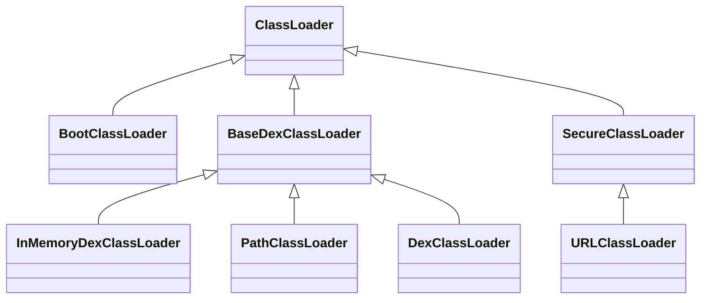
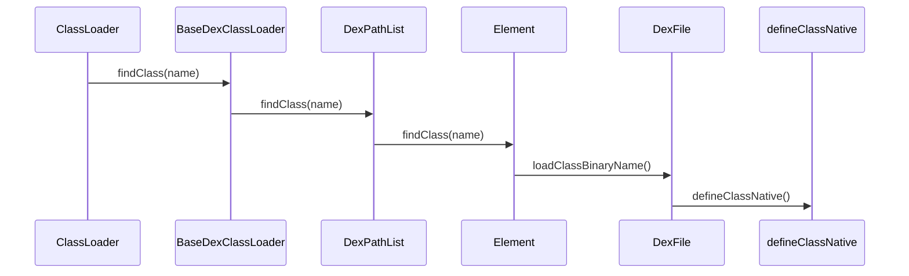

Android 应用也跑在虚拟机上，但不是 JVM。按时间线：

- **Dalvik（DVM）**：Android 1.0 到 4.4 的默认运行时，执行 `.dex` 字节码；
- **ART（Android Runtime）**：Android 4.4 作为开发者选项里的可选运行时引入，**Android 5.0 起成为默认**，从此 Dalvik 退出历史舞台。

Android 不直接用 JVM，原因不是“JVM 不好”，而是当年的权衡：早期设备的内存与 CPU 撑不起一个为服务端设计的通用虚拟机，必须针对移动端重做——基于寄存器而不是栈、可执行文件按 dex 重新组织、进程由 Zygote fork 出来共享预加载类。它借鉴了 JVM 的思路，但没有遵循 JVM 规范，所以 Android 上跑的是 APK，不是 jar。

## Dalvik 虚拟机

### 与 JVM 的差异

| 对比项 | DVM | JVM | 说明 |
| --- | --- | --- | --- |
| 指令架构 | 基于**寄存器** | 基于**栈** | 寄存器机器指令更少、解释更快，但指令更长 |
| 执行产物 | `.dex` | `.class` / `.jar` | dex 由多个 `.class` 合并转换而来；jar 只是 `.class` 的打包容器 |
| 虚拟机实例 | 每个应用进程一个 | 每个 Java 进程一个 | 都是一进程一 VM；差异见下文“共享机制” |
| 类共享 | 预加载类经 Zygote fork 后跨进程共享物理页 | 各进程各自加载一份 | 这是 Android 省内存的关键设计 |
| JIT | Android 2.2 引入 | 一直有 | JIT 把热点方法编译为机器码 |
| 64 位支持 | 无 | 有 | Dalvik 只存在于 32 位时代 |

“一进程一 VM”这点常被写反。真正的区别是 Android 的 **Zygote 模型**：Zygote 进程启动时预加载几千个常用类并初始化好 VM，之后每个应用进程都是 fork 出来的，直接继承这份已加载的类与堆，写入时才复制（copy-on-write）。JVM 没有这套机制，每个 Java 进程都要自己重新加载一遍。

### dex：从 class 到 dex

Java/Kotlin 源码先编译成 `.class`，再转换成 `.dex`。转换工具在历史上换过一次：

- 早期是 build-tools 里的 **DX**；
- **AGP 3.0 起由 D8 取代**（2018 年），现在 DX 已经从构建链里移除；
- 代码压缩混淆则由 **R8** 负责，它取代了 ProGuard，并且和 D8 共用同一套前端。

为什么要合并成一个 dex，而不是直接塞 jar？因为 jar 里每个 `.class` 都是独立的常量池与结构信息，加载时要逐个解析，冗余极大。dex 把所有类合到一个文件里，共享字符串常量池与类型索引，体积和加载开销都小得多——这对早期只有几百 MB 内存的设备是决定性的。

`.dex` 由 Android 的类加载器处理，经解释器（或 AOT/JIT 编译后的机器码）执行，最终仍落到 Linux 内核上。

### 64K 限制

单个 dex 文件的方法引用索引是 16 位，上限 **65,536**。超过就会在构建期报错：

```text
Cannot fit requested classes in a single dex file (# methods: 135672 > 65536)
```

注意这是 **dex 格式的限制，不是 Dalvik 的限制**——ART 同样执行 dex，所以同样的上限依然存在。这一点经常被误解成“换了 ART 就没有 64K 问题了”，实际并不是：

- `minSdk >= 21`：ART 原生支持多 dex，D8 会自动分包，运行时按顺序加载，**不需要** `MultiDex` 库；
- `minSdk < 21`：需要 `multiDexEnabled true` 并让 `MultiDexApplication`（或手动 `MultiDex.install()`）在启动时把附加 dex 装进类加载器。

即使如此，“单 dex 不超过 65536 个方法引用”这条规则始终成立，只是由构建工具拆分。真正减少方法数要靠 R8 的裁剪与依赖治理。

### 堆与 GC

DVM 的运行时堆由两个 Space 加若干辅助结构组成：

| 区域 | 说明 |
| --- | --- |
| Zygote Space | Zygote 启动时预加载创建的对象，**不参与 GC**，被 Zygote 与所有应用进程共享 |
| Allocation Space | 从 Zygote Space 中划出的空闲部分，之后所有对象都在这里分配与释放，**每个进程独立一份** |
| Card Table / Heap Bitmap / Mark Stack | GC 辅助结构：记录跨代引用、标记存活对象、维护待遍历集合 |

GC 算法是**标记-清除**，支持并发标记。日志格式（logcat tag 是 `dalvikvm`）：

```text
D/dalvikvm: GC_CONCURRENT freed 2048K, 20% free 10240K/12800K, paused 3ms+5ms, total 40ms
```

| 字段 | 含义 |
| --- | --- |
| GC 原因 | 见下表 |
| freed | 本次释放的内存量 |
| free / 总量 | 堆空闲比例与当前占用 |
| paused | 两次停顿（并发 GC 在开始与收尾各停一次） |
| total | 本次 GC 总耗时 |

常见 GC 原因：

| 原因 | 触发场景 |
| --- | --- |
| `GC_CONCURRENT` | 堆使用量上升时后台并发回收，不阻塞应用 |
| `GC_FOR_MALLOC` | 分配内存时堆已满，必须暂停应用回收 |
| `GC_HPROF_DUMP_HEAP` | 生成 HPROF 文件分析堆时触发 |
| `GC_EXPLICIT` | 显式调用 `System.gc()`，通常不建议 |
| `GC_EXTERNAL_ALLOC` | API 10 及以下的堆外内存分配（Bitmap 等） |

## ART 虚拟机

### 与 Dalvik 的差异

| 对比项 | ART | Dalvik |
| --- | --- | --- |
| 编译策略 | AOT + JIT + 配置文件引导 | 仅解释 + JIT |
| 64 位支持 | 支持（5.0 起） | 不支持 |
| 堆结构 | 多了 Image Space、Large Object Space 等 | Zygote Space + Allocation Space |
| 默认 GC | Concurrent Copying（Android 8 起） | 标记-清除 |
| 应用安装耗时 | 更长（要编译） | 较短 |

### 编译策略的演进

“ART 就是 AOT”是早期印象，实际上它一直在变，每次变化都是在“安装时间 / 存储占用 / 运行性能”三者之间重新找平衡：

| Android 版本 | 策略 | 后果 |
| --- | --- | --- |
| 5.0 – 6.0 | 安装时全量 AOT（`speed` 过滤器） | 运行快，但安装慢、`odex` 占空间大 |
| 7.0 – 8.1 | 引入 JIT + 配置文件，安装时只做校验或轻量编译 | 安装快，首次运行靠解释 + JIT 预热 |
| 8.0+ | 空闲时由 `bg-dexopt` 按 profile 做 AOT（`speed-profile`） | 常用路径逐渐编译成机器码，冷门代码不占空间 |
| 9.0+ | Play 安装时合并**云端 profile**，安装即按 `speed-profile` 编译 | 首启就能命中热点，但只对 Play 渠道生效 |

Baseline Profile 是另一条线：它让 APK 自带一份热点清单，不依赖用户先跑一遍。源码放 `src/main/baseline-prof.txt`，D8/R8 打包成 `assets/dexopt/baseline.prof`；设备端（需要 **Android 7.0+** 的 ART 支持）由 `androidx.profileinstaller` 在首次运行时把 profile 交给 ART，等设备空闲时由后台编译任务按 `speed-profile` 编译。旁加载（非 Play 渠道）的包不会在安装时编译，要等 `bg-dexopt` 跑过才有收益，这也是“我加了 profile 但首启还是慢”的常见原因。

### dex2oat 与编译过滤器

AOT 编译由设备上的 `dex2oat` 完成，编译多少由**编译器过滤器**（compiler filter）决定：

| 过滤器 | 行为 | 典型用途 |
| --- | --- | --- |
| `verify` | 只校验字节码，不生成机器码 | 无 profile 的全新安装 |
| `quicken` | 轻量优化（常量池解析等），不生成机器码 | Android 12 起废弃 |
| `space` | 编译但优先压缩体积 | 存储紧张设备 |
| `speed` | 全量编译，性能最好、体积最大 | 系统应用、5.0–6.0 的安装编译 |
| `speed-profile` | 只编译 profile 里的方法，其余校验 | **现代 Android 的默认选择** |
| `everything` | 连类初始化器都编译 | 调试或特殊系统组件 |

排查“profile 到底有没有生效”用这两条命令：

```bash
# 看某个包的编译状态与过滤器
adb shell dumpsys package com.example.app | grep -E "compilation_filter|status"

# 手动按 speed-profile 重新编译（改完 profile 后验证用）
adb shell cmd package compile -f -m speed-profile com.example.app
```

如果 `status` 还是 `verify`，说明 profile 没被 ART 用上：可能是 `baseline.prof` 没打进 APK，也可能是设备没跑过空闲编译任务。

### 堆结构与 GC

ART 的堆在 Dalvik 基础上扩展出几个空间，下表是 5.x 时代的经典划分：

| 空间 | 用途 |
| --- | --- |
| Image Space | 预加载类的镜像，与 Zygote Space 一起被所有进程共享 |
| Zygote Space | Zygote 预加载创建的对象，不参与 GC |
| Main Space | 普通对象分配区，Android 8 起由 RegionSpace 承担，支持并发拷贝 |
| Large Object Space | 大对象（早期阈值 12 KB），单独管理，避免搬移 |
| Non-moving Space | 不允许移动的对象（类对象、dex 缓存等） |

配套的辅助结构（Mod Union Table、Card Table、Heap Bitmap、Object Map、Object Stack）会随 GC 实现变化，不必死记——Android 8 换成并发拷贝之后，读屏障与 RegionSpace 成了主角，5.x 的那套结构只适合用来理解历史版本。

**GC 方案在 Android 8 换代了**：

- **Android 5.0 – 7.x**：默认 CMS（Concurrent Mark Sweep），配合 sticky / partial 两种变体，用 RosAlloc 空闲链表分配；
- **Android 8.0 起**：默认改为 **Concurrent Copying（CC）**。它用 RegionTLAB 做 bump-pointer 分配（每个线程一个 TLAB，分配不加锁），靠**读屏障**在并发拷贝对象的同时整理堆，整个 GC 只有一次极短停顿，且停顿时间与堆大小基本无关；
- **Android 10 起**：CC 支持**分代**，优先回收朝生夕死的年轻对象，进一步减少全堆 GC；
- CMS 仍然保留（启动参数 `-Xgc:cms`，或 OEM 在构建时关掉读屏障），但新设备默认不用它。

> **三色标记与读屏障**：并发 GC 的统一抽象是三色标记（黑/灰/白），漏标要靠屏障解决（完整概念见《19》）。CMS/G1 用**写屏障**（增量更新 / SATB），ART 的 CC 换成了**读屏障**（Baker 算法）：并发搬移对象时，应用线程每读一个引用都要检查"对象是否已被搬走"，若已搬移就返回对象头里存的新地址（`kForwardingAddress` 转发地址）。代价是每次引用读取多一次判断，换来只有一次极短停顿、且停顿与堆大小基本无关。这也意味着 ART 8+ 的 GC 停顿主要看读屏障开销与一次 STW，而非堆大小——排查卡顿时优先怀疑业务自身。对象可被搬移还带来一个 JNI 细节：`GetPrimitiveArrayCritical` 会阻塞 GC 搬移、代价大，应谨慎使用。

日志示例（现代 ART，tag 是 `art`）：

```text
I/art: Background concurrent copying GC freed 12043(512KB) AllocSpace objects, 3(96KB) LOS objects, 42% free, 3MB/5MB, paused 180us total 20.5ms
```

字段含义：GC 原因、收集器名称、回收对象数与字节数（分 AllocSpace 与 LOS 两段）、堆空闲比例与占用量、停顿时间、总耗时。**日志格式随版本变化**，5.x 的模板与现在不同，排查时以实际输出为准。

常见 GC 原因（不同版本会新增，如 `Background`、`Startup`）：

| 原因 | 说明 |
| --- | --- |
| `Concurrent` | 后台并发 GC，不阻塞分配 |
| `Alloc` | 分配内存时堆不足，在分配线程内触发 |
| `NativeAlloc` | Native 内存压力触发（Bitmap、RenderScript 等） |
| `Explicit` | 显式调用 `System.gc()` |
| `CollectorTransition` | 切换收集器或进程状态变化引起 |
| `HomogeneousSpaceCompact` | 进程进入可察觉的暂停状态时做堆压缩 |
| `DisableMovingGc` | 并发压缩被 `GetPrimitiveArrayCritical` 阻塞 |
| `HeapTrim` | 堆裁剪，会阻塞 GC 直到完成 |

### synchronized 与锁实现

`synchronized` 代码块编译后是 `monitor-enter` / `monitor-exit` 两条指令，围绕对象头里的锁状态做文章。**ART 与 HotSpot 的锁模型不同，照搬 JVM 资料会出错。**

ART 的对象头比 HotSpot 更紧凑：由 `kclass_`（类指针）+ `monitor_`（一个 **32 位的 LockWord**）组成。LockWord 用 32 位编码多种状态（定义在 `art/runtime/mirror/object.h`）：

| 状态 | 含义 |
| --- | --- |
| `kUnlocked` | 无锁 |
| `kThinLocked` | 薄锁（对应轻量级锁），存线程 ID + 重入计数 |
| `kFatLocked` | 重量级锁，指向独立的 `Monitor` 对象 |
| `kHashCode` | 已计算哈希码，存 hash 值 |
| `kForwardingAddress` | 转发地址，Concurrent Copying GC 搬移对象时用 |

**关键区别：ART 没有偏向锁。** HotSpot 是"偏向锁 → 轻量级锁 → 重量级锁"三级（偏向锁已在 JDK 15 移除），ART 只有"薄锁 → 重量级锁"两档，从未实现偏向锁。

升级过程：获取锁先 CAS 把 LockWord 从 `kUnlocked` 改成 `kThinLocked`；重入时计数 +1，达到 `kThinLockMaxCount` 阈值升级重量级锁；竞争时先自旋（超过 `kExtraSpinIters` 后 `sched_yield` 让出 CPU），仍拿不到就升级。重量级锁分配一个 `Monitor` 对象，底层是 Linux 的 `futex`，挂起线程进入等待队列。`Object.wait()/notify()` 依赖 `Monitor`，`wait()` 前必须先持有锁。

工程意义：无竞争时薄锁接近 CAS 成本，膨胀成重量级锁就涉及内核态 futex 挂起/唤醒，代价陡增——**避免在锁内做耗时操作、缩小锁粒度**；死锁/ANR 排查时，理解"等待线程挂在 futex"能解释"主线程卡死但 CPU 不高"。

### 方法调用与分派

多态在 ART 里怎么落地，直接影响性能。

- **静态分派**：编译期确定目标，如方法重载、`invoke-static`、`invoke-direct`（构造器、私有方法）；
- **动态分派**：运行期按接收者实际类型决定，即多态，对应 `invoke-virtual`、`invoke-interface`。

查找结构：虚方法走**虚方法表（vtable）**，按方法索引直接取地址，开销很低；接口方法走**接口方法表（IMT，Interface Method Table）**，一个类可实现多接口、查找比 vtable 贵，IMT 冲突时走 `art_quick_imt_conflict_trampoline` 慢路径。所以接口调用的常量开销通常略高于虚方法调用。

虚调用真正的优化来自**内联缓存（Inline Cache, IC）**。ART 的 JIT（`Optimizing Compiler`）在解释和 baseline 编译阶段记录每个调用点实际命中的接收者类型：

| IC 状态 | 观察到的类型数 | 处理方式 |
| --- | --- | --- |
| Monomorphic（单态） | 1 种 | 直接内联目标方法 + 一次类型检查，最快 |
| Polymorphic（多态） | 2~4 种 | 生成类型判断级联，逐个分发 |
| Megamorphic（退化） | 过多 | 退回 vtable/itable 查表 |

单态 IC 让 `invoke-virtual` 接近直接调用——这正是"虚方法调用开销大"在现代 ART 上不成立的真正原因：被 IC 内联后它不再是查表调用。

工程意义：热路径上避免不必要的接口抽象、同一调用点不要"一接口多实现乱飞"（否则 IC 退化、内联失效）；小方法、少分支的代码更容易被内联（R8 优化、JIT 内联都吃这一套）。

## Android 类加载器

### 与 JVM 类加载器的关系

先纠正一个说法：Android 的类加载器**不是**和 JVM 完全无关的另一套东西——它们都继承自 `java.lang.ClassLoader`，都用双亲委派，`loadClass` / `findClass` 的骨架也一样。区别在于**加载什么**：

- JVM 的类加载器读 `.class`（jar、目录、模块）；
- Android 的类加载器读 `.dex` / `.oat`，最终都落到 `BaseDexClassLoader` 上。

Android 的类加载器分两类：系统提供的 `BootClassLoader`、`PathClassLoader`、`DexClassLoader`，以及开发者自定义的子类。

### BootClassLoader

`BootClassLoader` 负责预加载系统常用类。与 JVM 的 Bootstrap 不同，它**由 Java 实现**（`ClassLoader` 的内部类），并且是单例、包级私有，应用代码拿不到它的实例。

它在 Zygote 启动时创建，配合 `classForName()` 把系统镜像里的预加载类清单（`preloaded-classes`，各版本路径与生成方式不同）逐个加载。预加载得越充分，fork 出来的应用进程要单独做的事就越少——典型的以空间换时间。

### PathClassLoader

用于加载**已安装应用**的 dex，包括 APK 里的 `classes.dex` 及附加分包。它继承 `BaseDexClassLoader`，实际逻辑都在父类里。

应用进程的 `PathClassLoader` 由框架在进程启动时创建（`ApplicationLoaders`），父加载器是 `BootClassLoader`。它有两个构造方法，都**没有** `optimizedDirectory` 参数——dex 的优化产物由系统统一管理，应用无权指定目录。

### DexClassLoader

用于加载**未安装**的 dex/jar/apk，是插件化与热修复的基础。构造参数：

| 参数 | 说明 |
| --- | --- |
| `dexPath` | dex/jar/apk 路径集合，多个用文件分隔符（`:`）分隔 |
| `optimizedDirectory` | 解压出的 dex 存放目录（**API 26 起被忽略**） |
| `librarySearchPath` | 包含 so 的目录集合，可为 null |
| `parent` | 父加载器 |

**两个必须知道的现状**：

- `DexClassLoader` 从 **API 26 起被标记废弃**，官方建议改用 `PathClassLoader`（加载已安装 APK）或 `InMemoryDexClassLoader`（加载内存中的 dex）；
- `optimizedDirectory` 从 **API 26 起被忽略**，传什么都一样，dex 优化产物由 ART 自己管理。老教程里“把 odex 输出到应用私有目录以提升加载速度”的做法早已失效。

### InMemoryDexClassLoader 与 DelegateLastClassLoader

API 26 新增 `InMemoryDexClassLoader`，可以直接从 `ByteBuffer` 加载 dex，不落盘——加固、热修复、动态下发都用它：

```kotlin
val loader = InMemoryDexClassLoader(dexBuffer, parentClassLoader)
val clazz = loader.loadClass("com.example.Plugin")
```

API 27 新增 `DelegateLastClassLoader`，把委派顺序反过来：**先自己找，找不到再交给父加载器**。这对“插件里带的库版本比宿主新”的场景是必需的，`PathClassLoader` 的父优先策略在这种场景下会加载到宿主的旧版本。

### 继承关系与双亲委派



Android 的类加载同样遵循双亲委派：先委托父加载器，父加载器找不到才自己找。这个顺序保证了两件事——系统类不会被应用的同名类替换；同一个类不会被重复加载。



热修复与插件化正是围绕这套机制做文章：把补丁 dex 插到 `BaseDexClassLoader` 的 `pathList.dexElements` 最前面，让查找时先命中补丁类；或者用 `DelegateLastClassLoader` 改变委派顺序。前者在 Android 9 之后受隐藏 API 限制，需要借助官方或成熟的框架，不建议手写反射。

## 小结

- Dalvik 只活在 Android 4.4 及以前，ART 从 5.0 起是默认运行时；两者的分界不是“有没有 JIT”，而是 AOT 与 profile 引导的引入。
- 64K 是 **dex 格式**的限制，ART 一样受限；API 21+ 只是能自动多 dex，不是限制消失。
- dex 转换工具早已从 DX 换成 **D8**，裁剪混淆换成 **R8**。
- ART 的默认 GC 从 Android 8 起是 **Concurrent Copying**，Android 10 起分代；CMS 已不是默认。
- 首启性能的关键是 **Baseline Profile + speed-profile 编译**，而不是把整个应用 AOT 一遍。
- 类加载器都和 `java.lang.ClassLoader` 同源，但加载的是 dex；`DexClassLoader` 与 `optimizedDirectory` 在 API 26 已废弃，新代码用 `InMemoryDexClassLoader` / `DelegateLastClassLoader`。
