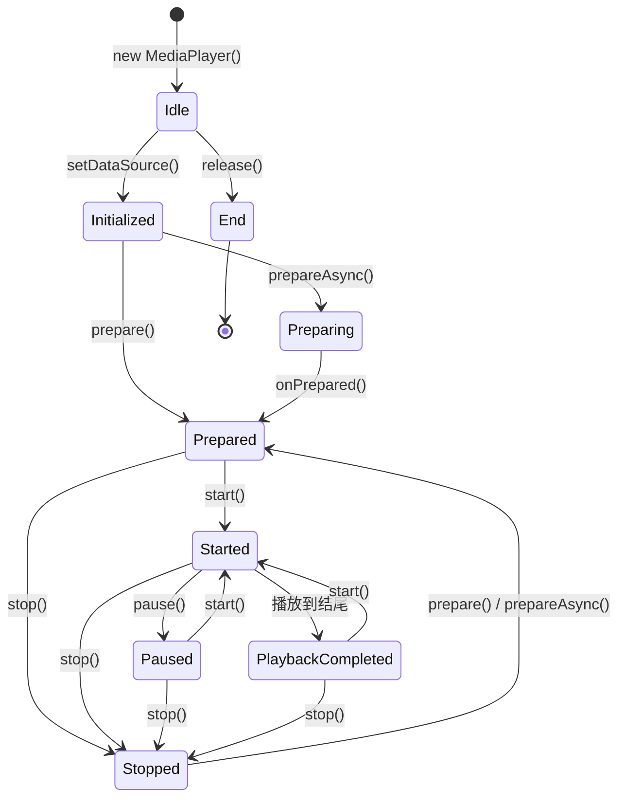

Android 多媒体框架支持播放各种常见媒体类型，以便开发者能轻松地将音频、视频和图片集成到应用中。本节内容主要介绍 Android 多媒体框架中基础的 API 使用，至于更深入的音视频开发，则在其他章节展开。

需要先说明的是，Android 传统的 `MediaPlayer` 虽然仍在系统框架中可用，但已基本停止演进，官方已明确将播放能力迁移到 [Jetpack Media3](https://developer.android.com/media/media3) 中的 `ExoPlayer`。因此本节以 `ExoPlayer` 为主线介绍常用 API，`MediaPlayer` 仅作基本了解。

## 为什么选择 ExoPlayer

在展开具体 API 之前，先明确选择 `ExoPlayer` 而不是 `MediaPlayer` 的理由，这有助于理解后续 API 设计的背景：

1. **协议与格式支持更广**：`MediaPlayer` 依赖系统底层实现，对不同设备、不同协议的兼容性参差不齐；`ExoPlayer` 直接支持 DASH、HLS、SmoothStreaming 等自适应流协议，且可通过扩展模块按需引入。
2. **可定制、可扩展**：`ExoPlayer` 将数据加载（`DataSource`）、媒体源（`MediaSource`）、渲染器（`Renderer`）、轨道选择（`TrackSelector`）等组件全部解耦，开发者可按需替换任意一环；`MediaPlayer` 则是高度封装的黑盒。
3. **行为一致**：`ExoPlayer` 屏蔽了设备与系统版本碎片化，使同一份代码在不同设备上表现一致。
4. **状态机简单**：`MediaPlayer` 有一张复杂的状态机，调用顺序稍有不当就会抛出 `IllegalStateException`；`ExoPlayer` 通过统一的 `Player` 接口与方法语义大幅降低了出错概率。
5. **持续维护**：`ExoPlayer` 现在是 Media3 的默认实现，由官方团队持续更新；独立的 `com.google.android.exoplayer2` 库已被停用。

在 Media3 中，`ExoPlayer` 是 `Player` 接口的默认实现。`Player` 定义了一套高层播放能力（播放、暂停、seek、查询播放状态等），`MediaSession` 与 `MediaController` 等组件同样实现了 `Player` 接口，因此它们能够无缝协作。

## MediaPlayer：基本了解

`MediaPlayer` 是 Android 多媒体框架最早期、最基础的播放组件，能够获取、解码并播放音频与视频，且只需极少设置。它支持多种媒体源，例如：

+ `res/raw` 资源；
+ 在线资源（HTTP/HTTPS 流式传输）；
+ 内部 URI，例如从 `ContentResolver` 获取到的 URI。

`MediaPlayer` 最需要理解的概念是它的**状态机**。`MediaPlayer` 在内部维护了一组状态（Idle、Initialized、Preparing、Prepared、Started、Paused、Stopped、PlaybackCompleted、Error、End），只有调用特定方法才能从当前状态切换到目标状态，否则会抛出 `IllegalStateException`。例如必须先完成 `prepare()`/`prepareAsync()` 进入 Prepared 状态，才能调用 `start()` 开始播放。



上图为 `MediaPlayer` 的状态机示意图（基于官方文档用 Mermaid 重绘）。核心主流程为：`new MediaPlayer()` 进入 Idle，`setDataSource()` 进入 Initialized，`prepare()`（或 `prepareAsync()` 经 Preparing）进入 Prepared，`start()` 进入 Started，此后可在 Started 与 Paused 之间切换；播放到结尾自动进入 PlaybackCompleted，`stop()` 则进入 Stopped（可再次 `prepare()` 回到 Prepared）。

除主流程外，还有几条**全局规则**：

+ `release()`：任意状态调用后进入 End，对象终结不可再用；
+ 出错：任意状态发生错误都会进入 Error，`onErrorListener` 回调后应调用 `release()`；
+ `reset()`：任意状态调用后回到 Idle，等价于重新 `new` 一个；
+ `seekTo()`：仅在进入 Prepared 之后的状态有效，在 Idle、Initialized 状态调用会抛异常。

理解这张图有助于读懂遗留代码，但在新项目的开发中已不建议直接使用 `MediaPlayer`。更多资料可参阅 [Google 官方文档](https://developer.android.google.cn/guide/topics/media/mediaplayer)。

## ExoPlayer 常用 API

`ExoPlayer` 位于 Jetpack Media3 中，包名为 `androidx.media3.*`。以下按「引入依赖 → 创建播放器 → 准备媒体 → 控制播放 → 监听事件 → 绑定 UI → 生命周期」的顺序介绍常用 API。

### 引入依赖

`ExoPlayer` 采用模块化设计，按需引入所需模块。基础播放通常需要以下依赖：

```kotlin
implementation("androidx.media3:media3-exoplayer:1.11.1")
implementation("androidx.media3:media3-ui:1.11.1")
implementation("androidx.media3:media3-common:1.11.1")
```

其中：

+ `media3-exoplayer`：`ExoPlayer` 核心实现，播放普通渐进式媒体文件即可满足；
+ `media3-ui`：`PlayerView`、`PlayerControlView` 等预置 UI 组件；
+ `media3-common`：`Player`、`MediaItem`、`C` 等公共 API。

若需播放 DASH 或 HLS 自适应流，需额外引入对应扩展模块（详见[[24. 原生音视频开发：视频部分|视频部分]]）。

### 创建播放器

`ExoPlayer` 采用 Builder 模式构建，最简单的方式如下：

```kotlin
val player = ExoPlayer.Builder(context).build()
```

`ExoPlayer.Builder` 提供了丰富的配置入口，常用的有：

```kotlin
val player = ExoPlayer.Builder(context)
    // 设置音频属性，并声明是否由 ExoPlayer 自动处理音频焦点（详见音频部分）
    .setAudioAttributes(audioAttributes, /* handleAudioFocus = */ true)
    // 耳机拔出时是否自动暂停播放
    .setHandleAudioBecomingNoisy(true)
    // 自定义轨道选择器
    .setTrackSelector(trackSelector)
    .build()
```

播放器实例应在 `Activity`、`Fragment` 或 `Service` 的合适生命周期方法中创建，并保证在不再需要时及时释放。

### 媒体项与媒体源

在 `ExoPlayer` 中，每一个待播放的媒体都由一个 `MediaItem` 表示。最常用的是通过 URI 构建：

```kotlin
// 通过 URI 构建媒体项
val mediaItem = MediaItem.fromUri(videoUri)
```

`ExoPlayer` 原生支持播放列表，可以一次性准备多个媒体项并按顺序播放：

```kotlin
val player = ExoPlayer.Builder(context).build()

// 添加多个媒体项，构成播放列表
player.addMediaItem(MediaItem.fromUri(firstUri))
player.addMediaItem(MediaItem.fromUri(secondUri))
// 也可以一次性设置整个列表
// player.setMediaItems(listOf(item1, item2))

// 准备播放
player.prepare()
// 开始播放
player.play()
```

对于本地资源，可以直接使用 `res/raw` 的资源 URI：

```kotlin
val mediaItem = MediaItem.fromUri(
    "android.resource://$packageName/${R.raw.local_media}"
)
```

> 说明：`MediaItem` 内部会通过注入的 `MediaSource.Factory`（默认为 `DefaultMediaSourceFactory`）转换为 `MediaSource`，`MediaSource` 才是真正负责加载与读取媒体数据的组件。对于绝大多数场景，开发者只需与 `MediaItem` 打交道；只有深度定制（如自定义加载策略、旁路加载字幕等）时才需要直接操作 `MediaSource`。

### 播放控制

`Player` 接口定义了统一的高层播放控制方法：

```kotlin
// 准备播放，加载媒体并申请所需资源
player.prepare()

// 开始 / 恢复播放
player.play()

// 暂停播放
player.pause()

// 快进到指定位置（单位毫秒）
player.seekTo(30_000)

// 播放/暂停状态切换（true 表示处于播放意图中）
player.playWhenReady = true

// 切换到播放列表的下一项 / 上一项
player.seekToNextMediaItem()
player.seekToPreviousMediaItem()
```

> 说明：`playWhenReady` 与 `play()` 有所区别。`playWhenReady` 是播放器的一个持续状态，设为 `true` 表示「只要准备就绪就持续播放」；`play()` 本质上就是将该状态置为 `true`。同理，`pause()` 是将 `playWhenReady` 置为 `false`。

`ExoPlayer` 播放需要占用解码器、音频轨道等有限资源，使用完毕后必须释放：

```kotlin
// 释放播放器占用的资源，此后该实例不可再用
player.release()
```

### 播放事件监听

通过注册 `Player.Listener` 可以监听播放状态与各类事件。`Player.Listener` 是一个接口，`ExoPlayer` 提供了默认空实现，按需覆写即可：

```kotlin
player.addListener(object : Player.Listener {
    // 播放状态变化：缓冲中、就绪、结束等
    override fun onPlaybackStateChanged(playbackState: Int) {
        when (playbackState) {
            Player.STATE_BUFFERING -> { /* 正在缓冲 */ }
            Player.STATE_READY -> { /* 准备就绪，可以播放 */ }
            Player.STATE_ENDED -> { /* 播放结束 */ }
        }
    }

    // 是否正在播放（playWhenReady && 就绪）发生变化
    override fun onIsPlayingChanged(isPlaying: Boolean) {
        /* 更新播放/暂停图标 */
    }

    // 当前媒体项切换（例如播放下一个）
    override fun onMediaItemTransition(mediaItem: MediaItem?, reason: Int) {
        /* 更新标题等界面信息 */
    }

    // 播放出错
    override fun onPlayerError(error: PlaybackException) {
        /* 处理错误并给出提示 */
    }
})
```

### 绑定 UI

`PlayerView` 是 `ExoPlayer` 预置的播放器视图，内部封装了视频渲染用的 `Surface`、字幕显示用的 `SubtitleView` 以及播放控制条 `PlayerControlView`。在布局文件中声明即可：

```xml
<androidx.media3.ui.PlayerView
    android:id="@+id/player_view"
    android:layout_width="match_parent"
    android:layout_height="match_parent" />
```

随后将播放器与视图绑定：

```kotlin
val playerView = findViewById<PlayerView>(R.id.player_view)
playerView.player = player
```

绑定后，`PlayerView` 会自动同步播放器状态并渲染视频画面。

### 线程模型与生命周期

`ExoPlayer` 实例必须**在单个应用线程中访问**，绝大多数情况下是主线程。播放器内部维护了一条播放线程负责解码、渲染等重活，主线程与播放线程之间通过消息队列通信；注册的监听器回调也都在应用线程（默认主线程）上执行。因此开发者无需为 `ExoPlayer` 的调用自行加锁或切线程。

在生命周期管理上，`ExoPlayer` 的创建、准备与释放时机要与宿主生命周期对齐：

+ **Activity / Fragment**：在 API 24+ 上，应在 `onStart()` 中 `prepare()`，在 `onStop()` 中释放；API 23 及以下则在 `onResume()` 中 `prepare()`、在 `onPause()` 中释放。
+ **Service**：在 `onCreate()` 中准备，在 `onDestroy()` 中释放。

## 会话概览：MediaSession 与 MediaController

`ExoPlayer` 本身只负责「播放」。若要支持后台播放、锁屏与系统媒体控制、耳机线控、Android Auto / Wear OS 等外部控制，需要借助 Media3 的会话组件：

+ **MediaSession**：对外发布应用的播放状态，并接收外部客户端的播放指令，将指令转发给内部的 `Player`。
+ **MediaSessionService**：承载 `MediaSession` 与 `Player` 的服务，使应用在退出前台后仍能继续播放，并自动发布媒体通知。
+ **MediaController**：外部客户端（包括系统）控制会话的入口，同样实现 `Player` 接口。

音频相关的音频焦点、后台播放，以及视频相关的渲染、字幕、DRM 等话题，分别在第 22 篇与第 23 篇展开。

## 附录：官方资料

+ **Media3 概览**：[https://developer.android.com/media/media3](https://developer.android.com/media/media3)
+ **ExoPlayer API 参考**：[https://developer.android.google.cn/reference/kotlin/androidx/media3/exoplayer/ExoPlayer](https://developer.android.google.cn/reference/kotlin/androidx/media3/exoplayer/ExoPlayer)
+ **基础播放应用**：[https://developer.android.com/media/implement/playback-app](https://developer.android.com/media/implement/playback-app)
+ **MediaPlayer 文档（基本了解）**：[https://developer.android.google.cn/guide/topics/media/mediaplayer](https://developer.android.google.cn/guide/topics/media/mediaplayer)
