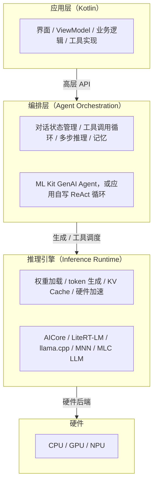

在 Android 应用里接入大模型能力，本质上是两条技术路线的取舍：**端侧大模型**（模型跑在设备本地）与**云端大模型**（通过 HTTP API 调用远端模型）。二者的对接方式、适用场景与工程约束截然不同，因此在动手写代码前，先厘清两条路线的基本概念，是选型与落地的前提。

## 端侧与云端

端侧大模型（On-Device LLM）是指在手机、平板等设备本地运行的大语言模型，推理过程完全在设备上完成，无需联网、不经过云端服务器。与之相对的云端大模型（如通过 API 调用 GPT、Gemini、Claude、Qwen 等），推理发生在厂商服务器上，设备只负责发起请求与渲染结果。

端侧部署的核心优势在于四点：

+ **隐私**：输入、推理、输出数据全程不出设备，天然规避了敏感数据的传输风险；
+ **离线可用**：不依赖网络，弱网、无网环境也能正常使用；
+ **零按次成本**：无每次 API 调用的计费，高频任务（如逐句润色、智能回复）成本可忽略；
+ **低延迟**：省去网络往返，首 token 延迟可控制在几百毫秒内。

但代价同样明显——端侧设备（尤其是手机）的算力、内存、功耗都远弱于云端，由此带来三大硬约束：

1. **模型体积**：8GB 内存的手机通常只能跑 INT4 量化后的 3~7B 参数模型；
2. **推理速度**：自回归生成逐 token 输出，首 token 延迟目标一般需控制在 500ms 内；
3. **上下文窗口**：受 KV Cache 内存占用限制，通常只有 4K~8K tokens。

云端则正好相反：模型能力更强、上下文更长、无需受设备算力约束，但依赖网络、有按 token 计费成本、数据需上传服务器。两者是**互补而非替代**关系——实际工程中常见「端侧优先、云端兜底」的组合：端侧可用的高频轻任务走本地，复杂推理或端侧不可用时降级到云端。

也正因为端侧存在这些硬约束，端侧大模型的发展高度依赖「小模型 + 量化 + 硬件加速」这条技术路线。而对应用开发者而言，两条路线都已具备成熟的高层 API 可以直接调用：端侧有 Google 的 AICore/Gemini Nano、MediaPipe LLM Inference、LiteRT-LM 及国产 MNN-LLM 等；云端则几乎都是 OpenAI 兼容的 HTTP 接口。应用层无需 ML 背景、无需碰 C++/JNI/NPU。

## 核心概念

### 推理引擎与编排层

要理解端侧大模型（尤其是「端侧 Agent」），首先要区分两个层次：

+ **推理引擎（Inference Runtime）**：负责把模型真正跑在设备上，处理权重加载、token 生成、硬件加速。代表有 llama.cpp、MNN、MLC LLM、Google 的 LiteRT-LM 等；
+ **编排层（Agent Orchestration）**：负责在模型之上实现「智能体」能力——对话状态管理、工具调用、多步推理、记忆。服务端有 LangChain、LlamaIndex 等，端侧则有 Google 的 ML Kit GenAI Agent。

「端侧 Agent」本质上是这两层的组合：推理引擎负责「跑模型」，编排层负责「当智能体」。前者已经很成熟，后者尚在早期，因此多数情况下需要「一个推理运行时 + 自己搭（或内置）的编排逻辑」。

端侧大模型的整体分层可概括如下：

**
图1. 端侧大模型分层示意图
**

其中「推理引擎」是应用可选的第三方组件（上述任一框架即可）；「编排层」要么用现成的 Agent 框架，要么在应用内自行实现「对话状态 + 工具白名单 + 执行循环」。二者可独立选型、自由组合。

### 模型量化

量化（Quantization）是把模型权重从 32/16 位浮点数压缩到低精度整数（INT8/INT4 等），以牺牲少量精度为代价，换取更小的体积和更快的推理。端侧部署几乎必然依赖量化，常见的精度级别有：

+ **FP16**：16 位浮点，质量最佳、体积最大，仅当内存充裕时使用；
+ **Q8**（8 位整数）：体积减半、精度损失极小，笔记本/边缘服务器首选；
+ **Q4**（4 位整数）：体积为 FP16 的 1/4，复杂推理略有退化，是移动端的标准选择；
+ **Q2/Q3**：极致压缩、质量损失明显，仅在极小模型上使用。

### KV Cache

KV Cache 是自回归生成中用于缓存已处理 attention 中间结果的机制，避免每个新 token 都重新计算历史部分。它的内存占用随上下文长度**线性增长**——对于小模型，长对话时 KV Cache 甚至可能超过模型权重本身。这正是端侧模型上下文窗口受限（通常 4K~8K）的根本原因，也是需要做滑动窗口、KV Cache 量化等优化的原因。

### GGUF 格式

GGUF 是 llama.cpp 社区定义、目前端侧部署**事实标准**的模型格式。它将模型权重存为单个二进制文件、内置量化支持，一份 GGUF 文件可在 Windows、macOS、Linux、Android、iOS 上跨平台运行。绝大多数开源模型的量化版都提供 GGUF 格式下载。
