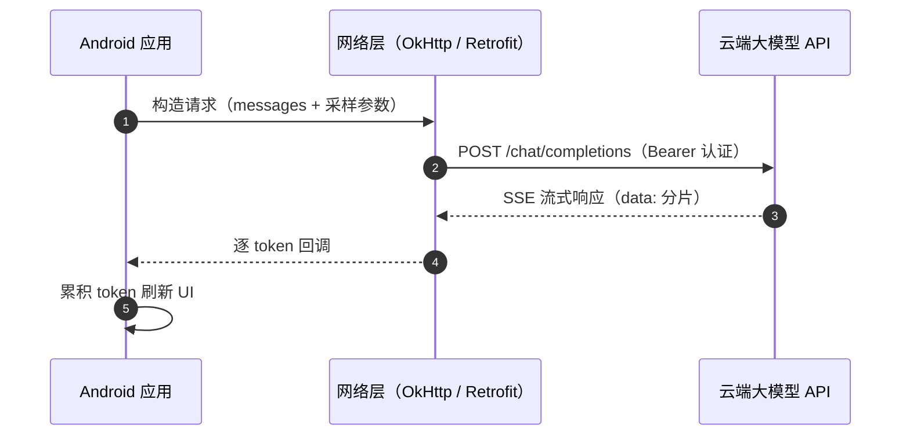

云端大模型的接入本质是**调用 HTTP API**——应用把「提示词 + 对话历史 + 采样参数」封装成 JSON 请求发给厂商服务器，再解析返回的文本。与端侧不同，云端对接不涉及模型文件、推理引擎与硬件加速，只涉及网络层与序列化，因此代码量小、上手快。

当前主流的云端大模型接口分两类格式：

+ **OpenAI 兼容格式**：DeepSeek、Qwen（通义千问）、GPT（OpenAI）、Grok（xAI）等绝大多数厂商都采用这一格式，只改 `base_url` 与模型名即可复用同一套客户端；
+ **Anthropic Messages 格式**：Claude 使用自有的接口约定，请求与响应结构不同，需单独适配。

这一差异是云端对接的核心认知：**理解「OpenAI 兼容」这个概念，就能用一套代码覆盖大部分厂商**。

## 基本逻辑链路

无论对接哪家云端模型，链路都是同一套：构造请求 → 网络层发送 → 解析响应 → 刷新 UI。流式场景下响应通过 SSE 逐分片返回：



## OpenAI 兼容格式

### 接口约定

OpenAI 兼容的厂商共用同一套 Chat Completions 接口约定，差异仅在 `base_url` 与模型名：

|厂商|base_url|认证|模型名示例|
|:--|:--|:--|:--|
|DeepSeek|`https://api.deepseek.com`|`Bearer`|`deepseek-chat` / `deepseek-reasoner`|
|Qwen（阿里百炼）|`https://dashscope.aliyuncs.com/compatible-mode/v1`|`Bearer`|`qwen-plus` / `qwen-max` / `qwen-turbo`|
|GPT（OpenAI）|`https://api.openai.com/v1`|`Bearer`|`gpt-4o-mini` / `gpt-4o`|
|Grok（xAI）|`https://api.x.ai/v1`|`Bearer`|`grok-4`|

公共约定：

|项|值|
|:--|:--|
|端点|`POST /chat/completions`|
|认证头|`Authorization: Bearer <API_KEY>`|
|流式|请求体 `"stream": true`，响应为 SSE，`[DONE]` 结束|

请求体与响应体均为 JSON，结构如下（`messages` 为对话历史，`role` 取 `system`/`user`/`assistant`）：

```json
// 请求
{
  "model": "deepseek-chat",
  "messages": [
    { "role": "system", "content": "你是一个有用的助手。" },
    { "role": "user", "content": "你好" }
  ],
  "stream": false,
  "temperature": 0.7
}
```

```json
// 非流式响应
{
  "choices": [
    { "message": { "role": "assistant", "content": "你好！有什么可以帮你的吗？" } }
  ]
}
```

```text
// 流式响应（SSE，逐分片返回，delta.content 为增量文本）
data: {"choices":[{"delta":{"content":"你"}}]}
data: {"choices":[{"delta":{"content":"好"}}]}
data: {"choices":[{"delta":{"content":""},"finish_reason":"stop"}]}
data: [DONE]
```

### 集成

云端接入只需一个 HTTP 客户端 + 一个 JSON 序列化库。这里用 OkHttp + Retrofit + kotlinx.serialization 组合：

```groovy
dependencies {
    implementation 'com.squareup.okhttp3:okhttp:$specified_version'
    implementation 'com.squareup.retrofit2:retrofit:$specified_version'
    implementation 'com.squareup.retrofit2:converter-kotlinx-serialization:$specified_version'
    implementation 'org.jetbrains.kotlinx:kotlinx-serialization-json:$specified_version'
}
```

```groovy
plugins {
    // kotlinx.serialization 需要开启序列化插件
    id 'org.jetbrains.kotlin.plugin.serialization'
}
```

### 数据模型

用 `@Serializable` 定义请求与响应模型，字段名与 JSON 键一一对应：

```kotlin
import kotlinx.serialization.SerialName
import kotlinx.serialization.Serializable

@Serializable
data class ChatMessage(
    val role: String,      // system / user / assistant
    val content: String,
)

@Serializable
data class ChatCompletionRequest(
    val model: String,
    val messages: List<ChatMessage>,
    val stream: Boolean = false,
    val temperature: Float = 0.7f,
    val max_tokens: Int? = null,
)

@Serializable
data class ChatCompletionResponse(
    val choices: List<Choice>,
) {
    @Serializable
    data class Choice(
        val message: ChatMessage,
        // 结束原因：stop / length / content_filter / tool_calls 等
        @SerialName("finish_reason") val finishReason: String? = null,
    )
}

// 流式响应的增量分片：正常分片带 choices，错误分片带 error，二者二选一
@Serializable
data class ChatStreamChunk(
    val choices: List<StreamChoice> = emptyList(),
    val error: StreamError? = null,
) {
    @Serializable
    data class StreamChoice(
        val delta: Delta,
        // 流式最后一个分片会携带 finish_reason，用于判断 content_filter 等
        @SerialName("finish_reason") val finishReason: String? = null,
    ) {
        @Serializable
        data class Delta(val content: String? = null)
    }

    @Serializable
    data class StreamError(
        val message: String? = null,
        val code: String? = null,
    )
}
```

> `finish_reason` 是判断「内容被过滤」的关键字段：它出现在正常 HTTP 200 的响应体内，而非作为错误码返回。常见的取值有 `stop`（正常结束）、`length`（达长度上限）、`content_filter`（输出触发安全过滤被截断）、`tool_calls`（模型发起工具调用）。

### 统一客户端封装

由于 DeepSeek、Qwen、GPT、Grok 四家接口完全兼容，可以把 `base_url`、`apiKey`、`model` 抽成构造参数，用同一个类覆盖全部厂商——新增一家厂商只需换三个参数，无需改业务代码：

```kotlin
import kotlinx.serialization.json.Json
import okhttp3.MediaType.Companion.toMediaType
import retrofit2.Retrofit
import retrofit2.converter.kotlinx.serialization.asConverterFactory
import retrofit2.http.Body
import retrofit2.http.Header
import retrofit2.http.POST

interface ChatApi {
    @POST("chat/completions")
    suspend fun chat(
        @Header("Authorization") auth: String,
        @Body request: ChatCompletionRequest,
    ): ChatCompletionResponse
}

// 通用 OpenAI 兼容客户端，覆盖 DeepSeek / Qwen / GPT / Grok
class OpenAiCompatClient(
    baseUrl: String,
    private val apiKey: String,
    private val model: String,
) {
    private val json = Json { ignoreUnknownKeys = true }

    private val api: ChatApi = Retrofit.Builder()
        .baseUrl(baseUrl)
        .addConverterFactory(json.asConverterFactory("application/json".toMediaType()))
        .build()
        .create(ChatApi::class.java)

    suspend fun ask(messages: List<ChatMessage>): String {
        val response = api.chat(
            "Bearer $apiKey",
            ChatCompletionRequest(model = model, messages = messages),
        )
        return response.choices.first().message.content
    }
}
```

按厂商实例化即可，例如：

```kotlin
val deepSeek = OpenAiCompatClient(
    baseUrl = "https://api.deepseek.com/",
    apiKey = DEEPSEEK_API_KEY,
    model = "deepseek-chat",
)

val qwen = OpenAiCompatClient(
    baseUrl = "https://dashscope.aliyuncs.com/compatible-mode/v1",
    apiKey = DASHSCOPE_API_KEY,
    model = "qwen-plus",
)

val gpt = OpenAiCompatClient(
    baseUrl = "https://api.openai.com/v1/",
    apiKey = OPENAI_API_KEY,
    model = "gpt-4o-mini",
)

val grok = OpenAiCompatClient(
    baseUrl = "https://api.x.ai/v1/",
    apiKey = XAI_API_KEY,
    model = "grok-4",
)
```

### 流式调用

流式适合「打字机式逐字输出」的聊天场景，体验远好于非流式。流式响应是 SSE，用 OkHttp 直接读字节流逐行解析，再用 `flow` 封装成 `Flow<String>`，配合 `flowOn(Dispatchers.IO)` 把网络 IO 切到后台：

```kotlin
import kotlinx.coroutines.Dispatchers
import kotlinx.coroutines.flow.Flow
import kotlinx.coroutines.flow.flow
import kotlinx.coroutines.flow.flowOn
import kotlinx.serialization.encodeToString
import kotlinx.serialization.json.Json
import okhttp3.MediaType.Companion.toMediaType
import okhttp3.OkHttpClient
import okhttp3.Request
import okhttp3.RequestBody.Companion.toRequestBody

class OpenAiCompatStreamClient(
    private val baseUrl: String,
    private val apiKey: String,
    private val model: String,
) {
    private val json = Json { ignoreUnknownKeys = true }
    private val client = OkHttpClient()

    fun stream(messages: List<ChatMessage>): Flow<String> = flow {
        val request = ChatCompletionRequest(model = model, messages = messages, stream = true)
        val body = json.encodeToString(request)
            .toRequestBody("application/json".toMediaType())

        val httpRequest = Request.Builder()
            .url("${baseUrl}chat/completions")
            .addHeader("Authorization", "Bearer $apiKey")
            .post(body)
            .build()

        client.newCall(httpRequest).execute().use { response ->
            if (!response.isSuccessful) {
                throw IOException("HTTP ${response.code}: ${response.body?.string()}")
            }
            val source = response.body!!.source()
            while (!source.exhausted()) {
                val line = source.readUtf8Line() ?: break
                if (!line.startsWith("data:")) continue

                val payload = line.removePrefix("data:").trim()
                if (payload == "[DONE]") break   // 正常结束标记

                val chunk = json.decodeFromString<ChatStreamChunk>(payload)

                // 流中错误分片：HTTP 200 后仍可能中途报错
                chunk.error?.let { throw IOException("流中错误 ${it.code}: ${it.message}") }

                val choice = chunk.choices.firstOrNull()

                // 输出触发安全过滤：finish_reason = content_filter
                if (choice?.finishReason == "content_filter") {
                    throw ContentFilteredException("回复内容被安全策略过滤")
                }

                val delta = choice?.delta?.content
                if (!delta.isNullOrEmpty()) emit(delta)   // 逐 token 发出
            }
        }
    }.flowOn(Dispatchers.IO)
}

// 自定义异常，便于调用方针对性提示
class ContentFilteredException(message: String) : IOException(message)
```

在 ViewModel 中消费这个 `Flow`，即可实现逐字刷新，并区分内容过滤与其他错误：

```kotlin
class ChatViewModel(private val client: OpenAiCompatStreamClient) : ViewModel() {

    private val _text = MutableStateFlow("")
    val text: StateFlow<String> = _text.asStateFlow()

    fun send(question: String) {
        viewModelScope.launch {
            _text.value = ""
            try {
                client.stream(listOf(ChatMessage("user", question))).collect { token ->
                    _text.update { it + token }
                }
            } catch (e: ContentFilteredException) {
                // 内容触发安全策略：单独提示，引导用户调整提问
                _text.value = "回复内容触发了安全策略，请调整提问后重试"
            } catch (e: Exception) {
                // 网络 / 额度 / 服务端等其他错误
                _text.value = e.message ?: "请求失败"
            }
        }
    }
}
```

### 多轮对话

云端模型是**无状态**的，不会自己记住上下文。多轮对话需由应用维护 `messages` 列表，每轮把完整历史随请求回传：

```kotlin
class ChatSession(private val client: OpenAiCompatClient) {

    private val messages = mutableListOf<ChatMessage>(
        ChatMessage("system", "你是一个有用的助手。"),
    )

    suspend fun send(userInput: String): String {
        messages += ChatMessage("user", userInput)
        val reply = client.ask(messages)      // 回传完整历史
        messages += ChatMessage("assistant", reply)
        return reply
    }
}
```

## Anthropic Messages 格式

Claude 使用 Anthropic 自有的 Messages API，与 OpenAI 兼容格式有几处关键差异，需单独适配：

|项|值|
|:--|:--|
|base_url|`https://api.anthropic.com`|
|端点|`POST /v1/messages`|
|认证|`x-api-key: <API_KEY>` + `anthropic-version: 2023-06-01`|
|模型|`claude-sonnet-4-5-20250929` / `claude-opus-4-20250514` 等|

与 OpenAI 格式的三点差异：

1. **`max_tokens` 必填**：请求中必须指定，否则报错；
2. **`system` 是顶层字段**：系统提示词不在 `messages` 数组里，而是独立的 `system` 字段；
3. **响应 `content` 是数组**：文本存放在 `content[0].text`，而非 `choices[0].message.content`。

请求与响应结构：

```json
// 请求
{
  "model": "claude-sonnet-4-5-20250929",
  "max_tokens": 1024,
  "system": "你是一个有用的助手。",
  "messages": [
    { "role": "user", "content": "你好" }
  ],
  "stream": false
}
```

```json
// 非流式响应
{
  "content": [
    { "type": "text", "text": "你好！有什么可以帮你的吗？" }
  ],
  "stop_reason": "end_turn"
}
```

### 数据模型与非流式调用

```kotlin
import kotlinx.serialization.SerialName
import kotlinx.serialization.Serializable

@Serializable
data class ClaudeMessage(
    val role: String,      // user / assistant
    val content: String,
)

@Serializable
data class ClaudeRequest(
    val model: String,
    @SerialName("max_tokens") val maxTokens: Int,
    val system: String,
    val messages: List<ClaudeMessage>,
    val stream: Boolean = false,
)

@Serializable
data class ClaudeResponse(
    val content: List<ContentBlock>,
) {
    @Serializable
    data class ContentBlock(
        val type: String,
        val text: String,
    )
}
```

```kotlin
import retrofit2.http.Body
import retrofit2.http.Header
import retrofit2.http.POST

interface ClaudeApi {
    @POST("v1/messages")
    suspend fun message(
        @Header("x-api-key") apiKey: String,
        @Header("anthropic-version") version: String,
        @Body request: ClaudeRequest,
    ): ClaudeResponse
}

class ClaudeClient(private val apiKey: String, private val model: String) {

    private val json = Json { ignoreUnknownKeys = true }
    private val api: ClaudeApi = Retrofit.Builder()
        .baseUrl("https://api.anthropic.com/")
        .addConverterFactory(json.asConverterFactory("application/json".toMediaType()))
        .build()
        .create(ClaudeApi::class.java)

    suspend fun ask(question: String): String {
        val response = api.message(
            apiKey = apiKey,
            version = "2023-06-01",
            request = ClaudeRequest(
                model = model,
                maxTokens = 1024,                        // 必填
                system = "你是一个有用的助手。",          // 顶层字段
                messages = listOf(ClaudeMessage("user", question)),
            ),
        )
        return response.content.first().text              // content 是数组
    }
}
```

### 流式调用

Claude 的流式响应也是 SSE，但比 OpenAI 兼容格式复杂——它通过 `event:` 行标记事件类型，文本增量在 `content_block_delta` 事件的 `delta.text` 中：

```text
event: message_start
data: {"type":"message_start", ...}

event: content_block_delta
data: {"type":"content_block_delta","delta":{"text":"你好"}}

event: content_block_delta
data: {"type":"content_block_delta","delta":{"text":"！"}}

event: message_stop
data: {"type":"message_stop"}
```

解析时需维护一个简单的状态机：记录当前的 `event` 类型，只在 `content_block_delta` 时提取 `delta.text`：

```kotlin
import kotlinx.coroutines.Dispatchers
import kotlinx.coroutines.flow.Flow
import kotlinx.coroutines.flow.flow
import kotlinx.coroutines.flow.flowOn
import kotlinx.serialization.SerialName
import kotlinx.serialization.Serializable
import kotlinx.serialization.encodeToString
import kotlinx.serialization.json.Json
import okhttp3.MediaType.Companion.toMediaType
import okhttp3.OkHttpClient
import okhttp3.Request
import okhttp3.RequestBody.Companion.toRequestBody

@Serializable
data class ClaudeStreamChunk(
    val type: String,
    val delta: Delta? = null,
) {
    @Serializable
    data class Delta(val text: String? = null)
}

class ClaudeClient(private val apiKey: String, private val model: String) {

    private val json = Json { ignoreUnknownKeys = true }
    private val client = OkHttpClient()

    fun stream(question: String): Flow<String> = flow {
        val request = ClaudeRequest(
            model = model,
            maxTokens = 1024,
            system = "你是一个有用的助手。",
            messages = listOf(ClaudeMessage("user", question)),
            stream = true,
        )
        val body = json.encodeToString(request)
            .toRequestBody("application/json".toMediaType())

        val httpRequest = Request.Builder()
            .url("https://api.anthropic.com/v1/messages")
            .addHeader("x-api-key", apiKey)
            .addHeader("anthropic-version", "2023-06-01")
            .post(body)
            .build()

        client.newCall(httpRequest).execute().use { response ->
            if (!response.isSuccessful) {
                throw IOException("HTTP ${response.code}: ${response.body?.string()}")
            }
            val source = response.body!!.source()
            var eventType = ""
            while (!source.exhausted()) {
                val line = source.readUtf8Line() ?: break
                when {
                    line.startsWith("event:") ->
                        eventType = line.removePrefix("event:").trim()
                    line.startsWith("data:") && eventType == "content_block_delta" -> {
                        val payload = line.removePrefix("data:").trim()
                        val text = json.decodeFromString<ClaudeStreamChunk>(payload).delta?.text
                        if (!text.isNullOrEmpty()) emit(text)
                    }
                }
            }
        }
    }.flowOn(Dispatchers.IO)
}
```

## 最佳实践

### API Key 安全

API Key 是云端对接的首要风险点，**绝不要硬编码在客户端**——Android 应用可被反编译，硬编码的 Key 会被提取并盗用，造成资损。正确的做法：

1. **首选后端代理**：应用请求自有后端，由后端持有 Key 并转发到厂商，这是生产环境的标准做法；
2. **次选服务端下发**：Key 从服务端动态下发，结合 Android Keystore / EncryptedSharedPreferences 加密存储；
3. **临时调试**：仅本地开发用环境变量或 `local.properties`（不入库、不提交）。

### 错误处理与重试

云端请求的失败可分「可重试」与「不可重试」两类，关键是**先判断错误性质，再决定是否退避重试**——对额度、鉴权、内容过滤类错误盲目重试，只会白白消耗资源且永远无法自愈。

**不可重试类（需人工介入或修改输入）：**

| 场景 | 表现 | 处理 |
|------|------|------|
| 鉴权失败 | `401`（Key 无效）/ `403`（无权限） | 提示并检查 Key 配置，不重试 |
| 额度不足 | DeepSeek `402 Insufficient Balance`；OpenAI 兼容 `insufficient_quota`（`credit_balance_exhausted` 等） | 提示充值/提额，不重试 |
| 内容被过滤（请求端拦截） | OpenAI `400` + `content_filter`；DeepSeek `422` 内容校验；阿里百炼 `400 DataInspectionFailed` | 修改 prompt 后重发，不重试 |
| 内容被过滤（输出端截断） | HTTP 200，但 `finish_reason = "content_filter"` | 提示用户内容被安全策略拦截，不重试 |
| 上下文超限 | `context_length_exceeded` | 截断历史或改用更大窗口模型，不重试 |

**可重试类（退避重试）：**

+ **429 限流**：请求过快或超 QPS/TPM，做**指数退避重试**（如 1s、2s、4s），并主动限流；优先读取 `Retry-After` 响应头；
+ **5xx 服务端异常**：`500`/`502`/`503` 等服务端抖动，退避后重试成功率较高；
+ **网络异常**：超时、连接中断，可有限次重试。

#### 内容过滤的判定

「回复内容被屏蔽」**不是 HTTP 错误码**，而是藏在正常 200 响应里——它通过 `finish_reason` 表达：

+ **输出被截断**：非流式看 `choices[0].finish_reason`，流式看最后一个分片的 `finish_reason`，值为 `content_filter` 即表示输出触发了安全过滤、后续 token 被丢弃；
+ **请求被拦截**：返回 `400`/`422` 等错误码，需检查 `error` 字段里的提示。

因此解析响应时，**不能只判 `content` 是否为空**，还要检查 `finish_reason`，否则会把「被过滤的回复」误判为「正常空回复」。

#### 流式中途错误

流式响应的一个陷阱是：HTTP 握手返回 200 后，**错误可能发生在流的中途**：

+ OpenAI 兼容格式：流中可能突然出现 `data: {"error": {...}}` 错误分片，或直接断连且没有 `[DONE]` 结束标记；
+ Claude：通过 `event: error` 事件表达失败。

因此流式解析时，除了处理 `data:` 分片，还应**识别错误分片、并校验是否收到 `[DONE]`/`message_stop` 结束标记**——未正常收尾即视为不完整响应，按需重试或提示。

### 费用控制

云端按 token 计费，长对话、高并发会显著增加成本：

+ 约束 `max_tokens` 与提示词长度，避免冗余输出；
+ 历史做滑动窗口截断或摘要压缩，而非无脑回传全量；
+ 高频重复问题（FAQ、固定指令）可在本地缓存，不必每次调 API。

### 上下文管理

与端侧同理，云端历史越长费用越高、越可能触发上下文超限。维护 `messages` 列表时，应设定上限，超出时从最早的对话裁剪（保留 system prompt），或对更早历史做摘要压缩。

> 各厂商模型名会随版本演进（如 `deepseek-chat` 已多次升级底层版本、GPT 已迭代到 5 系），但调用方式不变，具体以各自官方文档为准。
