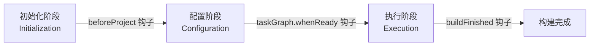
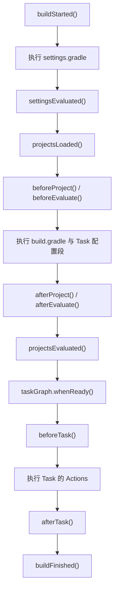

[Gradle](https://docs.gradle.org/current/userguide/what_is_gradle.html) 是 Android 的官方构建工具：管理依赖、编排构建任务、产出最终的 `.apk` / `.aar` / `.jar`。构建脚本可以用 Groovy（`.gradle`）或 Kotlin（`.gradle.kts`）两种 DSL，语法不同但能力一致。本笔记示例以 **Kotlin DSL（`.gradle.kts`）** 为主，这是现在新项目（Android Studio 模板）的默认选择。

> 版本说明：文中示例以 **AGP 8.x / Gradle 8 / Kotlin 2.x** 为基线。AGP 9.0（2026-01）有较大变化（内置 Kotlin、移除旧 Variant API），会单独一节说明。

相比 Maven 和 Ant，Gradle 的优势在于：用 DSL 而非 XML、一套系统同时支持 Android 与 JVM 项目、灵活性与统一性兼顾、支持增量构建。

## 核心概念：Project 与 Task

Gradle 里两个最基础的概念：

- **Project**：一个**构建单元**，不是“构建产物”。一个 Project 对应一个模块，产物可能是 `.jar`、`.aar` 或 `.apk`，但 Project 本身指的是“这一份待构建的代码与配置”。
- **Task**：不可分割的最小工作单元（原子操作），比如编译 Java 类、打包、生成文档。

关系是：**一次 build 由若干 Project 组成，每个 Project 由若干 Task 组成**。具体到 Android：每个 Module 是一个 Project，编译、资源处理、Lint、打包各是一个 Task。

## Gradle工作流程



Gradle 分三个阶段：**初始化 → 配置 → 执行**。

### 初始化阶段

执行 `settings.gradle.kts`，确定项目包含哪些模块，为每个模块创建 Project 对象。`settings.gradle.kts` 里可用 `Settings` 对象的 API。

### 配置阶段

执行每个 Project 的 `build.gradle.kts`，配置 Project。注意：**无论执行什么命令，初始化与配置阶段的代码都会执行**。排查构建变慢时，可以看哪些逻辑能挪进 Task（执行阶段），减少配置阶段的耗时。

### 执行阶段

真正执行 Task。Gradle 会根据依赖关系建立**有向无环图**（DAG），可通过 `Gradle.getTaskGraph()` 访问，然后 `gradle <任务名>` 执行。

### 构建流程监听

Gradle 在构建的各个阶段都留了回调点，供脚本或插件在特定时机执行自定义逻辑：



添加监听时要注意**顺序**：监听器必须在它所监听的生命周期**之前**注册，否则该阶段已经过去，回调不会触发。最基础的监听加在 `settings.gradle.kts` 里：

```kotlin
// settings.gradle.kts
// BuildListener / Settings / Gradle / BuildResult 均来自 org.gradle.api.* 的默认导入
gradle.addBuildListener(object : BuildListener {
    override fun settingsEvaluated(settings: Settings) { ... }
    override fun projectsLoaded(gradle: Gradle) { ... }
    override fun projectsEvaluated(gradle: Gradle) { ... }
    override fun buildFinished(buildResult: BuildResult) { ... }
})
```

`BuildListener` 只覆盖几个顶层阶段。要监听更细的时机（比如每个 Project 的评估前后），用 Project 上的监听 API：

```kotlin
// 为所有 Project 统一做某事（例如都应用某个插件）
gradle.beforeProject {
    apply(plugin = "java")
}

// 只针对当前 Project
allprojects {
    beforeEvaluate {
        apply(plugin = "java")
    }
}
```

> `gradle.beforeProject` 与 `beforeEvaluate` 时机一样，区别是前者作用于所有 Project，后者只作用于当前对象。

## Gradle文件一览

| 文件 | 用途 |
| --- | --- |
| `gradle/wrapper/gradle-wrapper.jar` | 下载 Gradle 发行版的程序 |
| `gradle/wrapper/gradle-wrapper.properties` | 配置 Gradle 下载源与版本（`distributionUrl`） |
| `gradlew` / `gradlew.bat` | 通过 Wrapper 执行构建的脚本 |
| `settings.gradle.kts` | 声明模块、配置仓库与插件管理（Gradle 7+ 迁移到这里） |
| `gradle.properties` | 全局属性，默认 String 类型 |
| `gradle/libs.versions.toml` | 版本目录（Version Catalog），统一管理依赖版本 |
| `build.gradle.kts`（根） | 声明全局插件（`apply false`）、公共配置 |
| `module/build.gradle.kts` | 模块的插件、依赖、编译选项与任务 |
| `local.properties` | 本地环境属性，最典型是 `sdk.dir` |

## 仓库配置

Gradle 7.0 起，仓库地址从根 `build.gradle.kts` 迁移到 `settings.gradle.kts`：

```kotlin
// settings.gradle.kts
pluginManagement {
    // 拉取 Gradle 插件的仓库
    repositories {
        google()
        mavenCentral()
        gradlePluginPortal()
    }
}
dependencyResolutionManagement {
    // 所有模块拉取依赖库的仓库
    repositoriesMode.set(RepositoriesMode.FAIL_ON_PROJECT_REPOS)
    repositories {
        google()
        mavenCentral()
    }
}
```

`RepositoriesMode.FAIL_ON_PROJECT_REPOS` 表示模块里再写自己的 `repositories` 会直接报错，强制仓库统一在 settings 里管理，避免各模块各配一套。

### 中国大陆镜像

Google / Maven / Gradle 官方源在大陆访问不稳定，常用镜像：

| 镜像 | 地址 |
| --- | --- |
| 阿里云 Maven 中央仓库 | `https://maven.aliyun.com/repository/central` |
| 阿里云公共仓库（含 central + jcenter） | `https://maven.aliyun.com/repository/public` |
| 阿里云 Google 仓库 | `https://maven.aliyun.com/repository/google` |
| 阿里云 Gradle 插件仓库 | `https://maven.aliyun.com/repository/gradle-plugin` |

除了依赖仓库，**Gradle 发行版本身**的下载也常卡，改 `gradle-wrapper.properties` 里的 `distributionUrl` 指向镜像（腾讯或阿里云的 gradle 镜像）即可。

### 导入本地二进制依赖

只提供 `.jar` / `.aar` 的依赖，用 `fileTree`：

```kotlin
dependencies {
    implementation(fileTree("libs") { include("*.jar", "*.aar") })
}
```

`.so` 放到 `src/main/jniLibs` 会被自动识别；要改路径：

```kotlin
android {
    sourceSets {
        getByName("main") {
            jniLibs.srcDirs("libs")
        }
    }
}
```

## 依赖冲突

不同模块引用了同一个库的不同版本，就是依赖冲突。**Gradle 默认取最高版本**，不会报错；只有取到的新版本与别的库二进制不兼容时才需要干预。

排查工具是两条命令：

```bash
# 看某个依赖的完整解析结果与被谁引入
./gradlew :app:dependencyInsight --dependency okhttp --configuration releaseRuntimeClasspath

# 看整个依赖树
./gradlew :app:dependencies --configuration releaseRuntimeClasspath
```

需要干预时有三种手段：

**强制指定版本**：

```kotlin
dependencies {
    implementation("org.apache.httpcomponents:httpclient:4.5.4")
    implementation("commons-codec:commons-codec") {
        version { strictly("1.9") }     // 严格固定
    }
}

configurations.configureEach {
    resolutionStrategy.force("commons-codec:commons-codec:1.9")
}
```

除了 `strictly`，Gradle 的 rich version 还支持 `prefer`、`require`、`reject`、`rejectAll`。

**排除特定依赖**：

```kotlin
dependencies {
    implementation("commons-beanutils:commons-beanutils:1.9.4") {
        exclude(group = "commons-collections", module = "commons-collections")
    }
}
```

**禁止依赖传递**：

```kotlin
dependencies {
    implementation("io.coil-kt:coil-compose:2.7.0") {
        isTransitive = false
    }
}
```

> `implementation` 引入的依赖本身就不对外传递，需要传递时改用 `api`。

## Gradle Plugin

Gradle 核心只提供基础设施，编译 Java / Android 的能力都来自插件。插件分**脚本插件**（额外构建脚本）和**二进制插件**（已发布成二进制的）。

应用插件有两种写法，差别在于“是否需要从远程仓库解析”：

```kotlin
// 需要声明版本（从远程仓库拉取），apply false 表示“声明但不立即应用”
plugins {
    id("com.android.application") version "8.7.3" apply false
    id("org.jetbrains.kotlin.android") version "2.1.0" apply false
}

// 模块里应用（版本已在根声明，或本身是核心插件）
plugins {
    id("com.android.application")
    id("org.jetbrains.kotlin.android")
}
```

`apply false` 的作用是**阻止立即应用**，让子模块按需应用。

## Android Gradle Plugin

AGP 是专门为 Android 项目准备的插件，模块 `build.gradle.kts` 里的 `android { }` 块就来自它：

```kotlin
android {
    namespace = "com.example.app"   // 包名，AGP 7.4 起取代 manifest 里的 package
    compileSdk = 36

    defaultConfig {
        applicationId = "com.example.app"
        minSdk = 23
        targetSdk = 36
        versionCode = 1
        versionName = "1.0"

        testInstrumentationRunner = "androidx.test.runner.AndroidJUnitRunner"
    }
}
```

### 更改源码目录

```kotlin
android {
    sourceSets {
        getByName("main") {
            java.srcDirs("other/java")                  // 代码
            res.srcDirs("other/res1", "other/res2")     // 资源
            manifest.srcFile("other/AndroidManifest.xml")
            jniLibs.srcDirs("other/libs")               // so
        }
        getByName("androidTest") {
            setRoot("src/tests")                        // 插桩测试源码根
        }
    }
}
```

### 配置应用签名

```kotlin
android {
    signingConfigs {
        create("release") {
            storeFile = file("my-release-key.jks")
            storePassword = "password"
            keyAlias = "my-alias"
            keyPassword = "password"
        }
    }
    buildTypes {
        getByName("release") {
            signingConfig = signingConfigs.getByName("release")
        }
    }
}
```

密码直接写死在 `build.gradle.kts` 会随仓库泄露，更稳的做法是读一个被 `.gitignore` 排除的 `keystore.properties`：

```kotlin
val keystoreProperties = java.util.Properties().apply {
    val f = rootProject.file("keystore.properties")
    if (f.exists()) {
        f.inputStream().use { load(it) }
    }
}

android {
    signingConfigs {
        create("release") {
            storeFile = file(keystoreProperties["storeFile"] as String)
            storePassword = keystoreProperties["storePassword"] as String
            keyAlias = keystoreProperties["keyAlias"] as String
            keyPassword = keystoreProperties["keyPassword"] as String
        }
    }
}
```

### 压缩与混淆

AGP 用 **R8** 做代码缩减、优化与混淆（ProGuard 已被 R8 取代，规则语法仍兼容）：

```kotlin
android {
    buildTypes {
        getByName("release") {
            isMinifyEnabled = true
            isShrinkResources = true    // 资源缩减，需要 minifyEnabled 同时开启
            proguardFiles(
                getDefaultProguardFile("proguard-android-optimize.txt"),
                "proguard-rules.pro"
            )
        }
    }
}
```

详细规则见 [[7. 代码混淆与应用加固]]。

### 构建类型与产品变体

**构建类型**（buildType）默认有 `release` 与 `debug`：

```kotlin
android {
    buildTypes {
        getByName("release") { ... }
        getByName("debug") { ... }
    }
}
```

**产品变体**（productFlavor）配合 `flavorDimensions` 使用：

```kotlin
android {
    flavorDimensions += "environment"
    productFlavors {
        create("free") {
            dimension = "environment"
            applicationIdSuffix = ".free"   // 让不同变体可共存安装
        }
        create("paid") {
            dimension = "environment"
        }
    }
}
```

变体总数 = 构建类型数 × 各维度的变体数（笛卡尔积）。`productFlavors` 与 `defaultConfig` 同属 `ProductFlavor`，因此 flavor 里也能配 `applicationId`、`versionName` 等。配置并同步后，IDE 的 Build Variants 面板里会出现 `<flavor><BuildType>` 的组合：

![[gradle3.png]]

按变体/测试类型加依赖，用前缀：

```kotlin
dependencies {
    "freeImplementation"(project(":mylibrary"))               // 只给 free 变体（变体前缀配置无类型安全访问器，用字符串）
    testImplementation("junit:junit:4.13.2")                  // 本地测试
    androidTestImplementation("androidx.test.espresso:espresso-core:3.7.0")   // 插桩测试
}
```

> 注意是 **`androidx.test.espresso`**，不是老的 `com.android.support.test`。Support Library 早在 2018 年就停止维护，所有测试依赖都走 androidx。

### 自定义 APK 名称

老写法 `applicationVariants.all { variant.outputs.all { outputFileName = ... } }` 在 AGP 9 已**移除**，改用组件 API：

```kotlin
// AGP 8 之前的写法（已废弃/移除）
android {
    applicationVariants.all {
        outputs.all { output -> output.outputFileName = "app.apk" }
    }
}
```

```kotlin
// AGP 8+ 推荐写法
androidComponents {
    onVariants { variant ->
        variant.outputs.forEach { output ->
            output.outputFileName.set("app-${variant.name}.apk")
        }
    }
}
```

禁用某些变体组合，同样从 `variantFilter`（已移除）换成 `beforeVariants`：

```kotlin
androidComponents {
    beforeVariants(selector().withBuildType("debug").withFlavor("environment", "free")) { builder ->
        builder.enable = false
    }
}
```

### 版本目录（Version Catalog）

新项目默认用 `gradle/libs.versions.toml` 统一管理版本，模块里不再散落版本号：

```toml
[versions]
agp = "8.7.3"
coreKtx = "1.13.1"
espresso = "3.7.0"

[plugins]
android-application = { id = "com.android.application", version.ref = "agp" }

[libraries]
androidx-core-ktx = { group = "androidx.core", name = "core-ktx", version.ref = "coreKtx" }
androidx-espresso-core = { group = "androidx.test.espresso", name = "espresso-core", version.ref = "espresso" }
```

```kotlin
// 模块里
dependencies {
    implementation(libs.androidx.core.ktx)
    androidTestImplementation(libs.androidx.espresso.core)
}
```

好处：一处改版本、全项目生效，配合 Dependabot/Renovate 还能自动提升级 PR（见 [[8. 代码扫描#版本与停更]]）。

### 编译选项与特性开关

```kotlin
android {
    compileOptions {
        sourceCompatibility = JavaVersion.VERSION_17
        targetCompatibility = JavaVersion.VERSION_17
    }
    kotlinOptions {
        jvmTarget = "17"
    }
    buildFeatures {
        compose = true
        viewBinding = true
        buildConfig = true   // AGP 8 起 BuildConfig 默认不生成，需要时显式开启
    }
}
```

几个容易漏的现代默认值：

- **AGP 8 起 `BuildConfig` 默认不生成**，用到 `BuildConfig.DEBUG` 必须 `buildConfig = true`（否则改用 `ApplicationInfo.FLAG_DEBUGGABLE`）；
- Kotlin 1.9+ 推荐用 `kotlin { compilerOptions { jvmTarget = ... } }` 取代 `kotlinOptions`；
- Java/Kotlin 的目标版本要一致，否则报 “Inconsistent JVM-target compatibility”。

## Gradle Task

### 创建 Task

```kotlin
// 无类型
tasks.register("hello") {
    doLast { println("hello") }
}

// 指定类型（如 Copy），继承默认行为
tasks.register<Copy>("copyFiles") {
    from("resources")
    into("target")
}
```

`tasks.register` 是推荐写法（懒注册），`tasks.create` 已不推荐。持有 Task 引用用 `tasks.named`：

```kotlin
val hello = tasks.register("hello") { ... }
tasks.named("hello") { ... }   // 再配置
```

两者返回的都是 `TaskProvider<T>`。`doFirst` / `doLast` 里的代码在**执行阶段**运行，闭包里其他代码在**配置阶段**运行。

### Task 依赖与顺序

```kotlin
// dependsOn：强依赖，B 依赖 A，跑 B 会先跑 A
tasks.named("taskY") { dependsOn("taskX") }

// mustRunAfter / shouldRunAfter：只约束顺序，不建立依赖
tasks.named("taskY") { mustRunAfter("taskX") }
tasks.named("taskZ") { shouldRunAfter("taskX") }
```

`shouldRunAfter` 约束最弱，与 `dependsOn` 冲突时会被忽略。`finalizedBy` 声明 finalizer Task，无论前置任务成败都会执行（类似 `finally`）。

### Task 结果标记

| 标记 | 含义 |
| --- | --- |
| `EXECUTED` | 已执行（有 action 或有依赖时显示） |
| `UP-TO-DATE` | 输出没变化，跳过 |
| `FROM-CACHE` | 命中构建缓存 |
| `SKIPPED` | 被显式排除或未满足条件 |
| `NO-SOURCE` | 没有可处理的输入（如找不到 `.java`） |

## AGP 9 的变化

AGP 9.0（2026-01）是一次“清仓式”升级，升级前必须知道：

| 变化 | 影响 |
| --- | --- |
| **移除旧 Variant API** | `applicationVariants` / `libraryVariants` / `variantFilter` / `variant.outputs` 全部移除，改用 `androidComponents` |
| **内置 Kotlin** | 默认无需再 apply `org.jetbrains.kotlin.android`（KGP），AGP 自带 Kotlin 编译 |
| **新 DSL 接口** | 旧的 `BaseExtension` 等内部类型被隐藏，自研插件里 `getByName("android") as BaseExtension` 会 `ClassCastException` |
| `dexOptions` 移除 | 本来就是 D8 取代 DX 后的空壳，现在直接报错 |
| R8 行为调整 | 9.1 起类重打包默认开启，9.2 起通配 `-keepattributes` 不再匹配不可见注解 |

`android.newDsl=false` 可以临时退回旧行为，但 AGP 10 会移除这条退路——迁移 `androidComponents` 是迟早的事。

## 小结

- Project 是**构建单元**、Task 是**最小工作单元**，别把 Project 理解成“产物”。
- 仓库、插件管理从 Gradle 7 起搬到 `settings.gradle.kts`，模块里别再各配一套。
- 依赖冲突默认取最高版本，用 `dependencyInsight` 定位来源，再决定强制/排除。
- 过时写法清单：`com.android.support.test.*` → androidx、`applicationVariants`/`variantFilter`/`outputFileName` → `androidComponents`、`kotlinOptions` → `compilerOptions`、manifest `package` → `namespace`。
- 新项目默认形态是 Version Catalog + `buildFeatures` 显式开关 + 配置缓存；升级 AGP 9 前先迁 `androidComponents`。
- Kotlin DSL 与 Groovy 的能力完全一致，只有语法不同；新项目默认 `.gradle.kts`，本笔记示例也以它为准。
