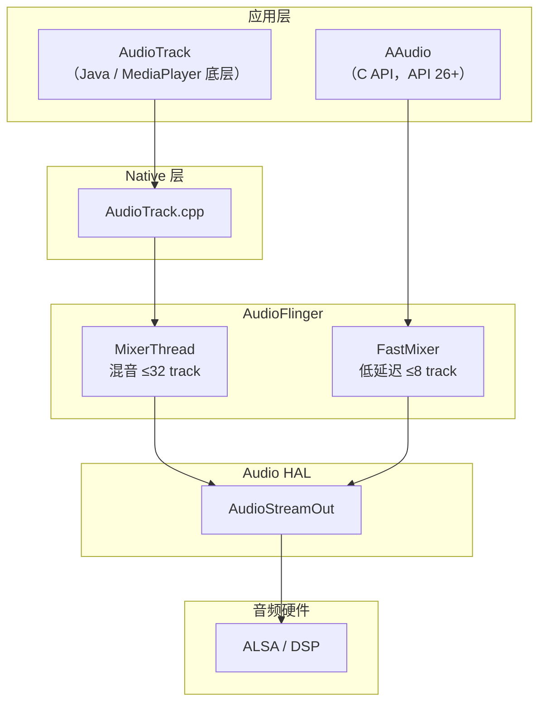
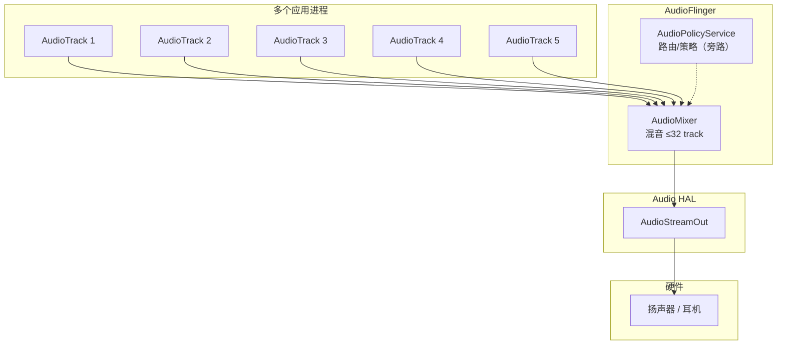

Android 多媒体框架支持捕获和编码常见的音频格式。录音有两条路线：**`MediaRecorder`**（封装式，配置好直接输出编码后的文件）和 **`AudioRecord`**（底层式，拿到原始 PCM 自行处理）。与之配套的 **`AudioTrack`** 负责播放 PCM 数据。本节按这三者展开。

无论用哪条路线，`RECORD_AUDIO` 都是敏感权限，需在 Manifest 声明并**运行时动态申请**：

```xml
<uses-permission android:name="android.permission.RECORD_AUDIO" />
```

运行时申请用 Activity Result API（写法与相机权限一致，见 [[9. 相机#权限]]）。

## MediaRecorder

`MediaRecorder` 是封装式录音：配置好音频源、输出格式、编码器，`prepare()` 后 `start()` 即可，直接产出编码后的文件。基本用法：

```kotlin
// Android 12（API 31）+ 上构造方法需传 Context，低版本用无参构造
var mediaRecorder: MediaRecorder = if (Build.VERSION.SDK_INT >= Build.VERSION_CODES.S) {
    MediaRecorder(this)
} else {
    @Suppress("DEPRECATION")
    MediaRecorder()
}

try {
    // 音频源：麦克风
    mediaRecorder.setAudioSource(MediaRecorder.AudioSource.MIC)

    // 输出格式与编码器要匹配：AAC 编码 + MPEG_4 容器 → .m4a（最通用）
    mediaRecorder.setOutputFormat(MediaRecorder.OutputFormat.MPEG_4)
    mediaRecorder.setAudioEncoder(MediaRecorder.AudioEncoder.AAC)

    // 输出文件，扩展名要与容器格式一致
    mediaRecorder.setOutputFile("recording.m4a")

    // 采样率（Hz）与声道数：语音场景常用 16 kHz 单声道
    mediaRecorder.setAudioSamplingRate(16_000)
    mediaRecorder.setAudioChannels(1)

    // 错误/信息回调
    mediaRecorder.setOnErrorListener { mr, what, extra -> /* 处理错误 */ }
    mediaRecorder.setOnInfoListener { mr, what, extra -> /* 处理信息 */ }

    // 所有 set 必须在 prepare() 之前调用
    mediaRecorder.prepare()
} catch (e: Exception) {
    /* 处理异常 */
}

// 开始 / 暂停 / 恢复
mediaRecorder.start()
mediaRecorder.pause()   // API 24+
mediaRecorder.resume()  // API 24+
```

> **MediaRecorder 没有 MP3 编码器**（Android 平台只提供 MP3 解码，不提供编码）。录音要 MP3 得引入 LAME 等第三方库。原生推荐的组合是：AAC + MPEG_4（`.m4a`）、AAC + AAC_ADTS（`.aac` 裸流）；需要流式传输时才用 AAC + MPEG_2_TS（`.ts`）。

录制结束后必须释放资源：

```kotlin
mediaRecorder.apply {
    try {
        stop()
        reset()     // reset 后对象可复用
        release()   // release 后对象不可再用
    } catch (e: Exception) {
        /* 处理异常 */
    }
}
mediaRecorder = null
```

> Android 10（API 29）+ 的 `MediaRecorder` 提供 `registerAudioRecordingCallback()` 接收录制事件，须配套 `unregisterAudioRecordingCallback()` 注销，避免内存泄漏。

## AudioRecord

`AudioRecord` 是比 `MediaRecorder` 更底层的 API，负责管理应用层音频资源，从硬件采集**原始 PCM 数据**（脉冲编码调制，未压缩），供开发者灵活处理（如实时分析、自行编码、自定义写入文件）。

### 对象构造

用 Builder 构建：

```kotlin
val audioRecord = AudioRecord.Builder()
    .setAudioSource(MediaRecorder.AudioSource.MIC)      // 音频源
    .setAudioFormat(
        AudioFormat.Builder()
            .setEncoding(AudioFormat.ENCODING_PCM_16BIT)   // PCM 16bit
            .setSampleRate(16_000)                         // 采样率 Hz
            .setChannelMask(AudioFormat.CHANNEL_IN_MONO)   // 单声道输入
            .build()
    )
    .setBufferSizeInBytes(1024) // 缓冲区大小（byte）
    .setContext(this) // API 31+ 可选，用于隐私指示等
    .setPrivacySensitive(true) // API 30+，语音通话/录像时建议 true
    .build()
```

也提供含参数的构造方法：

```kotlin
AudioRecord(
    MediaRecorder.AudioSource.MIC,
    16_000,
    AudioFormat.CHANNEL_IN_MONO,
    AudioFormat.ENCODING_PCM_16BIT,
    1024
)
```

### 基本操作

开启录音：

```kotlin
if (audioRecord?.state != AudioRecord.STATE_INITIALIZED) return
audioRecord?.startRecording()
```

停止并释放：

```kotlin
audioRecord?.run {
    stop()
    release()
}
audioRecord = null
```

### 音频流数据处理

`AudioRecord` 的核心是循环调用 `read()` 读取 PCM 数据。`read()` 是阻塞调用，必须在子线程执行：

```kotlin
// 最小缓冲区大小，会随采样率/格式变化
val minBufferSize = AudioRecord.getMinBufferSize(
    16_000, AudioFormat.CHANNEL_IN_MONO, AudioFormat.ENCODING_PCM_16BIT
)
val audioData = ByteArray(minBufferSize)

while (isRecording) {
    // 返回实际读取的字节数；负数表示出错
    val readCount = audioRecord.read(audioData, 0, minBufferSize)
    if (readCount > 0) {
        handleBuffer(audioData, readCount)   // 交给下一步处理（写文件 / 编码 / 分析）
    }
}
```

## AudioTrack

`AudioTrack` 是底层播放 API，用于播放已解码的 PCM 流或 `.wav`，尤其适合流媒体、VoIP 等场景。它没有解码器，因此能直接播放的只有 PCM（`MediaPlayer` 底层播放也走 `AudioTrack`）。

两种播放模式：

- **Streaming（MODE_STREAM）**：边写边播，适合长音频或按队列接收的音频流；
- **Static（MODE_STATIC）**：一次性写入再播放，适合短小、对时延敏感的音效。

`AudioTrack` 播放走一条从应用到硬件的调用链路，普通路径与低延迟路径（AAudio / FastMixer）在此分流：



每个音频流对应一个 `AudioTrack` 实例，创建时注册到 `AudioFlinger`，由它混音后输出到音频硬件。**普通 Mixer 线程的硬编码上限是 32 个活动 track**（AOSP `AudioMixer` 中 `MAX_NUM_TRACKS = 32`），低延迟的 FastMixer 则为 8 个：



### 对象构造

Builder 方式：

```kotlin
val audioTrack = AudioTrack.Builder()
    .setTransferMode(AudioTrack.MODE_STREAM)          // MODE_STREAM 或 MODE_STATIC
    .setAudioFormat(
        AudioFormat.Builder()
            .setChannelMask(AudioFormat.CHANNEL_OUT_STEREO)  // 输出声道
            .setEncoding(AudioFormat.ENCODING_PCM_16BIT)
            .setSampleRate(44_100)
            .build()
    )
    .setBufferSizeInBytes(1024)
    .setAudioAttributes(
        AudioAttributes.Builder()
            .setLegacyStreamType(AudioManager.STREAM_MUSIC)
            .build()
    )
    .setPerformanceMode(AudioTrack.PERFORMANCE_MODE_LOW_LATENCY)  // API 26+
    .build()
```

构造方法方式：

```kotlin
AudioTrack(
    audioAttributes,      // AudioAttributes
    audioFormat,          // AudioFormat
    1024,                 // 缓冲区大小（byte）
    AudioTrack.MODE_STREAM,
    sessionId             // AudioSessionId
)
```

### 流播放模式

流模式下在循环里边读边写：

```kotlin
// 注意这里是 AudioTrack（不是 AudioRecord）的最小缓冲区
val minBufferSize = AudioTrack.getMinBufferSize(
    44_100, AudioFormat.CHANNEL_OUT_STEREO, AudioFormat.ENCODING_PCM_16BIT
)
val audioData = ByteArray(minBufferSize)

DataInputStream(inputStream).use { input ->
    var readCount: Int
    while (input.available() > 0) {
        readCount = input.read(audioData)
        if (readCount > 0) {
            audioTrack?.run {
                if (state == AudioTrack.STATE_INITIALIZED) {
                    play()                          // 先 play 再写数据
                }
                write(audioData, 0, readCount)      // 把 PCM 写入 AudioTrack 播放
            }
        }
    }
}
```

### 固定播放模式

固定模式先一次性写入全部数据，再播放：

```kotlin
DataInputStream(inputStream).use { input ->
    val readCount = input.read(audioData)
    if (readCount > 0) {
        audioTrack?.run {
            write(audioData, 0, readCount) // MODE_STATIC 先写数据
            if (state == AudioTrack.STATE_INITIALIZED) {
                play() // 写完后才 play
            }
        }
    }
}
```

### 释放资源

```kotlin
audioTrack?.run {
    // MODE_STREAM 下 stop() 会播完已写入缓冲的数据后停止
    stop()
    // 想立即停止并丢弃未播数据，用 pause() + flush()
    // pause(); flush()
    release()
}
```

### 缓冲区与帧

`AudioTrack.getMinBufferSize()` 用于计算应用层应分配的缓冲区大小，其底层涉及一个核心概念：**帧（Frame）**——一个采样点（Sample）在所有声道上的数据量，即「单声道每采样点字节数 × 声道数」。例如 16bit 立体声，一帧 = 2 字节 × 2 = 4 字节。声卡驱动的内部缓冲区也以帧为单位分配。

`getMinBufferSize()` 会综合硬件能力（是否支持该采样率、硬件延迟等）返回一个最小缓冲区，实际分配常取它的整数倍。

## 附录：音频配置 API

- **AudioManager**：https://developer.android.google.cn/reference/kotlin/android/media/AudioManager
- **AudioFormat**：https://developer.android.google.cn/reference/kotlin/android/media/AudioFormat
- **AudioAttributes**：https://developer.android.google.cn/reference/kotlin/android/media/AudioAttributes
