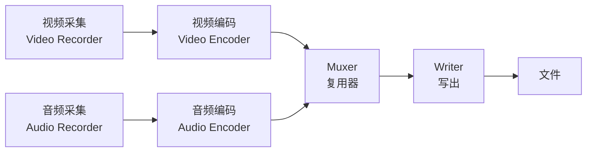
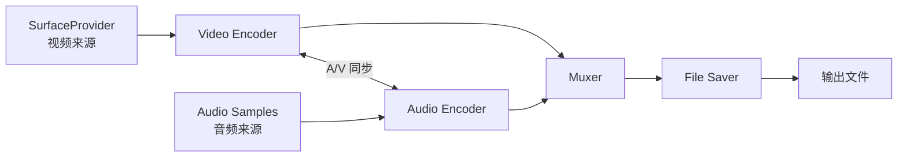
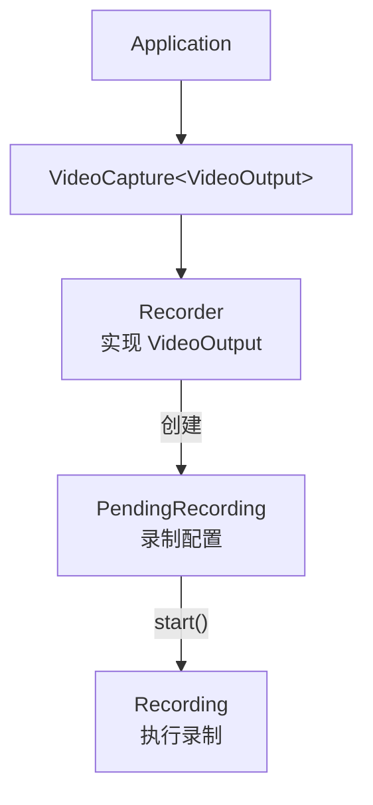

## 何为 CameraX

[CameraX](https://developer.android.google.cn/training/camerax) 是 Google 官方推出的 Jetpack 组件，用于简化相机功能开发。它是基于 [Camera2](https://developer.android.google.cn/training/camera2) 的上层封装，把大量兼容性适配交给库本身处理，让开发者用统一的 API 完成预览、拍照、帧分析、视频拍摄。

两个关键版本事实：

- **当前稳定版 1.6.2**（2026-08）；1.7 已在候选阶段。
- **最低系统版本**：1.4.x 及以前为 Android 5.0（API 21）；**1.5.0 起提升到 Android 6.0（API 23）**。

与 Camera2 相比，CameraX 的两个核心差异：**生命周期感知**（绑定 `LifecycleOwner`，随界面生命周期自动开/关相机，无需手动在 `onResume`/`onPause` 里启停），以及**基于"用例"（Use Case）**的抽象——把预览、拍照、帧分析、视频拍摄封装成四个用例，按需组合绑定。此外还有[厂商扩展 API](https://developer.android.google.cn/training/camerax/vendor-extensions)，在支持的设备上调用厂商能力实现人像、夜景等特效。

## 前置工作

CameraX 不随 Android SDK 内置，需引入依赖。推荐用 **BOM** 统一管理各模块版本，避免版本不一致：

```kotlin
val cameraxVersion = "1.6.2"

dependencies {
    // BOM：统一 CameraX 各模块的版本
    implementation(platform("androidx.camera:camera-bom:$cameraxVersion"))
    implementation("androidx.camera:camera-core")       // 核心库（camera-camera2 会间接引入，显式声明更清晰）
    implementation("androidx.camera:camera-camera2")    // 基于 Camera2 的实现
    implementation("androidx.camera:camera-lifecycle")  // 生命周期支持
    implementation("androidx.camera:camera-view")       // PreviewView 视图控件
    implementation("androidx.camera:camera-video")      // 视频拍摄
}
```

### 权限

相机和麦克风是敏感权限，必须在 Manifest 声明并在运行时动态申请：

```xml
<!-- 相机权限 -->
<uses-permission android:name="android.permission.CAMERA" />
<!-- 录音权限（拍视频需要） -->
<uses-permission android:name="android.permission.RECORD_AUDIO" />

<!-- 声明相机硬件需求；若相机非必需功能，required="false" 可避免 Play 过滤掉无相机设备 -->
<uses-feature android:name="android.hardware.camera.any" android:required="false" />
```

存储权限要特别说明——**旧资料里的 `READ_EXTERNAL_STORAGE` / `WRITE_EXTERNAL_STORAGE` 已经过时**：

- **保存自己拍的照片/视频到 MediaStore**：Android 10（API 29）起访问"自己创建的媒体文件"**不需要任何存储权限**；
- **读取其他应用创建的图片/视频**：Android 13（API 33）起改用细分的 `READ_MEDIA_IMAGES` / `READ_MEDIA_VIDEO`，旧的两个存储权限对 MediaStore 查询已失效。

运行时权限用 Activity Result API 申请：

```kotlin
private val requestPermission =
    registerForActivityResult(ActivityResultContracts.RequestMultiplePermissions()) { grants ->
        val cameraOk = grants[Manifest.permission.CAMERA] ?: false
        val audioOk = grants[Manifest.permission.RECORD_AUDIO] ?: false
        if (cameraOk) { /* 启动相机 */ }
    }

// 需要时调用
requestPermission.launch(arrayOf(Manifest.permission.CAMERA, Manifest.permission.RECORD_AUDIO))
```

## 基本使用

CameraX 通过"用例"组织功能，官方提供四个：`Preview`（预览）、`ImageCapture`（拍照）、`ImageAnalysis`（帧分析）、`VideoCapture`（视频拍摄）。

先准备一个非主线程的线程池，供 IO 与帧分析使用（直接在主线程执行会阻塞 UI 引发 ANR）：

```kotlin
private val cameraExecutor = Executors.newSingleThreadExecutor()
```

### 画面预览

`PreviewView`（`androidx.camera.view.PreviewView`）是 CameraX 提供的预览控件，放在布局里即可。

第一步，获取 `ProcessCameraProvider`（相机设备与生命周期的绑定入口）：

```kotlin
val cameraProviderFuture = ProcessCameraProvider.getInstance(this)
```

第二步，为它注册监听器。第二个参数是**回调执行的线程**——官方示例用主线程是为了在回调里操作 UI，**并非强制要求主线程**：

```kotlin
cameraProviderFuture.addListener({
    // 这里实现预览逻辑
}, ContextCompat.getMainExecutor(this))
```

预览逻辑在监听器里实现：

```kotlin
// 用 ProcessCameraProvider 绑定相机与生命周期
val cameraProvider: ProcessCameraProvider = cameraProviderFuture.get()

// 配置预览用例
val preview = Preview.Builder().build().also {
    // 让 PreviewView 提供用于渲染画面的 Surface
    it.setSurfaceProvider(binding.previewView.surfaceProvider)
}

// 默认后置摄像头
val cameraSelector = CameraSelector.DEFAULT_BACK_CAMERA

try {
    // 先解绑旧用例，再绑定新用例
    cameraProvider.unbindAll()
    val camera = cameraProvider.bindToLifecycle(this, cameraSelector, preview)

    // 点击预览画面重新对焦
    binding.previewView.setOnClickListener {
        camera.cameraControl.startFocusAndMetering(
            FocusMeteringAction.Builder(
                binding.previewView.meteringPointFactory.createPoint(it.x, it.y)
            ).build()
        )
    }
} catch (e: Exception) {
    // 捕获并处理异常
}
```

> 预览是最基础的功能，其余三个用例正常情况下都应与预览组合使用。

### 拍照

拍照的核心是 `ImageCapture` 用例：

```kotlin
val imageCapture = ImageCapture.Builder()
    .setTargetResolution(Size(1080, 1440)) // 目标分辨率
    .setTargetRotation(binding.previewView.display.rotation)  // 旋转方向跟随屏幕
    .setFlashMode(ImageCapture.FLASH_MODE_AUTO) // 自动闪光灯
    .setIoExecutor(cameraExecutor) // 照片保存的 IO 线程池
    .build()
```

> 早期版本有 `CAPTURE_MODE_MINIMIZE_LATENCY` / `CAPTURE_MODE_MAXIMIZE_QUALITY` 两个预设（`setCaptureMode`），现已弃用，改由 `setTargetResolution` 等精确控制。

调用 `takePicture()` 前，先配置照片的保存位置与文件名（用 MediaStore，高版本系统无需存储权限）：

```kotlin
val name = "IMG_${System.currentTimeMillis()}.jpg"
val outputOptions = ImageCapture.OutputFileOptions.Builder(
    contentResolver,
    MediaStore.Images.Media.EXTERNAL_CONTENT_URI,
    ContentValues().apply {
        put(MediaStore.Images.Media.DISPLAY_NAME, name)
        put(MediaStore.Images.Media.MIME_TYPE, "image/jpeg")
    }
).build()
```

执行拍照：

```kotlin
imageCapture.takePicture(outputOptions, cameraExecutor, object : ImageCapture.OnImageSavedCallback {
    override fun onError(exc: ImageCaptureException) {
        // 处理保存失败
    }

    override fun onImageSaved(output: ImageCapture.OutputFileResults) {
        val savedUri = output.savedUri   // 保存后的 Uri
    }
})
```

最后把用例一起绑定：

```kotlin
cameraProvider.bindToLifecycle(this, cameraSelector, preview, imageCapture)
```

### 帧分析

帧分析（官方称"图像分析"）用于对连续预览帧做实时处理（如 ML 检测、扫码）。两步：创建 `ImageAnalysis` 用例 + 实现 `ImageAnalysis.Analyzer` 接口。

创建 `ImageAnalysis` 用例：

```kotlin
val imageAnalyzer = ImageAnalysis.Builder()
	// 默认 YUV_420_888，也支持 RGBA_8888
    .setOutputImageFormat(ImageAnalysis.OUTPUT_IMAGE_FORMAT_YUV_420_888)
    // 分析分辨率（分辨率越高越耗资源）
    .setTargetResolution(Size(640, 480))
    // 背压策略：只保留最新帧                    
    .setBackpressureStrategy(ImageAnalysis.STRATEGY_KEEP_ONLY_LATEST) 
    .build()
```

> `STRATEGY_KEEP_ONLY_LATEST`（丢帧保实时）适合实时分析；`STRATEGY_BLOCK_PRODUCER`（阻塞直到消费）会拖慢相机，仅在对帧不丢有强要求时用。旧版的 `setImageQueueDepth` 已移除。

实现 `ImageAnalysis.Analyzer` 接口：

```kotlin
val analyzer = object : ImageAnalysis.Analyzer {
    override fun analyze(image: ImageProxy) {
        image.use { proxy ->
            // planes 表示一张图像的 YUV，planes[0]=Y、planes[1]=U、planes[2]=V
            proxy.planes.forEach { plane ->
                val buffer = plane.buffer
                // 处理每一帧
            }
        }
    }
}
```

> `ImageProxy` 实现 `AutoCloseable`，用 `use` 确保帧缓冲及时释放，否则会阻塞后续帧。YUV 中 Y 表示亮度、UV 组合表示色度。

把分析器挂到用例上（必须用后台线程池）：

```kotlin
imageAnalyzer.setAnalyzer(cameraExecutor, analyzer)
```

绑定：

```kotlin
cameraProvider.bindToLifecycle(this, cameraSelector, preview, imageCapture, imageAnalyzer)
```

### 视频拍摄

视频拍摄同时处理视频流与音频流，两者分别捕获编码，再经 Muxer 复用后写盘：



`VideoCapture` 用例的架构组件：



- `SurfaceProvider`：视频来源；
- `AudioSource`：音频来源；
- 视频/音频编码器 + 媒体复用器 + 文件保存器。

#### VideoCapture 的 API 层次

VideoCapture 通过几层对象把录制抽象出来：

- `VideoCapture`：顶级用例，绑定到 `LifecycleOwner`；
- `Recorder`：实现 `VideoOutput` 的对象，负责接收视频帧并保存（File / ParcelFileDescriptor / MediaStore），会自动选择系统最合适的格式（最常见 H.264 AVC + MP4 容器）；
- `PendingRecording`：录制配置对象，用 `Recorder` 创建；
- `Recording`：实际执行录制的对象，用 `PendingRecording` 创建。



流程：用 `QualitySelector` 创建 `Recorder` → 用 `OutputOptions` 配置输出 → 可选 `withAudioEnabled()` 启用音频 → `start()` 开始 → `Recording` 的 `pause()`/`resume()`/`stop()` 控制。

#### VideoCapture 的基本使用

创建 `Recorder`（需搭配 `QualitySelector` 选择分辨率）：

```kotlin
val qualitySelector = QualitySelector.fromOrderedList(
    listOf(Quality.UHD, Quality.FHD, Quality.HD, Quality.SD),
    FallbackStrategy.lowerQualityOrHigherThan(Quality.SD)
)

val videoRecorder = Recorder.Builder()
    .setExecutor(cameraExecutor)          // 必须是非 UI 线程池
    .setQualitySelector(qualitySelector)
    .build()
```

`QualitySelector` 提供四个预定义分辨率：

| 预定义分辨率 | 说明 |
| :---: | :---: |
| `Quality.UHD` | 4K 超高清（2160p） |
| `Quality.FHD` | 全高清（1080p） |
| `Quality.HD` | 高清（720p） |
| `Quality.SD` | 标清（480p） |

应用一般提供几个首选分辨率 + 一个后备策略（`FallbackStrategy`），在不支持首选时降级。

创建 `VideoCapture` 用例并绑定：

```kotlin
val videoCapture = VideoCapture.withOutput(videoRecorder)

cameraProvider.bindToLifecycle(this, cameraSelector, preview, imageCapture, videoCapture)
```

> **关于与 `ImageAnalysis` 的组合**：早期版本限制 `VideoCapture` 不能与 `ImageAnalysis` 同时绑定；现在已放开——官方允许 `Preview`、`VideoCapture`、`ImageAnalysis`、`ImageCapture` 各一个实例同时使用。但在硬件级别 FULL 及以下的设备上，同时组合多个用例会触发 stream sharing（复制 PRIV 流），带来更高延迟与耗电，实际能否同时跑取决于具体机型。

创建 `Recording`（真正执行录制的是 `Recording`，一个 `Recorder` 同一时刻只支持一个）：

```kotlin
val name = "VID_${System.currentTimeMillis()}.mp4"
val mediaStoreOutput = MediaStoreOutputOptions.Builder(
    contentResolver,
    MediaStore.Video.Media.EXTERNAL_CONTENT_URI
).setContentValues(
    ContentValues().apply {
        put(MediaStore.Video.Media.DISPLAY_NAME, name)
        put(MediaStore.Video.Media.MIME_TYPE, "video/mp4")
    }
).build()

val recording = videoRecorder.prepareRecording(this, mediaStoreOutput)
    .withAudioEnabled()   // 录制视频同时录音
    .start(cameraExecutor) { event ->
        when (event) {
            is VideoRecordEvent.Start -> { /* 开始录制 */ }
            is VideoRecordEvent.Status -> { /* 录制状态（时长/大小） */ }
            is VideoRecordEvent.Finalize -> {
                if (!event.hasError()) {
                    val uri = event.outputResults.outputUri   // 录制完成
                } else {
                    // 处理 event.error
                }
            }
        }
    }
```

`Recording` 还提供 `pause()` / `resume()` / `stop()`。调用 `stop()` 后相关对象会被自动清理，重新录制前必须重新配置 `Recording`，否则会 NPE。
