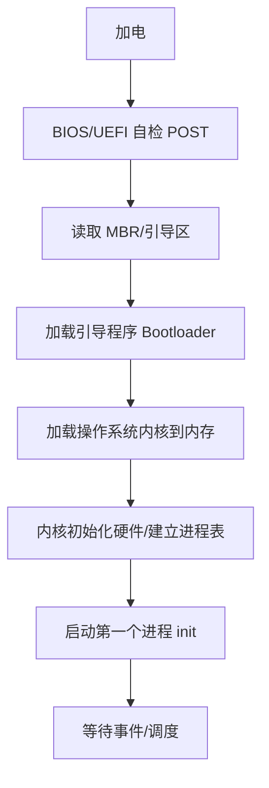
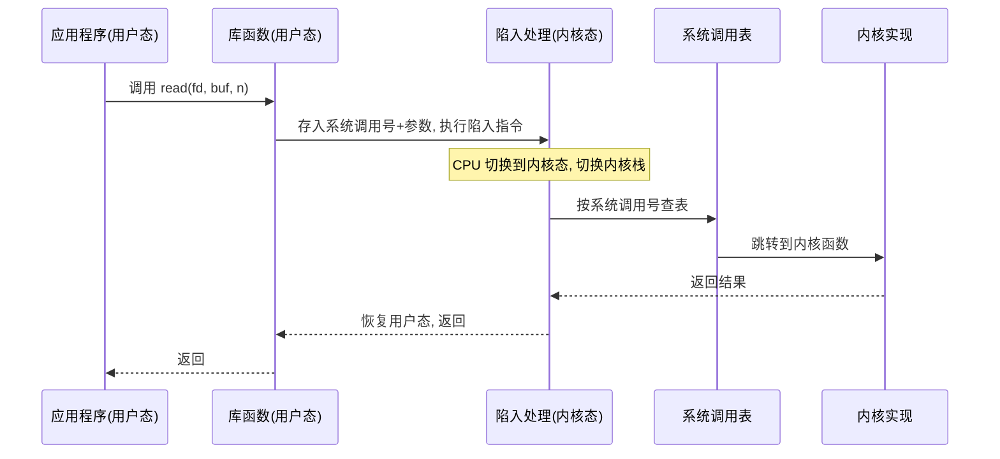
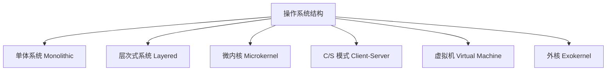

# 第1章 引论

## 本章要点

- 操作系统的定义与存在的必要性
- 计算机硬件的组成（处理器、存储器、磁盘、I/O 设备、总线）与启动过程
- 内核态与用户态的区别
- 操作系统的核心抽象（进程、地址空间、文件、I/O、保护、Shell）
- 系统调用机制，及其与普通函数调用的区别
- 操作系统的典型结构

---

## 一、什么是操作系统

### 1. 操作系统的必要性

一台计算机上同时运行着浏览器、播放器、编辑器等多个程序，它们都要使用 CPU、内存、硬盘、网卡。若各程序直接争夺硬件，会相互冲突——例如 A 程序读硬盘时 B 程序可能也在读，甚至互相覆盖数据。

因此，硬件与应用程序之间需要一个管理者，统一分配资源、提供服务。这个管理者就是**操作系统（Operating System, OS）**。

### 2. 操作系统定义的两种视角

操作系统没有公认的统一定义，通常从两个互补的视角来理解：

**视角一：自顶向下——对应用提供抽象**

硬件提供的接口往往是复杂、不一致的。让每个应用程序去适配成千上万种硬件接口，是不现实的。操作系统在中间隐藏底层硬件细节，向上提供清晰、一致、优雅的抽象（进程、地址空间、文件等）。

**视角二：自底向上——对硬件做资源管理**

从下往上看，操作系统的任务是：**记录哪些程序在使用什么资源、分配资源请求、评估使用代价，并调解不同程序/用户之间冲突的资源请求**。

> 概括而言：**操作系统是硬件与应用程序之间的"中间人"，既提供抽象，又管理资源。**

### 3. 资源复用的两种方式

操作系统用两种方式实现资源的共享（多路复用）：

- **时间复用（time multiplexing）**：一项资源由不同程序/用户**轮流**使用。例如 CPU 分时执行多个进程，每个进程轮流占用一小段时间片。
- **空间复用（space multiplexing）**：不同程序/用户各得到资源的**一部分**，无需排队。例如内存同时驻留多个程序，各自占一段空间。

时间复用与空间复用分别是分时系统、虚拟内存等机制的设计基础。

### 4. 操作系统的分类（大观园）

现实世界中的操作系统种类繁多，按运行环境可分为：

| 类型 | 特点 | 例子 |
|------|------|------|
| 大型机 OS | 面向海量 I/O 与高吞吐，分批处理/事务处理/分时三种服务 | IBM z/OS |
| 服务器 OS | 面向多用户网络服务 | Linux、Windows Server |
| 多处理器 OS | 支持多核/多 CPU 并行 | 现代 Linux、Windows |
| 个人计算机 OS | 面向单用户交互，强调易用性 | Windows、macOS、Linux |
| 掌上/移动 OS | 面向手机平板，省电、触屏 | iOS、Android |
| 嵌入式 OS | 运行在特定硬件，资源受限 | VxWorks、嵌入式 Linux |
| 传感器节点 OS | 极低功耗、极小内存 | TinyOS |
| 实时 OS | 保证在截止期内响应（硬/软实时） | VxWorks、QNX |
| 智能卡 OS | 极小规模、高安全 | Java Card |

不同运行环境对操作系统的要求差异显著，因此不存在通用的操作系统，只有适用于特定场景的操作系统。

---

## 二、计算机硬件简介

操作系统运行在硬件之上，硬件结构是理解操作系统行为的基础。下文介绍五大部件以及计算机的启动过程。

### 1. 处理器（CPU）

- CPU 是"大脑"，从内存中取指令、执行，周而复始。
- 每个 CPU 都有一套**指令集**，同时含若干寄存器：通用寄存器（存放变量/临时结果）、程序计数器（PC，指向下一条指令地址）、栈指针、程序状态字（PSW，含条件码、状态位等）。
- **流水线**：现代 CPU 把一条指令拆成取指、译码、执行等多级，同时并行处理多条指令，提升吞吐率。
- **多核**：一个芯片上放多个 CPU 核，各自有独立缓存、可独立执行。

### 2. 存储器（Memory）

计算机存储是一个**分层体系**，从上到下速度递减、容量递增：

| 层级 | 典型 | 速度 | 容量 |
|------|------|------|------|
| 寄存器 | CPU 内部 | 最快（1 个时钟周期） | 极小（几十个） |
| 高速缓存 Cache | L1/L2/L3 | 极快 | 几 KB ~ 几 MB |
| 主存 RAM | 内存条 | 快 | 几 GB ~ 几十 GB |
| 磁盘 | HDD/SSD | 慢 | 几百 GB ~ TB |

- **缓存（Cache）**：CPU 访问内存太慢，于是在两者间插入小而快的缓存，缓存最近访问的数据（依据"局部性原理"）。缓存命中则快，未命中则回主存取。
- 分层背后的核心规律：**越快的存储器越贵、容量越小**，所以必须用"快的小缓存 + 慢的大主存 + 更慢的磁盘"分层组合。

### 3. 磁盘（Disk）

- 机械硬盘（HDD）：由盘片、磁道、扇区、柱面组成，磁头寻道读取。访问时间 = 寻道时间 + 旋转延迟 + 传输时间。
- 固态硬盘（SSD）：基于闪存，无机械寻道，随机访问快得多。
- 磁盘是**块设备**，按固定大小的块读写。

### 4. I/O 设备

- 分**块设备**（磁盘，按块随机访问）与**字符设备**（键盘、打印机，按字符流）。
- 每个设备由**设备控制器**管理，控制器内含寄存器供 CPU 读写来下达命令、读取状态。
- 设备驱动是操作系统与控制器之间的软件桥梁。

### 5. 总线（Bus）

- 总线是 CPU、内存、设备之间的数据通道，分**地址总线、数据总线、控制总线**。
- 现代系统用多级总线（如高速 PCIe 总线连设备，慢速总线连键盘鼠标），速度各不同。

### 6. 启动计算机的过程（重要）

- 加电后，BIOS/UEFI 先做硬件自检，再找到引导设备，读入引导程序，由引导程序加载内核，内核完成初始化后进入正常工作状态。

---

## 三、内核态与用户态

### 1. 区分两种状态的原因

如果任何程序都能执行任意机器指令（如关中断、直接写硬盘、修改内存保护），那么一个普通程序的 bug 就可能导致整个系统崩溃。为保护系统，CPU 设计为两种运行状态：

- **内核态（管态/核心态）**：操作系统对硬件有完全访问权，可执行机器能运行的**任何**指令。
- **用户态**：只能执行机器指令的一个**子集**，一般应用程序都运行在用户态。

### 2. 状态切换

- 用户态程序需要执行特权操作（如读写文件、分配内存）时，不能直接做，必须通过**陷入（trap）/系统调用**进入内核态，由内核代劳。
- 某些会修改系统状态的指令被设计为**特权指令**，只有在内核态才能执行，用户态执行会触发异常。

用户态/内核态的区分是系统调用、保护机制、微内核等概念的底层前提。

---

## 四、核心抽象

操作系统最重要的价值，是向上提供一组**抽象**，使程序不必直接面对裸硬件。核心抽象包括以下各项。

### 1. 进程（Process）

- 本质：一个**正在执行的程序**，是容纳运行程序所需全部信息（代码、数据、堆栈、寄存器、打开文件等）的容器。
- 关键区别：进程是**活动**的（运行中、有状态、消耗资源），程序是**静态**的（磁盘上的一份文件）。同一个程序可对应多个进程。
- 每个进程有唯一的 **PID**；系统为其赋予 **UID**（用户标识），进程创建的子进程继承同一 UID；用户可属于组，还拥有 **GID**（组标识）。
- 内核维护一张**进程表**（数组或链表），记录每个进程的信息。

### 2. 地址空间（Address Space）

- 定义：从某个最小值到最大值的存储位置集合，进程在其中读写。
- 它是**逻辑概念**：可能映射到内存 + 磁盘（虚拟内存），因此其大小可大于也可小于物理内存。
- 一个地址空间可存放可执行程序、程序数据、堆栈等。每个进程有自己独立的地址空间，互不干扰（这就是"隔离"的来源）。

### 3. 文件（File）

- 对存储中特定格式数据集合的**高度抽象**，独立于任何硬件设备——不管是硬盘、U 盘还是网络盘，上层看到的都是"文件"。
- 访问文件时，若具备权限，系统返回一个**文件描述符（fd）** 小整数；否则返回错误码。
- 文件之下还有几个重要子概念：

**目录（Directory）**
- 用于分类保存文件，具有**层次结构**，可包含文件和其他目录，从而构成文件系统。
- 文件通过从**根目录**开始的**路径名**定位。**绝对路径**从根开始（如 `/home/user/a.txt`），**相对路径**从当前目录开始（如 `./a.txt`）。

**安装文件系统（Mount）**
- 把可移动介质（如 U 盘）的文件系统接入**主文件树**。
- 通过 `mount` 系统调用，把 U 盘的文件系统挂到根文件系统某个目录上，之后就能从根目录一路访问到 U 盘文件。

**特殊文件（Special File）**
- 作用：让 I/O 设备看起来像普通文件，可用相同调用方式读写，通常保存在 `/dev` 目录。
- **块特殊文件**：由可随机存取的块组成（如磁盘），访问时无需关心文件系统结构。
- **字符特殊文件**：用于接收/输出字符流的设备（如打印机、调制解调器）。

**管道（Pipe）**
- 一种**虚文件**，用于连接两个进程通信。发送方写入，接收方读出，交互类似普通文件读写。

### 4. 输入/输出（I/O）

- 操作系统通过设备控制器、驱动程序统一管理 I/O，向应用隐藏设备差异（详见第 5 章）。

### 5. 保护（Protection）

- 通过权限机制控制进程对资源的访问，防止进程间相互干扰或越权访问（详见第 9 章）。

### 6. Shell

- Shell **不是内核的一部分**，是运行在用户态的命令解释器，是用户与内核交互的接口之一。它读取命令并调用系统调用去执行。

---

## 五、系统调用（System Call）

### 1. 什么是系统调用

- 系统调用是操作系统提供的、供应用程序请求内核服务的 API，比如创建/删除/读写文件、创建进程、分配内存等。
- 它在**抽象层面**不依赖具体操作系统，但**具体实现**与操作系统相关。
- 系统调用提供的是系统服务，因此能进入内核执行指令。

### 2. 系统调用与普通函数调用的本质区别

两者在形式上都是"调用"，但底层机制完全不同：

| 维度 | 普通函数调用 | 系统调用 |
|------|--------------|----------|
| 运行状态 | 始终在用户态 | 从用户态陷入内核态 |
| 执行开销 | 仅保存调用点，跳转即可 | 需陷入（trap）、切换栈、权限检查，开销大 |
| 访问能力 | 只能访问用户态地址空间 | 可访问内核态全部资源 |
| 入口 | 直接函数地址 | 通过系统调用号查系统调用表 |

### 3. 系统调用的完整执行流程

逐步拆解：

1. **系统调用号**：每个系统调用有唯一编号，作为查表的索引。用户态程序把编号放入寄存器，再执行陷入指令。
2. **陷入指令**：如 x86 的 `syscall` / `int 0x80`，是用户态进入内核态的**唯一合法入口**。CPU 据此切换到内核态，跳转到固定的陷入处理入口。
3. **切换内核栈**：用户态和内核态各自有独立的栈（双栈），切换时需保存用户态寄存器、恢复内核态上下文。
4. **查系统调用表**：内核按编号查到对应的内核函数，校验参数（防止传入非法指针）后执行。
5. **返回**：内核函数返回后，内核恢复用户态上下文，把结果传回应用程序。

> 用户态程序不能直接访问内核资源，一切特权操作都必须"陷入"内核执行，这是"保护"机制得以实现的基础。

### 4. 系统调用的分类

- **进程管理类**：`fork`、`exec`、`wait`、`exit` 等。
- **文件管理类**：`open`、`read`、`write`、`close`、`lseek` 等。
- **目录管理类**：`mkdir`、`rmdir`、`opendir` 等。
- **其他类**：获取时间、设置属性、分配内存等。

---

## 六、操作系统结构

操作系统内部的代码组织方式经历了多种结构的演进，核心矛盾是**性能 vs 可靠性/可维护性**。

### 1. 单体系统（Monolithic System）

- **做法**：整个操作系统以过程集合方式编写，链接成一个大二进制可执行程序，在内核态以单一程序运行。
- **优点**：过程之间可自由高效调用，性能好。
- **缺点**：不受限制的调用多了会难以理解和维护；任何过程的崩溃都会拖累整个系统。
- 典型代表：早期的 UNIX、Linux、Windows 传统设计。

### 2. 层次式系统（Layered System）

- **做法**：把 OS 功能从下往上划分成若干层，除最底层外，上层都构建在下层之上，各层向上提供抽象（API）。
- **优点**：解决了单体系统自由调用带来的混乱，调用被限制在合理方向和范围。
- **缺点**：仍是内核态单一程序，任意层崩溃会拖累系统；且"内核-用户边界"如何划分并不总是一目了然。

### 3. 微内核（Microkernel）

- **做法**：为实现高可靠性，把 OS 划分成若干定义良好的小模块，**只有微内核本身运行在内核态**，其余模块（文件系统、驱动等）作为普通用户进程运行。
- **优点**：用户态模块出错不影响内核，系统可靠性高；内核更小巧。
- **缺点**：模块间靠消息传递通信，频繁的消息传递带来性能损耗。
- **机制与策略分离**是微内核的重要思想：机制（mechanism，"做什么"）放内核，策略（policy，"怎么做"）放用户态，便于灵活调整。
- 应用领域：对可靠性要求极高的实时/工业/航空/军工系统（如 QNX、MINIX）。桌面系统为性能仍偏向单体/混合设计。

### 4. C/S 模式（Client-Server）

- 可视为微内核的一种变体。进程分为**客户端进程**（使用服务）和**服务器进程**（提供服务）。
- 客户端要获得服务，需**构造一段说明所需服务的消息 → 发送给合适的服务器**；服务器收到后完成工作并返回响应。
- 客户端与服务器是否在同一台设备上无关紧要——都是"发消息、得回应"，典型应用即网站。

### 5. 虚拟机（Virtual Machine）

- 在硬件之上再加一层软件，模拟出多台独立机器，每台都能运行自己的操作系统（详见第 7 章）。
- 优点：隔离性好；缺点：性能损耗。

### 6. 外核（Exokernel）

- 内核只做**资源分区**（把硬件资源安全地划分给应用），把尽可能多的控制权交给应用层库。
- 优点：应用可深度优化性能；缺点：实现极其复杂，实际应用少。

### 7. 实时操作系统

> **硬实时**：动作必须在规定时间点/时间范围内执行，否则产生严重后果（如导弹制导）。**软实时**：允许偶尔违反最终期限，且不造成永久性损害（如多媒体播放）。

---

## 七、进一步了解的原理性知识

1. **C 语言与操作系统的关系**：内核几乎都用 C（及少量汇编）编写，因为 C 既有接近汇编的控制能力（直接操作内存、寄存器），又有高级语言的抽象，被称为"可移植的汇编"。

2. **个体重复系统发育**：新操作系统的开发往往会重演操作系统发展史——先做进程管理，再做内存、文件系统。理解这个规律，能更好地理解操作系统的分层演进。

3. **历史脉络（五代）**：真空管批处理（1945-1955）→ 晶体管批处理（1955-1965）→ 集成电路与多道程序设计（1965-1980）→ 个人计算机（1980 至今）→ 移动计算机（1990 至今）。每一代的推动力都是"让昂贵/稀缺的硬件更高效地被利用"。

---

## 小结

- 操作系统 = 抽象提供者 + 资源管理者，通过时间复用与空间复用实现资源共享。
- 硬件五大件（处理器、存储器、磁盘、I/O、总线）及"加电→BIOS→引导→内核"的启动过程，是理解 OS 行为的起点。
- 内核态（全权访问硬件）与用户态（受限指令子集）的区分，是保护与系统调用的前提。
- 核心抽象：进程、地址空间、文件（含目录/mount/特殊文件/管道）、I/O、保护、Shell。
- 系统调用通过「系统调用号 + 陷入指令」进入内核态，与普通函数调用有本质区别（状态切换、双栈、开销）。
- 结构从单体 → 层次 → 微内核 → 虚拟机演进，核心矛盾是**性能 vs 可靠性/可维护性**。
