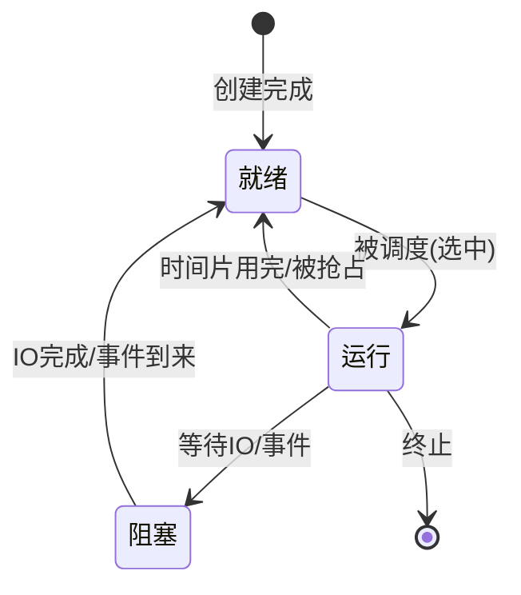
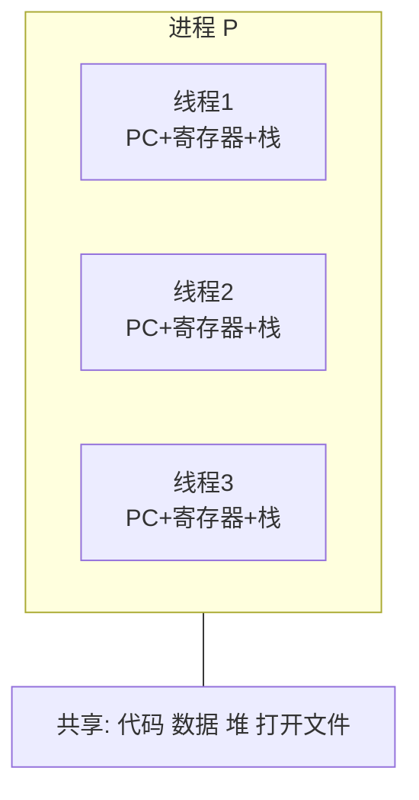
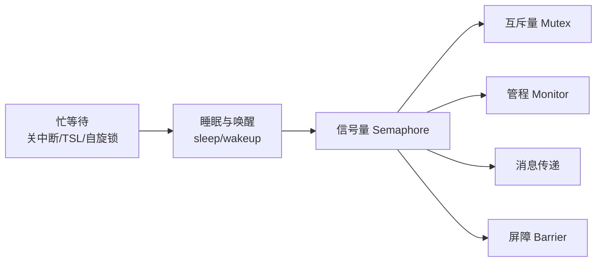

# 第2章 进程与线程

## 本章要点

- 进程的定义、状态、创建与终止
- 线程的引入原因，用户态线程与内核态线程的区别
- 进程/线程的通信与同步，竞争条件的规避
- 操作系统的进程/线程调度

---

## 一、进程（Process）

### 1. 进程模型与多道程序设计

早期的计算机一次只能运行一个程序，CPU 大部分时间都在等待慢速的 I/O 设备，利用率低。**多道程序设计**让内存同时驻留多个程序，CPU 在它们之间快速切换——当一个程序等待 I/O 时，CPU 转去运行另一个，从而大幅提升利用率。

为实现"快速切换"，必须为每个运行中的程序维护一份完整状态，由此引入**进程**：

> **进程 = 正在执行的程序 + 它占用的全部资源**（CPU 时间、内存、文件、I/O 设备）。

- **程序是静态的**（磁盘上的文件），**进程是动态的**（运行中的实体）。同一程序可对应多个进程（如同时打开两个终端）。
- CPU 在多个进程间快速切换，制造"多个程序同时运行"的假象（单核是假并行，多核才是真并行）。

### 2. 进程的创建与终止

**创建进程的四种典型场景：**

1. **系统初始化**：开机时启动的前台/后台进程（守护进程）。
2. **`fork` 系统调用**：一个运行中的进程调用 `fork` 创建自己的副本（子进程）。
3. **用户请求启动程序**：双击图标、敲命令。
4. **批处理作业**：批处理系统提交的作业。

**终止进程的四种典型场景：**

1. 正常退出（如 `exit`）。
2. 出错退出（如参数错误）。
3. 致命错误（如访问非法内存、除零）。
4. 被其他进程杀死（如 `kill`）。

**进程层次（进程树）**：父进程创建子进程，子进程可再创建子进程，形成一棵进程树。在 UNIX/Linux 中，所有进程最终都是 `init`（PID 1）的后代。

### 3. 进程的状态

一个进程在其生命周期中，会在三种状态之间迁移：



| 状态 | 含义 | 何时进入 |
|------|------|----------|
| 运行（Running） | 正在占用 CPU | 被调度器选中 |
| 就绪（Ready） | 可运行，等待 CPU 分配 | 创建完成 / I/O 完成 / 时间片用完 |
| 阻塞（Blocked） | 等待某事件，事件未到不能运行 | 发起 I/O / 等锁 / 等网络 |

> 两条关键转换：
> - **运行 → 就绪**：时间片用完，或被更高优先级进程抢占。
> - **运行 → 阻塞**：主动发起 I/O 或等待某事件，直到事件发生。

### 4. 进程的实现：PCB 与上下文切换

- 内核维护一张**进程表**（数组或链表），每一项就是该进程的 **PCB（进程控制块）**，记录了进程的全部管理信息：
  - CPU 寄存器、程序计数器（PC）
  - 内存映射信息（代码段、数据段、栈的地址范围）
  - 打开的文件列表、当前工作目录
  - 进程状态、优先级、PID、UID
  - 信号、资源占用统计等

- **上下文切换（Context Switch）**：CPU 从进程 A 切到进程 B 时——
  1. 把 A 的寄存器、PC 等保存到 A 的 PCB；
  2. 从 B 的 PCB 加载 B 的寄存器、PC；
  3. CPU 继续执行 B。

- **切换是有代价的**：不仅切寄存器，还会冲刷 CPU 缓存、TLB 等，频繁切换会拖慢系统。这也是协程比线程更轻量的底层原因之一。

---

## 二、线程（Thread）

### 1. 线程的引入

进程虽然解决了"并发运行多个程序"，但仍有两个痛点：

1. **进程太重**：创建、切换进程开销大。
2. **进程间共享数据麻烦**：不同进程地址空间隔离，想共享数据得靠 IPC，成本高。

于是引入更轻量的**线程**：一个进程内部可以包含多个线程，它们**共享进程的地址空间和资源**，但各自拥有独立的程序计数器、寄存器、栈。



**关键结论**：
- 进程是**资源分配的单位**，线程是 **CPU 调度的单位**。
- 线程切换比进程切换轻量（因为不需要切换地址空间）。
- 同进程内线程共享数据无需 IPC，直接读写内存即可（但这也带来竞争条件问题，见第三节）。

### 2. 用户态线程 vs 内核态线程 vs 混合实现

线程的管理者是一个关键设计选择：

| 模型 | 实现位置 | 优点 | 缺点 |
|------|----------|------|------|
| 用户态线程 | 用户态线程库，内核不知情 | 切换快（无需陷入内核） | 一个线程阻塞会阻塞整个进程；无法利用多核 |
| 内核态线程 | 内核直接管理 | 可多核并行；线程阻塞不影响其他线程 | 创建/切换需系统调用，开销大 |
| 混合实现 | 内核线程上复用多个用户线程 | 兼顾性能与灵活性 | 实现复杂 |

> 用户态线程的核心缺陷：内核"看不见"这些线程，当某个用户态线程发起阻塞式系统调用时，内核会阻塞整个进程。这也是现代多核系统普遍采用内核态线程或混合模型的原因。

### 3. POSIX 线程与调度程序激活机制

**POSIX 线程（pthreads）**

- POSIX 是 IEEE 定义的线程标准接口（`pthread_create`、`pthread_join` 等），让程序用统一 API 操作线程。
- 关键点：POSIX 只规定**接口**，不规定底层是用户态还是内核态实现——各系统可自行选择，程序无需关心底层。

**调度程序激活（Scheduler Activations）**

- 解决"用户态线程与内核态线程脱节"的进阶方案：内核在发生阻塞等事件时，通过**上行调用（upcall）**通知用户态线程库，由线程库决定如何调度用户线程。
- 目的：让用户态线程库既能享受用户态切换的轻量，又能感知内核的调度事件，兼得二者优点。

---

## 三、进程间通信与同步（IPC）

### 1. 竞争条件（Race Condition）

经典例子：两个进程都想往共享的打印队列里加一项。

```text
进程 A 读 in = 7
进程 B 读 in = 7        ← 都读到 7
进程 A 把文件放到 7 号槽，in 变成 8
进程 B 把文件放到 7 号槽，in 变成 8   ← 覆盖了 A 的文件！
```

结果：A 的文件丢了。原因在于"读 in → 放文件 → 写 in"这段操作被并发执行、交错运行，最终结果**取决于执行顺序**。

> **竞争条件**：多个进程/线程并发读写共享数据，最终结果取决于执行顺序——这是并发 bug 的根源。

**解决核心：临界区（Critical Section）**——把访问共享内存的那段代码保护起来，保证**互斥**（同一时刻最多一个进程在临界区里）。

一个良好互斥方案应满足四要素：

1. 任何时刻最多一个进程在临界区内。
2. 不假设 CPU 数量或速度。
3. 临界区外的进程不得阻塞其他进程。
4. 进程不应无限期等待进入临界区。

### 2. 互斥方案的演进



**① 忙等待方案（自旋锁）**

- **关中断**：进程进入临界区前关中断，出来后开中断。缺点：把中断权交给用户进程很危险（它忘了开中断系统就停了）；且多核下无效。
- **TSL（测试并加锁）**：依赖硬件原子指令，读一个内存字并同时写入非零值，不可分割。进程在循环里反复尝试，直到抢到锁。
- 特点：**忙等待**——抢不到锁时死循环空转，浪费 CPU。适合临界区**极短**的场景（因为等待时间短，空转比切换线程更划算）。

**② 睡眠与唤醒（sleep/wakeup）**

- 忙等待浪费 CPU，于是引入 `sleep`（进程阻塞自己）和 `wakeup`（唤醒阻塞进程）。
- 但裸用 sleep/wakeup 会引入**丢失唤醒（lost wakeup）**问题：如果 wakeup 发生在 sleep 之前，唤醒信号就丢了，进程可能永远睡下去。
- 于是需要更严谨的同步原语——信号量。

**③ 信号量（Semaphore）**

- Dijkstra 提出。一个整型计数器，配合两个原子操作：
  - **P（down）**：若值 > 0 则减 1；若值 = 0 则进程阻塞（挂到等待队列，不忙等）。
  - **V（up）**：若有人阻塞则唤醒一个；否则值加 1。
- 关键：P/V 操作是**原子**的（通过关中断或 TSL 保证），且阻塞是"睡眠"而非"忙等"。
- **两种用法**：
  - **互斥信号量**：初值 1，保护临界区（P 进入、V 离开）。
  - **同步信号量**：初值 0，用于"等待事件发生"——生产者 V、消费者 P。

**④ 互斥量（Mutex）**

- 二值信号量的特化，只有"锁定/解锁"两态，语义更纯粹、更不易误用。

**⑤ 管程（Monitor）**

- 高级语言层面的原语（编译器保证互斥），配合**条件变量**使用。进程在条件变量上 `wait`（阻塞自己并释放锁）或 `signal`（唤醒等待者）。
- 好处：把互斥与同步的细节交给编译器，程序员不易写错。

**⑥ 消息传递**

- 不共享内存，而是通过 `send`/`receive` 传递消息，天然适合跨进程/跨机器。

**⑦ 屏障（Barrier）**

- 所有线程都必须到达某个同步点，才能继续往下执行。常用于并行计算的阶段划分。

**⑧ 读-复制-更新（RCU）**

- 一种**避免使用锁**的同步机制：读者完全无锁读取；写者先复制一份数据、在副本上修改，改完后一次性切换指针让读者看到新版本，旧版本等所有读者读完后再回收。
- 适用场景：**读多写少**（如内核的路由表、配置表），读者无锁开销极低，写者成本较高但可接受。
- 这是现代 Linux 内核大量使用的机制，与前面"加锁互斥"的思路本质不同：**用"复制 + 延迟回收"换取"读者零开销"**。

### 3. 经典 IPC 问题

**① 生产者-消费者问题**

- 场景：一个生产者往有界缓冲放数据，一个消费者取数据。
- 约束：缓冲满时生产者不能放（要等消费者取走），缓冲空时消费者不能取（要等生产者放入）。
- 解法：用**两个同步信号量**（空槽数 `empty`、满槽数 `full`）+ 一个互斥信号量。

**② 哲学家就餐问题**

- 场景：5 个哲学家围坐，5 根筷子，每人左右各一根。吃饭需要同时拿左右两根筷子。
- 风险：如果每个人都先拿左边（或都先拿右边）的筷子，就会死锁。
- 解法之一：让其中一人**先拿右边**（打破对称/破坏循环等待）。这是第 6 章"死锁"的经典引子。

**③ 读者-写者问题**

- 场景：多个读者可同时读共享数据（读不冲突），但写者必须独占。
- 难点：如果读者源源不断，写者可能一直等不到机会（**写者饥饿**），需要额外机制保证公平。

---

## 四、调度（Scheduling）

### 1. 何时调度

- 新进程创建时；进程退出时；进程阻塞时；I/O 中断发生时。

### 2. 三类环境下的调度算法

不同系统追求的目标不同，算法也不同：

| 环境 | 目标 | 典型算法 |
|------|------|----------|
| 批处理 | 吞吐量、周转时间、CPU 利用率 | FCFS、SJF（最短作业优先）、最短剩余时间优先 |
| 交互式 | 响应时间 | 轮转 RR、优先级调度、多级队列 |
| 实时 | 满足截止期 | 速率单调、最早截止时间优先 EDF |

**关键算法拆解：**

- **FCFS（先来先服务）**：按到达顺序执行。简单公平，但"短作业等长作业"会导致平均等待时间变长。
- **SJF（最短作业优先）**：先执行最短的作业，平均周转时间最优，但长作业可能饿死，且需预知作业长度。
- **轮转 RR（Round Robin）**：每个进程轮流用一个小时间片，用完就排到队尾。适合交互式系统。

### 3. RR 时间片的权衡

- 时间片太短 → 切换开销占比高，CPU 效率低。
- 时间片太长 → 响应时间变差，交互卡顿。
- 折中目标：**时间片远大于切换开销，又足够短以保证响应**（典型如 20–50ms）。

### 4. 策略与机制分离

- **机制（mechanism）**在内核（提供调度能力），**策略（policy）**在用户态（决定怎么调）。二者分离，便于灵活调整而不必改内核。

---

## 五、进一步了解的原理性知识

1. **fork 的写时复制（COW）**：`fork` 创建子进程时并不立即复制全部内存，而是让父子共享只读页；任一进程写入时才复制该页。这是 fork 性能优化的关键。

2. **互斥的"忙等 vs 阻塞"**：自旋锁忙等（短临界区高效），信号量阻塞（长临界区高效）。工程上按临界区长短选择——内核多用自旋锁，应用层多用互斥锁。

3. **锁的粒度**：锁保护的范围越细（细粒度锁），并发度越高，但死锁风险也越大。这是并发编程的经典权衡。

---

## 小结

- 进程是资源分配单位，线程是 CPU 调度单位；线程共享地址空间，切换更轻量。
- 三状态（运行/就绪/阻塞）是理解一切并发的基石。
- 竞争条件是并发 bug 的根源，解法是互斥访问临界区；工具从自旋锁→信号量→管程→消息传递逐级抽象，本质是"忙等"与"阻塞"的权衡。
- 调度在批处理/交互式/实时三种场景目标不同，RR 时间片是典型折中。
- 生产者-消费者、哲学家就餐、读者-写者是理解同步的三个经典模型。
