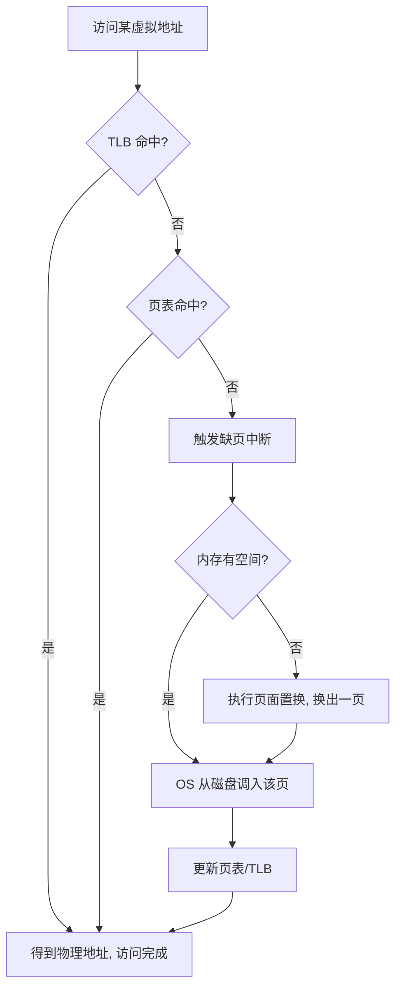
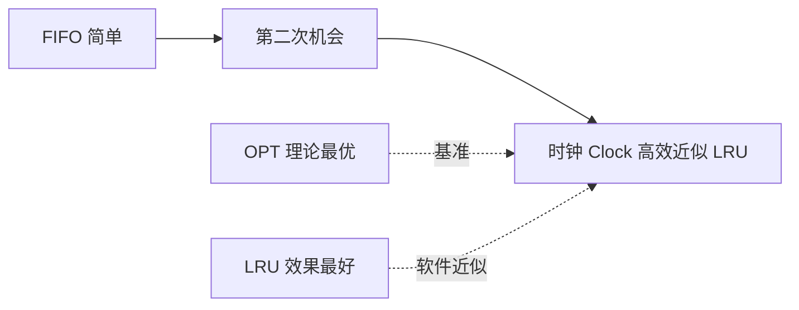

# 第3章 内存管理

## 本章要点

- 地址空间的引入原因，虚拟内存的含义
- 分页机制下的虚拟地址到物理地址的翻译过程
- 页表需要 TLB 加速、多级结构的原因
- 内存不足时的页面置换算法

---

## 一、地址空间抽象

### 1. 无抽象的内存管理

早期计算机上，程序直接操作物理内存地址，没有任何抽象。这带来三个严重问题：

1. **互相干扰**：两个程序同时运行，可能读写同一块物理内存，互相破坏。
2. **重定位困难**：程序硬编码了物理地址，换个内存布局就跑不了。
3. **无法多道程序设计**：多个程序无法安全地共存于内存。

### 2. 引入地址空间

**地址空间（address space）**：一个进程可以使用的、从最小值到最大值的一组逻辑地址。每个进程拥有自己独立的地址空间。

- 进程在地址空间里读写（逻辑地址），由操作系统负责把逻辑地址**映射**到物理内存。
- 好处：
  - **隔离保护**：进程 A 访问不到进程 B 的地址空间，互不干扰。
  - **便于多道程序设计**：多个进程可安全共存。
  - **程序不必关心物理位置**：程序写的是逻辑地址，实际放哪由 OS 决定。

> 核心思想：**在进程和物理内存之间加一层"映射"**，让每个进程以为自己独占一块连续内存。后续的交换、分页、虚拟内存，都是这层映射的不同实现方式。

### 3. 交换（Swapping）

- **做法**：内存不足时，把某个进程**整体**从内存换出到磁盘（swap out），腾出空间给别的进程；需要时再换回来（swap in）。
- **缺点**：粒度太大（整个进程），换入换出开销高。
- 现代系统已较少整进程交换，改用更细粒度的**分页**。

### 4. 空闲内存管理

进程需要分配内存时，记录空闲内存有两种方式：

- **位图法**：内存按分配单元划分，每个单元对应一个位，1=占用、0=空闲。
- **空闲链表法**：维护一条空闲区链表，分配时有三种策略：
  - **首次适配**：找到第一个够大的空闲区。
  - **最佳适配**：找到最小的够用空闲区。
  - **最差适配**：找到最大的空闲区。

> 权衡：位图固定占空间但找连续区需扫描；链表灵活但可能产生碎片。这些策略的目标都是**减少碎片、提高利用率**。

---

## 二、虚拟内存与分页

### 1. 分页（Paging）的基本思想

**分页**是现代操作系统内存管理的核心机制：

- 把**物理内存**划分为固定大小的块，叫**页框（Page Frame）**。
- 把**逻辑地址空间**划分为同样大小的块，叫**页（Page）**。
- 任何一页都可以装入任意一个页框，用**页表（Page Table）**记录"第几页 → 哪个页框"的映射。

> 关键：虚拟地址 = **页号 + 页内偏移**；查页表把页号翻译成帧号，**偏移量不变**，拼接起来就是物理地址。

### 2. 分页实现虚拟内存的原理

分页带来一个关键能力：**不需要把进程的整块地址空间都装入内存**。

- 页表中每一项可以标记"这一页现在在不在内存里"（存在位）。
- 当进程访问一个"不在内存"的页时，触发**缺页中断**，由操作系统把这一页从磁盘调入。
- 于是：进程地址空间可以大于物理内存，因为只有**正在使用的页**才需要在内存里。

这就是**虚拟内存**的本质：**让程序以为拥有完整的连续大内存，实际由 OS 按需映射到物理内存 + 磁盘。**

### 3. 页表项（PTE）的结构

每个页表项除了"帧号"，还包含若干控制位：

| 位 | 含义 |
|----|------|
| 存在/缺页位（P） | 该页是否在内存中（0 则访问触发缺页中断） |
| 保护位（R/W/X） | 读、写、执行权限 |
| 引用位（R） | 是否被访问过（页面置换算法的依据） |
| 修改位（M，脏位） | 是否被写过（换出时决定是否写回磁盘） |
| 缓存禁用位 | 是否禁止该页进入 CPU 缓存 |

### 4. 页表的加速与多级结构

**页表体积问题**

- 32 位地址空间（4GB）、每页 4KB，页表项多达 100 万条。单级页表过大且大部分空闲。
- **多级页表**：把页表本身也分页，只分配实际用到的下级页表，显著节省内存。代价是翻译需多步（这是 TLB 重要的原因）。

**访存性能问题**

- **TLB（快表，Translation Lookaside Buffer）**：一个很小的硬件缓存，缓存最近用过的"页号→帧号"映射。
- 访问内存时先查 TLB，命中则直接得到物理地址（极快）；未命中再走完整的页表查找。

| 技术 | 作用 |
|------|------|
| 页表 | 页号 → 帧号映射，每进程一份 |
| 快表 TLB | 缓存最近用过的页表项，加速地址翻译 |
| 多级页表 | 页表本身分页，节省大地址空间下的页表内存 |
| 倒排页表 | 以帧为索引，节省内存但查找慢 |

### 5. 缺页中断（Page Fault）的完整流程

补充两点：
- 若换出的页被修改过（M=1），换出前需先**写回磁盘**（脏页写回）。
- 若换出的页没被改过（干净页），直接丢弃即可，无需写回。

---

## 三、页面置换算法

当内存已满、需要调入新页时，必须淘汰一个旧页。**目标：减少缺页率**（被淘汰的页越可能是"近期不会用"的越好）。

### 算法逐一讲解

**① 最优置换 OPT（理论基准）**
- 淘汰**未来最久**都不会用到的页。
- 缺点：需要预知未来访问序列，**无法实现**。它作为理论最优基准，用来衡量其他算法差多少。

**② 先进先出 FIFO**
- 淘汰最早调入的页，维护一个队列。
- 缺点：最早调入的页可能正是频繁使用的页，容易误伤。

**③ 第二次机会（Second Chance）**
- 对 FIFO 的改进：检查队首页的引用位 R，若 R=1（最近被用过）就把它置 0、移到队尾，再给一次机会；若 R=0 才淘汰。

**④ 时钟算法（Clock）**
- 第二次机会的**环形链表**实现：指针在环形链表上扫描，遇 R=1 置 0 继续，遇 R=0 淘汰。
- 优点：高效、近似 LRU，是实际系统常用算法。

**⑤ 最近最少使用 LRU**
- 淘汰**最久未使用**的页（基于"过去用得多、未来大概率还用"的经验）。
- 优点：效果好；缺点：精确实现需硬件记录每次访问，开销大，故多用软件近似。

**⑥ 最近未使用 NRU**
- 按 R 位和 M 位把页分 4 类，随机淘汰最低类。简单近似。

**⑦ 工作集（Working Set）与 WSClock**
- 基于"进程在一段时间内访问的页集合（工作集）"，淘汰不在工作集中的页，更贴近程序局部性。

### 局部性原理（根本原因）

这些"猜测未来"的置换算法能生效，源于程序访问内存的**局部性**：

- **时间局部性**：刚访问过的地址，短期内很可能再次访问（如循环变量）。
- **空间局部性**：访问一个地址后，很可能访问它附近的地址（如数组遍历）。

> 局部性原理是内存管理一切优化的根基，也是 CPU 缓存、预取等技术的依据。

### Belady 异常

- 现象：**增加页框数，缺页率反而升高**。
- FIFO 算法会触发此异常；而 LRU、OPT 这类"栈式算法"不会（增加内存至少不会更差）。
- 意义：说明"内存越多越好"并非对所有算法都成立——**选对算法比单纯加内存更重要**。

### 页面系统中的设计问题

除"淘汰哪一页"外，分页系统还涉及几个设计权衡：

- **局部分配 vs 全局分配**：局部分配——每个进程只能淘汰自己的页（隔离性好，但可能浪费）；全局分配——可从别的进程抢页（利用率高，但可能拖垮别的进程）。现代系统多为混合。
- **负载控制**：内存中进程太多会导致频繁缺页（**抖动 thrashing**），系统需控制同时运行的进程数，必要时换出整个进程。
- **共享页面与共享库**：多个进程共享同一份只读代码页（如共享库 libc），节省内存；配合写时复制（COW），共享页在写入时才分裂出私有副本。
- **分离的指令空间与数据空间**：代码段与数据段分开，代码只读可共享，数据可写。
- **清除策略**：定期把"脏页"提前写回磁盘，这样真正缺页时能快速腾出干净页框，减少换页等待。

---

## 四、分段（Segmentation）

- **做法**：按逻辑单元（代码段、数据段、栈段）把地址空间划分成若干段，每段长度可变。
- 与分页的区别：
  - 分页是固定大小、对程序员透明（纯硬件划分）；
  - 分段是逻辑划分、有语义（程序员知道有代码段/数据段）。
- 现代系统多为**段页式结合**（如 x86 的历史实现）。

### 段页式结合：MULTICS 与 x86

- 单纯分段有"外部碎片"问题，单纯分页缺少逻辑语义，于是有了**段页式**：先分段、段内再分页。
- **MULTICS** 是段页式的先驱：每个段有自己的页表，虚拟地址 = 段号 + 页号 + 偏移。
- **Intel x86** 历史上也采用段页式（逻辑地址 → 线性地址 → 物理地址），但现代 64 位模式已弱化分段，以分页为主。

---

## 五、进一步了解的原理性知识

1. **写时复制（COW）**：多个进程共享只读页，写入时才复制独立副本。`fork` 创建子进程、`mmap` 映射文件都依赖此机制——这就是 fork 能"瞬间完成"的原因。

2. **内存映射文件**：把文件映射到地址空间，访问内存即读写文件，省去系统调用，适合大文件与共享库。

3. **页大小的权衡**：页太大 → 内部碎片多；页太小 → 页表变大、磁盘传输效率低。4KB 是长期折中的结果。

---

## 小结

- 地址空间抽象带来隔离与多道程序设计，核心是"进程与物理内存之间加一层映射"。
- 分页是核心：虚拟地址 = 页号 + 偏移，页表完成映射，TLB 加速，多级页表省内存。
- 缺页中断实现"按需调页"，是虚拟内存得以成立的关键。
- 页表项含存在位、引用位、修改位等控制信息。
- 页面置换算法围绕"减少缺页"展开，时钟算法是实际常用的 LRU 近似；Belady 异常说明算法选择的重要性。
- 局部性原理（时间 + 空间）是内存管理一切优化的根基。
