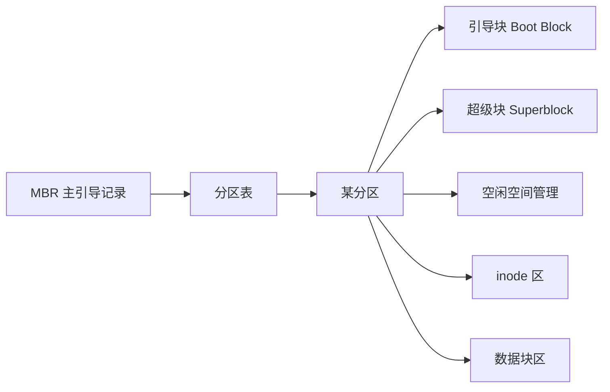
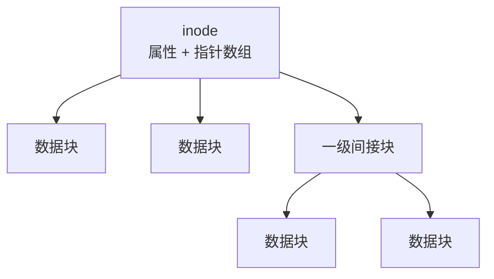
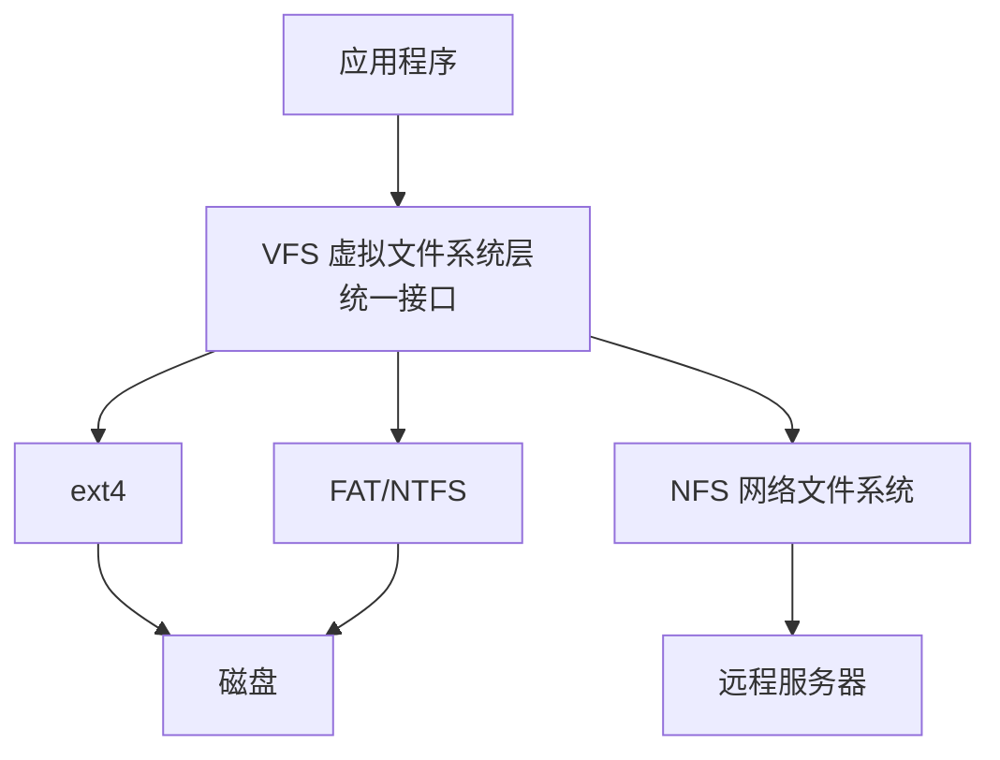

# 第4章 文件系统

## 本章要点

- 文件的属性与操作
- 目录对文件的组织方式
- 文件系统在磁盘上的实现，inode 的作用
- 日志文件系统与虚拟文件系统

---

## 一、文件（File）

### 1. 文件抽象的意义

磁盘本质是一堆 0/1 字节，若每个程序直接按物理块号读写磁盘，就需要知道数据存于哪个块、块多大、如何避开其他数据，复杂度极高。

操作系统引入**文件**这一抽象：**对存储数据集合的统一视图，独立于任何物理设备**。程序只需指定"打开 a.txt 读 100 字节"，无需关心数据实际位于磁盘的哪个磁道扇区。

这是"抽象"思想的体现：向应用隐藏设备细节，提供一致的访问方式。

### 2. 文件的命名与结构

- **命名规则**：因系统而异（扩展名、大小写敏感性等）。扩展名只是约定，告诉程序文件"大概是什么"，并非强制的类型声明。
- **文件结构**（内核如何看待文件内容）：
  - **字节序列**（UNIX/Linux）：内核不关心文件内部结构，最灵活，应用自行解释。
  - **记录序列**（早期大型机）：定长/变长记录。
  - **树**：带键的记录树。

### 3. 文件类型

- 普通文件、目录、字符特殊文件（字符流设备）、块特殊文件（磁盘等）。

### 4. 文件访问方式

- **顺序访问**：从头到尾依次读。
- **随机访问**：通过 `seek` 直接跳到任意位置读写。

### 5. 文件属性与操作

- **属性**：大小、创建/修改时间、权限、所有者、是否隐藏等。
- **常见操作**：`create`、`delete`、`open`、`close`、`read`、`write`、`seek`、`get/set attributes`。
- `open` 的意义：打开文件后，系统返回一个**文件描述符（fd）**，后续操作都用 fd 引用该文件，无需每次重新解析路径。

---

## 二、目录（Directory）

### 1. 目录的作用

如果所有文件都平铺在一个地方，文件一多就找不到。目录就是用来**分类组织文件**的：

- 目录本身也是一个"文件"，其内容是「文件名 → 元数据」的映射表。
- 目录可以包含文件和其他目录，从而构成**层次结构**（树状）。
- 文件的定位靠**路径名**：**绝对路径**从根目录开始（`/home/user/a.txt`），**相对路径**从当前目录开始（`./a.txt`）。

### 2. 目录操作

- `create`（建目录）、`delete`、`opendir`、`closedir`、`readdir`（列出目录项）、`rename`、`link`/`unlink`（链接相关，见后文）。

---

## 三、文件系统的实现

### 1. 文件系统在磁盘上的布局

一个磁盘分区从外到内大致如下：

| 组成 | 作用 |
|------|------|
| MBR（主引导记录） | 磁盘最开头，含引导代码和分区表 |
| 引导块 | 分区内的引导程序 |
| 超级块（Superblock） | 记录文件系统的关键参数：类型、块大小、inode 数等 |
| 空闲空间管理 | 位图或链表记录哪些块空闲 |
| inode 区 | 存放文件元数据（索引节点） |
| 数据块区 | 存放文件实际内容与目录数据 |

### 2. 文件如何存储：inode 索引节点

文件的内容和元数据是分开存的：

- **inode（索引节点）**：存放文件的**元数据**（大小、权限、时间、属主）+ **指向数据块的指针**。
- **数据块**：存放文件的实际内容。
- 目录项里存的是「文件名 → inode 号」，而不是文件名 → 数据，这样多个文件名可以指向同一个 inode（这就是硬链接的基础）。

**直接块 vs 间接块**：inode 内通常有约 10 个**直接指针**直接指向数据块（小文件快速访问）；更大的文件通过**间接块**扩展——一级间接块存满指针后，再用二级、三级，逐级放大容量上限。

### 3. 打开一个文件的完整流程

从路径 `/home/user/a.txt` 到读到内容，系统要做的：

1. 从根目录的 inode 开始，逐级解析路径（`home` → `user` → `a.txt`）。
2. 每一级：查当前目录（本质是「文件名→inode号」表）找到下一级 inode 号。
3. 找到 `a.txt` 的 inode，校验权限。
4. 通过 inode 里的指针找到数据块，按需读数据。

> 深层路径文件的打开比浅路径稍慢，因为需要逐级查目录。

### 4. 日志文件系统（Journaling FS）

**动机**：系统在写文件过程中突然崩溃（断电）时，文件系统可能处于不一致状态（如"数据写了一半、元数据没更新"）。传统做法是崩溃后用 `fsck` 全盘检查，慢且不可靠。

**做法**：写操作之前，先把"将要做的变更"写进一个**日志**；真正写数据后，再标记日志完成。崩溃后重放日志，即可把文件系统恢复到一致状态。

- 代表：ext3/ext4、NTFS、XFS。
- 这就是"写文件突然断电，文件内容可能丢了，但文件系统结构不会坏"的原因。

### 4.5 日志结构文件系统（LFS）

- **概念**：把整个磁盘当作一个**大日志**，所有写操作（数据 + 元数据）都**顺序追加**到日志末尾，不原地覆盖。
- **动机**：磁盘顺序写远快于随机写。传统文件系统要"寻道 + 原地更新"，LFS 全改成顺序追加，显著提升写性能。
- **代价**：需要后台"清理器（cleaner）"回收被废弃的旧数据块（垃圾回收），复杂且可能影响性能。
- **与日志文件系统的区别**：Journaling 是"额外记一份日志、数据仍原地更新"；LFS 是"数据本身就按日志顺序写"。二者名字相近，机制不同。

### 5. 虚拟文件系统（VFS）

**动机**：系统上可能同时挂载多种文件系统（ext4、FAT 的 U 盘、NTFS 的移动硬盘、NFS 网络盘），让应用逐一适配并不现实。

**做法**：VFS 在上层提供**统一的 `open/read/write` 接口**，下层对接各种具体文件系统：

---

## 四、进一步了解的原理性知识

1. **磁盘空间的三种分配方式**：
   - **连续分配**：文件占连续磁盘块，简单但易产生外部碎片；
   - **链表分配**：每块指向下一块，无碎片但随机访问慢；
   - **inode/索引分配**：用索引节点统一记录块指针，折中最常用。

2. **硬链接 vs 符号链接**：
   - **硬链接**：多个目录项指向同一 inode，删一个不影响另一个（只有当所有链接都删除，数据才释放）。
   - **符号链接（软链接）**：一个文件存目标路径，类似"快捷方式"；目标删除则链接失效。

3. **日志的两类策略**：只记元数据（ext4 默认，性能好）或记全部数据（更安全但慢）。

4. **文件系统性能优化**：块缓存、预读（read-ahead）、减少碎片，核心都是围绕"减少磁盘寻道"这一最贵成本展开。

---

## 小结

- 文件是数据的抽象，目录是「文件名 → inode」的映射，二者共同构成层次化的文件系统。
- 文件系统实现三要素：超级块、inode 区、数据块区；inode 用直接块 + 间接块管理文件内容。
- 打开文件 = 逐级解析路径 → 定位 inode → 按指针读数据。
- 日志文件系统用「先写日志」保证崩溃一致性；VFS 统一多文件系统接口。
