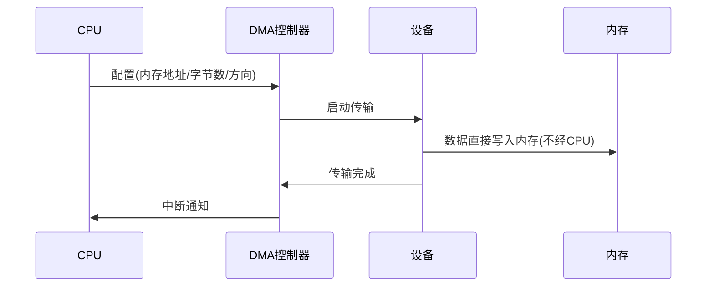
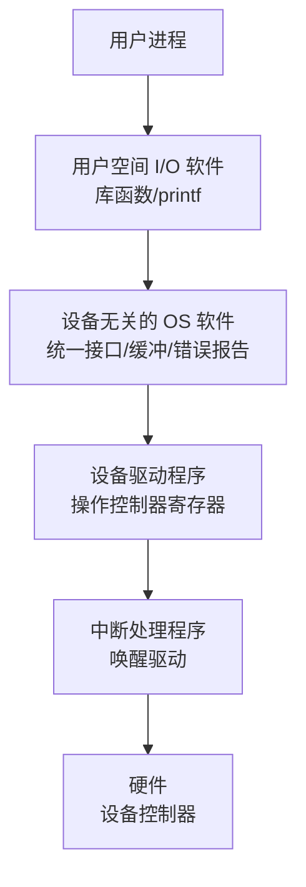

# 第5章 输入/输出

## 本章要点

- I/O 硬件的工作方式，设备与 CPU 的通信
- I/O 软件的分层与各层职责
- 中断、DMA 对 I/O 效率的提升
- 磁盘的调度方式

---

## 一、I/O 硬件原理

### 1. I/O 的复杂性

I/O 设备种类繁多（磁盘、键盘、网卡、打印机、显示器等）、速度差异巨大（磁盘比键盘快几个数量级），且相对 CPU 都很慢。操作系统的目标是：**统一管理各类设备，向上提供一致的接口，同时尽量不让慢速 I/O 拖垮 CPU**。

### 2. I/O 设备的分类

- **块设备**：按固定大小的块随机访问（磁盘、SSD）。
- **字符设备**：按字符流收发（键盘、打印机、网卡）。

### 3. 设备控制器

- 每个设备由一个**设备控制器**（芯片/板卡）管理，OS 不直接和设备打交道，而是通过控制器的**寄存器**下达命令、读取状态。
- 控制器是硬件和操作系统之间的"翻译官"。

### 4. 内存映射 I/O

CPU 读写控制器寄存器有两种方式：

- **内存映射 I/O**：把设备寄存器映射到内存地址空间，CPU 像读写内存一样读写寄存器（现代主流）。
- **专用 I/O 端口指令**：用专门的 `IN/OUT` 指令访问（x86 早期做法）。

### 5. DMA（直接存储器存取）

早期 I/O 靠 CPU 逐字节搬运数据——读一个字节，存到内存，再读下一个。大批量传输时 CPU 全耗在搬运上。

DMA 的解决方式是引入 **DMA 控制器**，代替 CPU 做搬运：

- **作用**：CPU 只做"启动"和"收完成通知"两件事，中间的逐字节搬运全交给 DMA，大幅解放 CPU。
- 代价：DMA 可能与 CPU 争用内存总线，但相比逐字节搬运仍是巨大提升。

### 6. 中断（Interrupt）

设备完成后，CPU 若反复"轮询"设备状态，就是忙等待，浪费 CPU。

中断的方式是：设备完成操作后，主动向 CPU 发一个**中断信号**。CPU 停下当前工作，进入内核态执行**中断处理程序**，处理完再恢复。

> 中断让 CPU 不必空等设备，实现了"异步 I/O"。这是现代计算机高效运转的核心机制之一。

---

## 二、I/O 软件分层

I/O 软件分层，是因为不同层面对不同的复杂度。从上到下共四层：

| 层 | 职责 | 例子 |
|----|------|------|
| 用户空间 I/O 软件 | 库函数，把用户请求封装成系统调用 | `printf`、`read` |
| 设备无关软件 | 统一命名、保护、缓冲、错误报告 | 提供块设备/字符设备通用接口 |
| 设备驱动程序 | 与控制器寄存器交互，发出具体命令 | 磁盘驱动、网卡驱动 |
| 中断处理程序 | 响应设备中断，唤醒等待的驱动进程 | 键盘中断、磁盘完成中断 |

> 分层的核心价值：**设备无关层屏蔽硬件差异**，让上层看到统一接口；只有驱动层才关心具体硬件。这也就是"换硬盘不需要改应用代码"的原因。

### 三种 I/O 方式对比

| 方式 | CPU 参与度 | 效率 | 适用 |
|------|-----------|------|------|
| 程序控制 I/O（轮询） | CPU 逐字检查状态 | 低，忙等待浪费 CPU | 极简单设备 |
| 中断驱动 I/O | 设备完成后中断通知 | 中，仍有中断开销 | 慢速设备 |
| DMA I/O | CPU 只发启动/收完成 | 高，大批量几乎不占 CPU | 磁盘、网卡等大流量设备 |

### 中断驱动的完整闭环

1. 进程发起 I/O 请求，进入**阻塞**状态等待。
2. CPU 转去执行其他进程（不空转）。
3. 设备完成 I/O，向 CPU 发**中断**。
4. CPU 进入内核态执行**中断处理程序**，唤醒等待的进程。
5. 被唤醒进程回到**就绪**队列，等待调度。

> 这个「发起请求 → 阻塞 → 中断唤醒 → 就绪」的闭环，正是**异步 I/O** 的底层原理：发起 I/O 的进程不必占着 CPU 空等，CPU 可以用来做别的事。

---

## 三、磁盘

### 1. 磁盘的结构与访问时间

- 机械硬盘由**盘片、磁道、扇区、柱面**组成，靠磁头寻道读写。
- **访问时间 = 寻道时间 + 旋转延迟 + 传输时间**。
- 其中**寻道时间**（磁头移动到目标磁道）通常占主导、最慢，所以磁盘调度的重点是**减少寻道**。

### 2. 磁盘臂调度算法

| 算法 | 思路 | 问题 |
|------|------|------|
| 先来先服务 FCFS | 按请求顺序服务 | 公平但寻道距离大 |
| 最短寻道优先 SSF | 先服务离当前磁头最近的 | 响应快，但可能饿死远端请求 |
| 电梯算法 SCAN | 磁头像电梯一样来回扫描 | 兼顾公平，常用 |
| 循环扫描 C-SCAN | 单向扫描到头再回起点 | 避免两端请求等待不均 |

> SSF 的"饥饿"问题：如果总是有离磁头更近的新请求进来，远处的请求可能永远轮不到。电梯算法通过"保持方向扫描"缓解了这一点。

### 3. 磁盘格式化

- 磁盘使用前需**格式化**：先做低级格式化（划分物理扇区、写入前导码与校验码），再做高级格式化（建立文件系统的空结构：超级块、空闲空间管理、根目录等）。

---

## 四、时钟（Clock）

时钟是操作系统的重要设备，用途远不止"看时间"：

- **时钟硬件**：石英晶体振荡器产生固定频率脉冲，计数器随脉冲递减/递增，归零时向 CPU 发出中断。
- **时钟软件**：操作系统利用时钟中断做三件事——维护系统时间（date/time）、统计各进程占用 CPU 的时间、提供定时器功能。
- **软定时器（soft timer）**：为避免每个定时器都触发一次硬件中断，把多个定时请求合并，在**一次**时钟中断里统一检查哪些已到期——用"少次中断"服务"多个定时器"。

> 时钟的本质是一个"周期性中断源"。抢占式调度（时间片轮转）正是靠时钟中断驱动的——每次时钟中断都可能触发"是否该切换进程"的检查。

---

## 五、进一步了解的原理性知识

1. **缓冲（Buffering）vs 缓存（Caching）**：缓冲是为了**匹配速度差异**（快慢设备之间），缓存是为了**重复读取更快**。二者都靠中间存储，但目的不同。

2. **假脱机（Spooling）**：把独占设备（如打印机）的并发请求先排队到磁盘缓冲，再逐个处理，让慢设备看起来可"并发"。

3. **稳定存储器**：通过冗余写入（写两份 + 校验）保证断电/损坏也不丢数据，是数据库事务、文件系统日志的底层思想。

4. **轮询 vs 中断的选择**：设备极快时（高速网卡），中断处理本身的开销可能比轮询还大，此时轮询反而更优。工程上常混合使用（空闲时中断、繁忙时轮询）。

---

## 小结

- I/O 硬件核心三件套：设备控制器、DMA、中断。
- I/O 软件分四层：用户软件 → 设备无关层 → 驱动 → 中断处理，分层屏蔽硬件差异。
- DMA 让 CPU 免于逐字节搬运，中断让 CPU 免于轮询，「阻塞 + 中断唤醒」是异步 I/O 的底层闭环。
- 磁盘调度围绕"减少寻道时间"，SSF 快但有饥饿问题，电梯算法折中。
