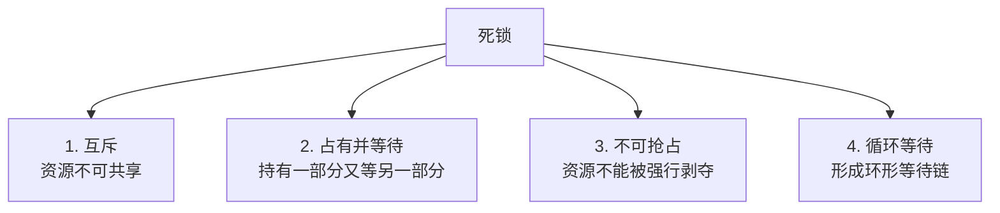
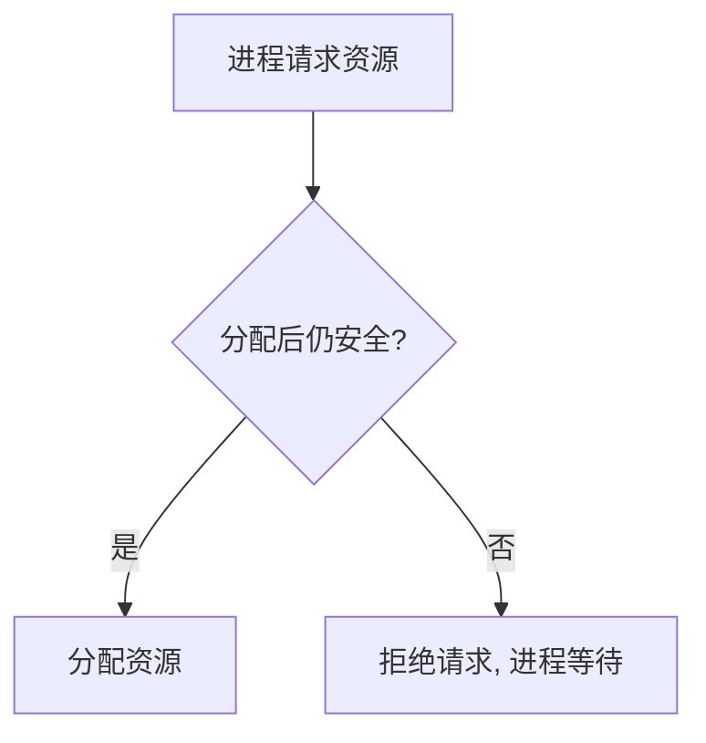

# 第6章 死锁

## 本章要点

- 死锁的定义与四个必要条件
- 死锁的检测、恢复、避免、预防
- 死锁、活锁、饥饿的区别

---

## 一、资源与死锁的定义

### 1. 资源

进程运行需要资源：CPU、内存、打印机、文件锁等。资源按能否被"拿走"分为两类：

- **可抢占资源**：可从持有者拿走而不产生危害（如内存，可换出）。
- **不可抢占资源**：拿走会导致错误（如打印机，正在打印时抢走会打乱输出；正在写的文件）。

> **死锁主要与不可抢占资源相关**——如果资源都能随便抢，就不会卡死。

### 2. 死锁的定义

> **一组进程中的每个进程，都在等待一个只能由本组其他进程释放的事件/资源，导致所有进程永远无法推进。**

用一个具体场景说明：进程 A 持有打印机、等待扫描仪；进程 B 持有扫描仪、等待打印机。于是 A 等 B、B 等 A，谁都无法推进，即死锁。

### 3. 死锁建模：资源分配图

资源分配情况可用图刻画：

- 进程用**圆**表示，资源用**方框**表示。
- **分配边**（资源 → 进程）：资源已分配给该进程。
- **请求边**（进程 → 资源）：进程在等待该资源。
- 若图中有**环**，就可能死锁：
  - 每种资源只有一个实例：**有环 ⟺ 死锁**。
  - 每种资源有多个实例：有环只是**可能**死锁，不一定。

---

## 二、死锁的四个必要条件

死锁发生时，以下四个条件**必须同时成立**：

1. **互斥**：资源一次只能被一个进程使用，不能共享。
2. **占有并等待**：进程已经持有至少一个资源，又在等待别的资源。
3. **不可抢占**：资源不能被强行夺走，只能由持有者主动释放。
4. **循环等待**：存在一个进程环，环中每个进程都在等待下一个进程持有的资源。

> **四个条件缺一不可**：破坏其中任意一个，死锁就不可能发生。这是所有死锁解决方案的理论根基。

---

## 三、死锁的四种处理策略

处理死锁有四种策略，从"完全不管"到"彻底预防"：

| 策略 | 思路 | 特点 |
|------|------|------|
| 鸵鸟算法 | 假装死锁不存在 | 多数通用 OS 采用（Linux/Windows） |
| 检测与恢复 | 允许发生，事后检测并恢复 | 数据库常用 |
| 死锁避免 | 动态判断是否安全，避免进入危险状态 | 银行家算法 |
| 死锁预防 | 从结构上破坏四个条件之一 | 静态，资源利用率可能降低 |

### 1. 鸵鸟算法

像鸵鸟把头埋进沙子一样**假装死锁不存在**。
- 理由：死锁在通用系统里概率低、代价可接受（用户重启进程即可）；而预防/避免的代价（资源利用率下降、编程复杂）对所有进程持续存在，不划算。
- 这是"概率 × 代价"权衡的典型：**当问题罕见且损失可控时，不处理反而最经济**。

### 2. 死锁检测与恢复

允许死锁发生，但要能发现并恢复：

- **检测**：定期构建资源分配图，检测是否有环（每种资源一个实例时）；多种资源时用矩阵算法。
- **恢复**（任选其一）：
  - **抢占资源**：从某进程夺走资源给另一个。
  - **回滚（rollback）**：把进程回退到之前的检查点，重新执行。
  - **杀死进程**：最粗暴，选代价最小的杀（比如刚启动的、占用资源少的）。

### 3. 死锁避免：银行家算法

**思路**：不预防、也不事后恢复，而是**在分配资源前先判断**——这次分配会不会把系统带入不安全状态？会则拒绝。

- **安全状态**：存在一种资源分配顺序，能让所有进程都顺利完成。
- 每次进程请求资源时，系统**假设分配给它**，然后检查系统是否仍处于安全状态：是 → 分配；否 → 拒绝，让进程等待。

> 银行家算法的局限：要求进程**事先声明最大资源需求**，而真实进程很难精确预知自己需要多少资源，所以难以在通用 OS 普及，主要用于数据库等资源类型明确的场景。

**单个资源 vs 多个资源的银行家算法**

- **单个资源类型**（只有一种资源，多个实例）：判断较简单——检查是否存在一个安全序列，能依次满足所有进程。
- **多个资源类型**：维护「已分配矩阵、需求矩阵、可用向量」三组数据，模拟"按安全序列逐一满足进程需求"，若能全部满足则当前状态安全。
- **资源轨迹图**：针对两个进程的直观可视化——横轴、纵轴分别代表两个进程的执行进度，图中的阴影区是"危险区"（两进程各持有对方所需资源）。若调度路径必须穿过阴影区则必死锁，能绕开则安全。

> 资源轨迹图把"安全/不安全状态"映射为图上"能否绕开阴影区到达终点"，是"死锁避免"的直观表示。

### 4. 死锁预防（破坏四条件）

从根上让死锁不可能发生，方法是破坏四个条件之一：

| 破坏的条件 | 做法 | 代价 |
|-----------|------|------|
| 互斥 | 某些资源做成可共享（如假脱机打印） | 很多资源本质不可共享 |
| 占有并等待 | 一次性申请全部资源 | 资源利用率低，可能长期等待 |
| 不可抢占 | 允许抢占（如内存换出） | 对打印机等不适用 |
| 循环等待 | 资源全局排序，按序申请 | 可能不便，但最可行 |

---

## 四、其他相关问题

### 1. 死锁、活锁、饥饿的区别

| 概念 | 含义 |
|------|------|
| 死锁 | 所有进程都阻塞，谁也动不了 |
| 活锁（Livelock） | 进程没阻塞，但反复做无用功（如互相礼让），谁也没进展 |
| 饥饿（Starvation） | 系统在运行，但某进程始终得不到服务 |

> 三者都是并发要规避的问题，但成因与表现不同：死锁是"卡死"，活锁是"空转"，饥饿是"被冷落"。

### 2. 两阶段加锁

- 数据库事务常用：第一阶段只加锁、不释放；第二阶段只释放、不加锁。避免部分提交导致的不一致。

---

## 五、进一步了解的原理性知识

1. **通信死锁**：消息传递系统中，双方都在等对方先发消息，形成死锁。本质与资源死锁同构，只是"资源"变成了"消息"。

2. **破坏循环等待的工程实践**：给所有锁编号，强制按**升序**加锁，可从根上避免环形等待——这是写多线程代码最实用的防死锁手段（对应前面"哲学家就餐"的"改变一人拿筷子顺序"）。

3. **通用 OS 采用鸵鸟算法的原因**：死锁罕见、损失小（重启即可），而预防/避免的代价是持续性的资源浪费和复杂度上升。这是"概率 × 代价"权衡的经典案例，也说明并非所有理论问题都值得工程上花大代价解决。

---

## 小结

- 死锁四条件：互斥、占有并等待、不可抢占、循环等待，缺一不可。
- 四策略：鸵鸟（最常用）、检测恢复、避免（银行家）、预防（破坏条件）。
- 活锁与饥饿是死锁的"近亲"，成因与对策不同。
- 破坏循环等待（锁排序）是最实用的工程防死锁手段。
