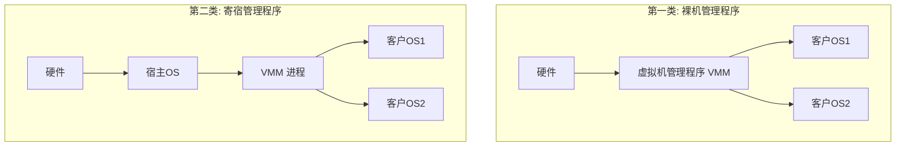
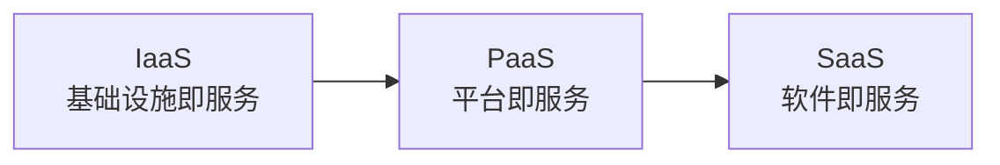

# 第7章 虚拟化和云

## 本章要点

- 虚拟化的动机
- 两类虚拟机管理程序的区别
- 内存和 I/O 的虚拟化方式
- 云服务的分层

---

## 一、虚拟化的动机

### 1. 从"一台机器一个系统"到"一台机器多个系统"

传统上，一台物理机只运行一个操作系统，存在资源浪费：

- 服务器大多时间很闲，一台机器却只能干一件事；
- 测试不同系统要准备多台机器；
- 迁移服务时，旧系统的环境难以复现。

**虚拟化**在硬件之上加一层软件，把一台物理机**模拟成多台独立的"虚拟机（VM）"**，每台 VM 都能运行自己的操作系统，彼此隔离。

### 2. 典型应用场景

- **服务器合并**：把多台闲散服务器合并到一台物理机上，节省成本。
- **隔离测试**：在隔离的 VM 里测软件，不影响宿主环境。
- **灾备与迁移**：把整台 VM 打包迁移到别处。
- **云基础设施**：云厂商正是靠虚拟化按需"切"出虚拟机对外提供。
- **兼容旧系统**：在新硬件上运行老系统。

---

## 二、虚拟机管理程序（Hypervisor）

### 1. 两类管理程序

负责创建和管理虚拟机的软件叫**虚拟机管理程序（Hypervisor）**，分两类：

| 类型 | 运行位置 | 代表 | 特点 |
|------|----------|------|------|
| 第一类（裸机） | 直接跑在硬件上 | VMware ESXi、Xen、KVM | 性能好，用于数据中心 |
| 第二类（寄宿） | 作为宿主 OS 的一个进程 | VMware Workstation、VirtualBox | 方便，有宿主 OS 开销 |

第一类是"自己当操作系统"，第二类是"操作系统里的一个程序"。

### 2. 虚拟化的必要条件

虚拟化的经典做法是**trap-and-emulate**：客户 OS 执行特权指令时陷入 VMM，由 VMM 模拟执行。

**可虚拟化的前提**：所有**敏感指令**（影响系统状态、需受控执行的指令）都必须是**特权指令**（执行时能陷入）。

- 问题出在 x86：历史上部分敏感指令**不是**特权指令，执行时不会陷入 VMM，导致 trap-and-emulate 失效，x86 虚拟化一度很困难。
- 解决：**硬件辅助虚拟化**——Intel 新增 VT-x、AMD 新增 AMD-V。CPU 引入"根模式"和"非根模式"：VMM 跑在根模式，客户 OS 跑在非根模式，敏感指令会自动陷入 VMM。

### 3. 两种 CPU 虚拟化技术

| 技术 | 思路 | 特点 |
|------|------|------|
| 全虚拟化 | VMM 完整模拟硬件，客户 OS 无需修改 | 兼容性好，开销大 |
| 准虚拟化（Paravirtualization） | 修改客户 OS 源码，用 hypercall 替代敏感指令 | 性能好，但需改 OS |

---

## 三、内存与 I/O 虚拟化

### 1. 内存虚拟化：两层映射

这是虚拟化的关键部分。正常情况下，OS 维护"虚拟地址 → 物理地址"的页表。虚拟化后多了一层：

1. 客户 OS 维护「客户虚拟地址 → **客户物理地址**」页表。
2. VMM 维护「客户物理地址 → **机器地址**」映射（影子页表，或硬件嵌套页表 EPT/NPT）。

> 两层翻译开销大，这正是 TLB 在虚拟化环境更重要的原因（每次多一层映射，更需要缓存加速）。

### 2. I/O 虚拟化

- VMM 截获客户 OS 的 I/O 指令，**模拟设备**（慢但通用），或把真实设备**直通**给某个 VM（快但独占）。
- 虚拟装置（virtual appliance）：预打包的虚拟机镜像，开箱即用。

---

## 四、云

### 1. 虚拟化是云的技术底座

云的本质：把**可弹性伸缩的虚拟资源**通过互联网按需提供。没有虚拟化，就无法"按需切出虚拟机、用完释放"。

### 2. 云服务分层

| 层 | 提供什么 | 例子 |
|----|----------|------|
| IaaS | 虚拟机、存储、网络等基础资源 | AWS EC2、阿里云 ECS |
| PaaS | 应用运行平台（不管理底层） | 云数据库、容器平台 |
| SaaS | 完整的软件服务 | Google Docs、在线办公 |

> IaaS 提供"裸机器"，PaaS 提供"平台"，SaaS 提供"成品软件"。用户管理的范围越少，抽象层次越高。

### 3. 关键机制

- **虚拟机迁移**：在线把 VM 从一台物理机搬到另一台（用于负载均衡、维护），核心是"内存状态拷贝 + 增量同步"。
- **检查点**：保存 VM 状态快照，可回滚到某个时间点。

---

## 五、进一步了解的原理性知识

1. **虚拟化 vs 容器**：虚拟化在**硬件层**隔离（每个 VM 有独立 OS）；容器在 **OS 层**隔离（共享内核，如 Docker）。容器更轻量，但隔离性弱于虚拟机——这是理解 Docker 与 VMware 区别的关键。

2. **VMM 与微内核的类比**：书中指出 VMM 与微内核有相似之处——都尽量小、都管理核心资源，可对照理解（呼应第 1 章）。

3. **为什么 x86 虚拟化曾是难题**：根源在于早期 x86 指令集设计时没考虑虚拟化，部分敏感指令不陷入。这一历史教训说明了"可虚拟化"是架构设计时需要前瞻考虑的性质。

---

## 小结

- 虚拟化 = 用软件模拟多台独立机器，关键是管理程序（Hypervisor）。
- 第一类跑在裸机（性能强），第二类寄宿在宿主 OS（方便）。
- 可虚拟化的前提是敏感指令可被捕获；x86 靠 VT-x/AMD-V 硬件辅助解决。
- 内存虚拟化靠「客户虚拟地址 → 客户物理地址 → 机器地址」两级映射。
- 云服务分 IaaS / PaaS / SaaS 三层，虚拟化是云的技术底座。
