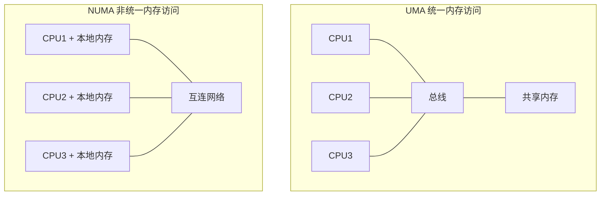
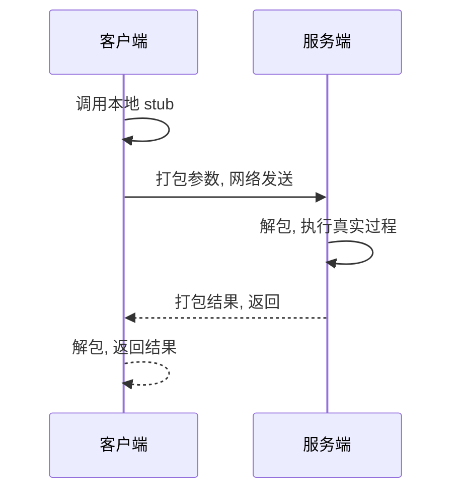

# 第8章 多处理机系统

## 本章要点

- 多处理机与多计算机的区别
- 多处理机的同步与调度
- 分布式系统的概念

---

## 一、多处理机（Multiprocessor）

### 1. 从单核到多核

单核 CPU 的主频提升逐渐遇到物理瓶颈（功耗、散热），业界转向**在一个芯片上放多个 CPU 核**，让它们并行工作，即多处理机/多核。

多核带来的核心问题是：**如何让多个 CPU 高效、正确地协同工作**。

### 2. 两个基本概念：多处理机 vs 多计算机

| 类型 | 内存 | 耦合度 | 通信方式 |
|------|------|--------|----------|
| 多处理机 | 多个 CPU 共享同一物理内存 | 紧耦合 | 共享内存 |
| 多计算机 | 各自有独立内存，通过网络连接 | 松耦合 | 消息传递 |

"共享内存 vs 消息传递"的区分，是整个并行/分布式世界的分水岭。

### 3. 硬件类型：UMA vs NUMA

| 类型 | 内存访问延迟 | 特点 |
|------|-------------|------|
| UMA（统一内存访问） | 所有 CPU 访问内存耗时相同 | 简单，扩展性受限 |
| NUMA（非统一内存访问） | 访问本地内存快，远程慢 | 可扩展到大核数 |

> UMA 类似多人围着一张桌子用同一个盆（都能拿到，但人多了拥挤）；NUMA 类似每人各有一个小盆（取自己的快，取别人的慢）。

### 4. 多处理机操作系统的三种组织方式

- **每个 CPU 一个 OS**：各 CPU 独立运行自己的 OS，可共享磁盘（简单但浪费）。
- **主从式**：一个主 CPU 负责管理，其余从属 CPU 只执行任务（主 CPU 成为瓶颈）。
- **对称多处理（SMP）**：所有 CPU 地位平等，共享同一份 OS 代码与数据结构。**这是现代主流**。

### 5. 多核同步：关中断的失效

第 2 章介绍了单核下用"关中断"实现互斥——关中断后，单核上不会有其他进程打断当前进程。

但在多核下，关中断**失效**：关掉一个核的中断，其他核仍在运行，照样能同时进入临界区。

因此多核同步必须依赖**硬件提供的原子指令**：

- **TSL（测试并加锁）**：读一个内存字并同时写非零值，整个操作**不可分割**。
- **CAS（比较并交换）**：`if 旧值 == 预期 then 置新值`，原子完成。
- **自旋锁**：基于上述原子指令，在循环里反复尝试抢锁，适合短临界区。
- **读写锁**：区分读者（可并发）与写者（独占），提高读多写少场景的并发度。

> **单核互斥靠"关中断"，多核互斥靠"原子指令"**，这是两者同步的本质差异。

### 6. 多处理机调度

多核调度比单核多了几个新考量：

- **负载均衡**：把任务均匀分到各核，避免"一核忙死、其余闲死"。
- **CPU 亲和性**：尽量让线程留在同一 CPU 上，充分利用该核的缓存（迁移到新核会导致缓存失效）。
- 分时（time-sharing，线程轮流用核）与空分（space-sharing，线程固定绑核）。

---

## 二、多计算机（Multicomputer）

### 1. 特点

- 每个节点有独立内存，通过高速网络通信，**没有共享内存**，只能靠**消息传递**。
- 通信层次（自下而上）：硬件 → 底层通信软件 → 用户层通信（`send`/`receive`）→ RPC（远程过程调用）→ 分布式共享内存（DSM）。

### 2. RPC（远程过程调用）

目标是让**远程调用看起来像本地函数调用**，隐藏网络细节：

- 核心是 **stub（桩）**：客户端 stub 把参数**序列化**（打包）后发送；服务端 stub **反序列化**（解包）后调用真实函数，再反向传回结果。

---

## 三、分布式系统

### 1. 定义

- 多台独立计算机通过网络协作，对用户表现为**一个系统**（用户感觉不到背后是多台机器）。

### 2. 中间件类型

| 类型 | 例子 |
|------|------|
| 基于文档 | Web、HTTP |
| 基于文件系统 | NFS、分布式文件系统 |
| 基于对象 | CORBA、RMI |
| 基于协作 | 对等网络、消息队列 |

---

## 四、进一步了解的原理性知识

1. **共享内存 vs 消息传递**：这是两类并行编程范式的根源——"线程共享内存"（需锁）与"进程/微服务消息通信"（天然隔离）。现代并发编程、分布式架构都在这个二分法上展开。

2. **缓存一致性问题**：多核 CPU 各有缓存，一个核改了内存，其他核的缓存可能还是旧值。需缓存一致性协议（如 **MESI**）保证一致。这是理解 `volatile`、内存屏障（memory barrier）的底层背景。

3. **分布式系统的核心难题**：CAP 定理（一致性 Consistency、可用性 Availability、分区容错 Partition tolerance 三者不可兼得）、分布式一致性、故障检测——这是理解云/微服务架构的理论基础。

---

## 小结

- 多处理机共享内存（紧耦合），多计算机靠消息传递（松耦合），这是并行世界的分水岭。
- UMA 访问内存延迟一致、易扩展受限；NUMA 本地快远程慢、可扩展。
- SMP 是主流多处理机模型；多核同步必须靠原子指令（TSL/CAS），关中断失效。
- 多计算机靠 RPC 隐藏网络细节，核心是 stub 的序列化/反序列化。
- 分布式系统通过中间件隐藏分布性，核心难题是 CAP 与一致性。
