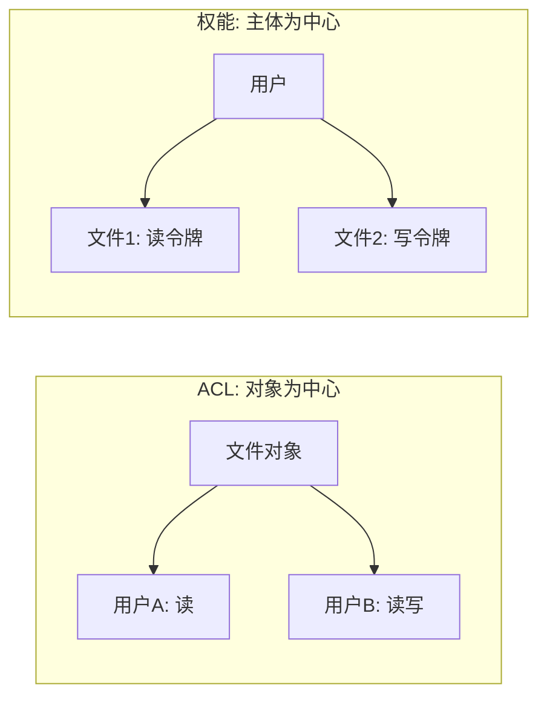
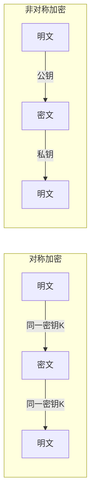
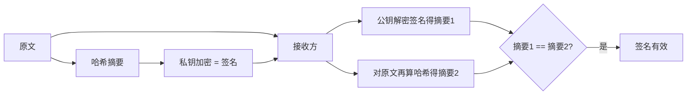

# 第9章 安全

## 本章要点

- 安全威胁与安全三要素
- 保护机制（保护域、ACL、权能）
- 密码学基础（对称/非对称加密、数字签名、哈希）
- 常见软件漏洞与恶意软件，及其防御

---

## 一、威胁与安全目标

### 1. 安全三要素（CIA）

安全的目标是保证三个要素：

| 要素 | 含义 | 被破坏的例子 |
|------|------|--------------|
| 机密性 Confidentiality | 数据不被未授权访问 | 密码被偷看 |
| 完整性 Integrity | 数据不被未授权篡改 | 转账金额被改 |
| 可用性 Availability | 系统对合法用户可用 | 被 DDoS 攻击打挂 |

### 2. 威胁来源

- **入侵者**：从偶发好奇 → 专业窃密 → 内部人员（内部人员往往最危险，因为有权限）。
- **恶意软件**：病毒、蠕虫、木马、间谍软件、rootkit。

---

## 二、保护机制

### 1. 保护域（Protection Domain）

- **定义**：一组「对象 + 对该对象允许的操作」的集合。进程在某个域内运行，拥有该域赋予的权限。
- 典型例子：**用户域** vs **内核域**（呼应第 1 章的用户态/内核态）。
- 意义：把"谁能做什么"集中定义，进程的权限取决于它所在的域。

### 2. 访问控制列表（ACL）

- **思路**：每个对象附带一张列表，记录「谁 → 什么权限」。
- 例：UNIX 文件权限 `rwxr-xr-x`（owner / group / others 的读 / 写 / 执行）。
- 特点：**以对象为中心**——想知道"某对象谁能访问"，看它的 ACL。

### 3. 权能（Capability）

- **思路**：持有权能（类似令牌）即可访问对象。
- 与 ACL 相反：ACL 是「对象查人」，权能是「人持牌」。
- 例：数字令牌、能力列表。

> ACL 适合"查某对象谁能访问"；权能适合"某主体能访问哪些"。现代系统多混合使用。

### 4. 安全形式化模型

- **多级安全（Bell-LaPadula）**：核心规则「不向上读、不向下写」——低权限者不能读高密级信息（防泄密），也不能把高密级信息写入低密级（防降级泄露）。
- **隐蔽信道（Covert Channel）**：绕过正常权限控制传递信息的通道（如利用资源占用编码信息），是极难防范的威胁。

### 5. 可信系统与可信计算基（TCB）

- **可信系统**：经过形式化验证、可证明其安全性的系统（常用于军事/政府等高安全场景）。
- **可信计算基（TCB，Trusted Computing Base）**：系统中所有"安全攸关"的部分——硬件 + 内核 + 关键系统程序。TCB 之外的部分即使出问题，也不该危及系统安全。
- 核心原则：**TCB 要尽可能小**——越小越容易验证、越难出错。这与微内核"内核最小化"的思想一脉相承。

### 6. 可信平台模块（TPM）

- 主板上的一个专用安全芯片，负责安全存储密钥、生成随机数、度量系统启动状态（检测是否被篡改）。
- 用于硬盘加密（如 BitLocker）、安全启动、远程证明等。

---

## 三、密码学基础

### 1. 对称加密 vs 非对称加密

| 类型 | 密钥 | 特点 | 应用 |
|------|------|------|------|
| 对称加密 | 加解密同一密钥 | 快，但密钥分发难 | AES、DES |
| 非对称加密 | 公钥加密、私钥解密 | 慢，但解决密钥分发 | RSA、ECC |

**对称加密与非对称加密的分工**：对称加密快，但"密钥如何安全地交给对方"是难题；非对称加密用"公钥公开、私钥保密"解决了分发，但速度慢。实际系统**混合使用**：用非对称加密交换对称密钥，再用对称密钥加密数据（HTTPS 即此机制）。

### 2. 单向函数与哈希

- **单向函数**：正向计算容易，逆向极难。
- **哈希**：把任意长数据映射为定长摘要（如 SHA-256 输出 256 位），用于校验完整性。
- MD5 已不安全（可构造碰撞），应使用 SHA-256 等。
- **密码存储**：不能存明文密码，应存**加盐哈希**（每个密码加随机盐再哈希），防止彩虹表攻击。

### 3. 数字签名

**目标**：让一段数据"不可抵赖 + 不可篡改"。做法：用**私钥加密摘要**，接收方用公钥验证。

> 只有持有私钥的人才能产生这个签名（不可抵赖）；原文被改哪怕一个字节，重新计算的摘要就对不上（完整性）。

### 4. 认证（Authentication）

- 认证即确认主体身份。三种方式：
  - **知道什么**（密码）
  - **拥有什么**（物理令牌、U 盾、手机）
  - **是什么**（生物特征：指纹、人脸）
- **双因素认证（2FA）** 组合两种方式（如密码 + 短信验证码），安全性大幅提升。

---

## 四、软件漏洞与攻击

| 漏洞/攻击 | 说明 |
|-----------|------|
| 缓冲区溢出 | 写入超界覆盖返回地址，最经典的攻击（C 语言常见） |
| 格式化字符串攻击 | `printf` 格式串被恶意控制 |
| 悬垂指针 | 释放后仍使用 |
| 空指针/整数溢出 | 逻辑错误被利用 |
| 命令注入 | 拼接命令字符串导致任意执行 |
| 检查时间/使用时间（TOCTOU） | 检查与使用之间的竞态被利用 |

### 缓冲区溢出的原理

1. 函数的局部变量和**返回地址**存在同一个栈帧里，且相邻。
2. 如果程序向一个局部缓冲区写入**超长**数据，就会越界**覆盖栈上的返回地址**。
3. 攻击者精心构造输入，把返回地址改成恶意代码（shellcode）的入口。
4. 函数返回时，CPU 跳转到被篡改的地址，执行恶意代码。

**防御手段**：
- **栈不可执行（NX/DEP）**：标记栈为不可执行，shellcode 跑不起来。
- **栈金丝雀（canary）**：在返回地址前放一个随机值，返回前校验，被覆盖就检测到。
- **地址随机化（ASLR）**：随机化代码/栈地址，让攻击者难以猜中地址。

---

## 五、恶意软件与防御

### 1. 恶意软件类型

| 类型 | 特点 |
|------|------|
| 木马 | 伪装成正常软件，诱骗安装 |
| 病毒 | 寄生在程序中，随执行传播 |
| 蠕虫 | 主动自我复制、网络传播 |
| 间谍软件 | 偷偷收集信息 |
| rootkit | 隐藏自身，最高权限潜伏 |

### 1.5 内部攻击（最危险，因为攻击者已拥有权限）

| 类型 | 特点 |
|------|------|
| 逻辑炸弹 | 藏在代码里，特定条件触发恶意行为（如被解雇的员工埋的雷） |
| 后门陷阱 | 预留的隐蔽入口，绕过正常认证直接进入系统 |
| 登录欺骗 | 伪造登录界面骗取密码（如假登录框） |

> 内部攻击之所以危险，在于攻击者**已经拥有合法权限**，传统的"防外部入侵"手段难以奏效。

### 2. 防御手段

- **防火墙**：网络层过滤可疑流量。
- **反病毒**：特征码匹配 + 启发式检测。
- **代码签名**：验证软件来源可信。
- **沙箱/囚禁**：把不可信程序隔离在受限环境运行。
- **入侵检测系统（IDS）**：监控异常行为。

---

## 六、进一步了解的原理性知识

1. **为什么非对称加密能"不可抵赖"**：私钥只有持有者拥有，用私钥签名 = 只有他能产生这个签名，故无法抵赖。这是数字签名的法律与技术基础。

2. **中间人攻击（MITM）与证书**：公钥可能在传输中被中间人替换，于是需要「公钥基础设施（PKI）+ 数字证书」把公钥与身份绑定，由可信第三方（CA）背书。HTTPS 的证书体系就是为此而生。

3. **最小权限原则**：进程/程序只应获得完成任务所需的**最小权限**。这是权限系统、沙箱的共同理论根基，也是安全设计的核心准则。

---

## 小结

- 安全三要素：机密性、完整性、可用性（CIA）。
- 保护机制：保护域、ACL（对象查人）、权能（人持牌）。
- 密码学核心：对称/非对称加密、哈希、数字签名、认证；实际系统混合使用并依赖 PKI/证书对抗中间人。
- 缓冲区溢出是最经典的内存攻击，防御靠栈不可执行、金丝雀、ASLR。
- 常见攻击与防御：防火墙、签名、沙箱、最小权限原则贯穿始终。
