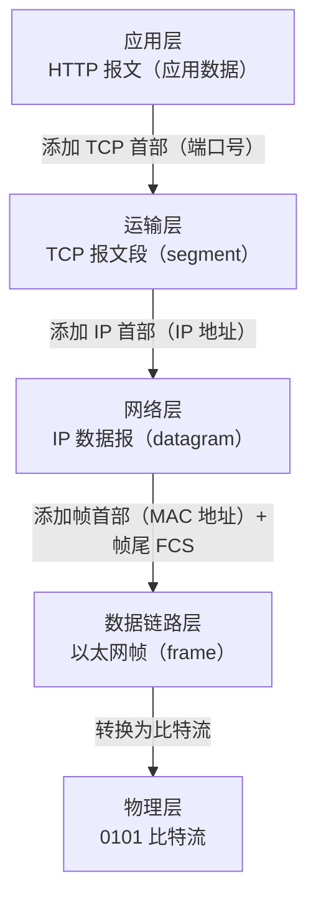
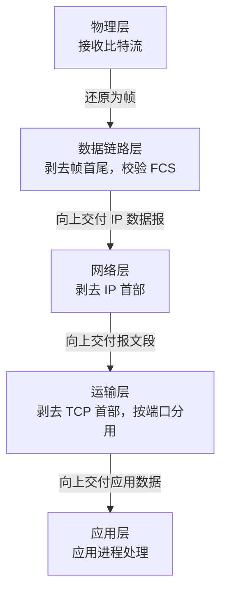
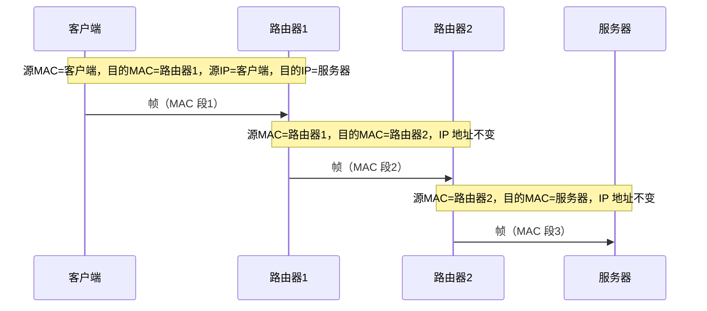

从浏览器中输入一个 URL 到页面渲染完成，是串联[[1. 计算机网络概述|概述]]、[[2. 物理层|物理层]]、[[3. 数据链路层|数据链路层]]、[[4. 网络层|网络层]]、[[5. 运输层|运输层]]、[[6. 应用层|应用层]]各层的典型端到端通信场景：数据包在发送端被逐层封装，经网络转发后在接收端被逐层解封装，最终交付应用进程。

## 完整链路总览

从输入 URL 到页面展示，大致经历以下阶段：

## 阶段一：DNS 解析

浏览器首先要把域名（如 `www.example.com`）解析为 IP 地址，这一过程由[[6. 应用层#域名系统DNS|DNS]]完成。解析结果会缓存在浏览器、操作系统乃至本地域名服务器中，命中缓存则无需递归查询。

## 阶段二：建立 TCP 连接

拿到服务器 IP 后，客户端通过[[5. 运输层#建立连接|三次握手]]与服务器（默认 80/443 端口）建立一条可靠的 TCP 连接。若使用 HTTPS，还需在此之上完成 TLS 握手。

## 阶段三：发送 HTTP 请求

连接建立后，浏览器发送[[9. HTTP深入#HTTP 报文结构|HTTP 请求报文]]，其中包含请求行（方法、目标、版本）、首部字段（Host、User-Agent 等）以及可选的报文主体。

## 阶段四：服务器处理并响应

服务器解析请求，执行业务逻辑，返回 HTTP 响应报文（状态码 + 首部 + 主体）。对于 HTTPS，响应内容还会被加密。

## 阶段五：浏览器解析渲染

浏览器收到 HTML 后开始解析，遇到外部资源（CSS、JS、图片等）会继续发起请求，最终完成页面渲染与脚本执行。

## 核心：分层封装与解封装

端到端通信的核心机制，是数据在发送端逐层**向下封装**、在接收端逐层**向上解封装**。

### 发送端的封装

每一层封装时添加的信息各不相同，且只对**对等层**有意义：

| 层 | 添加内容 | 关键标识 | 对等层如何解读 |
| :--- | :--- | :--- | :--- |
| 应用层 | HTTP 报文 | — | 应用进程按协议解析 |
| 运输层 | TCP 首部 | **端口号** | 目标主机按端口分用给应用进程 |
| 网络层 | IP 首部 | **IP 地址** | 路由器按 IP 地址转发 |
| 数据链路层 | 帧首部 + FCS 帧尾 | **MAC 地址** | 交换机/网卡按 MAC 地址投递 |
| 物理层 | — | 比特流 | 传输媒体传输 |

### 接收端的解封装

接收端按相反顺序，从下往上逐层剥去首部：

> 关键点：中间设备（路由器、交换机）并不需要完整地逐层解封装到应用层。路由器只解封装到**网络层**（读取 IP 首部即可转发），交换机只处理到**数据链路层**（按 MAC 地址转发），只有真正的主机才会一路解封装到应用层。

## 数据包在网络中的实际流转

一个数据包从客户端到服务器，途中会经过多台路由器与交换机：

流转过程中，有两类地址相互配合：

+ **IP 地址**在整个传输过程中保持不变（除 NAT 场景外），负责端到端的寻址；
+ **MAC 地址**在每一段链路上都不同，每经过一台路由器，帧的源/目的 MAC 地址就会被替换为该段链路两端的 MAC 地址——这就是"IP 负责全局寻址，MAC 负责下一跳投递"的含义。

## 小结

一条完整的端到端通信链路可概括为：

1. **应用层**产生数据（HTTP 报文）；
2. **运输层**加端口，保证进程间可靠交付（TCP）；
3. **网络层**加 IP 地址，负责跨网络的路由转发；
4. **数据链路层**加 MAC 地址，负责同一段链路内的投递；
5. **物理层**把一切转换为比特流在媒体上传输；
6. 到达目的主机后**逐层解封装**，最终由应用进程消费。

这种层层封装、层层剥离的机制，是分层体系结构（[[1. 计算机网络概述#3.实体、协议、服务和服务访问点|协议与服务]]）在实际通信中的直接体现。
