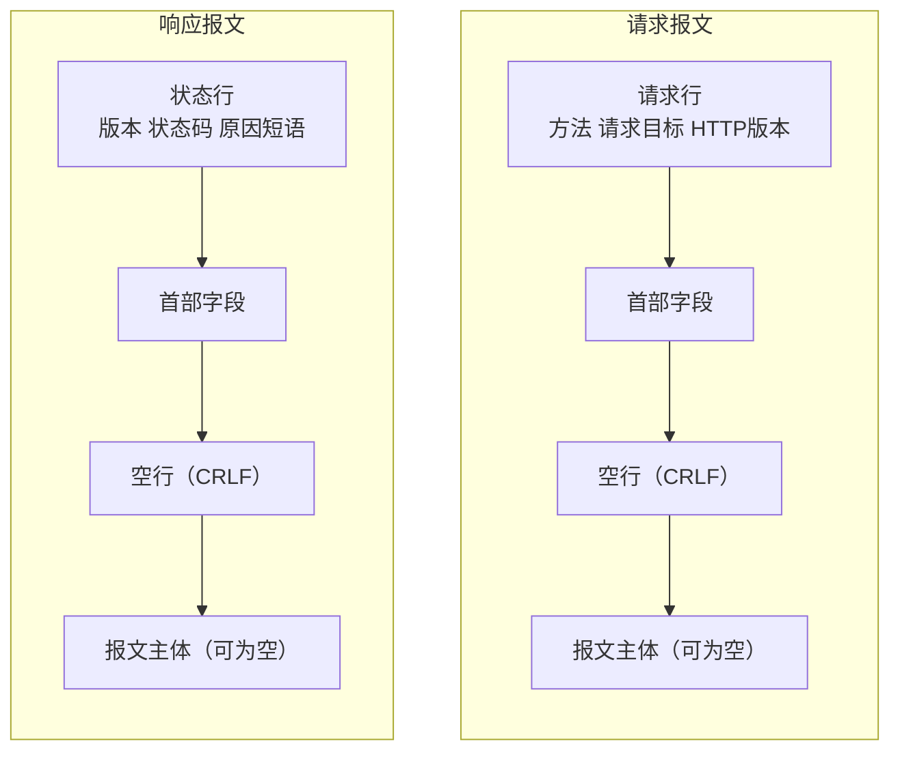
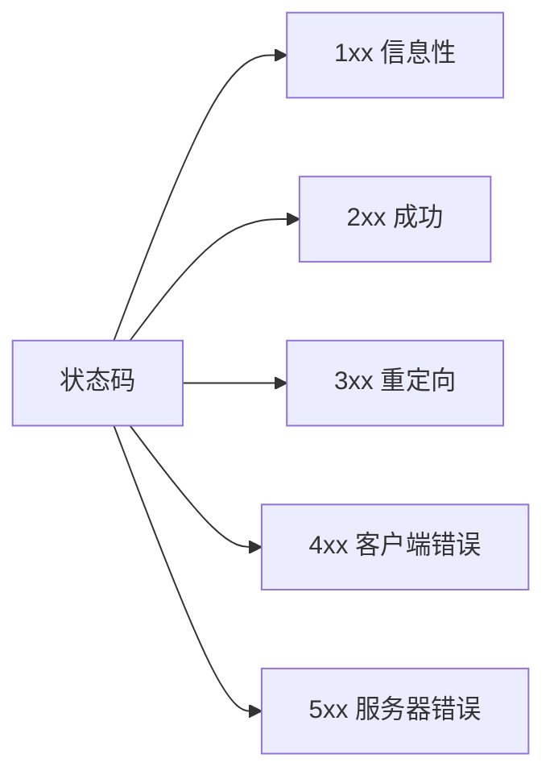
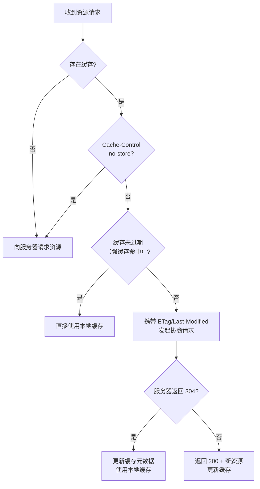
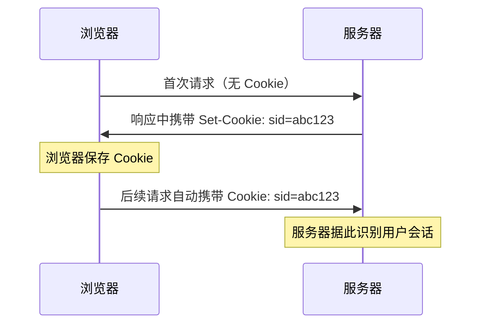
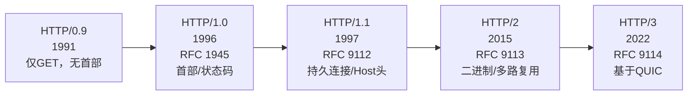
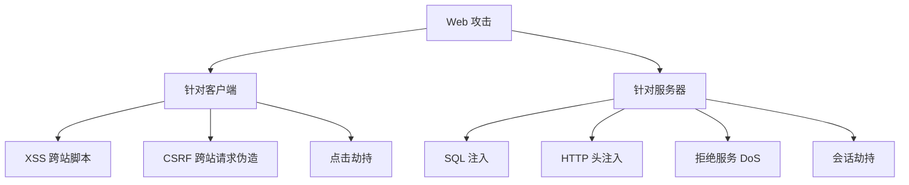
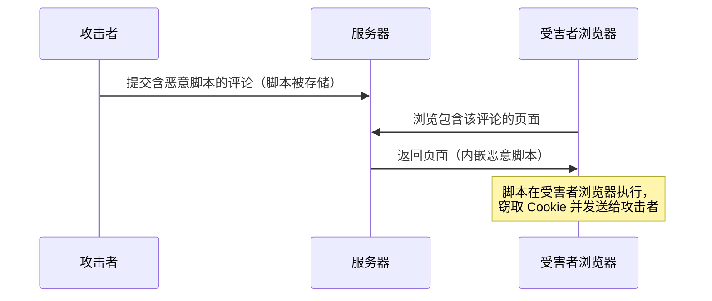
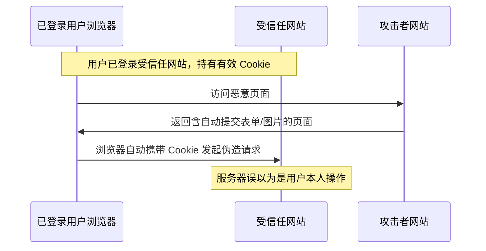

HTTP 报文结构、请求方法、状态码、缓存机制、Cookie 会话管理与版本演进，是《图解HTTP》一书的核心内容。

## HTTP 报文结构

HTTP 报文是客户端与服务器之间交互的载体，由**报文首部**与**报文主体**两部分组成，报文首部与报文主体之间以一个空行（CRLF）分隔。

### 请求报文与响应报文

请求报文由**请求行、首部字段、空行、报文主体**组成；响应报文由**状态行、首部字段、空行、报文主体**组成。两者的结构几乎一致，差别仅在第一行。



一个典型的请求报文与响应报文如下：

```
GET /index.html HTTP/1.1
Host: www.example.com
User-Agent: Mozilla/5.0
Accept: text/html

（空行，无报文主体）
```

```
HTTP/1.1 200 OK
Content-Type: text/html; charset=utf-8
Content-Length: 342

<html>...</html>
```

### 首部字段的分类

HTTP 首部字段按其用途可分为四大类：

| 类别 | 说明 | 示例 |
| :--- | :--- | :--- |
| 通用首部字段 | 请求与响应报文双方都会使用的字段 | `Cache-Control`、`Connection`、`Date` |
| 请求首部字段 | 仅在请求报文中出现 | `Host`、`User-Agent`、`Accept`、`Authorization` |
| 响应首部字段 | 仅在响应报文中出现 | `Location`、`Server`、`Set-Cookie`、`ETag` |
| 实体首部字段 | 描述报文主体的字段 | `Content-Type`、`Content-Length`、`Content-Encoding` |

> 随着 RFC 9110 对语义的重整，"实体（entity）"概念已统一为"内容（content）"，`Content-*` 系列首部统称为**表示首部字段**（representation header）与**内容首部字段**（content header）。

## HTTP 请求方法

HTTP/1.1 定义了 8 种方法，后续又加入了 PATCH，共 9 种：

| 方法 | 语义 | 幂等性 | 是否含主体 |
| :--- | :--- | :---: | :---: |
| GET | 获取资源 | 是 | 否 |
| HEAD | 获取资源的首部（不含主体） | 是 | 否 |
| POST | 向服务器提交数据（新建资源或触发处理） | 否 | 是 |
| PUT | 上传/替换指定资源 | 是 | 是 |
| DELETE | 删除指定资源 | 是 | 否 |
| OPTIONS | 查询服务器支持的通信选项 | 是 | 否 |
| TRACE | 回显收到的请求，用于诊断 | 是 | 否 |
| CONNECT | 建立隧道（如用于 HTTPS 代理） | 否 | 否 |
| PATCH | 对资源做部分修改 | 否 | 是 |

> 幂等性是指多次执行同一请求，副作用与执行一次相同。GET/HEAD/PUT/DELETE/OPTIONS/TRACE 是幂等的，POST 不是——重复提交 POST 可能创建多份资源。

其中 GET 与 POST 是最常用的两种方法，其核心区别如下：

+ **语义不同**：GET 用于"取"，POST 用于"交"。GET 是幂等的、可被缓存和收藏；POST 则可能改变服务器状态。
+ **参数位置不同**：GET 的参数拼接在 URL 的查询字符串中（`?a=1&b=2`），长度受限且暴露在地址栏；POST 的参数放在报文主体中，可承载更大数据量。
+ **安全性**：二者都不安全（明文传输时都会被窃听），只是 GET 的参数更易被日志、浏览器历史记录泄露。

## HTTP 状态码

状态码用于描述请求的处理结果，由三位数字组成。第一位数字定义了响应的**类别**，据此分为五大类：



### 1xx 信息性

表示请求已被接收，需要继续处理。

| 状态码 | 含义 |
| :--- | :--- |
| 100 Continue | 已收到请求首部，客户端应继续发送主体 |
| 101 Switching Protocols | 服务器同意切换协议（如升级到 WebSocket） |
| 103 Early Hints | 在最终响应前预先返回部分首部（用于预加载） |

### 2xx 成功

表示请求被成功接收、理解并处理。

| 状态码 | 含义 | 典型场景 |
| :--- | :--- | :--- |
| 200 OK | 请求成功 | 最通用的成功响应 |
| 201 Created | 已创建新资源 | POST/PUT 成功创建资源后返回 |
| 204 No Content | 成功但无主体返回 | 删除成功、提交表单后 |
| 206 Partial Content | 返回部分内容 | 断点续传、范围请求（配合 `Range` 首部） |

### 3xx 重定向

表示需要客户端采取进一步操作才能完成请求。

| 状态码 | 含义 | 说明 |
| :--- | :--- | :--- |
| 301 Moved Permanently | 永久重定向 | 资源已永久迁移，浏览器会缓存该跳转 |
| 302 Found | 临时重定向 | 资源临时移动，历史原因常用于 POST 转 GET |
| 303 See Other | 查看其他位置 | 明确要求用 GET 访问新地址（POST 后跳转的推荐做法） |
| 304 Not Modified | 未修改 | 用于缓存校验，表示资源未变可直接用缓存 |
| 307 Temporary Redirect | 临时重定向（保持方法） | 与 302 类似但**不改变请求方法** |
| 308 Permanent Redirect | 永久重定向（保持方法） | 与 301 类似但**不改变请求方法** |

> 301/302 在早期实现中会导致 POST 变 GET，307/308 则严格保持原有方法。这是理解重定向语义的关键区别。

### 4xx 客户端错误

表示客户端请求有误。

| 状态码 | 含义 | 典型场景 |
| :--- | :--- | :--- |
| 400 Bad Request | 请求报文语法错误 | 请求格式非法 |
| 401 Unauthorized | 需要身份认证 | 未登录或凭证失效 |
| 403 Forbidden | 服务器拒绝请求 | 无权限访问（与 401 区别：403 认证了也无权） |
| 404 Not Found | 资源不存在 | 访问了不存在的 URL |
| 405 Method Not Allowed | 方法不被允许 | 对只读接口发起 POST |
| 408 Request Timeout | 请求超时 | 服务器等待请求主体超时 |
| 409 Conflict | 资源冲突 | 并发修改冲突 |
| 413 Payload Too Large | 请求主体过大 | 上传文件超过限制 |
| 414 URI Too Long | URL 过长 | GET 参数过多 |
| 415 Unsupported Media Type | 不支持的媒体类型 | Content-Type 不被支持 |
| 429 Too Many Requests | 请求过于频繁 | 限流触发 |

### 5xx 服务器错误

表示服务器在处理请求时发生错误。

| 状态码 | 含义 | 典型场景 |
| :--- | :--- | :--- |
| 500 Internal Server Error | 服务器内部错误 | 代码异常、配置错误 |
| 501 Not Implemented | 功能未实现 | 服务器不支持该请求方法 |
| 502 Bad Gateway | 网关错误 | 反向代理从上游收到无效响应 |
| 503 Service Unavailable | 服务不可用 | 服务器过载或停机维护 |
| 504 Gateway Timeout | 网关超时 | 上游服务器响应超时 |

## HTTP 缓存机制

缓存是 HTTP 提升性能的关键手段。根据是否需要向服务器发起请求，缓存分为**强缓存**与**协商缓存**两大类。

### 强缓存

强缓存是指客户端在缓存有效期内**直接使用本地缓存，不向服务器发起请求**。由 `Cache-Control` 与 `Expires` 控制：

+ `Cache-Control: max-age=3600` —— 缓存有效期为 3600 秒，为当前主流做法；
+ `Expires: Wed, 21 Oct 2026 07:28:00 GMT` —— 指定过期时间点（绝对时间，受客户端时钟影响，优先级低于 `Cache-Control`）；
+ `Cache-Control: no-store` —— 完全不缓存；
+ `Cache-Control: no-cache` —— 不直接使用缓存，每次都需与服务器协商（注意与 `no-store` 的区别）；
+ `Cache-Control: private` / `public` —— 仅浏览器缓存 / 可被共享缓存（如 CDN）缓存。

### 协商缓存

当缓存过期或策略要求协商时，客户端携带缓存标识向服务器确认资源是否变化，由 `ETag` 与 `Last-Modified` 实现：

+ `ETag` / `If-None-Match`：`ETag` 是资源的唯一标识（通常为内容的哈希）。客户端下次请求时带上 `If-None-Match: <ETag>`，服务器比对后若未变化则返回 `304 Not Modified`；
+ `Last-Modified` / `If-Modified-Since`：记录资源最后修改时间，客户端带上 `If-Modified-Since`，服务器比对时间戳。

`ETag` 的精度高于 `Last-Modified`（后者只能精确到秒，且内容变而时间不变时无法感知），因此 `ETag` 优先。

### 缓存决策流程



## Cookie 与会话管理

HTTP 是无状态协议，服务器默认无法区分不同请求是否来自同一用户。Cookie 通过在客户端保存一小段状态信息，配合服务器实现会话保持。

### Cookie 的工作流程



### Set-Cookie 的关键属性

| 属性 | 作用 |
| :--- | :--- |
| `Expires` / `Max-Age` | 指定 Cookie 的过期时间 / 有效秒数 |
| `Domain` | 指定 Cookie 生效的域名范围 |
| `Path` | 指定 Cookie 生效的路径范围 |
| `Secure` | 仅通过 HTTPS 传输 Cookie |
| `HttpOnly` | 禁止 JavaScript 读取，降低 XSS 窃取 Cookie 的风险 |
| `SameSite` | 控制跨站请求是否携带 Cookie，取值 `Strict`/`Lax`/`None`，用于缓解 CSRF |

> `SameSite` 是防御 CSRF 的重要手段：`Strict` 表示任何跨站请求都不携带；`Lax` 表示仅顶级导航（如点击链接）的 GET 请求携带；`None` 则完全不受限（必须配合 `Secure`）。自 2020 年起主流浏览器默认将 `SameSite` 视为 `Lax`。

### Cookie 与 Session

Cookie 只是"凭据的载体"，真正的会话状态通常由服务器端维护。常见方案是由服务器生成一个会话标识（session id），通过 Cookie 下发，服务器在内存或存储中维护该标识对应的会话数据。二者的分工：

+ Cookie 存储在**客户端**，容量小（约 4KB），可被用户查看和篡改；
+ Session 存储在**服务器**，容量大，安全但占用服务器资源、不便于分布式扩展。

## HTTP 版本演进

HTTP 自 1991 年诞生以来经历了多次演进：



### HTTP/1.0 → HTTP/1.1

HTTP/1.0 每请求一个资源都要建立一次 TCP 连接，带来两倍 RTT 的额外开销。HTTP/1.1 引入：

+ **持久连接**（keep-alive）：一条 TCP 连接可复用传输多个请求/响应；
+ **管线化**（pipelining）：一个连接上连续发出多个请求而不必逐个等待——但因队头阻塞问题，实际主流浏览器普遍未启用；
+ **Host 首部**：使一台服务器上可以托管多个虚拟主机；
+ **范围请求**：支持断点续传。

### HTTP/1.1 → HTTP/2

HTTP/2 不再改变语义，而是彻底重构了传输方式：

+ **二进制分帧**：报文被切分为更小的二进制帧（frame），首部帧与数据帧分离；
+ **多路复用**：一条连接上交错传输多个流的帧，从根本上解决 HTTP/1.1 的队头阻塞；
+ **头部压缩**（HPACK）：对重复的首部字段进行压缩，减少冗余传输；
+ **服务器推送**：服务器可主动推送客户端可能需要的资源。

### HTTP/2 → HTTP/3

HTTP/3 将传输层从 TCP 换为基于 UDP 的 **QUIC**（RFC 9000），将 TLS 1.3 直接内建其中：

+ 连接建立与 TLS 握手合并，支持 **0-RTT/1-RTT** 建连，降低延迟；
+ 在 QUIC 层实现多路复用，彻底消除 TCP 层面的队头阻塞（单个流丢包不影响其他流）；
+ 支持**连接迁移**，切换网络（如 Wi-Fi 到移动网络）连接不中断。

| 版本 | 传输层 | 分帧 | 多路复用 | 头部压缩 | 队头阻塞 |
| :--- | :--- | :---: | :---: | :--- | :--- |
| HTTP/1.1 | TCP | 否 | 否（管线化未启用） | 否 | 有（连接级） |
| HTTP/2 | TCP | 是 | 是 | HPACK | 有（TCP 级） |
| HTTP/3 | UDP(QUIC) | 是 | 是 | QPACK | 无 |

## Web 攻击与防御

Web 应用层的常见攻击方式与防御对策，源自《图解HTTP》第 11 章。与[[7. 网络安全|网络安全]]一章侧重密码学与加密协议不同，Web 攻击聚焦**应用层（HTTP 层）的攻击面**。

### 攻击方式总览

Web 攻击按攻击对象可分为针对**客户端**与针对**服务器**两大类：



### XSS 跨站脚本攻击

XSS（Cross-Site Scripting）是指攻击者在网页中**注入恶意脚本**，当其他用户浏览该页面时脚本被执行，从而窃取信息或冒充用户操作。按其触发方式分为三类。

#### 三种类型

| 类型 | 说明 | 典型场景 |
| :--- | :--- | :--- |
| 反射型（非持久型） | 恶意脚本随请求参数返回，立即执行 | 诱导用户点击携带脚本的链接 |
| 存储型（持久型） | 恶意脚本被**保存到服务器**（如评论、留言），所有访问者均会触发 | 论坛、评论区注入 |
| DOM 型 | 脚本不经过服务器，仅由前端 JavaScript 操作 DOM 触发 | `document.write` 等不安全 API |

#### 攻击流程（存储型示例）



#### 危害与防御

XSS 可导致：窃取 Cookie（进而冒充用户）、篡改页面、发起钓鱼等。

防御的核心是**对不可信数据进行输出转义**：

+ 输出 HTML 时对 `<`、`>`、`&`、`"`、`'` 等进行实体编码；
+ 对用户输入进行校验与过滤（白名单优于黑名单）；
+ 设置 `HttpOnly` 使 Cookie 无法被 JavaScript 读取，降低被窃取风险；
+ 使用 `Content-Security-Policy`（CSP）限制脚本来源。

### CSRF 跨站请求伪造

CSRF（Cross-Site Request Forgery）是指攻击者**诱导已登录用户在不知情的情况下，向受信任的网站发起非本人意愿的请求**。

#### 攻击流程



例如，攻击者放置一个自动提交的转账表单或一张 `` 图片，浏览器就会在用户无感的情况下向银行发起请求。

#### 防御

+ **验证码 / 二次确认**：敏感操作前强制人工确认；
+ **Token 校验**：在表单中加入服务器下发的随机 CSRF Token，服务器校验该 Token（攻击者无法跨域读取）；
+ **SameSite Cookie**：设置 `SameSite=Strict/Lax`，使跨站请求不携带 Cookie；
+ **校验 Referer/Origin**：检查请求来源是否为本站。

### SQL 注入

SQL 注入（SQL Injection）是指攻击者利用程序**将用户输入直接拼接进 SQL 语句**的漏洞，注入恶意 SQL 片段，从而越权读取、篡改甚至删除数据库数据。

#### 攻击示例

假设登录查询被拼接为：

```sql
SELECT * FROM users WHERE name = '$name' AND password = '$password';
```

若用户输入用户名为 `' OR '1'='1' --`，拼接后变为：

```sql
SELECT * FROM users WHERE name = '' OR '1'='1' --' AND password = '';
```

其中 `--` 注释掉了后续条件，`'1'='1'` 恒为真，从而绕过密码校验。

#### 防御

+ **参数化查询 / 预编译语句**（首选）：使用占位符 `?` 传入参数，将 SQL 结构与数据分离，从根本上杜绝拼接注入；
+ **输入校验**：对输入做类型、长度、格式校验；
+ **最小权限**：数据库账号仅授予必要权限，降低注入成功后的破坏面；
+ **错误信息不泄露**：不向客户端回显数据库报错细节。

### 其他常见攻击

#### 会话劫持

攻击者获取用户的会话标识（session id），从而冒充用户。途径包括：XSS 窃取 Cookie、网络窃听（明文 HTTP）、暴力猜测等。防御：Cookie 加 `HttpOnly`、全程 HTTPS、会话标识高强度随机、定期轮换。

#### 点击劫持

攻击者用透明 iframe 覆盖在正常页面上，诱导用户点击看似无害的按钮，实际触发了隐藏页面的操作。防御：设置 `X-Frame-Options: DENY/SAMEORIGIN` 或 CSP 的 `frame-ancestors` 指令，禁止页面被嵌入。

#### HTTP 头注入

攻击者利用程序将用户输入直接拼入响应首部，通过注入换行符伪造响应头、设置恶意 Cookie 或重定向。防御：对首部输出中的换行符（`\r\n`）进行过滤或编码。

#### 拒绝服务 DoS

通过大量请求耗尽服务器资源，使正常用户无法访问。分布式版本（DDoS）利用海量"肉鸡"发起攻击。防御手段包括：限流、验证码、CDN/防火墙清洗、资源配额等。

### 防御总纲

Web 应用安全防御可归纳为几条基本原则：

1. **输入校验**：不信任任何客户端输入，做类型、长度、格式、范围校验（白名单优先）；
2. **输出转义**：所有回显到 HTML、JavaScript、SQL、HTTP 首部的数据都按上下文正确编码；
3. **最小权限**：数据库账号、进程权限、文件权限均按最小必要授予；
4. **会话安全**：Cookie 设置 `Secure`、`HttpOnly`、`SameSite`，会话标识高强度随机；
5. **加密传输**：全站 HTTPS，杜绝明文窃听；
6. **安全响应头**：合理配置 CSP、`X-Frame-Options`、`Strict-Transport-Security`（HSTS）等；
7. **安全测试**：在开发与发布阶段引入自动化安全扫描与渗透测试。
