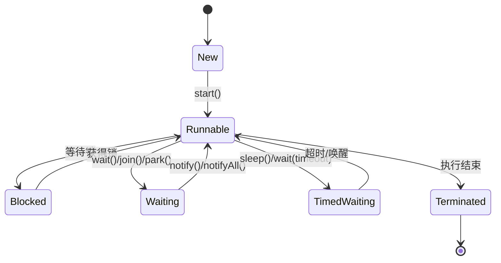

协程（Coroutine），又称微线程或纤程，是一种并发设计模式。按照Google官方的说法，Kotlin协程的主要用处在于“**（以同步的写法）来简化异步执行的代码**”，从而避免不自觉地陷入“回调地狱（Callback Hell）”。因此在使用Kotlin协程的时候，开发者无需过多关心异步任务的线程切换问题，几乎只要按照同步的思路编写程序即可。Google官方对于协程十分看重，并且已经在Android R中替代了AsyncTask的使用。

尽管协程本身是一个很早提出的概念，但直到近些年才在某些语言中（如Go、Lua、Python、Kotlin甚至C++20等）广泛运用。值得注意的是，Kotlin协程与其他语言的协程经常被拿来比较，但它们在实现层次上并不相同。Kotlin在JVM（含Android）上的协程是**编译器 + 运行时库**共同实现的：编译器把`suspend`函数改写成带状态机的回调（CPS变换），`kotlinx.coroutines`负责调度与恢复，最终仍然运行在**有限数量的真实线程**上。所以Kotlin协程并不是"操作系统级协程"，也不是"在JVM上凭空造出不需要线程的并发"。

所谓"线程封装"，指的是线程作为**执行载体**承载协程，协程无法脱离线程运行；而它封装的并不是"线程API的语法糖"，而是**任务与线程的绑定关系**。`Executors`提交N个任务，就是N个任务各自占住一个线程直到跑完；协程是M:N调度，成千上万个协程可以复用同一个线程池，某个协程挂起时线程立刻空出来去跑别的协程。因此协程的"挂起"是**不阻塞线程**的，这是它与`AsyncTask`、`Handler`这类基于线程/消息队列的方案最本质的区别。

理解时分成两层最清晰：**执行载体是线程（物理层）**，**调度单元是协程（逻辑层）**。这两层混在一起解释，就会出现"协程就是线程池的语法糖"或"协程不需要线程"这两种极端说法。

在了解协程之前，需要先掌握线程的用法。因为只有通过逐步接触**最原始**的线程用法，了解到基于原始线程用法执行并发任务的不便之后，才能够理解为什么会有Executors、AsyncTask乃至Kotlin协程这些线程框架的出现和应用。

## 线程基础概念

与线程（thread）紧密相关的一个概念是进程（process）。所谓进程，在一些教科书中被定义为“程序的一次执行”，“系统进行资源分配和调度的一个独立单位”，简而言之就是系统的一个任务。

与线程相关的另一个重要概念是并发（concurrence）。所谓并发，是指若干事件在**同一时间间隔**内发生（同时发生则为**并行**），宏观上表现为“同时进行”，微观上则是“交替执行”。

还有一个重要概念是异步（asynchronism）。所谓异步，是指发出一个功能调用后，即便调用者还没有得到结果，仍可以继续执行后续操作；而当这个调用完成后，就通过状态、通知和回调等方式来通知调用者。与异步概念相对应的就是同步（synchronism）。

最后一个重要概念是临界资源（critical resource）。临界资源是指一类只能采用**互斥**方式进行共享的资源，简单来说就是在一段时间内该类资源只能提供给一个访问者，比如硬件资源中的打印机。

现在再来介绍线程。线程是现代操作系统中调度和分派的基本单位，也是最小的任务执行单元。线程和进程之间属于被包含和包含的关系，简单地说，**进程是操作系统的子任务，而线程就是进程的子任务**。正如操作系统中通常有多个进程并发运行那样，进程中至少有一个线程（即主线程）在运行。

线程概念的出现与实现，跟进程并发执行的资源开销问题有十分密切的联系。在操作系统中，作为资源的拥有者，进程在创建、撤消以及切换方面都需要付出较大的资源开销，尤其是切换线程时，一方面需要保留当前进程的CPU环境，另一方面还要为新进程设置CPU环境。而单个线程由于占用资源较少，因此在创建、撤消和切换的过程中所要付出的代价也比进程小很多。

多线程几乎是所有现代操作系统的必备基础技术，同时也是程序应用最基本的并发模型。

## 线程基本使用

### 创建线程

创建线程主要有两种方式：通过实例化Thread类或实现Runnable接口。某些专业书籍或博客将“实现`Callable`接口”列为第三种方式，然而**其本质上依然是实现Runnable接口**，因此这里只介绍上述两种方式。

实例化Thread的方法为：

```
//Kotlin：
val thread = Thread {
    //TODO
}
thread.start()

//Java：
Thread thread = new Thread(() -> {
    //TODO
});
thread.start();
```

实现Runnable接口的方法为：

```
//Kotlin：
val thread = Thread(MyRunnable())
thread.start()

class MyRunnable: Runnable {
    override fun run() {
        //TODO
    }
}

//Java：
Thread thread = new Thread(new MyRunnable());
thread.start();

class MyRunnable implements Runnable {
    @Override
    public void run() {
        //TODO
    }
}
```

>注意，无论采用哪一种方式创建线程，必须**调用`start()`方法来启动新线程**，直接调用`run()`方法等效于在当前线程执行代码（而这些代码原本需要在其他线程中执行），起不到多线程的效果。此外，一个线程对象只能调用一次`start()`方法。

线程对象可以设置名称和优先级，但是要注意，高优先级的线程不一定能先执行，因为线程的调度由操作系统决定，程序本身无法决定线程的调度顺序，而“程序调度”正是协程对线程所具备的优势。

### 暂停和中断线程

要暂停某个线程，就需要在其内部的执行逻辑中调用`Thread.sleep()`方法，例如：

```
val thread = Thread {
    //TODO
    Thread.sleep(1000) //当前线程暂停1s
}
```

>注意，调用`Thread.sleep()`方法是有可能抛出异常的，因此通常需要使用`try-catch`语句进行拦截，或是在方法签名中向上抛出。

中断线程则通过调用线程对象的`interrupt()`方法，并且配合检测线程对象的`isInterrupted`标志位来确定线程是否已接收到中断指令，进而执行后续的操作，例如：

```
val thread = MyThread()
thread.start()
thread.interrupt()

class MyThread: Thread() {
    override fun run() {
        while (!isInterrupted) {
            //TODO
        }
    }
}
```

>注意，如果目标线程处于等待状态，在调用`interrupt()`方法时会抛出`InterruptedException`异常并被捕获。

只要目标线程在运行过程中接收到中断指令或捕获`InterruptedException`，都应该立即结束自身线程。

### 线程状态

线程有以下6种状态：

+ *New*：新创建，创建线程对象之后、调用`start()`方法之前
+ *Runnable*：可运行，调用`start()`方法之后、被暂停、中断或终止之前
+ *Blocked*：被阻塞，正在等待获取对象的**监视器锁**（monitor lock），也就是想进入某个被其他线程占用的 `synchronized` 代码块。注意，网络通信、读写文件这类 I/O 等待**不属于**该状态，此时线程在 `getState()` 里仍然显示为 *Runnable*
+ *Waiting*：等待中，调用了不带超时的`Object.wait()`、`Thread.join()`或`LockSupport.park()`。**唤醒来源各不相同**：`wait()`要靠同一个锁对象上的`notify()/notifyAll()`唤醒，`join()`则是等目标线程终止后自动返回，`park()`需要`unpark()`
+ *Timed waiting*：计时等待，在调用`Thread.sleep()`等带有超时参数的方法之后
+ *Terminated*：被终止，`run()`方法退出（正常退出或异常终止）


大致的状态切换为：



线程状态可以通过`getState()`方法获得。

### 守护线程

守护线程是指程序运行时在后台提供某些通用服务的一种线程，比如Java的垃圾回收线程。守护线程具有**自动结束自己生命周期的特性**：当JVM中所有**非守护线程**都结束时，JVM就会退出，此时所有守护线程被**直接终止**——注意，终止时不会执行`finally`块，也不会执行任何收尾逻辑。反过来说，只要还有一个非守护线程在跑（尤其是<u>在内部开启了无限循环</u>的非守护线程），JVM就不会退出。

要使用守护线程，方法非常简单，只需要**在调用`start()`方法之前**通过`isDaemon = true`或者`setDaemon(true)`的方式，将一个普通线程设置成守护线程即可。守护线程在使用上和普通线程几乎没有区别，但有两点需要注意：

>1. 在守护线程中开启的新线程也是守护线程；
>2. 守护线程不应该用于读写文件等访问固有资源的操作，否则可能会因为JVM退出发生数据丢失。

## 线程安全

当多个线程同时运行时，线程的调度由操作系统决定，因此任何一个线程随时都可能被暂停，或是恢复执行。在这种情况下，一个单线程中不存在的问题便出现了：**如果多个线程同时操作一个可共享的资源变量，那么势必会引发冲突**。

事实上，同步问题并非多线程独有，因为在多道程序环境下，多个进程间也同样存在这个问题，并由此衍生出诸如“生产者-消费者”、“哲学家进餐”以及“读者-写者”等一系列关于同步问题具有代表性的描述。

综上可知，同步问题的核心在于：**必须确保同一时刻只有一个线程/进程对共享资源进行操作**。妥善处理同步问题，是保证多线程运行安全的关键所在。

### 线程同步

之前提到，同步问题的核心在于同一时刻只能有一个线程/进程对共享资源进行操作，亦即在多线程模型下，要保证逻辑正确，对共享资源进行读写时，必须保证一组指令以**原子**方式执行。在Java中，保证一段代码的原子性就是通过<u>加锁</u>和<u>解锁</u>实现的。

+ **volatile关键字**

`volatile`关键字用于修饰线程间的共享变量，目的是解决可见性问题：当一个线程修改了某个共享变量的值，其他线程能够立刻看到修改后的值。

在JVM中，变量的值保存在主内存，当线程访问变量时，它会先获取一个副本，并保存在自己的工作内存中。如果线程修改了变量的值，虚拟机会在某个**不确定**的时刻把修改后的值回写到主内存。而这个过程中产生的时间差，就有可能造成多线程之间共享变量不一致的情况发生。

在使用`volatile`关键字修饰共享变量后，就能确保线程访问变量时，总是获取主内存的最新值，并在修改变量后立刻将其回写到主内存。

> 注意两条边界：第一，`volatile`保证**可见性**和**有序性**（禁止指令重排），但**不保证原子性**——`count++`这种"读-改-写"三步操作，加上`volatile`依然会丢更新，必须用`synchronized`或`AtomicInteger`。第二，`volatile`只对**单一变量的读写**生效，不能用来保护"多个变量之间的不变式"（比如账户A减、账户B加）。

+ **synchronized**

`synchronized`主要用于修饰线程代码块（将一组操作打包成原子操作），目的是解决多线程同步访问共享变量的正确性问题。它的基本使用方式如下：

```
1. 找出修改共享变量的线程代码块；
2. 选择一个共享实例作为锁；
3. 使用synchronized(lockObject) {}包裹代码块。
```

>注意，存在竞争关系的线程之间，使用的加锁对象必须是同一个共享实例。

在使用`synchronized`的时候，无论是否有异常，都会在`synchronized`结束处正确释放锁。

使用`synchronized`进行加锁和解锁，一方面限制了代码块的并发执行，另一方面需要消耗一定的时间，因此会降低程序的执行效率和性能。此外，`synchronized`锁是一种可重入锁，即**能被同一线程反复获取**。

当加锁对象是一个类的`this`实例时，可以将`synchronized`用在修饰类的实例方法上，比如：

```
//synchronized修饰方法：
class Demo {
    public synchronized ReturnType foo(param: ParamType) {
        //TODO
    }
}


//等效语法：
class Demo {
    public ReturnType foo(param: ParamType) {
        synchronized (this) {
             //TODO
        }
    }
}
```

对于Java中的静态方法，`synchronized`的加锁对象为该类的`Class`实例，比如：

```
//synchronized修饰静态方法：
class Demo {
    public synchronized static ReturnType foo(param: ParamType) {
        //TODO
    }
}


//等效语法：
class Demo {
    public static ReturnType foo(param: ParamType) {
        synchronized (Demo.class) {
             //TODO
        }
    }
}
```

+ ***死锁问题*

“死锁”在计算机操作系统中可以大致定义为：一组进程中的每个进程都在等待仅由该组其他进程才能引发的事件触发后续操作。将进程换作线程，也能得到相似的定义。而无论是进程还是线程，死锁的产生都需要同时满足以下四个条件：

  1. **互斥条件**：对所分配到的资源排他使用
  2. **请求和保持条件**：在持有至少一个不可抢占资源的情况下又提出新的资源请求
  3. **不可抢占条件**：已获得的资源只有在使用结束后才能被释放
  4. **循环等待条件**：持有其他访问者所请求的资源，并请求其他访问者所持有的资源，由此陷入死循环

**以`synchronized`锁为例，假设两个线程A、B各自持有锁A和锁B，且试图获取对方的锁，由于对方的锁都处于被持有状态无法获取，这就陷入了无限等待的死锁状态。一旦陷入死锁，只能通过`jstack`导出线程栈定位（会显示`Found one Java-level deadlock`），程序层面没有任何解除办法。**

只有破坏死锁产生的条件，才能解决死锁问题。由于互斥条件是强制要求，因此通常都是从破坏其他三个条件入手，但无论采取什么样的破坏手段，本质上都是为了实现<u>“不释放资源者不得请求资源”</u>。

`synchronized`锁解决了系统调度下的多线程竞争问题，但是还需要一种机制以确保多线程在一定程度上能够为开发者所控制，进而能够协调地运行。最常见的就是在<u>`synchronized`代码块内</u>对**锁对象**调用`wait()`、`notify()`或者`notifyAll()`方法。

调用了`wait()`方法的线程会进入等待状态，并释放持有的锁对象，以确保其他线程能获得锁。

在相同锁对象上调用`notify()`或者`notifyAll()`方法，会使处于等待状态的线程被唤醒恢复至运行状态，并在重新获取锁之后才能继续执行`wait()`后面的代码（如果有的话）。

>注意，`notify()`只能随机唤醒众多等待线程中的某一个，而`notifyAll()`可以一次性全部唤醒，因此通常情况下更推荐使用`notifyAll()`。

然而`synchronized`毕竟是非常底层且原始的锁，使用起来并不方便，于是Java在后续的版本中又加入了更为高效便利的线程锁。

### 线程锁

#### ReentrantLock

从Java 5开始，Java引入了一个高级的处理并发的`java.util.concurrent`包，它提供了大量更高级的并发功能，能大大简化多线程程序的编写。

ReentrantLock就是这个包里面的其中一种工具，它是一种被设计用于替代`synchronized`的线程锁。和`synchronized`一样，ReentrantLock也是一种可重入锁，但是它比`synchronized`多了一项特性——可以尝试获取锁，即便获取失败也不会引起死锁，这就提高了多线程任务的安全性。

ReentrantLock的典型使用方式如下：

```
//不做获取锁的尝试
class Demo {
    private final Lock lock = new ReentrantLock();

    public void foo(int num) throws InterruptedException {
        lock.lock();
        try {
            //TODO：执行目标代码
        } catch (Exception e) {
            e.printStackTrace();
        } finally {
            lock.unlock();
        }
    }
}

//尝试获取锁
class Demo {
    private final Lock lock = new ReentrantLock();

    public void foo(int num) throws InterruptedException {
        //可以设置等待时间，一定时间后仍未获取到锁就会放弃等待，程序可以脱离出来执行别的任务
        if (lock.tryLock(someTime, TimeUnit.XXX)) { 
            try {
                //TODO：执行目标代码
            } catch (Exception e) {
                e.printStackTrace();
            } finally {
                lock.unlock();
            }
        }
    }
}
```

>注意，ReentrantLock通常建议跟try-catch-finally代码块搭配使用，以确保锁一定可以被释放。后面介绍的其他线程锁也同样遵循这一规则。

`synchronized`通过配合`wait()`、`notify()`以及`notifyAll()`方法来执行线程的等待和唤醒，而ReentrantLock则依靠Condition对象来实现相同的功能。Condition对象必须由Lock对象来创建，这样才能确保其跟线程锁绑定在一起，从而发挥其应有的作用。对上面的示例代码进行修改，加入Condition对象：

```
class Demo {
    private final Lock lock = new ReentrantLock();
    private final Condition condition = lock.newCondition();

    public void foo(int num) throws InterruptedException {
        if (lock.tryLock(someTime, TimeUnit.XXX)) { 
            try {
                //TODO：执行目标代码
                //condition.await(); 线程释放当前锁进入等待状态，唤醒之后需要重新获得锁
                //condition.signal(); 唤醒某个线程
                //condition.signalAll(); 唤醒所有线程
            } catch (Exception e) {
                e.printStackTrace();
            } finally {
                lock.unlock();
            }
        }
    }
}
```

Condition对象的`await()`方法和ReentrantLock对象的`tryLock()`方法类似，也可以设置等待时间，如果线程在指定时间内没有被其他线程锁唤醒，它就会在时间到了以后自己唤醒执行任务。

综上，利用ReentrantLock和Condition，可以实现更为安全灵活的多线程并发机制。

#### ReadWriteLock

ReentrantLock对于线程读写的加锁保护是非常严格的，它可以确保任何时候都只有一个线程执行临界区代码（包括读和写），安全性不言而喻。然而事实上，**线程安全最关键的地方在于“写”，仅仅是“读”数据其实并没有什么太多的问题**。

Java提供ReadWriteLock就是为了满足这样的需求：为了提高并发效率，当没有线程修改数据时，应当允许多个线程同时读取数据。请注意，多个线程同时读取数据的前提是“**此时没有线程在修改数据**”，否则读取数据的操作就不被允许执行。而且反过来，当有线程在读取数据时，写入操作同样也是不被允许的。正因为读与写绝对互斥（**一种操作必须等待另一种操作释放锁才能执行**），这种"先拿锁再访问"的模型属于典型的**悲观并发控制**（与StampedLock那种"先读、冲突再重试"的乐观策略相对）。

对于一些读多写少的场合，使用ReadWriteLock无疑是非常合适的。

ReadWriteLock的典型使用方式如下：

```
public class Demo {
    private final ReadWriteLock rwlock = new ReentrantReadWriteLock();
    private final Lock rlock = rwlock.readLock();
    private final Lock wlock = rwlock.writeLock();

    public void set(int index) {
        wlock.lock(); //加写锁
        try {
            //TODO：执行目标代码
        } catch (Exception e) {
            e.printStackTrace();
        } finally {
            wlock.unlock(); //释放写锁
        }
    }

    public SomeType get() {
        rlock.lock(); //加读锁
        try {
            //TODO：执行目标代码
            return someThing;
        } catch (Exception e) {
            e.printStackTrace();
        } finally {
            rlock.unlock(); //释放读锁
        }
    }
}
```

注意到ReadWriteLock在Java中的具体实现是ReentrantReadWriteLock。ReentrantReadWriteLock针对读和写提供了`readLock()`和`writeLock()`两个方法，它们都会返回一个Lock对象，**这样，不同的操作就通过不同的Lock对象调用`newCondition()`方法获得各自的Condition对象**，在使用上就和ReentrantLock基本一样了。

#### StampedLock

为了进一步提高并发效率，Java 8提供了另一种线程锁StampedLock，它和ReadWriteLock相比有个重要的差别：读的过程中也允许其他线程获取写锁后写入。此外，StampedLock是一种不可重入锁。

StampedLock的工作原理是这样的：预期读取过程中大概率不会有写入，而一旦发生读写同时操作导致读取的数据不一致，需要检测出来，之后再读一遍以确保读到的是最新的数据。这种基于概率的线程锁就被称为**乐观锁**。

StampedLock的典型使用方式如下：

```
class Demo {
    private final StampedLock stampedLock = new StampedLock();

    public void set(SomeType arg) {
        long stamp = stampedLock.writeLock(); //获取写锁
        try {
            //TODO：执行目标代码
        } catch (Exception e) {
            e.printStackTrace();
        } finally {
            stampedLock.unlockWrite(stamp); //释放写锁
        }
    }

    public SomeType get() {
        long stamp = stampedLock.tryOptimisticRead(); //获得一个乐观读锁
        //TODO：未加锁情况下先进行一次读取
        if (!stampedLock.validate(stamp)) { //检查乐观读锁后是否有其他写锁发生
            stamp = stampedLock.readLock(); //如果确实发生了其他写锁，获取一个悲观读锁
            try {
                //TODO：执行目标代码，在加锁情况下重新读取一次
            } catch (Exception e) {
                e.printStackTrace();
            } finally {
                stampedLock.unlockRead(stamp); //释放悲观读锁
            }
        }
        return someThing;
    }
}
```

注意到在上面的示例代码中，通过`writeLock()`、`tryOptimisticRead()`以及`readLock()`方法获取到的对象不是Lock类型，而是long类型，这是一个**版本号**。此外，可以看到，StampedLock对写入操作的加解锁和先前其他的线程锁是类似的，但是对于读取操作则需要加入版本号验证的环节。

最后要注意的是，StampedLock通过`asReadLock()`、`asWriteLock()`以及`asReadWriteLock()`这三个方法来获取Lock对象，进而获取到Condition对象来执行线程的等待和唤醒操作。

### Concurrent集合与Atomic操作类

在Java中，如果一个类不作特殊说明，通常都是默认为**非线程安全**的，需要通过`synchronized`等方式对共享变量和相关代码块进行加锁和解锁。

对于常用的集合类，Java在`java.util.concurrent`包里面提供了一些基本的线程安全的具体实现：

|接口|非线程安全的常用具体实现|线程安全的常用具体实现|
|:--:|:--:|:--:|
|List|ArrayList|CopyOnWriteArrayList|
|Map|HashMap|ConcurrentHashMap|
|Set|HashSet、TreeSet|CopyOnWriteArraySet（读多写少）、ConcurrentSkipListSet（需要有序）|
|Queue|ArrayDeque、LinkedList|ArrayBlockingQueue、LinkedBlockingQueue|
|Deque|ArrayDeque、LinkedList|LinkedBlockingDeque|

上面这些线程安全的集合类具体实现可以拿来直接替换，不需要做其他额外的更改。

除了Concurrent集合，Java还提供了一系列原子操作的封装类，它们位于`java.util.concurrent.atomic`包中，常见的有AtomicInteger、AtomicBoolean以及AtomicLong等等。Atomic类可以通过**无锁**方式来实现线程安全访问。

所谓CAS（Compare and Set，比较并交换）是一种**无锁**的原子操作，由CPU提供单条指令保证原子性。它的执行逻辑是：比较当前值与期望值，**若相等则把当前值替换为新值并返回`true`，若不等则不做任何修改并返回`false`**。也就是说，CAS判断的是“值有没有被别人改过”，比较成功才写入；失败时由调用方自己读取最新值后重试（这个重试过程通常被称为自旋）。`AtomicInteger.compareAndSet(expected, update)` 就是这套语义的直接体现。

## 线程池

线程池（ThreadPool）是Java内置的一种线程复用机制，主要是为了解决频繁创建和销毁大量线程所带来的系统资源消耗问题。线程池内部维护了若干个线程（数量可设置），在没有任务的时候，这些线程处于等待状态，如果有任务则分配一个空闲线程去执行。当线程池满的时候，新来的任务要么放入队列等待，要么增加新的线程进行处理。

### Executors

Java标准库提供了ExecutorService接口，以及FixedThreadPool、CachedThreadPool、SingleThreadExecutor以及ScheduledThreadPool等常见的实现类，这些实现类的创建都被封装到Executors类当中。四种常见实现类的创建和使用方法如下：

+ **FixedThreadPool**

FixedThreadPool是一种**线程数固定**的线程池，其创建和使用方法为：

```
//创建线程池：
val tp = Executors.newFixedThreadPool(线程数) //传入的线程数决定线程池大小

//提交执行任务：
tp.submit(Task) //Task可以通过继承Runnable和Callable接口来实现
tp.submit {
    //TODO
}

//关闭线程池：
tp.shutdown() //执行完当前任务之后再关闭
tp.shutdownNow() //立即关闭
tp.awaitTermination(等待时长,时间单位) //等待一段时间后自动关闭线程池
```

>注意，线程池使用完毕后必须关闭，以免发生内存泄漏。**如无特别说明，所有线程池都应当如此**。

+ **CachedThreadPool**

CachedThreadPool是一种**可以根据任务数量动态调整线程数**的线程池，除了在创建上跟FixedThreadPool有所区别之外，其他的使用方式基本一样：

```
val tp = Executors.newCachedThreadPool()
```

>注意，如果想创建一个在某个范围内动态调整线程数的线程池，那么可以考虑实例化ThreadPoolExecutor类。

+ **SingleThreadExecutor**

SingleThreadExecutor是一种**仅单线程执行**的线程池，通常用于执行顺序固定的任务（用线程做同步任务），遵循队列的FIFO原则：

```
val tp = Executors.newSingleThreadExecutor()
```

+ **ScheduledThreadPool**

ScheduledThreadPool是一种**定长的、可执行定时或周期性任务**的线程池。需要注意的是，它的实例类型是`ScheduledThreadPoolExecutor`，实现的是`ScheduledExecutorService`接口（而非`ExecutorService`），因此多出了`schedule`系列方法，这也是它和前面三个实现类在类型上的差别（Kotlin的`val`能自动推导，不需要特意声明类型）。其创建和使用方式如下：

```
//创建线程池：
val tp = Executors.newScheduledThreadPool(线程数)

//提交一次性定时任务：
tp.schedule(Task, 等待时长, 时间单位) //等待一段时间后执行任务

//提交周期性触发任务：
tp.scheduleAtFixedRate(Task, 等待时长, 时间间隔, 时间单位) //按照固定时间间隔触发执行任务

//提交固定时间间隔任务：
tp.scheduleWithFixedDelay((Task, 等待时长, 时间间隔, 时间单位) //任务执行完毕后等待固定时间间隔再执行下一个任务
```

### Future和CompletableFuture

之前已经提到，提交到线程池的Task要么实现Runnable接口，要么实现Callable接口，这两者之间存在什么区别？简单来说，实现Runnable接口的Task调用方法是拿不到返回值的，而实现Callable接口就可以做到，因为它是一个泛型接口，可以返回指定类型的结果。换句话说，如果使用线程池去执行异步任务且不需要考虑返回结果，那么就让Task实现Runnable，否则必须实现Callable。

在实现Callable接口之后，下一步就是从线程池实例对象的`submit()`方法中拿到结果。`submit()`方法返回的是一个Future类型的对象，而Future本身是一个泛型接口，因此调用该对象的`get()`方法就会得到指定类型的结果。Future的典型用法如下：

```
val future: Future<SomeType> = threadPool.submit(Callable {
    //TODO：执行耗时代码，最后一句代码应该返回一个指定类型的结果
})
future.get() //获得指定类型的异步结果
future.get(someTime, TimeUnit.XXX) //在指定时间内未能获取到异步结果，主线程自行脱离阻塞状态
future.isDone() //判断异步任务是否已经完成
future.cancel() //取消当前异步任务
future.isCancelled() //判断当前异步任务是否已经被取消

threadPool.shutdown()
```

正如它的名称一样，Future会在“未来”拿到一个异步返回的结果，但是这个“未来”有多远就很难确定了，因此要十分注意**调用`get()`方法可能会造成主线程的长时间阻塞**。

为了解决使用Future造成主线程被迫阻塞等待结果的问题，Java 8又推出了CompletableFuture，它对Future的主要改进之处在于，可以传入回调对象，当异步任务完成或者发生异常时，自动调用回调对象的回调方法。此外，CompletableFuture还具备串行执行的特性（同步写法执行异步任务？）。

CompletableFuture的典型用法如下：

```
val cf: CompletableFuture<SomeType> = CompletableFuture.supplyAsync { //supplyAsync自动开启一个子线程
    //TODO：执行耗时代码，最后一句代码应该返回一个指定类型的结果
}
cf.thenAccept { it: SomeType!
    //TODO：处理异步任务成功返回的结果
}
cf.exceptionally { it: Throwable!
    //TODO：处理异步任务执行过程中发生的异常
}

//上一个异步任务执行成功后，串行执行下一个异步任务
val cf2: CompletableFuture<SomeType> = cf.thenAcceptAsync {
    //TODO：执行耗时代码，最后一句代码应该返回一个指定类型的结果
}
cf2.thenAccept { it: SomeType!
    //TODO：处理异步任务成功返回的结果
}
cf2.exceptionally { it: Throwable!
    //TODO：处理异步任务执行过程中发生的异常
}
```

>注意，如果主线程的结束时间比子线程早，那么CompletableFuture就会来不及返回处理任何结果。

CompletableFuture的调用方法在命名上也有一些讲究，比如以Async结尾的方法都会在线程池中异步执行，没有以Async结尾的方法则会继续在已有的线程中执行。

除此之外，CompletableFuture还提供了`anyOf()`和`allOf()`这两个方法，它们都可以接受若干个CompletableFuture对象作为参数，也都会返回一个CompletableFuture对象，但是在具体的使用上存在差异：

+ 前者表示只要有一个CompletableFuture对象执行异步任务成功，就返回一个CompletableFuture\<Any!>对象
+ 后者表示必须所有的CompletableFuture对象执行异步任务成功，才会返回一个CompletableFuture\<Void!>对象

两个方法的组合使用可以实现非常复杂的异步流程控制。

### ForkJoin

ForkJoin是Java 7引入的一种新型线程池，其主要原理是：基于“分治”的思想，将一个大型任务拆分成小型任务**并行执行**，最后将并行执行的结果合并。

ForkJoin的使用有两个重点值得关注：一是如何构建任务，二是如何传递任务。接下来配合下面的示例代码进行说明。

构建任务的核心在于创建继承RecursiveTask或RecursiveAction的子类。RecursiveTask和RecursiveAction都是实现了ForkJoinTask这个抽象泛型类的子类，只不过后者在实现的时候传入的泛型是`Void`，所以就没有返回值可用了。

```
class DemoTask(···): RecursiveTask<SomeType>() {
    override fun compute(): SomeType {
        //TODO：执行并行计算的具体代码，并将结果返回
        val demo = DemoTask(···)
        val demo2 = DemoTask(···)
        ···
        invokeAll(demo,demo2,···)
        val result = demo.join()
        val result2 = demo2.join()
        ···
    }
}

class DemoTask2(···): RecursiveAction() {
    override fun compute() {
        //TODO：执行并行计算的具体代码，但是没有结果返回
        val demo = DemoTask2(···)
        val demo2 = DemoTask2(···)
        ···
        invokeAll(demo,demo2,···)
        demo.join()
        demo2.join()
        ···
    }
}
```

无论是继承哪一个，都要覆写`compute()`方法。在这个方法里面，有三个需要注意的地方：

1. 将一个大型任务拆分成相同类型的足够小的任务对象
2. 拆分出来的小型任务对象传入`invokeAll()`方法中并行执行
3. 调用这些小型任务对象的`join()`方法，以确保并行计算任务能够在完成前不被随意中断

>注意，在上面的示例代码中，DemoTask或DemoTask2都应该使用带参数的构造器，无参构造器是不能实现大型任务拆分的。比如拆分一个大型数组，至少要传入数组本身、拆分起始位置和拆分结束位置这些参数。

在介绍完如何构建任务之后，接下来就要知道如何在主线程里传递任务。传递任务的方式很简单，有以下五种：

```
val task = DemoTask(···) //或是val task = DemoTask2(···)

ForkJoinPool.commonPool().invoke(task) //传递单个大型任务

ForkJoinPool.commonPool().invokeAll(taskCollection) //传递多个大型任务执行并行计算

ForkJoinPool.commonPool().invokeAll(taskCollection,someTime,TimeUnit.XXX) //传递多个大型任务，并尝试在指定时间内完成所有并行计算任务

ForkJoinPool.commonPool().invokeAny(taskCollection) //传递多个大型任务，并返回成功执行的任务的结果

ForkJoinPool.commonPool().invokeAny(taskCollection,someTime,TimeUnit.XXX) //传递多个大型任务，并返回在指定时间内完成的任务的结果
```

`invoke()`、`invokeAll()`以及`invokeAny()`方法都是泛型方法，返回值的具体类型主要由task所使用的任务类决定。

### ThreadLocal

ThreadLocal并不是一个Thread，而是一个Thread的局部变量。它在Java 1.2时期就已经出现，Java 5时期修改成泛型。ThreadLocal的主要作用在于通过为每个线程提供一个独立的变量副本，解决变量并发访问的冲突问题。它适合在**一个**线程的处理流程中保持上下文，从而避免了同一参数在所有方法中传递。也就是说，只要一个线程内需要调用若干个方法，而这些方法又需要用到同一个参数，那么就可以使用ThreadLocal作为该线程作用域内的“全局变量”。

ThreadLocal的典型用法如下：

```
val threadLocal = ThreadLocal<SomeType>() //创建ThreadLocal对象
threadLocal.set(···) //设置ThreadLocal对象的参数内容，进行初始化

try {
    threadLocal.get() //获取ThreadLocal对象的参数内容
} catch(e: Exception) {
    e.printStackTrace()
} finally {
    threadLocal.remove() //释放ThreadLocal对象，防止上下文干扰
}
```

一个线程内允许创建和使用多个ThreadLocal。

## Handler

Android系统中使用Handler处理异步消息，从而实现子线程与主线程之间的切换。Handler机制包含四个部分：Message、Handler、MessageQueue以及Looper。下面简要介绍一下这四个部分以及Handler的基本使用方式。

+ `Message`

可以在内部携带少量信息，在不同线程间传递数据。

+ `Handler`

主要用于发送和处理消息。发送消息调用的是`sendMessage()`或`post()`等方法，处理消息则调用`handleMessage()`方法。

+ `MessageQueue`

主要用于存放所有通过Handler发送并等待处理的消息。每个线程只会有一个MessageQueue对象。

+ `Looper`

主要用于从MessageQueue中取出Message，并传递到Handler的`handleMessage()`中。每个线程只包含一个Looper对象，且Looper会调用`loop()`方法进入一个无限循环，以持续检测MessageQueue中是否有Message。

> 注意，`Looper.loop()`进入无限循环并不会引起ANR——ANR的判定标准是"主线程在规定时间内没有处理完输入事件/广播/服务回调"，而`Looper.loop()`本身就是消息循环，只要它持续取消息、派发消息，就不算"卡住"。真正导致ANR的是**某条消息在`handleMessage()`里执行太久**，把整个循环堵死了。

Handler机制的一种典型用法如下：

1. 在主线程中创建Handler对象，并重写`handleMessage()`（注意`Handler()`无参构造自**API 30起已废弃**，因为它隐式绑定"创建时所在线程"的Looper，在子线程误建就会绑错队列；显式传入Looper更安全）：
   ```
   // 旧写法（API 30 起废弃）
   val handler = object: Handler() {
       override fun handleMessage(msg: Message) {
           //在此处可进行UI操作
       }
   }

   // 推荐写法：显式指定主线程的Looper
   val handler = object: Handler(Looper.getMainLooper()) {
       override fun handleMessage(msg: Message) {
           //在此处可进行UI操作
       }
   }
   ```
2. 在子线程中创建Message对象，并通过Handler实例发送出去：
   ```
   thread {
        val msg = Message()
        msg.what = value1
        // 整型数据
        msg.arg1 = value2 
        // 整型数据
        msg.arg2 = value3
        // Object对象
        msg.obj = object
        handler.sendMessage(msg)
   }
   ```
3. Message被投递到**Handler所绑定Looper所在线程**的MessageQueue中（本例是主线程的队列）。关键点是：Handler在哪个线程创建，就绑定哪个线程的Looper，与它在哪个线程被调用`sendMessage()`无关。所以"子线程更新UI"的本质是——**把UI操作打包成消息，跨线程投递到主线程的队列里，由主线程的Looper取出执行**，子线程从头到尾没有碰过UI对象。

经过上述步骤之后，就可以实现子线程更新UI线程的操作了。

## AsyncTask

Android系统的异步方案，除了`Handler`之外还有一个`AsyncTask`。`AsyncTask`自 **Android 11（API 30）** 起被标记为`@Deprecated`，Google给出的替代方案是`java.util.concurrent`包与Kotlin协程；目前新项目已没有使用它的理由。它仍然值得作为 **历史知识** 了解：大量存量项目、老教程和面试题仍以它为背景，读懂旧代码时需要知道它的执行流程。

`AsyncTask`的历史局限也很明确：它在Android 3.0之前是**串行执行**的（`execute()`绑定单个后台线程），3.0之后改为线程池并行（`executeOnExecutor()`），但线程池大小固定且不可控；同时它持有Activity引用，配置变更（如旋转屏幕）容易造成内存泄漏与结果丢失。这正是它被协程取代的根本原因——协程用结构化并发和`viewModelScope`把“生命周期内完成任务”这件事变成了语言层面的约束。

AsyncTask是一个抽象类，因此需要定义一个子类继承AsyncTask并重写相关方法：

```
class DemoAsyncTask : AsyncTask<Params, Progress, Results>() {

    // 唯一必须重写的方法；返回类型必须是第三个泛型参数 Results
    override fun doInBackground(vararg params: Params?): Results? {
        // 在这里开启子线程执行耗时操作，返回值会传给 onPostExecute
        return null
    }

    override fun onPreExecute() {
        // 在后台任务开始执行前调用，用于界面上的初始化操作（主线程）
    }

    override fun onProgressUpdate(vararg values: Progress?) {
        // 调用 publishProgress() 后触发，可进行UI操作（主线程）
    }

    override fun onPostExecute(result: Results?) {
        // 后台任务结束后触发，可进行UI操作（主线程）
    }

    override fun onCancelled() {
        // 任务被取消时调用（主线程）；带参的 onCancelled(Results?) 已废弃，不必重写
    }
}
```

AsyncTask有三个泛型参数：

+ **Params**

在执行异步任务时需要传入的参数。

+ **Progress**

显示任务进度，通常会选择Int或者Double。

+ **Result**

任务执行完毕之后需要返回的结果。

AsyncTask中只声明了一个抽象方法`doInBackground()`，其余方法可以根据需要有选择性地去重写。

在实现AsyncTask之后，在主线程中调用`execute()`方法执行后台任务即可：

```
val demoAsyncTask: AsyncTask = DemoAsyncTask()
demoAsyncTask.execute(param: Param?) //execute方法是可以传递任意数量的参数的
```
