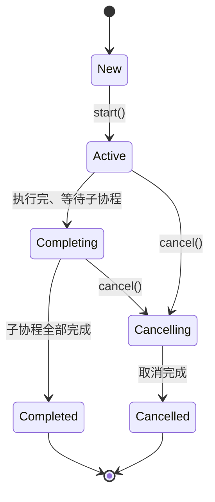

## Kotlin协程基本概念

### 协程作用域

作用域（scope）是指**变量和函数执行代码可被访问和生效的区域范围**。例如在一个类中，函数以外定义的属性，其作用域为整个类；而函数以内定义的成员变量，其作用域仅为该函数。Java里面的使用`public static`修饰的类属性和方法，其作用域即为整个项目。Kotlin协程也有对应的协程作用域，所有协程只能在协程作用域中使用，脱离协程作用域就无法通过编译。

+ **CoroutineScope**

CoroutineScope是Kotlin官方提供的作用域**接口**，它声明了一个名为`coroutineContext`（协程上下文）的属性。在此基础上，Kotlin又设计了`launch`、`async`以及`runBlocking`等扩展函数，作为协程构建器。注意，这些构建器里面执行的代码也被称作“协程”，因此从这里开始，协程实际上既可以指一种并发设计模型和组件，也可以指一系列执行异步任务的代码，在后续的内容中需要联系上下文加以辨别。

常用构建器如下：

`launch{}`：用于创建一个不阻塞当前线程的协程，**并返回一个`Job`对象用于管理该协程实例**；

`async{}`：和`launch`类似，但是返回一个`Deferred`对象，里面包含一个异步代码块返回、需要调用`await()`同步获取的结果；

`runBlocking{}`：创建一个可以阻塞当前线程的协程，官方**强烈建议不要在正式开发中使用该构建器**；

`withContext(){}`：创建一个指定调度器的协程，并同步获取内部异步代码块返回的结果，通常用于取代`async{···}.await()`的用法。

+ **GlobalScope**

GlobalScope是一个由Kotlin官方实现的最基础的**自定义**作用域，通常只用于功能测试或演示。它能够以单例模式创建启动一个**顶级**协程，这些协程在整个应用程序生命周期内运行，不会被过早地被取消。

然而，GlobalScope通常也不与任何生命周期组件绑定，除非手动管理，否则很难满足实际开发中的需求。因此，Android项目的程序代码应该使用自定义的协程作用域，**强烈不建议在生产用的业务逻辑中直接使用GlobalScope**。

+ **MainScope**

MainScope是`kotlinx.coroutines`核心库提供的工厂函数（并不是Android专属，只是最常用于UI场景），它等价于`CoroutineScope(SupervisorJob() + Dispatchers.Main)`，用于在主线程中创建协程。因为内部是`SupervisorJob`，它下面的某个子协程失败不会连累其他兄弟协程；但它不绑定任何Android生命周期，需要在组件的生命周期结束时手动调用`cancel()`取消协程，以防内存泄漏。

+ **LifecycleCoroutineScope**

LifecycleCoroutineScope是一个抽象类，通常在Android中调用的是`lifecycleScope`这一实例对象，进而调用其内部的抽象方法。LifecycleCoroutineScope的特点是可以自动管理生命周期，开发者只需要在合适的地方调用它即可，不需要像GlobalScope或者MainScope那样手动管理协程的取消与资源释放。早期它还提供了`launchWhenCreated{}`、`launchWhenStarted{}`以及`launchWhenResumed{}`等构建器用于按生命周期阶段启动协程，但这三个API**现已废弃**，替代方案是`suspend`函数`repeatOnLifecycle{}`（详见下文"lifecycleScope"一节）。

+ **viewModelScope**

ViewModel没有提供lifecycleScope来创建协程，而是用了一个viewModelScope的实例对象（继承的是CoroutineScope，而不是LifecycleCoroutineScope），用于创建管理只在ViewModel生命周期内运行的协程。和LifecycleCoroutineScope类似，开发者同样不需要手动管理viewModelScope的生命周期。

### 挂起函数

目前在JVM平台上的任何Kotlin协程代码块，要么写在协程作用域里，要么写在挂起函数当中，绝无例外；同样地，挂起函数要么也是运行在协程作用域里，要么也是运行在另一个挂起函数中。之所以要这样设计，是因为JVM的调用栈是"一插到底"的：一个方法调用没返回，调用者就卡在原地，中间没有任何地方能保存"执行到哪了"的状态。协程要支持"中途退出、稍后接着跑"，就必须由编译器把函数改造成可保存状态的形式，`suspend`关键字就是触发这一改造的开关（CPS变换，详见[[8. Kotlin协程：进阶部分#Kotlin协程的挂起与恢复|进阶部分]]）。

挂起函数涉及三个彼此独立的动作：

1. **挂起（suspend）**：协程在挂起点让出当前线程，线程回到池子里去执行别的任务。这一步不涉及线程切换，也不存在"脱离某个线程"的说法——它只是暂时不占着线程。
2. **切换（dispatch）**：只有显式指定了另一个调度器时（如`withContext(Dispatchers.IO)`、`flowOn()`），协程才会在恢复后被**派发**到那个调度器的线程上执行。`suspend`关键字本身**不会**引起任何线程切换。
3. **恢复（resume）**：挂起条件满足后，由调度器把协程续体（`Continuation`）重新提交执行。恢复到哪个线程取决于**当前上下文的调度器**，而不是"原来那个线程"。

一句话概括：**挂起函数提供的是"可中断、可恢复"的能力，线程归属由调度器决定。** 进入挂起函数并不等于切到后台线程——在`suspend fun`里直接写`Thread.sleep()`，一样会卡住调用它的线程。

> 注意，在引入协程之后，Kotlin语言体系中的函数就划分为普通函数和挂起函数两派，其中挂起函数既能调用普通函数又能调用其他挂起函数，而普通函数只能调用其他的普通函数。

### 启动模式

在官方提供的Kotlin协程框架中，`launch`等构建器都会有一个`CoroutineStart`类型的`start`参数，用于设置协程的启动模式，默认值为`CoroutineStart.DEFAULT`。目前启动模式一共有如下四种：

|模式|说明|
|:--:|:---------:|
|`DEFAULT`|协程创建后立即开始调度，在调度前如果协程被取消，其将直接进入取消相应的状态|
|`ATOMIC`|协程创建后立即开始调度并执行，协程执行到第一个挂起点之前不会响应取消|
|`LAZY`|只有协程被需要时，如主动调用`start`、`join`或`await`等函数时才会开始调度，若调度前就被取消将直接进入异常结束状态|
|`UNDISPATCHED`|协程创建后立即在当前函数调用栈中执行，直到遇到第一个挂起点|

在上面的说明中，需要弄清楚“立即调度”和“立即执行”不是同一回事，一个协程从接收调度到真正执行往往还有一段时间，主要是为了寻找执行时机和分配线程。通常情况下，`DEFAULT`和`LAZY`这两种启动模式就足够应付了，其他两种主要用于一些特殊场景。

### 调度器

Kotlin协程执行通常需要进行调度，这时候就需要向构建器中传入`CoroutineDispatcher`类型的调度器。官方框架预置了以下四个调度器：

|调度器|描述|
|:----:|:------:|
|`Dispatchers.Default`|CPU密集型任务调度器，适合处理后台计算|
|`Dispatchers.IO`|IO密集型任务调度器适合执行IO相关操作|
|`Dispatchers.Main`|UI调度器，在Android上就是主线程调度器|
|`Dispatchers.Unconfined`|非受限调度器，不要求协程执行在特定线程上|

> CPU密集型任务是指**以数值运算为主**的任务（比如计算圆周率、编解码等），IO密集型任务是指**以磁盘读写和网络通信为主**的任务。

> 非受限调度器的作用是让协程在挂起点恢复执行时，会在恢复操作所在的线程上直接执行。若嵌套创建以它为调度器的协程，那么这些协程会在启动时被调度到协程框架内部的事件循环上，以免出现StackOverflow。

> `Dispatchers.Default`和`Dispatchers.IO`**共享同一批底层线程**（官方注释写明：share threads with the Default dispatcher），区别在于后者限制了**可并行执行的阻塞任务数量**：默认上限为`max(64, CPU核数)`，可通过系统属性`kotlinx.coroutines.io.parallelism`调整。另外，由`Dispatchers.IO.limitedParallelism(n)`派生出的视图**不受这个上限约束**，可以用来给不同阻塞源（数据库连接池、HTTP客户端）分别限流。由于两者共享线程，从`Default`切到`IO`通常并不会真的发生线程切换。

如果预置的任务调度器无法满足需求，还可以继承`CoroutineDispatcher`自行定义调度器，不过更常见的做法是将[[6. Kotlin协程：线程基础#线程池|线程池]]转换为调度器，只要调用`asCoroutineDispatcher()`函数即可。但是要注意，线程池转换出来的调度器还需要主动关闭以免造成内存泄漏，通常可以调用`use`函数包裹要执行的业务逻辑，这样就不用手动管理。

如果开启协程时没有显式传入调度器，协程的调度器按**向上继承**规则确定：

1. 先继承父协程（或所在`CoroutineScope`）上下文里的调度器；
2. 如果整条继承链上都没有任何调度器，协程框架会在`newCoroutineContext()`中补一个`Dispatchers.Default`作为兜底。

所以`CoroutineScope(EmptyCoroutineContext).launch {}`跑在`Dispatchers.Default`的线程池上，而不是调用者线程；而`runBlocking {}`内部的子协程之所以看起来"都在当前线程"，是因为`runBlocking`自身提供了一个**事件循环调度器**并把它放进了上下文，子协程继承的是它。同理，`viewModelScope`的上下文里预置了`Dispatchers.Main.immediate`，所以它开启的协程默认就在主线程。

这也解释了为什么在Android里"忘记指定调度器"通常不会立刻炸：`viewModelScope`、`lifecycleScope`都自带主线程调度器。但一旦在`Dispatchers.Default`里做阻塞式I/O（读文件、查数据库），占的就是本应用于计算的线程池，因此耗时操作仍应显式切到`Dispatchers.IO`。

## Kotlin协程基本用法

### 前置工作

在Android项目中使用协程，首先要通过Gradle导入相关依赖：

```
// 基本使用
implementation "org.jetbrains.kotlinx:kotlinx-coroutines-android:$specific_version"

// 在ViewModel中使用viewModelScope
implementation "androidx.lifecycle:lifecycle-viewmodel-ktx:$specific_version"

// 使Room支持协程
implementation "androidx.room:room-ktx:$specific_version"

// 在Activity中使用lifecycleScope
implementation "androidx.lifecycle:lifecycle-runtime-ktx:$specific_version"

// 在Service中使用lifecycleScope
implementation "androidx.lifecycle:lifecycle-service:$specific_version"
```

> 版本基准（2026-11-10 核对）：`kotlinx-coroutines` 最新稳定版为 **1.11.0**（2026-05-08 发布），Kotlin 最新稳定版为 **2.4.21**（2026-10-08 发布）。协程库的版本需要与项目使用的 Kotlin 版本匹配，不要盲目取最新；Android端推荐直接使用`kotlinx-coroutines-android`（它内含`Dispatchers.Main`的实现），不要再单独引入`-core`。

### 开启协程

+ **GlobalScope**

要在程序中开启一个协程，最为简单的方式如下：

```
// 开启全局顶级协程，并保存返回的 Job
val job = GlobalScope.launch {
    // TODO
}

// 取消协程的正确方式：通过 launch 返回的 Job 取消
job.cancel()

// 也可以附带取消原因，便于在日志中定位是谁取消的
job.cancel("canceled by developer", IllegalStateException("exceptions"))
```

> 注意，`GlobalScope.cancel()`会直接抛出`IllegalStateException`。`GlobalScope`的上下文是`EmptyCoroutineContext`，官方注释写明"unlike other CoroutineScope implementations, this scope does not have a Job in its context"，而`CoroutineScope.cancel()`扩展函数的第一步就是`coroutineContext[Job] ?: error("Scope cannot be cancelled because it does not have a job")`。此外，即使某个作用域有Job，对作用域调用`cancel()`取消的也是**这个作用域**，而不是它启动过的某个具体协程——所以管理单个协程，认准`launch`/`async`的返回值。

在`launch{}`当中编写需要异步执行的代码，然后编译运行即可。

但是前面已经提到过，GlobalScope由于不绑定任何生命周期组件，手动管理相对麻烦，因此通常并不建议在正式的Android项目中使用。如果想要在正式的Android项目中使用协程，一般会选用MainScope、lifecycleScope以及viewModelScope这三个作用域来开启协程并进行管理。

此外，GlobalScope开启的协程类似于[[6. Kotlin协程：线程基础#守护线程|守护线程]]，只要虚拟机结束运行，无论里面的协程代码是不是一个一直在执行的死循环，都会跟着被取消。

+ **MainScope**

MainScope在主线程中开启和取消协程的基本方式如下：

```
// MainScope实例化
val mainScope = MainScope()

// 开启MainScope协程
mainScope.launch {
    // TODO
}

// 取消MainScope（取消整个作用域，内部的子协程全部取消）
mainScope.cancel()

// 也可以带原因取消：第二个参数必须是Throwable，不能是字符串
mainScope.cancel("canceled by developer", IllegalStateException("manual cancel"))
```

> 注意两点：第一，`CoroutineScope.cancel()`有两个重载——`cancel(cause: CancellationException?)`和`cancel(message: String, cause: Throwable?)`，第二个参数的类型是`Throwable`，写成字符串会编译失败；第二，必须对同一个MainScope对象进行开启和取消，否则达不到管理协程的目的，还会引发内存泄漏。

+ **lifecycleScope**

lifecycleScope主要是在具有生命周期的组件（比如Activity和Fragment等）当中开启协程。它最主要的协程构建器在前面已经提到过，下面是简单用法：

```
// 推荐方式：用 repeatOnLifecycle 控制"在哪个生命周期区间内运行"
lifecycleScope.launch {
    repeatOnLifecycle(Lifecycle.State.STARTED) {
        // 每次进入 STARTED 都会重新启动这段逻辑，退到后台则自动取消
        viewModel.uiState.collect { state ->
            // TODO：更新 UI
        }
    }
}

// 以普通方式开启协程（不受前后台切换影响，随 onDestroy 一起取消）
lifecycleScope.launch {
    // TODO
}
```

> 注意，`launchWhenCreated`、`launchWhenStarted`、`launchWhenResumed` **已被官方标记为废弃**。官方给出的理由是"can lead to wasted resources in some cases"——它们只是把协程**挂起**在恢复点上，协程本身并没有被取消，上游的生产者（比如`Flow`）仍在后台继续跑；等回到前台时又一次性把积压的数据吐出来。正确做法是`repeatOnLifecycle`：离开指定状态时**取消**内部协程，重新进入时**重新启动**，这才是"只在可见时干活"的语义。

lifecycleScope的存在意义，就在于调用它不需要额外编写任何取消协程的代码，只要组件的生命周期走到`onDestroy`这个阶段，所有属于lifecycleScope作用域的协程都会被**自行取消**，从根本上杜绝了开发者忘记手动取消协程引发内存泄漏的可能性。因此从这个角度来说，用lifecycleScope比MainScope更为方便和安全。

+ **viewModelScope**

viewModelScope用在MVVM架构的项目当中，特别是用在ViewModel里面。使用viewModelScope在ViewModel当中开启协程的基本方式如下：

```
viewModelScope.launch { 
    // TODO
}
```

viewModelScope和lifecycleScope一样，也不需要额外编写取消协程的代码。但是要注意，viewModelScope开启的协程跟ViewModel本身的生命周期是同步的。

### 异步任务

Kotlin协程既然在本质上是线程的一种良好封装，那么用来执行异步任务自然是理所应当的了。Kotlin协程提供的`async{}`构建器就是专门用来实现异步并发执行的。

`async{}`构建器的一个使用示例如下：

```
launch {
    val a = async {
        delay(1000L)
        (Math.random()*10).toInt()
    }

    val b = async {
        delay(1500L)
        (Math.random()*10).toInt()
    }

    Log.e("MyTag","a = ${a.await()} b = ${b.await()} c = ${a.await()+b.await()}")
}
```

上述示例代码的总执行时间通常接近1500毫秒，而非2500毫秒。这表明两个子协程的确是并发执行的，而且最后拿到的结果也是二者结果的汇总。

前面的内容已经提到过，`async{}`构建器返回的是一个`Deferred`对象，而`Deferred`是一个继承于`Job`的泛型接口，可以视为一个轻量级的非阻塞[[6. Kotlin协程：线程基础#Future和CompletableFuture|Future]]。在`async{}`构建器当中，最后一行代码往往就是要返回的结果，如果不返回结果，那么通过`await()`方法拿到的结果类型就是`Unit`。

利用`async{}`构建器构建协程执行异步任务，**<u>在需要结果的地方</u>**，调用`await()`方法获取异步任务产生的结果，这就是Kotlin协程基本的异步任务使用方式。

如果将示例代码改成下面的形式：

```
launch {
    val a = async {
        delay(1000L)
        (Math.random()*10).toInt()
    }.await()

    val b = async {
        delay(1500L)
        (Math.random()*10).toInt()
    }.await()

    Log.e("MyTag","a = $a b = $b c = ${a+b}")
}
```

执行后会发现所需时间接近2500毫秒，表明这两个协程变成**同步执行**的了。

在使用`async{}`构建器编写结构化并发代码时，异常的行为分两层：

1. **异常本身不会立即抛出**，而是被保存在对应的`Deferred`对象里，只有调用`await()`时才抛给调用方；
2. **但异常依然会向上传播并取消父协程**，父协程被取消后，它的其他子协程（兄弟协程）也会被一并取消。

也就是说，`async`只是"延迟了异常的抛出时机"，并没有"隔离异常的影响范围"。如果希望某个`async`失败不影响其他兄弟任务，必须用`supervisorScope{}`或`SupervisorJob`；此时唯一能拿到异常的途径仍然是`await()`（或`Deferred.invokeOnCompletion`），而`CoroutineExceptionHandler`对它不起作用。

这种"一处失败、全部取消"的行为符合结构化并发的设计意图：一段并发代码是一个整体，某个环节失败说明结果已经不可信，与其带着残缺结果继续跑，不如整体失败并把异常交给调用方处理。

值得注意的是，IDE会提示可以将`async{···}.await()`修改成`withContext(···){···}`形式的代码：

```
launch {
    val a = withContext(Dispatchers.Default) {
        delay(1000L)
        (Math.random() * 10).toInt()
    }

    val b = withContext(Dispatchers.Default) {
        delay(1500L)
        (Math.random() * 10).toInt()
    }

    Log.e("MyTag","a = $a b = $b c = ${a+b}")
}
```

之前已经提到过，`withContext()`就是用来替换`async{}.await()`这种调用方式的，而且前者**占用内存更低**。因此只要出现`async{}.await()`这种形式的调用，都应当调整成`withContext()`。

### 结构化并发

每个并发操作都在处理一个任务，它可能属于某个父任务，也可能有自己的子任务。每个任务都拥有自己的生命周期，而不同长度生命周期的并发任务整合在一起时，它们之间的协调就成了一个十分重要的问题。一种典型的情况是：如何确保一个短周期父任务在嵌套一个长周期子任务时，还能确保这个子任务执行完毕，而不是跟着父任务被强行结束？另外一种典型情况是：如何确保两个有明显顺序执行关系的并发任务按照开发者的意图依次执行？

结构化并发这一概念的提出就是为了解决上述的两个问题。对于开发者而言，父任务不应该在其所有的子任务执行完毕前（或任一子任务抛出异常）就自行结束；两个需要按照顺序执行下来的并发任务也不应该完全听凭操作系统的随机调度。传统的线程对于这两个问题都没有很便捷的解决方案，而Kotlin协程则提供了相对优雅的方法。

Kotlin协程只需要用一种方式编写代码即可同时解决上述两个问题，示意如下：

```
// 在某个作用域协程中开启子协程
launch {
    // 按同步写法依次开启子协程执行任务
    launch {
        // TODO
    }

    launch {
        // TODO
    }

    // 一个挂起函数
    foo() 
    ···
    // TODO: 所有子协程执行结束之后才会执行父协程
}
```

在上面的示意当中，代码结构非常清晰，而且意图也比较明确，很好地实现了结构化并发。

在结构化并发当中，`Job`对象是一个非常重要的存在，它代表着一段协程代码，一项协程任务。每创建一个协程，都会生成一个`Job`实例，用于管理协程的生命周期。当协程创建、执行、完成和取消时，`Job`实例的状态都会随之改变，因此通过检查`Job`对象的属性可以追踪到协程当前的状态。

`Job`对象一共包含有`New`、`Active`、`Completing`、`Completed`、`Cancelling`以及`Cancelled`六个状态，这也代表着它的生命周期。协程在`Active`和`Completing`阶段可以响应取消命令，一旦接收到取消命令，协程就会马上经过`Cancelling`和`Cancelled`这两个生命周期。



对协程作用域调用`cancel()`函数会取消此作用域内的所有子协程，而对代表某个子协程的`Job`实例调用`cancel()`时只会取消该子协程，并不会影响其他兄弟协程的继续执行。如果对`Job`实例调用`join()`函数，那么父协程就会被阻塞，直至该子协程执行完或被取消。

总体而言，Kotlin协程的结构化并发有以下三个特性：

+ 父协程（父作用域）的生命周期会持续到所有子协程（子作用域）执行完；
  
+ 当父协程（父作用域）被结束时，附属于其下的子协程（子作用域）也会一同被结束；

+ 子协程（子作用域）未被捕获到的异常将不会被重新抛出，而是逐级向上传递直到父协程（父作用域），并最终导致父协程（父作用域）被结束。

关于第三个特性，在后面的[[8. Kotlin协程：进阶部分#异常处理|协程异常处理]]内容中还会继续涉及，并且会对实际的程序设计产生重要影响，因此需要特别关注。

### 作用域构建器：coroutineScope 与 supervisorScope

前面介绍的`launch`/`async`都是"启动一个协程"，而`coroutineScope{}`和`supervisorScope{}`属于另一类构建器——它们**不启动新协程，而是创建一个子作用域，并挂起等待其中所有子协程结束**。这两个是理解结构化并发最关键、也最容易被跳过的一对API。

**coroutineScope{}**

```kotlin
suspend fun loadDashboard(): Dashboard = coroutineScope {
    val user = async { repo.loadUser() }      // 并发
    val orders = async { repo.loadOrders() }  // 并发
    Dashboard(user.await(), orders.await())   // 两者都完成后才返回
}
```

它的三个特征：

1. 是**挂起函数**，不阻塞线程（这点与`runBlocking`相反）；
2. 必须等所有子协程结束后才返回，返回值为lambda的最后一个表达式；
3. 任一子协程失败 → 作用域内其余子协程全部取消，异常继续向上抛给调用者。

所以"并发请求两个接口再合并结果"这种需求，正确写法就是`coroutineScope + async`，而不是在外面套一个`launch`。

**supervisorScope{}**

```kotlin
suspend fun loadPartial(): Result = supervisorScope {
    val a = async { repo.loadA() }   // 可能失败
    val b = async { repo.loadB() }   // 不受 a 影响
    Result(a.runCatching { await() }, b.runCatching { await() })
}
```

与`coroutineScope`唯一的差别是**异常隔离**：子协程失败不会取消兄弟协程，也不会取消父作用域。代价是异常不再自动传播，必须自己通过`await()`、`runCatching`或`invokeOnCompletion`去拿，`CoroutineExceptionHandler`在这里同样不生效。

| 构建器 | 是否挂起 | 阻塞线程 | 子协程失败的影响 |
|:--|:--:|:--:|:--|
| `launch` | 否 | 否 | 传播到父，取消父及兄弟 |
| `async` | 否 | 否 | 同上，但异常延迟到`await()`才抛出 |
| `coroutineScope` | 是 | 否 | 取消本作用域所有子协程并向上抛 |
| `supervisorScope` | 是 | 否 | 只影响失败的那个子协程 |
| `runBlocking` | 是 | **是** | 仅用于`main()`和测试 |

**配套的超时控制**

`withTimeout()`与`withTimeoutOrNull()`通常和作用域构建器配合使用：

```kotlin
val data = withTimeoutOrNull(3_000L) {   // 超时返回 null，不抛异常
    repo.loadRemote()
} ?: cache.loadLocal()                    // 超时降级读缓存
```

`withTimeout()`超时会抛`TimeoutCancellationException`，而它是`CancellationException`的子类。这一点必须记住：`CancellationException`表示"协程被取消"，本质上不是业务错误。如果开发者习惯性地写`catch (e: Exception)`把整段代码包住，就会把**取消信号一起吞掉**，导致协程无法正常结束（比如`viewModelScope`在页面销毁时的取消会失效，进而引发泄漏）。稳妥的写法是先放行取消异常：

```kotlin
try {
    repo.loadRemote()
} catch (e: CancellationException) {
    throw e                       // 取消信号必须原样抛出，不能吞
} catch (e: Exception) {
    reportError(e)                // 这里才是真正的业务异常
}
```

## 高频对比速查

这一节把最容易在面试和代码评审里被追问的几组概念放在一起对照，便于快速回忆。

### 协程与线程

| 维度 | 线程 | 协程 |
|:--|:--|:--|
| 实现层次 | 操作系统内核调度 | 编译器（CPS）+ 库（`kotlinx.coroutines`）用户态调度 |
| 执行载体 | 自身即载体 | **由线程承载**，不能脱离线程运行 |
| 数量级 | 数百至数千（每线程栈默认约 512KB–1MB，依平台与`-Xss`而定） | 数十万级（单个协程只是一个状态机对象） |
| 切换成本 | 内核态上下文切换（**微秒级**） | 用户态恢复续体（**亚微秒级**，量级对比，非精确值） |
| 取消机制 | `interrupt()`，只能打断阻塞点 | 协作式取消，`CancellationException` 沿挂起点传播 |
| 对应关系 | —— | **M:N**，一个线程可先后承载多个协程 |

**"轻量"到底轻在哪**：一个挂起函数被编译后，协程的"运行现场"就是堆上的一个续体对象（保存状态机编号与局部变量），大小在几十到几百字节；而一个线程要占用独立的栈空间（JVM 默认约1MB）和内核调度实体。所以"开十万个协程"可行，"开十万个线程"会直接 `OutOfMemoryError`。

### launch 与 async

| 对比项 | `launch` | `async` |
|:--|:--|:--|
| 返回类型 | `Job`（无结果） | `Deferred<T>`（有结果） |
| 获取结果 | 不提供 | `await()` |
| 异常抛出时机 | 立即交给父协程/异常处理器 | 存进 `Deferred`，`await()` 时才抛给调用方 |
| 是否取消父协程 | 是 | 是（异常同样向上传播） |
| 典型场景 | 只关心"做完"，不关心结果 | 并行拆分计算，最后合并结果 |

### 四个易混API

| API | 阻塞线程 | 返回结果 | 用途 |
|:--|:--:|:--:|:--|
| `runBlocking` | **是** | 有 | `main()`、测试，禁止在Android主线程用 |
| `coroutineScope` | 否（挂起） | 有 | 并发拆分再合并，失败整体回滚 |
| `withContext` | 否（挂起） | 有 | 切调度器 + 返回结果 |
| `launch` | 否 | 无（返回`Job`） | 发起后台任务 |

> 记住一条判断标准：**看它是不是`suspend`函数**。`runBlocking`、`coroutineScope`、`withContext`都是挂起函数（调用它们的函数也必须能挂起）；`launch`、`async`不是，它们只是"启动"一个协程就立刻返回。

---

> 机制部分到此为止。这些行为怎么在测试里验证（虚拟时间、`TestDispatcher`、替换`Main`、测Flow）见 [[9. Kotlin协程：测试与调试]]。
