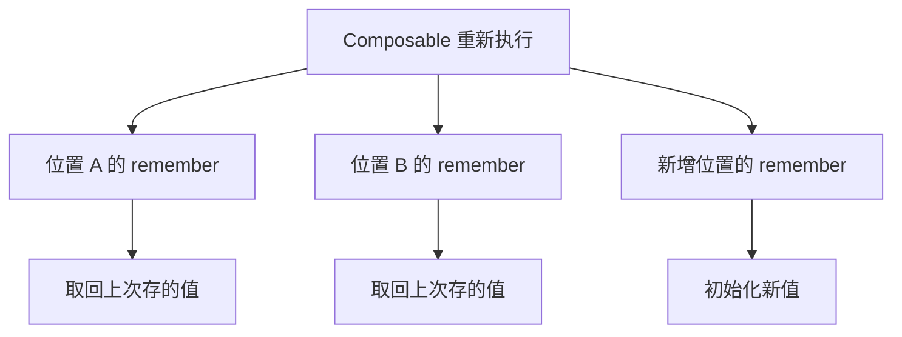
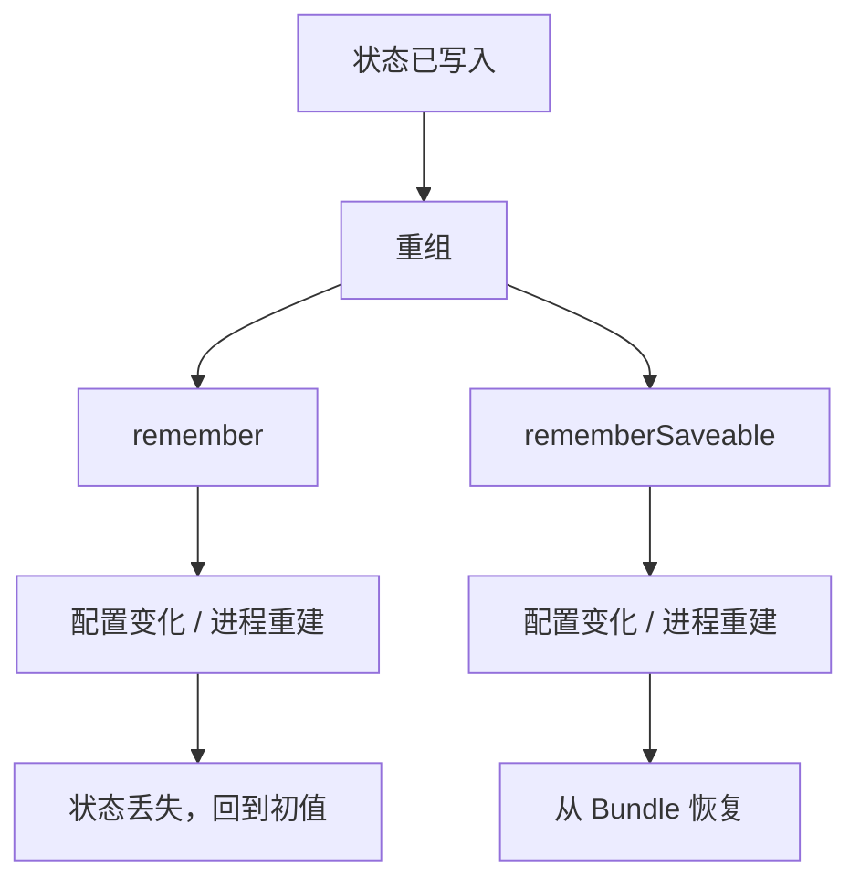
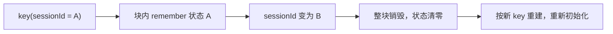
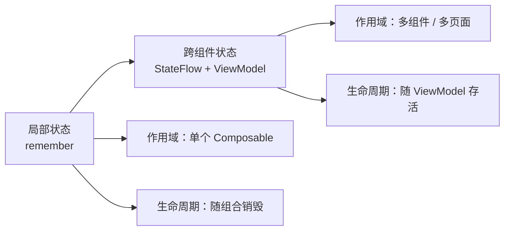
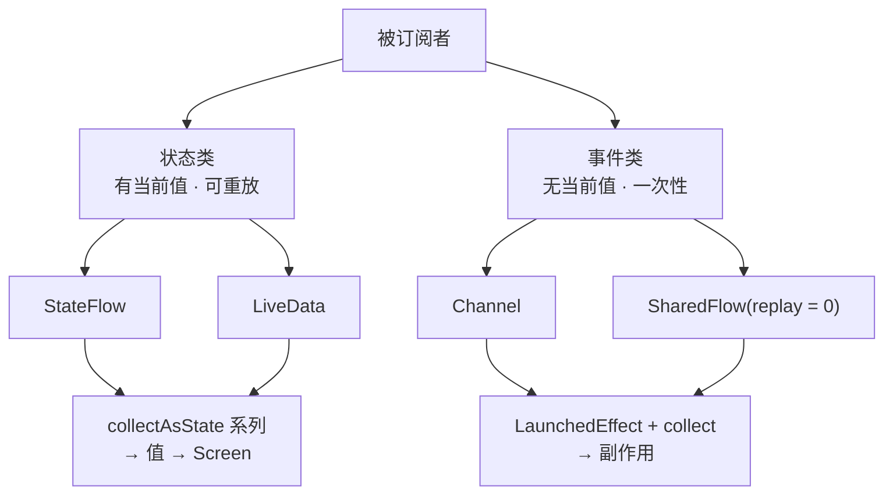

本章承接「State初探」的基础，聚焦两件进阶事项：一是 `remember` / `derivedStateOf` / `key` 的深层用法与边界；二是从「单个 Composable 内部的局部状态」进阶到「跨组件共享的状态」，重点厘清订阅数据流（StateFlow / LiveData / Channel）的正确姿势与常见误区。

## remember用法进阶

### remember 到底在记什么

`remember` 是按「调用位置」记值的，不是按变量名。

具体机制：Compose 在编译时会给每一处 `remember` 调用标定位置。函数重新执行时，同一位置的 `remember` 取回上次存的值，不同位置的 `remember` 各自独立。

由此产生两个实际后果：

1. **`for` 循环里每一轮迭代各存各的**。循环体每执行一次，就是一次新的 `remember` 调用，Compose 把它当成独立位置，单独创建并保存一份 state。所以每轮迭代的 state 变量互不干扰——这正是「每轮都会产生一个新的 state 对象、记忆对象也随之不同」的底层原因。
2. **`if` / `when` 分支切换时旧值会丢**。分支切换后，Compose 认为原位置的 `remember` 不存在了，重新进入时按新位置初始化，之前的记忆丢失。若需跨分支保留，改用 `rememberSaveable`，或把状态提升到分支外。



### remember(key)：什么时候重新计算

`remember(key) { 计算 }` 的规则：key 与上一次渲染时的值不相等，就重新执行 `{ 计算 }` 并替换旧结果；相等则直接返回上次的结果。典型用途是「参数变化时重建开销较大的对象」：

```kotlin
val decoded by remember(imageUrl) { decodeImage(imageUrl) }  // imageUrl 变了才重新解码
```

### rememberSaveable 与自定义 Saver

`rememberSaveable` 把值存入 Bundle，跨配置变化（旋转屏幕）与进程重建后仍能恢复，但仅支持 Bundle 支持的类型（基本类型、String、Parcelable 等）。自定义类型需提供 `Saver`：

```kotlin
val userSaver = listSaver<User, Any>(
    save = { listOf(it.name, it.age) },
    restore = { User(it[0] as String, it[1] as Int) }
)

var user by rememberSaveable(stateSaver = userSaver) { mutableStateOf(User("", 0)) }
```



## derivedStateOf用法进阶

`derivedStateOf` 只解决一个问题：**依赖的 state 频繁变化、但推导出来的结果很少变化时，避免重复触发重组**。

```kotlin
val list by remember { mutableStateOf(listOf(1, 2, 3)) }
val isEmpty by remember { derivedStateOf { list.isEmpty() } }
// list 反复增删元素时，isEmpty 只在 true/false 切换的瞬间才通知重组
```

若计算本身很廉价（如 `a + b`），直接算就行，套 `derivedStateOf` 反而多余。它与 `remember(key)` 的区别在于：

- `remember(key)`：key 一变就重新计算，**触发重算的是 key**。
- `derivedStateOf`：依赖的 state 一变就重新计算，但**只有结果和上次不同时才通知 UI 重组**。

## key用法进阶

`key(value) { ... }` 用来告诉 Compose：这一块内容的「身份」由 value 决定。value 一变，Compose 就把整块当成全新的，销毁重建，块内所有 `remember` 一并清零。

**场景一：列表项稳定身份**

```kotlin
LazyColumn {
    items(users, key = { it.id }) { user -> /* ... */ }
}
```

不显式给 `key` 时，Compose 只能按 item 在列表里的顺序来区分；数据增删导致顺序变化时，状态就会跟错 item。显式 `key` 保证「同 id 永远是同一项」。

**场景二：强制重置状态**

```kotlin
key(sessionId) {
    UserProfile(sessionId)  // 换会话 = 换一个全新的 UserProfile，内部状态清零
}
```

典型用途：登录态切换、数据源整体更换时，要求整块 UI 回到初始状态。



## 订阅数据流：局部状态到跨组件状态

`remember` 解决的是「一个 Composable 内部」的局部状态。当状态需要在多个组件间共享、跨页面存活、或由 ViewModel 统一管理时，就要把它交给外部管理，也就是本节的核心：**订阅数据流**。



首先应明确一条规则：**订阅动作发生在「有状态层」，无状态层只接收「值」。**

```kotlin
// 有状态层（Route）：持有 ViewModel，订阅在这里
@Composable
fun LoginRoute(viewModel: LoginViewModel) {
    val state by viewModel.uiState.collectAsStateWithLifecycle()  // 订阅
    LoginScreen(state = state, onLogin = viewModel::login)       // 传值，不是传流
}

// 无状态层（Screen）：只收值，不订阅任何流
@Composable
fun LoginScreen(state: LoginUiState, onLogin: () -> Unit) {
    Button(onClick = onLogin) { Text(state.username) }
}
```

### 状态流：StateFlow / LiveData

状态流随时能读到「当前值」，新订阅者一接入就能拿到最新状态，用 `collectAsState` 系列订阅并转成值：

```kotlin
// StateFlow → collectAsStateWithLifecycle（推荐，生命周期感知）
val state by viewModel.uiState.collectAsStateWithLifecycle()

// LiveData → observeAsState（旧项目常见）
val user by viewModel.user.observeAsState()
```

两者都在内部完成了「remember + 订阅 + 自动更新」，开发者只写一行，`by` 委托后拿到的就是**值**（而非 State 对象）。区别在于：

- `collectAsStateWithLifecycle`：感知生命周期，界面不可见（ON_STOP）时自动停止收集，回到前台恢复；依赖 `androidx.lifecycle:lifecycle-runtime-compose`。
- `collectAsState`（无 Lifecycle 后缀）：不感知生命周期，Composition 存活期间持续收集；生产环境推荐前者。

### 事件流：Channel

事件流没有「当前值」，谁消费谁拿走，**不可**用 `collectAsState`（会丢事件、用法本身也不对），必须用 `LaunchedEffect + collect` 逐个消费：

```kotlin
// ViewModel 用 Channel 发一次性事件
private val _events = Channel<LoginEvent>(Channel.BUFFERED)
val events = _events.receiveAsFlow()

// Route 用 LaunchedEffect 消费，弹 Toast / Snackbar / 导航
LaunchedEffect(viewModel) {
    viewModel.events.collect { event ->
        when (event) {
            is LoginEvent.ShowToast -> toast(event.message)
        }
    }
}
```

**为什么事件不能进 State？** 若把「密码错误」这类一次性提示写进 State，旋转屏幕后重新订阅会再次读到这条消息，Toast / Snackbar 重复弹出。Channel 只投递一次、消费即消失的特性，恰好规避了这一点。

### 事件流的另一种选择：SharedFlow(replay = 0)

`Channel` 之外，`SharedFlow(replay = 0)` 也能承载一次性事件，但两者投递模型不同，不能无条件互换。

| 维度 | Channel | SharedFlow(replay = 0) |
|---|---|---|
| 投递模型 | 单播：一个元素只能被一个消费者取走 | 广播：每个订阅者各收一份 |
| 无订阅者时 | `send` 进缓冲排队，等消费者取走，不丢 | `emit` 立即返回，值直接丢弃 |
| 多个收集点 | 元素被分摊 | 每个收集点都收到同一份 |
| 一次性语义 | 天然具备（消费即消失） | 只是不补发历史，不是一次性消费 |
| 关闭 | 可 `close()` | 不能关闭 |

最关键的是第二条：`SharedFlow` 官方文档明确说明，无订阅者时 `emit` 立即返回、**事件直接丢失**；即便配置了 `extraBufferCapacity`，无订阅者时也不生效，行为等价于 `DROP_OLDEST`。

**在 Compose 中的接入方式**

接入方式取决于把 `SharedFlow` 当作状态还是事件：

| 用途 | 写法 |
|---|---|
| 事件（replay = 0） | `LaunchedEffect(viewModel) { events.collect { ... } }` |
| 状态（replay > 0） | `collectAsStateWithLifecycle(initialValue = ...)`，但通常应改用 StateFlow |

```kotlin
// ViewModel：状态走 StateFlow，事件走 SharedFlow(replay = 0)
private val _uiState = MutableStateFlow(LoginUiState())
val uiState: StateFlow<LoginUiState> = _uiState.asStateFlow()

private val _events = MutableSharedFlow<LoginEvent>(replay = 0)
val events: SharedFlow<LoginEvent> = _events.asSharedFlow()

// Compose：状态转值，事件逐个消费
@Composable
fun LoginRoute(viewModel: LoginViewModel) {
    val state by viewModel.uiState.collectAsStateWithLifecycle()
    val snackbarHostState = remember { SnackbarHostState() }

    LaunchedEffect(viewModel) {
        viewModel.events.collect { event ->
            when (event) {
                is LoginEvent.ShowToast -> snackbarHostState.showSnackbar(event.message)
                LoginEvent.NavigateToHome -> { /* 导航 */ }
            }
        }
    }

    LoginScreen(state = state, onLogin = viewModel::login, snackbarHostState = snackbarHostState)
}
```

**使用要点**

1. **事件流只在一处收集**。`SharedFlow` 是广播，多个 `LaunchedEffect` 收集同一事件流会导致重复消费（Snackbar 弹两次）。
2. **`LaunchedEffect` 的 key 用稳定值**（如 `viewModel`），避免重组时反复取消重订阅、漏掉事件。
3. **界面不可见时事件会丢**。`LaunchedEffect` 随 Composition 销毁而取消，此时 `emit` 触发「无订阅者即丢」；要求事件不丢时改用 `Channel`。
4. **`replay` 必须为 0**。设为大于 0 会让新订阅者收到历史事件，旋转屏幕后重复弹提示。
5. **`StateFlow` 是 `SharedFlow` 的特化版**（replay = 1、自动去重、必须有初始值）。需要「当前值」语义时直接用 `StateFlow`，不必用裸 `SharedFlow`。

**选型结论**：需要「当前值」用 `StateFlow`；需要「广播给多个收集者」用 `SharedFlow(replay = 0)`；需要「单播、不丢、消费即消失」用 `Channel`。

### 四类被订阅者对照

| 被订阅者 | 本质 | 订阅方式 | 去向 |
|---|---|---|---|
| StateFlow | 可重放的状态源（SharedFlow 特化版） | `collectAsStateWithLifecycle` | 值 → 无状态函数（进 State） |
| LiveData | 可观察的状态源 | `observeAsState` | 值 → 无状态函数（进 State） |
| Channel | 单播、消费即消失的事件源 | `LaunchedEffect + collect` | 副作用（不进 State） |
| SharedFlow(replay = 0) | 广播、不补发历史的事件源 | `LaunchedEffect + collect` | 副作用（不进 State） |



## 常见认知误区

1. **误以为「无状态 = 订阅」**：无状态 Composable 恰恰不订阅，它只接收已算好的值、吐出回调；订阅永远发生在有状态层。
2. **把 Flow / LiveData / Channel 当参数传给无状态函数**：应传「值」，不传「流」。传流会让叶子层自己订阅，破坏分层，也失去 `@Preview` 能力。
3. **手写 `remember + collect + value =`**：`collectAsState` 系列已是「记住 + 订阅 + 更新」的一体化封装，无需手动实现。
4. **Channel 用 `collectAsState`**：事件流无当前值，会丢事件；应采用 `LaunchedEffect + collect`。
5. **状态流与事件流混为一谈**：StateFlow / LiveData 是「状态」（进 State），Channel / SharedFlow 是「事件」（走副作用），两者不可互相替代。
6. **把 `SharedFlow(replay = 0)` 等同于 `Channel`**：两者投递模型不同（广播 vs 单播），且 `SharedFlow` 在无订阅者时直接丢弃事件，不能无条件互换。
7. **忘记 `remember`**：state 每次重组重建、值归零。
8. **原地改 `List` / `data class`**：`mutableStateOf` 靠 `equals` 判断变化，须整体替换（`copy()` / 新列表），或改用 `mutableStateListOf` / `mutableStateMapOf`。
