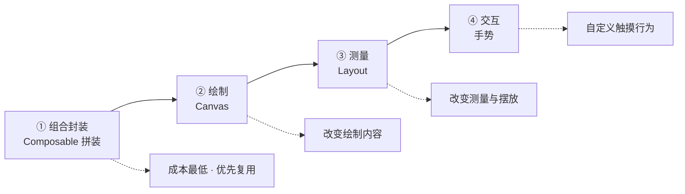
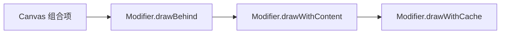
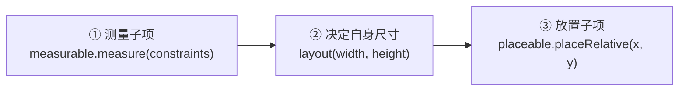
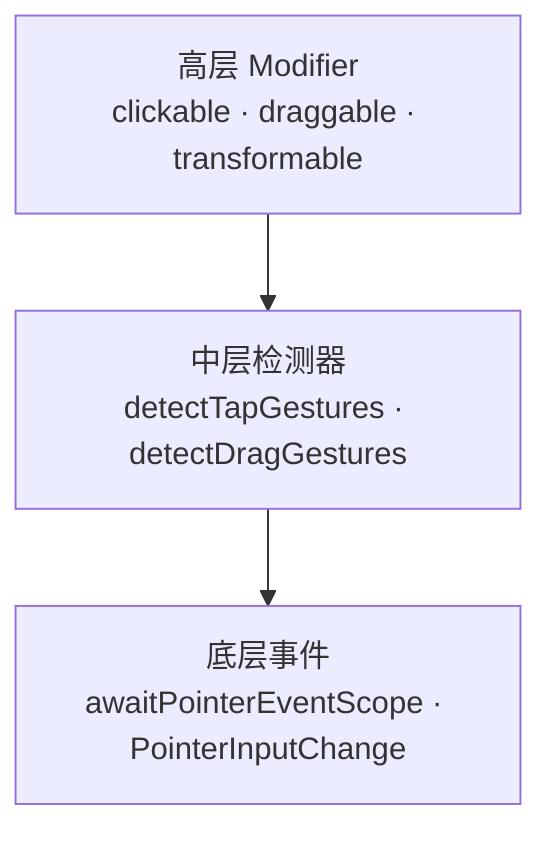
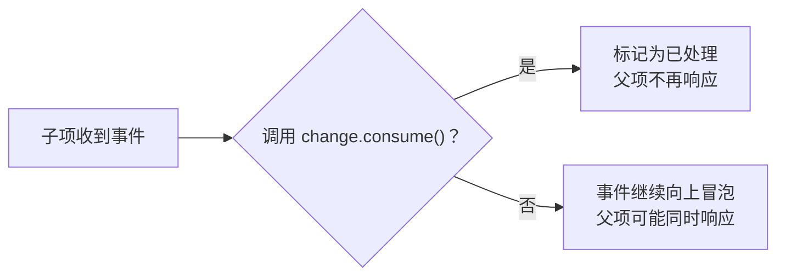

Compose 的自定义能力分为四个层次，由易到难依次是：**组合封装**（用现有组件拼装）、**绘制**（Canvas）、**测量**（Layout / Modifier.layout）、**交互**（手势）。每一层解决的问题不同，能复用上层就不下沉到底层。



## 自定义组件封装

### 与底层自定义的边界

| 需求 | 应采用的方案 |
|---|---|
| 现有组件组合即可满足 | 组合封装（`@Composable` 函数） |
| 需要改变绘制内容（曲线、图表、圆环） | `Canvas` |
| 需要改变子项的测量与摆放规则 | `Layout` 或 `Modifier.layout` |
| 需要自定义触摸行为 | `pointerInput` + 手势检测器 |

组合封装是成本最低、可维护性最高的方式。只有在组合层确实无法表达时，才下沉到绘制或测量。

### 三条封装规范

**规范一：接受 `modifier` 参数，且放在第一个可选参数位置。**

```kotlin
@Composable
fun InfoCard(
    title: String,
    modifier: Modifier = Modifier,          // 第一个可选参数
    content: @Composable ColumnScope.() -> Unit
) {
    Column(
        modifier = modifier                // 透传给最外层容器，不做裁剪
            .fillMaxWidth()
            .clip(MaterialTheme.shapes.medium)
            .background(MaterialTheme.colorScheme.surfaceVariant)
            .padding(16.dp)
    ) {
        Text(title, style = MaterialTheme.typography.titleMedium)
        Spacer(Modifier.height(8.dp))
        content()
    }
}
```

`modifier` 必须透传到最外层，否则调用方传入的 `padding`、`clickable`、`testTag` 等全部失效。不要在组件内部对 `modifier` 做二次包装（如 `modifier.padding(8.dp)` 之后再传），那会破坏调用方的预期。

**规范二：使用 slot API，而非固定内容。**

`content: @Composable ColumnScope.() -> Unit` 这种参数称为 slot（插槽）。它把"内部放什么"的决定权交给调用方，组件只负责布局与样式。这样同一组件可承载任意内容，复用度远高于硬编码。

**规范三：优先无状态，状态由调用方持有。**

组件内部不持有业务状态，只接收值、向上抛事件；仅在纯 UI 状态（如展开/折叠）时才内部 `remember` 持有。这是状态提升在组件封装中的直接应用，也是组件可预览、可测试的前提。

### 其他约定

- **不硬编码尺寸与颜色**：尺寸从参数或 `MaterialTheme` 取，颜色走 `MaterialTheme.colorScheme`，保证深色模式与主题切换一致。
- **不吞事件**：组件内部不要为"方便"擅自加 `clickable`，点击行为应由调用方通过参数控制。
- **默认值要有意义**：`modifier = Modifier`、`content = {}` 是标准默认值；业务参数通常不给默认值，避免调用方遗漏。

## Canvas

### 本质

`Canvas` 是一个由 `Modifier` 决定尺寸的绘制区域，其 lambda 提供 `DrawScope` 作为接收者：

```kotlin
Canvas(modifier = Modifier.size(120.dp)) {
    // DrawScope 作用域，size 为画布尺寸（px）
    drawCircle(color = Color.Blue, radius = size.minDimension / 2)
}
```

`DrawScope` 的关键成员：

| 成员 | 含义 |
|---|---|
| `size` | 画布尺寸，`Size` 类型（px） |
| `center` | 画布中心点 `Offset` |
| `drawLine` / `drawRect` / `drawRoundRect` | 线、矩形、圆角矩形 |
| `drawCircle` / `drawOval` / `drawArc` | 圆、椭圆、圆弧 |
| `drawPath` | 任意路径（配合 `Path`） |
| `drawPoints` | 点集 |

`dp` 需转 `px`：`2.dp.toPx()`。`DrawScope` 实现了 `Density`，可直接调用 `toPx()`。



封装关系：`Canvas` 只是 `drawBehind` 的便利封装；`drawBehind` 又是 `drawWithContent` 的固定化封装（绘制顺序固定在内容之后）；`drawWithCache` 在此基础上追加对象缓存能力。

### Path 与画笔

```kotlin
val path = Path().apply {
    moveTo(0f, size.height)                 // 起点
    lineTo(size.width / 2, 0f)              // 直线到
    cubicTo(...)                            // 三次贝塞尔
    close()                                 // 闭合
}
drawPath(
    path = path,
    color = MaterialTheme.colorScheme.primary,
    style = Stroke(width = 2.dp.toPx(), cap = StrokeCap.Round)
)
```

`style` 取 `Fill`（默认填充）或 `Stroke`（描边）；`Stroke` 的 `cap`（端点形状）、`join`（拐角形状）、`pathEffect`（虚线等）按需配置。

### 用例一：折线图

```kotlin
@Composable
fun Sparkline(values: List<Float>, modifier: Modifier = Modifier) {
    val lineColor = MaterialTheme.colorScheme.primary
    Canvas(modifier = modifier.fillMaxWidth().height(72.dp)) {
        if (values.size < 2) return@Canvas
        val stepX = size.width / (values.size - 1)
        val minValue = values.min()
        val range = (values.max() - minValue).takeIf { it > 0f } ?: 1f
        val path = Path().apply {
            values.forEachIndexed { index, value ->
                val x = index * stepX
                val y = size.height * (1f - (value - minValue) / range)
                if (index == 0) moveTo(x, y) else lineTo(x, y)
            }
        }
        drawPath(path, lineColor, style = Stroke(width = 2.dp.toPx(), cap = StrokeCap.Round))
    }
}
```

### 用例二：圆环进度

```kotlin
@Composable
fun RingProgress(progress: Float, modifier: Modifier = Modifier) {
    val trackColor = MaterialTheme.colorScheme.surfaceVariant
    val indicatorColor = MaterialTheme.colorScheme.primary
    Canvas(modifier = modifier.size(64.dp)) {
        val strokeWidth = 8.dp.toPx()
        drawArc(
            color = trackColor,
            startAngle = 0f,
            sweepAngle = 360f,
            useCenter = false,
            style = Stroke(strokeWidth)
        )
        drawArc(
            color = indicatorColor,
            startAngle = -90f,                       // 从 12 点方向开始
            sweepAngle = 360f * progress.coerceIn(0f, 1f),
            useCenter = false,
            style = Stroke(strokeWidth, cap = StrokeCap.Round)
        )
    }
}
```

### 性能注意

绘制 lambda 在**每一帧**执行，任何耗时计算都会被放大。涉及 `Path` 构建、`Brush` 创建等可缓存的产物，改用 `drawWithCache` 缓存：

```kotlin
Modifier.drawWithCache {
    val path = buildPath(size)                   // 仅在 size 变化时重建
    onDrawBehind { drawPath(path, color) }
}
```

### 与 View 体系 Canvas 的差异

Compose 的 `Canvas` 与 `android.graphics.Canvas` 名称相同，但属于两种绘图模型。

**核心区别**：`Canvas` 是一个 `@Composable` 函数，本质是 `Modifier.drawBehind` 的便利封装；真正的绘图环境是 `DrawScope`——一个声明式、无状态的绘图 API。`android.graphics.Canvas` 则是有状态的绘图对象，配合 `Paint`，在 `onDraw` 中以命令式方式驱动。

| 维度 | View 体系 | Compose |
|---|---|---|
| 绘图载体 | `android.graphics.Canvas` 对象 | `DrawScope` 作用域 |
| 绘图模型 | 命令式：持有 `Paint`，调用 `canvas.drawXxx` | 声明式：参数即配置 |
| 状态 | `Paint` 有状态（`setColor`、`setStrokeWidth`） | `DrawScope` 无状态 |
| 重绘触发 | 手动 `invalidate()` | 状态变化自动重组重绘 |
| 尺寸来源 | `onSizeChanged` / `width`、`height` | `DrawScope.size`，由 `Modifier` 决定 |
| 变换与裁剪 | `save()` / `restore()` 手动配对 | `translate {}` / `rotate {}` 作用域，退出自动恢复 |
| 缓存方式 | `Paint`、`Path` 作为成员变量复用 | `drawWithCache` |
| 文字绘制 | `canvas.drawText(text, x, y, paint)` | `drawText(textMeasurer, text, ...)` |
| 平台归属 | `android.graphics.*`，Android 专属 | `androidx.compose.ui.graphics.*`，跨平台 |
| 原生互操作 | 本身即原生 | `drawIntoCanvas { it.nativeCanvas }` |

**变换的作用域差异**

View 的变换作用于 Canvas 的全局状态，必须手动保存与恢复：

```kotlin
canvas.save()
canvas.translate(100f, 100f)
canvas.rotate(45f)
canvas.drawRect(...)
canvas.restore()
```

Compose 的变换是作用域函数，退出 lambda 后自动还原：

```kotlin
translate(left = 100f, top = 100f) {
    rotate(degrees = 45f) {
        drawRect(...)
    }
}
```

**访问原生 Canvas**

`DrawScope` 不直接暴露 `Canvas` 对象。需要调用原生 API（例如绘制 `Drawable`）时，通过 `drawIntoCanvas` 桥接：

```kotlin
drawIntoCanvas { canvas ->
    drawable.setBounds(0, 0, size.width.toInt(), size.height.toInt())
    drawable.draw(canvas.nativeCanvas)      // nativeCanvas 即 android.graphics.Canvas
}
```

Compose 未绕开底层渲染管线，最终仍落到 `android.graphics.Canvas`，只是在其上增加了一层声明式、无状态、跨平台的抽象。

**同一效果的两份实现**

```kotlin
// View：有状态 Paint + 命令式调用
private val paint = Paint(Paint.ANTI_ALIAS_FLAG).apply {
    shader = LinearGradient(0f, 0f, width.toFloat(), 0f, Color.RED, Color.BLUE, Shader.TileMode.CLAMP)
}

override fun onDraw(canvas: Canvas) {
    super.onDraw(canvas)
    canvas.drawRoundRect(0f, 0f, width.toFloat(), height.toFloat(), 16f, 16f, paint)
}
```

```kotlin
// Compose：参数驱动，无需持有绘图对象
Canvas(modifier = Modifier.size(200.dp, 100.dp)) {
    drawRoundRect(
        brush = Brush.horizontalGradient(listOf(Color.Red, Color.Blue)),
        cornerRadius = CornerRadius(16.dp.toPx())
    )
}
```

**坐标与单位**

两套体系的坐标系统一致：原点在左上角，x 向右、y 向下，绘制调用以 px 为单位。差异在于 Compose 的 `DrawScope` 实现了 `Density`，可直接 `dp.toPx()`；View 需通过 `resources.displayMetrics.density` 换算。

## Layout 测量

### 三阶段模型

每个布局节点的摆放分为三步：**测量子项 → 决定自身尺寸 → 放置子项**。

Compose 明确禁止多次测量（单次测量原则）：一个子项在一次布局流程中只能被 `measure` 一次，因此不存在 View 体系中 `RelativeLayout` 的"双重测量"问题。



三个步骤在一次布局流程内顺序完成，且子项只允许被测量一次。

### Layout 组合项

`Layout` 是 `Column`、`Row`、`Box` 等内置布局的底层实现，其尾随 lambda 即 `MeasurePolicy`：

```kotlin
@Composable
fun EqualRow(modifier: Modifier = Modifier, content: @Composable () -> Unit) {
    Layout(modifier = modifier, content = content) { measurables, constraints ->
        val count = measurables.size
        if (count == 0) {
            layout(0, 0) {}
        } else {
            val cellWidth = constraints.maxWidth / count
            val cellConstraints = Constraints(minWidth = cellWidth, maxWidth = cellWidth)
            val placeables = measurables.map { it.measure(cellConstraints) }
            val height = placeables.maxOf { it.height }
            layout(constraints.maxWidth, height) {
                placeables.forEachIndexed { index, placeable ->
                    placeable.placeRelative(index * cellWidth, 0)
                }
            }
        }
    }
}
```

关键 API：

| API | 作用 |
|---|---|
| `measurables: List<Measurable>` | 待测量的子项 |
| `constraints: Constraints` | 父级给出的尺寸约束 |
| `measurable.measure(constraints)` | 测量单个子项，返回 `Placeable` |
| `layout(width, height) { ... }` | 上报自身尺寸，并在 lambda 内放置子项，返回 `MeasureResult` |
| `placeable.placeRelative(x, y)` | 相对放置，RTL 下自动镜像 |
| `placeable.place(x, y)` | 绝对放置，不随布局方向镜像 |

### Modifier.layout

仅需改变**单个元素**的测量与摆放时，用 `Modifier.layout`，不必包一层 `Layout`：

```kotlin
fun Modifier.firstBaselineToTop(padding: Dp) = layout { measurable, constraints ->
    val placeable = measurable.measure(constraints)
    val firstBaseline = placeable[FirstBaseline]
    check(firstBaseline != AlignmentLine.Unspecified)
    val offsetY = padding.roundToPx() - firstBaseline
    layout(placeable.width, placeable.height + offsetY) {
        placeable.placeRelative(0, offsetY)
    }
}
```

该修饰符等价于 `paddingFromBaseline`，用于把首行文字的基线压到指定距离。

### 约束与边界

- `constraints.maxWidth` / `maxHeight` 在滚动容器等场景可能为 `Constraints.Infinity`，直接参与除法会得到非预期结果。使用前应判断 `constraints.hasBoundedWidth` / `hasBoundedHeight`。
- 子项测量约束由父级决定。若向子项传入比父级更宽松的约束，可能导致子项超出自身边界。
- 未调用 `place` / `placeRelative` 的子项不会显示。

### 固有测量

`Layout` 默认通过近似方式推算固有尺寸，多数场景够用。若布局需要精确支持 `IntrinsicSize`（如 `Modifier.height(IntrinsicSize.Max)`），可覆写 `MeasurePolicy` 的 `minIntrinsicWidth` / `maxIntrinsicHeight` 等方法。

### SubcomposeLayout

当"子项内容依赖测量结果"时（如 `LazyColumn` 只组合可见项），需要使用 `SubcomposeLayout`。它的代价是子项组合发生在测量阶段，无法享受常规的重组跳过，性能开销明显高于 `Layout`。非必要不使用。

## 手势

### 三个层次

| 层次 | 代表 API | 适用场景 |
|---|---|---|
| 高层 Modifier | `clickable`、`combinedClickable`、`draggable`、`transformable`、`scrollable` | 点击、拖拽、缩放、滚动等标准交互 |
| 中层检测器 | `pointerInput { detectTapGestures / detectDragGestures }` | 需要区分单击、双击、长按、拖拽方向 |
| 底层事件 | `awaitPointerEventScope`、`PointerInputChange` | 多指手势、自定义手势识别 |

优先使用高层 Modifier，它已处理好无障碍、水波纹、焦点等细节。



自上而下抽象程度递减、控制粒度递增。高层 Modifier 已处理无障碍语义、水波纹与焦点，能表达需求时不应下沉。

### pointerInput 与检测器

```kotlin
Modifier.pointerInput(Unit) {
    detectTapGestures(
        onTap = { offset -> /* 单击 */ },
        onDoubleTap = { offset -> /* 双击 */ },
        onLongPress = { offset -> /* 长按 */ }
    )
}
```

`pointerInput(key)` 的 `key` 变化时会取消并重启手势检测。因此 key 应使用稳定值（如 `Unit`）；若手势回调依赖会变化的外部变量，用 `rememberUpdatedState` 包裹，而非把变量塞进 key（后者会导致手势中途被打断）。

### 用例：拖拽方块

```kotlin
@Composable
fun DraggableBox(modifier: Modifier = Modifier) {
    var offset by remember { mutableStateOf(Offset.Zero) }
    Box(
        modifier = modifier
            .size(80.dp)
            .offset { IntOffset(offset.x.roundToInt(), offset.y.roundToInt()) }
            .background(MaterialTheme.colorScheme.primary, MaterialTheme.shapes.medium)
            .pointerInput(Unit) {
                detectDragGestures { change, dragAmount ->
                    change.consume()                 // 消费事件，避免父级同时响应
                    offset += dragAmount
                }
            }
    )
}
```

`change.consume()` 用于声明该事件已被处理。若不消费，父级的滚动或点击可能同时触发，出现"拖动时列表也在滚"的问题。

### 事件消费与冲突

- 子项先于父项收到事件，消费后父项不再处理。
- 需要"子项不消费、继续向上传递"时，不要调用 `consume()`。
- 嵌套滚动优先使用 `Modifier.nestedScroll` 配合 `NestedScrollConnection`，而非手写 `pointerInput` 拦截。



## 常见误区

1. **在绘制 lambda 中做重计算**：每帧执行，应使用 `drawWithCache` 缓存 `Path`、`Brush` 等产物。
2. **对同一子项多次测量**：Compose 禁止多遍测量，重复 `measure` 会抛异常。需要多次尝试时改用 `SubcomposeLayout` 或固有测量。
3. **忘记 `place`**：只测量不放置，子项不可见。
4. **`constraints.maxWidth` 未判无限**：滚动容器中该值为 `Constraints.Infinity`，参与除法会得到异常结果。
5. **`pointerInput` 的 key 用了频繁变化的值**：导致手势中途被取消重启，表现为"拖到一半断掉"。
6. **未调用 `change.consume()`**：事件继续向上冒泡，引发父子同时响应。
7. **滥用 `SubcomposeLayout`**：组合发生在测量阶段，性能开销显著高于 `Layout`，仅在有明确需求时使用。
8. **组件内部覆盖调用方的 `modifier`**：在透传前追加 `padding`、`clickable` 等，会破坏调用方的布局与交互预期。
