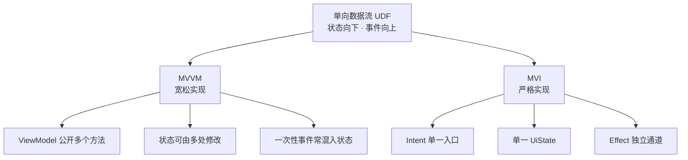
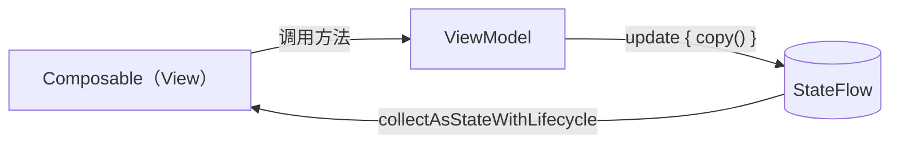
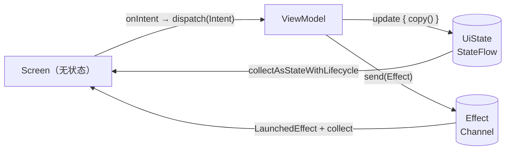
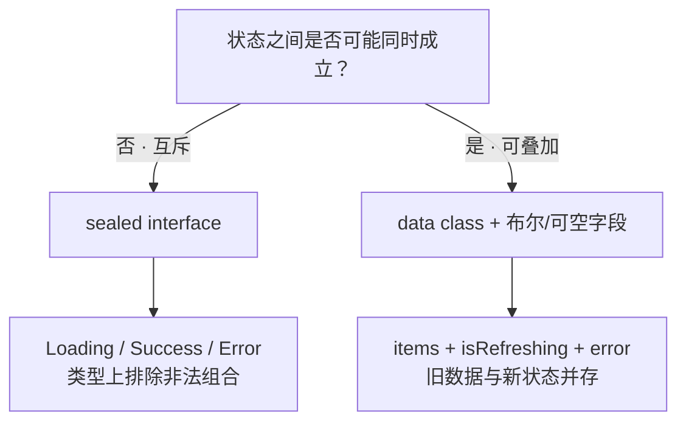
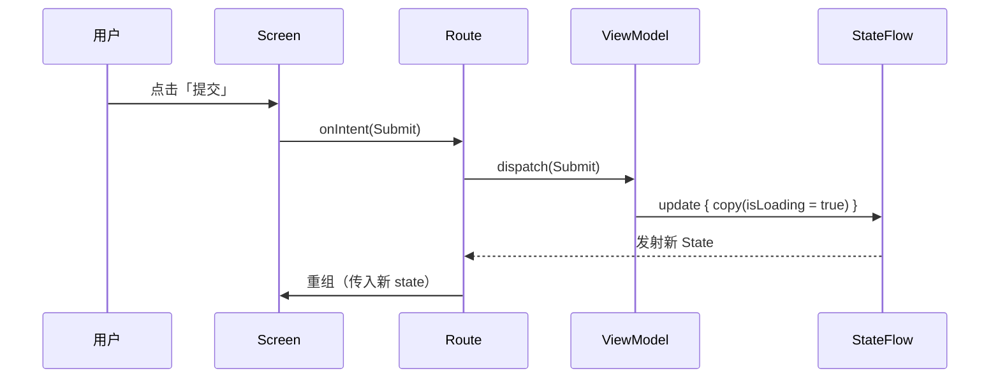

Compose 只解决"状态如何渲染成界面"，不规定状态由谁管理、如何流转。MVVM 与 MVI 解决的是后者：**状态放在哪里、用户操作如何进入、一次性事件如何送达**。两者不是互斥的架构选型，而是同一谱系上的两种严格程度。

## MVVM 与 MVI 的关系

### 思想来源与谱系

MVVM 由 Microsoft 在 2005 年提出，2015 年经 Google 引入 Android，2017 年随 Architecture Components（`ViewModel`、`LiveData`）成为官方推荐架构。其核心是**双向绑定或观察者式的分层**：View 观察 ViewModel 暴露的状态，ViewModel 处理业务逻辑并持有状态。

MVI 源自 Redux / Flux 的单向数据流思想，经 Elm Architecture 演化而来，2019 年前后在 Android 社区成型。它保留了 MVVM 的分层，但追加三个约束：**用户操作必须建模为 Intent、状态必须收敛为单一 State、一次性副作用的独立为 Effect**。

三者的包含关系是：**UDF（单向数据流）是目标，MVI 是 UDF 的严格实现，MVVM 是 UDF 的宽松实现**。Compose 官方文档推荐的是 UDF，并未指定 MVVM 或 MVI——只要满足"状态向下、事件向上"，两者都符合。



### 关键差异

| 维度 | MVVM | MVI |
|---|---|---|
| 状态载体 | 多个 `StateFlow` / `LiveData` 字段，或单个 UiState | 强制单一 `UiState` |
| 用户操作 | 直接调用 ViewModel 的公开方法 | 统一建模为 `Intent`，经单一入口 `dispatch` |
| 状态修改点 | 分散在各方法内 | 集中在 `dispatch` 的分支内 |
| 一次性事件 | 常混入状态，或使用 `SingleLiveEvent` | 独立 `Effect`（`Channel`） |
| 可追溯性 | 较弱，调用顺序不可枚举 | 较强，Intent 序列即操作日志 |
| 编译期约束 | 无 | `when (intent)` 穷举检查，新增意图立即报错 |
| 样板代码量 | 低 | 高，每个操作需定义 Intent 类型 |

### 选择依据

不存在绝对优劣，判断依据有三条：

1. **状态复杂度**：状态字段少于 5 个、交互只有两三种时，MVI 的 Intent 定义成本高于收益。
2. **状态修改点数量**：同一个 State 被 3 个以上方法修改时，MVI 的单一入口能显著降低"状态被谁改坏了"的排查成本。
3. **是否需要可追溯**：涉及支付、下单等需要复现操作序列的场景，Intent 序列可直接作为日志。

需要明确的是：**MVVM 在 Compose 项目中的事实形态，已经是 "MVVM + StateFlow + UDF"**，与 ViewBinding + LiveData 时代的经典 MVVM 有实质差异。因此本章讨论的 MVVM，指前者。

## MVVM 在 Compose 中的落地

### 状态容器的选择

ViewModel 向 UI 暴露状态有三种方式，取舍如下：

| 容器 | 适用场景 | 代价 |
|---|---|---|
| `StateFlow` | 默认选择，Compose 项目主流 | 需要 `collectAsStateWithLifecycle`，多一层 API |
| `LiveData` | 存量项目、与旧代码共存 | 需要 `observeAsState`，且依赖 Android 框架 |
| `mutableStateOf` | 不推荐 | 把 Compose 运行时依赖带入 ViewModel 层，破坏分层，且无法跨平台复用 |

`mutableStateOf` 在 ViewModel 中的问题在于：`MutableState` 属于 `androidx.compose.runtime`，让 ViewModel 依赖 UI 框架，单元测试与跨平台迁移都会受阻。

### 代码

```kotlin
data class LoginUiState(
    val username: String = "",
    val password: String = "",
    val isLoading: Boolean = false,
    val error: String? = null
)

class LoginViewModel : ViewModel() {
    private val _uiState = MutableStateFlow(LoginUiState())
    val uiState: StateFlow<LoginUiState> = _uiState.asStateFlow()

    fun onUsernameChange(value: String) {
        _uiState.update { it.copy(username = value) }
    }

    fun login() {
        if (_uiState.value.isLoading) return          // 防重复提交
        viewModelScope.launch {
            _uiState.update { it.copy(isLoading = true, error = null) }
            // 请求与结果处理
        }
    }
}
```

```kotlin
@Composable
fun LoginRoute(viewModel: LoginViewModel = viewModel()) {
    val state by viewModel.uiState.collectAsStateWithLifecycle()
    LoginScreen(
        state = state,
        onUsernameChange = viewModel::onUsernameChange,
        onLogin = viewModel::login
    )
}
```

**`update {}` 与 `value =` 的区别**：`update {}` 基于 CAS 循环，并发调用时不会丢失更新；`value =` 是"读—改—写"三步，并发下可能相互覆盖。所有基于旧值的修改都应使用 `update {}`。



### MVVM 的边界

MVVM 在 Compose 中的主要问题是**状态修改点分散**：`onUsernameChange`、`login`、`logout`、`refresh` 各自直接改 `_uiState`，状态的变化路径无法通过类型系统约束。方法数量增长后，"某个字段在哪些方法里被改过"只能靠检索。

这正是 MVI 要解决的问题，也是判断是否需要升级到 MVI 的直接信号。

## MVI 在 Compose 中的落地

### 三要素

| 要素 | 职责 | 约束 |
|---|---|---|
| `Intent` | 描述"用户做了什么" | `sealed interface`，穷举所有操作 |
| `State` | 描述"界面现在是什么样" | 单一 `data class`，不可变 |
| `Effect` | 描述"需要执行一次什么" | `Channel`，一次性消费 |



### Intent 的设计细节

```kotlin
sealed interface LoginIntent {
    data class UsernameChange(val value: String) : LoginIntent
    data class PasswordChange(val value: String) : LoginIntent
    data object Submit : LoginIntent
}
```

- **用 `sealed interface` 而非 `sealed class`**：Intent 不需要持有实现状态，接口更轻，且允许多重实现。
- **无参数意图用 `data object` 而非 `object`**：`data object` 提供有意义的 `toString()` 与 `equals()`，日志与测试断言更可读。
- **粒度以"用户动作"为单位**：一次点击、一次输入事件对应一个 Intent。不要拆到"字段级"（如 `UsernameEmpty`、`UsernameTooLong`），那属于校验逻辑，应放在 ViewModel 内部。
- **高频输入需要节流**：每次字符输入都 `dispatch` 会导致每帧一次状态更新。若输入伴随校验或请求，应在 ViewModel 内做防抖（`debounce`），而非在 UI 层拦截。

### State 的设计细节

```kotlin
data class LoginUiState(
    val username: String = "",
    val password: String = "",
    val isLoading: Boolean = false
)
```

- **不可变**：所有字段 `val`，修改通过 `copy()` 产生新实例。可变字段会导致 `StateFlow` 的相等性判断失效，跳过发射。
- **单一 State 的代价**：每次 `copy()` 会复制整个 data class。字段数量在数十个以内时，这个开销可忽略；若 State 膨胀到上百字段，说明页面职责过重，应拆分页面而非优化 `copy`。
- **嵌套 State 的处理**：页面级 State 内可以嵌套子 State（如 `LoginUiState.form: FormState`、`LoginUiState.dialog: DialogState`），子 State 仍须是不可变 data class。

### Effect 的设计细节

```kotlin
sealed interface LoginEffect {
    data class ShowToast(val message: String) : LoginEffect
    data object NavigateToHome : LoginEffect
}
```

- **Effect 必须一次性**：`Channel(BUFFERED) + receiveAsFlow()`，不可用 `StateFlow`（会重放导致旋转屏幕后重复触发），也不可用 `SharedFlow(replay = 0)` 替代单播场景（无订阅者时事件直接丢弃）。
- **单一收集点**：Effect 只在 Route 层收集一次。多处收集会导致 Snackbar 重复弹出。
- **Effect 不参与状态渲染**：Effect 只承载"执行一次"的动作（提示、导航、震动），任何需要持续显示的内容都应进 State。

### dispatch 的实现

```kotlin
class LoginViewModel : ViewModel() {
    private val _uiState = MutableStateFlow(LoginUiState())
    val uiState: StateFlow<LoginUiState> = _uiState.asStateFlow()

    private val _effect = Channel<LoginEffect>(Channel.BUFFERED)
    val effect = _effect.receiveAsFlow()

    fun dispatch(intent: LoginIntent) {
        when (intent) {
            is LoginIntent.UsernameChange -> _uiState.update { it.copy(username = intent.value) }
            is LoginIntent.PasswordChange -> _uiState.update { it.copy(password = intent.value) }
            LoginIntent.Submit -> submit()
        }
    }

    private fun submit() {
        if (_uiState.value.isLoading) return
        viewModelScope.launch {
            _uiState.update { it.copy(isLoading = true) }
            // 成功：_effect.send(LoginEffect.NavigateToHome)
            // 失败：_effect.send(LoginEffect.ShowToast("登录失败"))
        }
    }
}
```

关键点：

- **`dispatch` 本身是同步的**，状态更新立即生效；异步操作在内部通过 `viewModelScope.launch` 启动，不阻塞调用方。
- **防重复提交在 `submit()` 入口判断**，而不是在 UI 层禁用按钮。UI 层的禁用只是视觉提示，快速点击仍可能穿透。
- **`when` 必须穷举**：新增 Intent 后编译器会在所有未处理分支报错，这是 MVI 相比方法调用的核心收益。

### 消费侧

```kotlin
@Composable
fun LoginRoute(viewModel: LoginViewModel = viewModel()) {
    val state by viewModel.uiState.collectAsStateWithLifecycle()

    LaunchedEffect(viewModel) {
        viewModel.effect.collect { effect ->
            when (effect) {
                is LoginEffect.ShowToast -> { /* 弹提示 */ }
                LoginEffect.NavigateToHome -> { /* 导航 */ }
            }
        }
    }

    LoginScreen(state = state, onIntent = viewModel::dispatch)
}

@Composable
fun LoginScreen(state: LoginUiState, onIntent: (LoginIntent) -> Unit) {
    TextField(
        value = state.username,
        onValueChange = { onIntent(LoginIntent.UsernameChange(it)) }
    )
    Button(onClick = { onIntent(LoginIntent.Submit) }) {
        Text(if (state.isLoading) "登录中…" else "登录")
    }
}
```

`LaunchedEffect` 的 key 使用 `viewModel`：ViewModel 实例在配置变化时保持不变，不会触发重订阅；若使用 `Unit`，在 ViewModel 被替换（如导航到新页面）时不会重新订阅。

### MVI 的代价

1. **样板代码**：每个用户操作需要定义 Intent 类型、dispatch 分支，简单页面会显得臃肿。
2. **间接性**：从 UI 到实际逻辑多了一层分发，调试时需要跟一层 `when`。
3. **过度设计的风险**：单一表单、静态展示页使用 MVI 属于负收益。

判断标准：**当页面存在 3 个以上相互影响的状态字段，或同一状态被 3 处以上修改时，MVI 的约束成本才开始低于排查成本。**

## 状态建模要点

MVI 的价值取决于 State 的建模质量。以下六条是可执行的判断标准。

### 1. 形态互斥时用 sealed，形态叠加时用 data class

```kotlin
// 互斥形态：加载中 / 成功 / 失败，三者不会同时出现
sealed interface DetailUiState {
    data object Loading : DetailUiState
    data class Success(val data: Detail) : DetailUiState
    data class Error(val message: String) : DetailUiState
}

// 叠加形态：有旧数据时仍可刷新、仍可报错
data class ListUiState(
    val items: List<Item> = emptyList(),
    val isRefreshing: Boolean = false,
    val error: String? = null
)
```

判断依据：**状态之间是否可能同时成立**。互斥用 sealed，可从类型上排除"既 Loading 又 Success"的非法状态；可叠加用 data class，避免把"有旧数据的刷新"强行塞进单一形态。



### 2. `isLoading` 与 `isRefreshing` 不可合并

- `isLoading`：无数据时的全屏加载；
- `isRefreshing`：已有旧数据时的下拉刷新。

合并为一个字段后，UI 只能依靠 `data == null` 反推当前语义，容易出现"刷新时整页闪白"。

### 3. 错误按呈现方式分流

- 无数据：错误写入 State，渲染全屏错误页与重试按钮；
- 有数据：错误走 Effect，以 Snackbar 提示，不打断内容浏览。

判断依据是"这个错误是否需要占满屏幕"，而非"错误是否严重"。

### 4. State 只装渲染所需

不要把整个领域模型、设置对象原样塞进 State。首页只用到主题色与单位时，只放这两个字段，避免无关字段变化触发整页重组。

### 5. 派生状态不进 State

可由其他字段计算得出的值，不应作为独立字段存入 State：

```kotlin
// 错误：canSubmit 是 username/password 的派生值
data class LoginUiState(
    val username: String = "",
    val password: String = "",
    val canSubmit: Boolean = false        // 需要两处同步维护，容易不一致
)

// 正确：在 UI 层或 ViewModel 的计算属性中派生
val canSubmit: Boolean get() = username.isNotBlank() && password.isNotBlank()
```

存入 State 意味着每次修改 `username` 都要同步更新 `canSubmit`，一旦遗漏就会产生不一致状态。

### 6. 避免布尔字段组合出非法状态

多个独立布尔字段容易组合出互斥的非法状态（如 `isLoading = true` 且 `error != null`）。若这些状态本应互斥，用 sealed 建模；若必须共存，在 ViewModel 内增加约束逻辑，避免向 UI 发射非法组合。

## 单向数据流的完整链路

### 正常链路



时序特征：`dispatch` 与状态更新同步完成，`StateFlow` 随即发射；`Route` 通过 `collectAsStateWithLifecycle` 取得新值后，`Screen` 才重组。**UI 重组是状态更新的结果，而非原因。**

### 异步与错误分支

```
dispatch → submit() → viewModelScope.launch
                          ├─ 成功：更新 State / 发送 Effect(Navigate)
                          └─ 失败：无数据 → 错误进 State（全屏错误页）
                                   有数据 → Effect(ShowToast)（Snackbar）
```

### 旁路：一次性副作用

```
ViewModel → Effect（Channel）→ LaunchedEffect + collect → Snackbar / 导航
```

**状态进 State，事件走 Effect**——两条路径不可混用。

### 生命周期与配置变化

| 场景 | State 行为 | Effect 行为 |
|---|---|---|
| 旋转屏幕 | ViewModel 存活，State 保留；重新订阅后拿到当前值 | Channel 中未消费的事件保留，重新订阅后仍可收到 |
| 界面进入后台 | `collectAsStateWithLifecycle` 停止收集，State 仍在 ViewModel 中 | ViewModel 仍可发送 Effect，进入 Channel 缓冲 |
| 返回前台 | 恢复收集，立即拿到最新 State | 缓冲中的 Effect 被消费 |
| 进程被杀死 | State 丢失（除非使用 `SavedStateHandle`） | 全部丢失 |

关键点：**`collectAsStateWithLifecycle` 停止的是 UI 侧的订阅，不是 ViewModel 的协程**。`viewModelScope` 中的任务在后台仍会继续执行，其产生的 State 与 Effect 会在界面恢复后送达。

## Route / Screen 拆分

MVI 的落地依赖 Route / Screen 两层结构，拆分的收益是具体的：

| 收益 | 说明 |
|---|---|
| 可预览 | `Screen` 不依赖 ViewModel，可直接传入构造的 `UiState` 渲染 `@Preview` |
| 可测试 | Compose UI Test 可直接对 `Screen` 断言，无需启动 ViewModel 与依赖注入 |
| 可复用 | 同一 `Screen` 可对接不同数据源，仅替换 Route 层的订阅逻辑 |

边界：**ViewModel 只在 Route 层出现**。`Screen` 的签名中只允许出现 `state`、`onIntent` 与纯 UI 回调，不出现任何 ViewModel 类型。

## 常见误区

1. **在 Composable 中直接修改 ViewModel 内部状态**：应通过 Intent 或公开方法，保持单向流动。
2. **把一次性事件放进 State**：旋转屏幕后重新收集会重复触发，应走 Effect。
3. **State 拆成多个 `StateFlow`**：UI 需要组合多个流，组合瞬间可能出现不一致的中间态；应合并为单一 `UiState`。
4. **Intent 使用 `enum`**：无法携带参数（如输入内容），应使用 `sealed interface` + `data class`。
5. **在 Screen 中调用 ViewModel**：Screen 应保持无状态，只接收 `state` 与 `onIntent`；ViewModel 只在 Route 层出现。
6. **使用 `collectAsState` 而非 `collectAsStateWithLifecycle`**：前者在界面不可见时仍持续收集，浪费资源。
7. **ViewModel 持有 `Context` / `View` 引用**：ViewModel 生命周期长于界面，持有界面对象会导致内存泄漏；确需 `Context` 时使用 `AndroidViewModel`（持有 Application Context）。
8. **派生值存入 State**：需要人工同步维护，容易产生不一致；应使用计算属性或 `derivedStateOf`。
9. **用多个布尔字段表达互斥状态**：可组合出非法状态；互斥场景应使用 sealed interface。
10. **在 UI 层用 `enabled = false` 防重复提交**：快速点击仍可能穿透；应在 ViewModel 入口判断 `isLoading`。
11. **`dispatch` 内部直接执行耗时操作**：会阻塞调用线程；应通过 `viewModelScope.launch` 异步执行。
12. **Effect 在多个位置收集**：`Channel` 的单播特性会导致事件被其中一个收集者取走，其余位置收不到；应统一在 Route 层收集。
