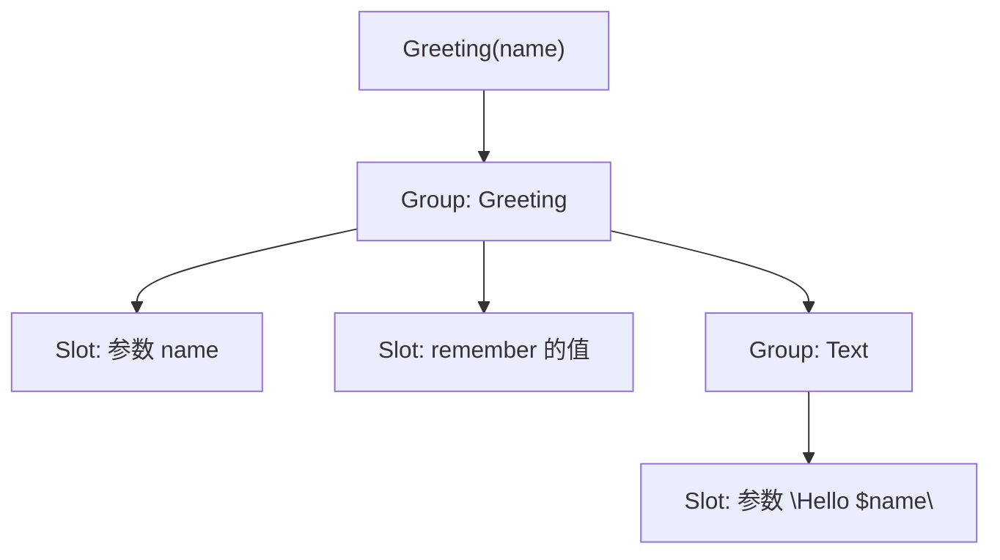
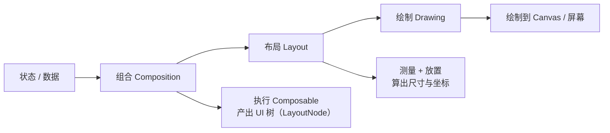
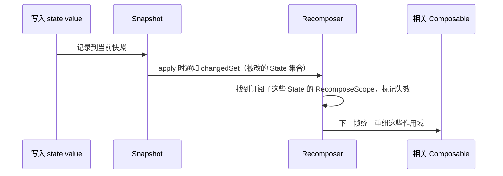
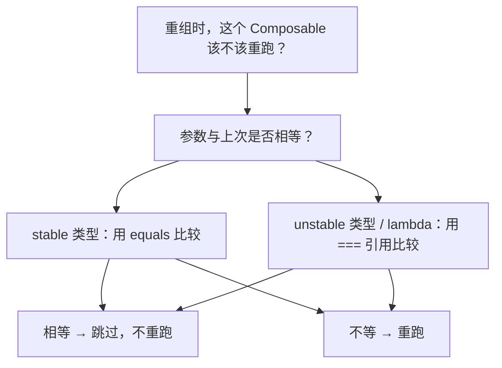
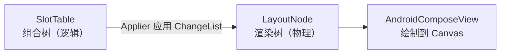

前六章都在回答"怎么用"——Composable 函数怎么写、状态怎么管、架构怎么搭。这一章换个角度，回答"为什么"：一段看起来只是"调用函数"的声明式代码，是如何在背后被编译、被追踪、最终变成屏幕上的像素的。

Compose 的底层机制可以浓缩为三件事：

1. **Composable 函数编译后长什么样**：编译器偷偷做了什么，让"函数调用"变成了可增量更新的结构。
2. **状态如何驱动界面更新**：`mutableStateOf` 背后那套"快照 + 失效"的机制，如何做到改一处、只重跑一处。
3. **三个阶段的流水线**：组合 → 布局 → 绘制，数据如何单向流动、哪些阶段可以被跳过。

把这三件事串起来，就能解释前面几章反复出现的两个现象：为什么 `remember` 是按"调用位置"记值（第 3 章），以及为什么 `StateFlow` 状态一变、界面就会"自动"重组（第 6 章）。

## 一、Composable 函数编译后是什么

### 1.1 编译产物：多了一个 Composer 参数

一段普通的 Composable 函数：

```kotlin
@Composable
fun Greeting(name: String) {
    Text("Hello $name")
}
```

编译之后，它多出了两个东西（大幅简化的示意，非真实字节码）：

```kotlin
fun Greeting(name: String, $composer: Composer?, $changed: Int) {
    $composer?.startRestartGroup(0x3a1f0c)      // 标记一个"可重启分组"的开始
    Text("Hello $name", $composer, 0)
    $composer?.endRestartGroup()?.updateScope { /* 记录：如果重跑，就重跑这段 */ }
}
```

两个关键产物：

1. **`Composer` 参数**：Composable 函数在运行时通过它读写组合数据，它是函数体与 Compose 运行时之间的唯一通道。这也是"Composable 函数只能在 Composable 上下文里调用"的底层原因——没有 `$composer`，函数体就无处安放。
2. **`startRestartGroup` / `endRestartGroup`**：把函数体包进一个"可重启分组"。这个分组就是后面要讲的"重组作用域（RecomposeScope）"的载体。

> **时效性提示**：Kotlin 2.0 起，这套改写逻辑已合并进 Kotlin 编译器本身，通过 `org.jetbrains.kotlin.plugin.compose` 插件启用，版本与 Kotlin 完全对齐，不再依赖独立的 Compose Compiler 插件。Kotlin 1.9 及以前的项目，才需要在 `composeOptions.kotlinCompilerExtensionVersion` 里手动对齐版本（本系列项目若基于 Kotlin 2.x 起步，无需关心旧配置）。

### 1.2 Slot Table：组合树就存在这里

Composable 函数在执行时，产出的数据并不是直接变成 View，而是先写进一张叫 **Slot Table（插槽表）** 的表里。它是整个 Compose 组合的"账本"，记录着界面有哪些元素、每个元素带什么参数、`remember` 了什么值。



结构上，**每个 Composable 调用对应一个 Group，Group 下挂一串 Slot**——参数、`remember` 的值、以及子 Group（子 Composable）。整棵"组合树"，本质上就是由这些 Group 嵌套而成的树。

Slot Table 底层用 **gap buffer（间隙缓冲区）** 实现——就是文本编辑器在光标位置插入/删除字符时用的同一种数据结构：数组中间保留一段"空位（gap）"，插入时把 gap 挪过去填数据，删除时把 gap 挪过来吞掉，**移动的是"空位"而不是搬运所有元素**。因此中途增删一个元素（比如某个条件成立后突然多出一个 `Icon`）只需要挪 gap，而不是重建整张表。

### 1.3 remember 按"位置"记值的本质

第 3 章说过，`remember` 是按"调用位置"记值，不是按变量名。现在可以给出底层解释：

`remember { ... }` 编译后等价于一次 `Composer.cache` 调用。它做的事情是——**去"当前 Group 的同一 Slot 位置"取上次存的值，只有取不到（或 key 变了）才重新计算**。

所谓"位置"，就是编译器生成的 group key 加上 Group 在组合树中出现的先后顺序。**位置就是身份**：

- `for` 循环每轮执行一次，就是一次新的 `remember` 调用、占据一个新位置，所以每轮各自独立；
- `if` / `when` 分支切换后，原位置上的 Group 不复存在，重新进入时按新位置初始化，旧值随之丢失；
- 这也是 `LazyColumn` 里"数据顺序一变、状态跟错 item"的根源——位置变了对不上号，必须用显式 `key` 来锁定身份。

## 二、三大阶段：组合、布局、绘制

### 2.1 每个阶段做什么

Compose 渲染一帧，会经过三个按序执行的阶段：



| 阶段 | 回答的问题 | 做什么 |
|---|---|---|
| **组合 Composition** | 显示**什么** | 执行 Composable 函数，构建一棵描述界面的树 |
| **布局 Layout** | 放在**哪里** | 两步：**测量（measure）** + **放置（placement）**，确定每个节点的大小和二维坐标 |
| **绘制 Drawing** | 怎么**渲染** | 从上到下遍历树，把元素画到 Canvas 上 |

布局阶段的两步值得单独强调：测量是"父问子要多大"（自下而上汇总），放置是"父决定子放在哪"（自上而下摆放）。这棵树在布局阶段**每个节点只访问一次**，因此遍历耗时随节点数**线性**增长，而不是指数增长。

### 2.2 单向数据流与阶段跳过

三个阶段顺序固定，数据从组合 → 布局 → 绘制**单向流动**，这就是第 6 章"单向数据流（UDF）"在渲染层面的体现。

概念上每一帧都会走完三个阶段，但 Compose 会在每个阶段内**追踪状态读取**：如果一个元素大小没变、树结构没增删，它就能**跳过组合甚至布局，只重绘**；如果连内容都没变，就整段跳过，什么都不做。**Compose 只做更新 UI 所需的最小工作量**，这正是"声明式 + 状态驱动"能自动高效的根基。

> **例外**：`BoxWithConstraints`、`LazyColumn`、`LazyRow` 的**子项组合依赖父项的布局结果**——必须等父项量完尺寸，才知道该组合哪些子项。因此它们会打破"先组合后布局"的固定顺序，这也是这几个组件性能特性与众不同的原因。

## 三、状态如何驱动重组

### 3.1 Snapshot：状态的"版本管理"

`mutableStateOf` 不是一个简单的"带监听器的变量"，它构建在 **Snapshot（快照）** 系统之上。这套系统可以类比 Git：状态值按版本管理，写入在快照内进行，提交（apply）后才对外可见。

```kotlin
val state = mutableStateOf(0)

val snapshot = Snapshot.takeSnapshot()   // 从全局快照拉出一个子快照
snapshot.enter {
    state.value = 1                       // 在子快照内写入
}
println(state.value)                      // 仍读到 0：子快照的变更对父快照不可见
snapshot.apply()                          // 合并回父快照，同时通知观察者
println(state.value)                      // 现在读到 1
```

（以上是脱离框架内部流程的原理示意；真实场景中，快照的创建与 apply 由运行时自动管理。）

三个关键特性：

1. **线程隔离**：快照是 ThreadLocal 的，不同线程各持各的快照视图，无需显式加锁。
2. **可见性单向**：子快照能看到父快照的值，父快照看不到子快照的变更，直到子快照 `apply()`。
3. **写入观察**：`apply()` 时系统会通知所有注册的观察者"这一批改了哪些 State 对象"。

### 3.2 从写入到重组的完整链路

把"状态写"和"界面更新"串起来，链路是这样的：



几点值得注意：

- **读取即订阅**。Composable 里每次读 `state.value`，都会被快照系统的 readObserver 记录"这个作用域读了这个 State"。没有显式的 `observe` / `collect`，读本身就是订阅。这正是第 6 章 `collectAsStateWithLifecycle` 能"读一次就自动刷新"的底层支撑——它内部也是落到一次状态读取。
- **写入本身不立即触发重组**。写入只标记快照"脏了"，`Recomposer`（重组的调度中心）把失效的作用域攒起来，**对齐到下一帧统一执行**。因此**同一帧内连续写多个 State，只触发一次重组**。
- **重组的是作用域，不是整个界面**。只有"读了那个 State"的 RecomposeScope 才会失效重跑，其他部分原样跳过。

### 3.3 重组作用域：最小重跑范围

编译器生成的"可重启分组"对应到运行时，就是 **RecomposeScope**。它是重组的**最小单元**：一个作用域失效，就整段重跑，但作用域之外的兄弟节点、父节点都不受影响。

它的粒度与"哪里读了 State"有关——只有实际读取了 State 的 Composable 才会被包进可重启分组。这也是为什么第 6 章反复强调"把状态读取下沉到叶子组件"：**读得越局部，失效范围越小，重组的代价越低**。

## 四、智能跳过：为什么没变的函数不重跑

### 4.1 稳定性决定怎么比较

重组时，某个 Composable 到底该不该重跑，取决于它的参数与上次相比**是否相等**。而"相等"的判定方式，取决于参数类型的**稳定性**：



- **稳定（stable）类型**：参数用 `equals` 比较。不可变数据类、`String`、基本类型都属此类，内容没变就能跳过。
- **不稳定（unstable）类型**：参数只能用 `===`（引用相等）比较。可变对象、普通 `interface`（如 `List`）属于此类。
- **lambda**：默认每次重组都会创建一个新实例（除非被 `remember` 住），按 `===` 比较时几乎永远"不等"，因此**直接内联传 lambda 是跳过失败的常见来源**。

### 4.2 @Stable / @Immutable 与 Strong Skipping

- **`@Stable`**：手动声明"这个类型的属性变化能被追踪，且 `equals` 结果可信"，让编译器改按 `equals` 比较、并追踪其属性变化。
- **`@Immutable`**：`@Stable` 的强化版，声明"所有属性都是 `val` 且类型都稳定"，值一旦创建永不改变。

**Strong Skipping（强跳过）**：自 Kotlin 2.0.20 起默认开启。它让**带不稳定参数的 Composable 也能参与跳过**——只是对不稳定参数改按 `===` 比较。它没有把任何类型"变稳定"，所以不稳定的 lambda 仍可能因每次新实例而跳过失败；但它显著降低了"因为一个不稳定字段就整段放弃跳过"的代价。

## 五、组合树与渲染树：Applier 的桥接

Slot Table 里存的只是**逻辑信息**（有哪些元素、参数、remember 值）。真正参与绘制的是另一棵树——**LayoutNode 树**。二者之间靠 **Applier** 桥接：



一次重组结束后，运行时把本次产生的变更（增删改）整理成一份 **ChangeList**，交给 Applier 应用到 LayoutNode 树上。应用完成后，`AndroidComposeView`（一个普通的 ViewGroup）把根 LayoutNode 绘制到 Android 交付的 Canvas 上——这就是第 1 章"画布 + 画笔"比喻的落点：**Compose 不生成一棵 View 树，而是直接在画布上画出所有元素**，因此不存在"每个控件都是重量级对象"的开销。

## 常见误区

1. **以为重组 = 重新执行整个界面**：重组只发生在读取了那个 State 的 RecomposeScope 内，兄弟与父节点不受牵连。
2. **把"读取即订阅"当成"需要手动 collect"**：Composable 里读 `state.value` 就是订阅，无需额外代码；`collectAsStateWithLifecycle` 底层也归结为一次状态读取。
3. **在 Composable 里内联写 lambda，又疑惑"为什么跳过失效"**：lambda 每次重组都是新实例，按 `===` 比较必然不等；要么 `remember` 住，要么接受强跳过下的引用比较语义。
4. **以为写入 State 会立即同步刷新**：写入只标记快照，`Recomposer` 攒到下一帧统一重组；同帧多次写入只触发一次。
5. **误以为状态读取位置越靠上越方便**：读得越靠上，失效作用域越大、重跑范围越广；应尽量把读取下沉到叶子组件。
6. **混淆"跳过组合"与"跳过整棵树"**：跳过某子树顶部的 Composable 能连带省掉其下所有子项，前提是它的参数能被判定为"相等"；反之，一个不稳定的顶层参数会拖垮整棵子树。
7. **手写快照或依赖旧版 Compose Compiler 配置**：Kotlin 2.0 起编译器已内建，旧项目的手动版本对齐方案不再适用，新项目直接对齐 Kotlin 版本即可。

## 小结

Compose 的底层原理，概括而言：**声明式函数被编译器改写成"带分组的数据写入"，运行时把这份数据存进 gap buffer 结构的 SlotTable，用 Snapshot 系统追踪状态读取、用 RecomposeScope 圈定最小重跑范围，最后通过 Applier 把变更应用到 LayoutNode 树并绘制到 Canvas**。

这套机制解释了系列前几章的三个结论：`remember` 按位置记值（位置即身份）、`StateFlow` 一变界面"自动"刷新（读取即订阅）、深层嵌套不再拖累性能（没有 View 树、只有轻量的函数调用与单向遍历）。底层原理的价值不在于背诵名词，而在于**遇到性能问题或"状态没刷新"的怪象时，知道该往哪个环节排查**。

> 本章引用的官方资料（内容以官方文档为准，访问链接为国内可用的镜像站）：
> - Compose 阶段（Composition / Layout / Drawing）：<https://developer.android.google.cn/develop/ui/compose/phases>
> - Compose 状态与 Snapshot：<https://developer.android.google.cn/develop/ui/compose/state>
> - 稳定性与跳过（含 Strong Skipping）：<https://developer.android.google.cn/develop/ui/compose/performance/stability>
> - Compose Compiler 迁移（Kotlin 2.0+ 合并）：<https://kotlinlang.org/docs/compose-compiler-migration-guide.html>
