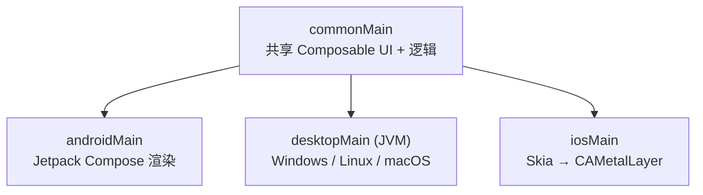
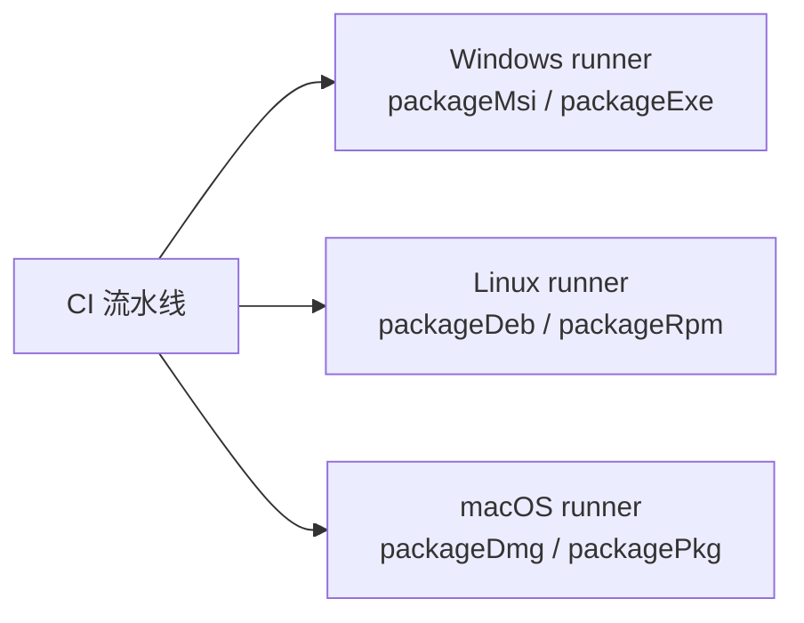

第 1 章提过，Compose 分两支：Android 平台的 Jetpack Compose，和跨平台的 Compose Multiplatform（下称 CMP）。前者只服务 Android，后者把同一套声明式 UI 带到桌面（Windows / Linux / macOS）、iOS 和 Web。本章聚焦两件工程上最实际的事：**桌面端如何开发与出包**，以及 **Apple 平台（macOS / iOS）对 Xcode 到底依赖到什么程度**——后者往往是决定团队要不要上 CMP 的关键顾虑。

## 一、CMP 与 Jetpack Compose 的关系

CMP 与 Jetpack Compose **同源**：同一套 Compose 运行时与 UI 代码，只是目标平台不同。JetBrains 与 Google 对齐发布节奏，CMP 的公共代码在 Jetpack Compose 稳定版本之上构建，两者版本大体对应（如 CMP 1.12.x 对应 Jetpack Compose 1.12.x）。

渲染上，**桌面与 iOS 端统一走 Skia**（经 Skiko 这个 Kotlin 绑定调用），在桌面画到窗口、在 iOS 画到 `CAMetalLayer`——这与第 1 章"画布 + 画笔"的比喻一致，也是 CMP 与 Flutter 早期方案同源的渲染思路。Android 端则复用 Jetpack Compose 自带的渲染路径。因此，**一套 `@Composable` 代码，跑在三个桌面平台和两个移动平台上**，是 CMP 的核心价值。



## 二、项目结构与源集

KMP 项目按 **源集（source set）** 组织：平台无关代码放 `commonMain`，各平台差异放对应的平台源集。Kotlin 1.9.20 起默认采用分层源集结构，`iosMain` 会自动聚合 `iosArm64`（真机）、`iosSimulatorArm64`（Apple Silicon 模拟器）、`iosX64`（旧 Intel 模拟器）等多个 iOS 目标，无需手动声明中间源集。

```kotlin
kotlin {
    // 桌面端用 JVM 目标，Windows / Linux / macOS 统一走它
    jvm("desktop")
    // iOS 三个目标，产出 framework 供 Xcode 使用
    listOf(iosX64(), iosArm64(), iosSimulatorArm64()).forEach { target ->
        target.binaries.framework {
            baseName = "Shared"
            isStatic = true
        }
    }
}
```

平台差异用 `expect` / `actual` 承接：`commonMain` 里声明 `expect`，各平台源集提供 `actual` 实现。原则是**只在真正有差异的地方开缝**，绝大多数代码应当纯 `commonMain`。

桌面端入口是一个普通 `main` 函数：

```kotlin
fun main() = application {
    // onCloseRequest 不处理的话，点关闭窗口进程不会退出
    Window(onCloseRequest = ::exitApplication, title = "ComposeWeather") {
        App()
    }
}
```

## 三、桌面端开发与出包（Windows / Linux / macOS）

### 3.1 渲染与两条路线

桌面端有一条主力路线、一条可选路线：

- **JVM 路线（推荐）**：`jvm("desktop")` 目标，三个桌面平台统一编译为 JVM 应用，出包统一走 jpackage。这是官方文档与绝大多数项目采用的路线，**全程不需要 Xcode**。
- **macOS 原生路线**：`macosArm64` / `macosX64`（Kotlin/Native）目标，可与 iOS 共享 native 代码，但桌面出包生态不如 JVM 路线成熟。如无复用 iOS native 代码的强需求，桌面端优先 JVM 路线。

### 3.2 本地开发：三个运行任务

`org.jetbrains.compose` 插件提供了从"快速调试"到"验证成品"的完整任务链：

| 任务 | 作用 | 特点 |
|---|---|---|
| `run` | 本地运行（非打包 JVM 应用） | 启动快、易调试，开发期首选 |
| `createDistributable` | 生成打包后的应用镜像（不生成安装器） | 验证"成品目录"长什么样 |
| `runDistributable` | 运行上面生成的镜像 | 验证精简后的运行时是否缺模块 |

**`run` 与 `runDistributable` 的区别很关键**：`run` 用的是完整 JVM 运行时，`runDistributable` 用的是 jlink 精简后的运行时。某个依赖在 `run` 下正常、打包后却 `ClassNotFoundException`，十有八九是 jlink 裁掉了它需要的 JDK 模块。

### 3.3 出包：jpackage 与各平台格式

出包底层是 JDK 自带的 **jpackage**（JDK 14+）。它把应用 + 精简后的 JRE 打成一个**自包含安装包**，目标机器无需预装 JDK。各平台支持的格式：

| 平台 | 格式 | 说明 |
|---|---|---|
| Windows | `.exe` / `.msi` | `.msi` 适合企业批量分发 |
| Linux | `.deb` / `.rpm` | 对应 Debian/Ubuntu 与 Fedora/RedHat 系 |
| macOS | `.dmg` / `.pkg` | 走 App Store 用 `.pkg`，外分发用 `.dmg` |

对应命令：

```bash
./gradlew :desktop:packageDistributionForCurrentOS   # 生命周期任务：聚合当前 OS 的所有格式
./gradlew :desktop:createDistributable               # 只出镜像，不出安装器
./gradlew :desktop:runDistributable                  # 运行打包镜像，验证成品
./gradlew :desktop:run                               # 本地快速运行
```

产物统一输出到 `build/compose/binaries` 目录。

### 3.4 完整打包配置

```kotlin
import org.jetbrains.compose.desktop.application.dsl.TargetFormat

compose.desktop {
    application {
        mainClass = "com.example.composeweather.MainKt"

        nativeDistributions {
            targetFormats(TargetFormat.Dmg, TargetFormat.Msi, TargetFormat.Deb)
            packageName = "ComposeWeather"
            packageVersion = "1.0.0"

            windows {
                iconFile.set(project.file("icons/icon.ico"))   // .ico 格式
                menuGroup = "ComposeWeather"                    // 开始菜单分组
            }
            linux {
                iconFile.set(project.file("icons/icon.png"))    // .png 格式
            }
            macOS {
                iconFile.set(project.file("icons/icon.icns"))   // .icns 格式
                bundleID = "com.example.composeweather"
                // 外分发还需配置签名与 notarization，见 4.2 节
            }
        }
    }
}
```

要点：

- **图标格式随平台而定**：Windows 用 `.ico`、macOS 用 `.icns`、Linux 用 `.png`，不能混用。
- `mainClass` 是含 `main` 方法的类的全限定名，Kotlin 顶层 `main` 默认是 `MainKt`。
- `jvmArgs` 可追加 JVM 参数（如 `-Xmx2G`），`args` 追加应用启动参数。
- `packageVersion` 默认取 Gradle 项目版本，可单独覆盖。

### 3.5 交叉编译限制与 CI

**jpackage 不支持交叉编译**：`.msi` 必须在 Windows 上打、`.deb`/`.rpm` 必须在 Linux 上打、`.dmg` 必须在 macOS 上打。不兼容当前 OS 的任务会被默认跳过。

因此跨平台出包的常规做法是**一套 CI、三个 runner**，各跑各平台：



### 3.6 体积优化：jlink 与 JDK 模块

插件用 jlink 只打包必需的 JDK 模块来减小体积，但**不会自动推断需要哪些模块**，缺失时运行期报 `ClassNotFoundException`。三种应对：

```kotlin
nativeDistributions {
    modules("java.sql")          // 手动补需要的模块
    // 或 includeAllModules = true   // 图省事全打包（体积大）
}
```

更省心的做法是先跑一次 `./gradlew :desktop:suggestModules`，它用 jdeps 静态分析给出可能缺失的模块清单（结果可能不全，需人工核对）。

## 四、macOS 与 iOS：Xcode 依赖的真相

这是 CMP 上最容易被误解的一点，先把结论摆出来：**iOS 的编译、签名、上架，Xcode 是硬依赖，绕不开；但"日常写共享 UI、改效果、调逻辑"这些高频动作，可以做到几乎不碰 Xcode。而 macOS 桌面端则完全不需要 Xcode。**

### 4.1 先厘清边界：哪些环节必须 Xcode

| 环节 | 需要 Xcode？ | 说明 |
|---|---|---|
| 编写共享 UI / 逻辑（`commonMain`） | 否 | 纯 Kotlin，任意 IDE |
| 桌面端预览、调试、Hot Reload | 否 | JVM 目标，无 Apple 工具链 |
| Android 端调试 | 否 | Android Studio |
| iOS 模拟器编译运行 | **是（部分）** | Kotlin/Native 需链接 iOS SDK，但可在 IDE 内操作 |
| iOS 真机调试 | **是** | 需要签名证书 |
| 上架 App Store | **是** | Xcode + 证书 + 公证 |

概括：**Xcode 是"最后一道工序"的工具，不是"日常编码"的工具。**

### 4.2 macOS 桌面端：完全不需要 Xcode

macOS 桌面端若走 JVM 路线（第 3 节），出 `.dmg` / `.pkg` / `.app` 全程只用 JDK + jpackage，**不依赖 Xcode**。唯一的额外要求是：如果要在 App Store 之外分发，macOS 的 Gatekeeper 会拦未签名应用，此时需配置签名与公证（notarization）——这属于发布环节，且所需的是开发者证书而非 Xcode 开发流程本身。

### 4.3 iOS 日常开发：减少对 Xcode 的依赖

这是降低 Xcode 依赖的核心手段，按推荐顺序：

1. **在桌面端开发共享 UI**。`commonMain` 里的 Composable 同时能跑在桌面 JVM 目标上，日常改 UI、调状态，直接在 IDE 里跑桌面窗口看效果，速度快、完全不碰 Xcode。
2. **用 Compose Hot Reload 加速**。JetBrains 已推出 Compose Hot Reload（KotlinConf 2025 发布）：改 UI 即时生效、无重启、状态不丢。即使主目标是移动端，也可借桌面预览热重载共享 UI；桌面 JVM 目标是当前最成熟的形态。
3. **IDE 内置 iOS 模拟器调试**。IntelliJ IDEA / Android Studio 的新 Kotlin Multiplatform 插件已支持在 IDE 内直接跑 iOS 模拟器、跨 Kotlin/Swift 调试，不必每次回到 Xcode。

Xcode 只在"最终集成、真机、签名、上架"时登场。

### 4.4 iOS 的三种集成方式

共享代码编译为 iOS 的 `.framework` 后，交给 Xcode 工程消费。按团队工作流选型：

| 集成方式 | 适用场景 | 说明 |
|---|---|---|
| **Direct integration（直接集成）** | monorepo、前后端同仓团队 | Xcode 构建时调 Gradle 脚本产 framework，经 framework search path 拾取 |
| **CocoaPods** | 需依赖其他 pod | Kotlin CocoaPods 插件生成 podspec，iOS 侧 `pod install` 消费 |
| **Swift Package Manager** | 远程分发、无 pod 依赖 | 产 XCFramework + `Package.swift` |

三者中，Direct integration 与 SPM 的日常摩擦更小；只有 KMP 模块需要 import 其他 CocoaPods 依赖时才必须走 CocoaPods。

### 4.5 Xcode 登场的最小环节

即便必须用 Xcode，也只需一个极薄的宿主工程：`iosApp` 里放一个 `ContentView`，调用 `MainViewControllerKt.MainViewController()` 把共享 Compose UI 嵌进来，其余全在 Kotlin 侧。Xcode 承担的实际工作收敛为：**链接 framework、签名、真机部署、上架**。

## 五、常见误区

1. **以为 CMP 桌面端也要 Xcode**：JVM 路线（Windows / Linux / macOS）全程只用 JDK，与 Xcode 无关。
2. **以为 iOS 用 CMP 就能彻底摆脱 Xcode**：编译（iOS SDK）、签名、上架仍是硬依赖，Xcode 只是从"日常工具"降级为"发布工具"。
3. **把 `.ico` / `.icns` / `.png` 图标混用**：三个桌面平台要求的图标格式不同。
4. **`run` 能跑就以为打包没问题**：`run` 用完整 JVM 运行时，打包后缺 JDK 模块才报 `ClassNotFoundException`，需用 `runDistributable` 验证成品。
5. **指望一条命令跨平台出包**：jpackage 不支持交叉编译，`.msi` / `.deb` / `.dmg` 须各在对应 OS 上打，靠 CI 多 runner 解决。
6. **在 `commonMain` 里塞桌面专用 API**（`MenuBar`、`Tray`、`FileDialog` 等）：这些只存在于桌面端，应放 `desktopMain`，否则其他平台编译失败。
7. **忽略 `Window` 的 `onCloseRequest`**：不处理关闭事件，点窗口关闭按钮进程不会退出，后台残留 JVM。
8. **把 `iosMain` 手写成多个 target 源集**：默认分层源集已自动聚合 iOS 各 target，无需手动声明中间源集。

## 小结

CMP 的桌面端是一条成熟、低门槛的路径：一套 `commonMain` UI + `jvm("desktop")` 目标，用 jpackage 出 `.msi` / `.deb` / `.dmg` 自包含安装包，全程不依赖 Xcode。Apple 平台的顾虑主要集中在 iOS——**Xcode 依然是编译、签名、上架的硬依赖，但可以被压缩到"最后一道工序"**：共享 UI 在桌面端或 IDE 内开发调试，配合 Hot Reload 与内置 iOS 模拟器调试，日常编码几乎不回 Xcode。

选择建议：若目标是桌面三端，CMP 是当前收益最直接的方案；若目标是 iOS，需评估团队是否愿意保留一个薄薄的 Xcode 宿主工程用于发布环节——这比"彻底不用 Xcode"现实得多，也足以支撑 CMP 上生产。

> 本章引用的官方资料（内容以官方文档为准）：
> - Compose Multiplatform 原生分发（jpackage / jlink / 各平台格式）：<https://www.jetbrains.com/help/kotlin-multiplatform-dev/compose-native-distribution.html>
> - Compose Multiplatform 与 Kotlin 版本兼容：<https://kotlinlang.org/docs/multiplatform/compose-compatibility-and-versioning.html>
> - Kotlin Multiplatform iOS 集成（Direct / CocoaPods / SPM）：<https://kotlinlang.org/docs/multiplatform/multiplatform-integrate-in-existing-app.html>
> - Compose Multiplatform for iOS Stable 公告（KotlinConf 2025，含 Hot Reload）：<https://blog.jetbrains.com/kotlin/2025/05/kotlinconf-2025-language-features-ai-powered-development-and-kotlin-multiplatform/>
