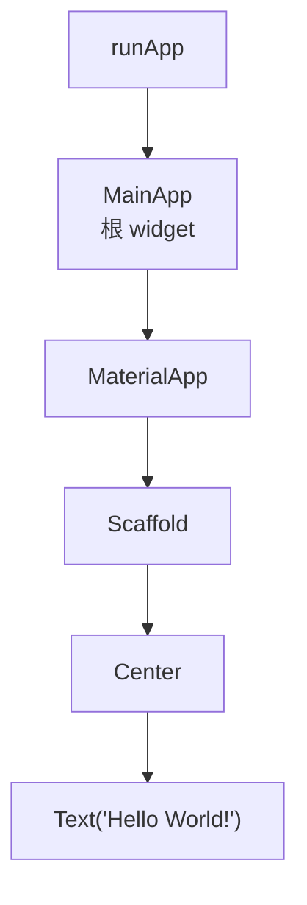

Android 开发者进入 Flutter 的起点不是安装工具，而是建立两套工程模型的对应关系：Gradle 模块与 pub 包、Activity 与入口函数、View 树与 widget 树、Logcat 与 Run 窗口。工具链已经具备，差异集中在工程组织、运行模型与 UI 构建方式上。

## 前提

Android Studio、Android SDK、模拟器或真机已就绪，Flutter SDK 与 IDE 插件已在环境中配置完成。本节不涉及安装、路径配置与设备创建，只讨论工程层面的差异。

需要确认的只有一点：IDE 工具栏出现设备下拉与 `Run` / `Debug` 按钮，说明 Flutter 插件已正确加载。若按钮灰化，通常是未选择设备而非环境缺失。

## 工程结构对照

Flutter 项目仍然是一个 Android Gradle 工程，`android/` 目录下包含 `settings.gradle.kts`、`app/build.gradle.kts`、`AndroidManifest.xml` 与 `MainActivity`。差别在于 UI 与业务逻辑位于 `lib/` 的 Dart 代码中，`android/` 只承担宿主职责。

| Flutter | Android | 说明 |
| --- | --- | --- |
| `lib/` | `app/src/main/java`（或 `kotlin`） | 业务与 UI 源码 |
| `pubspec.yaml` | `app/build.gradle.kts` | 依赖声明与元数据 |
| `android/` | 宿主模块 | 可独立作为 Gradle 工程打开 |
| `test/` | `test/` | JVM 单元测试 |
| `integration_test/` | `androidTest/` | 设备上的集成测试 |
| `build/` | `build/` | 构建产物，不入版本库 |
| `assets/`（在 `pubspec.yaml` 声明） | `res/` 或 `assets/` | 静态资源 |

`android/` 子工程可单独打开以获得 Gradle 脚本的完整补全：在项目视图中右键 `android`，选择 `Flutter` > `Open Android module in Android Studio`。

## 创建项目

两条路径产物一致，差别在模板内容：

- 向导：`File` > `New` > `New Flutter Project`，填写项目名、位置与 `Organization`，生成标准模板（含计数器示例）。
- 命令行：在 IDE 内置 Terminal（`Alt`+`F12`）执行 `flutter create birdle --empty`，生成只含一个根 widget 的精简模板；随后用 `File` > `Open` 打开项目根目录。

已有项目必须用 `File` > `Open` 打开。`New` > `Project from existing sources` 会按普通 JVM 工程导入，Flutter 插件能力全部失效。

向导中的 `Organization` 决定 Android 的 `applicationId` 与 iOS 的 Bundle ID，等价于 Android 工程里手工填写的包名，发布后不可更改。

### Android 侧的配置位置

| 配置项 | 位置 | 对应 Android 工程 |
| --- | --- | --- |
| `applicationId` | `android/app/build.gradle.kts` | 模块的 `applicationId` |
| `minSdk` / `targetSdk` / `compileSdk` | 同上，默认取 `flutter.minSdkVersion` 等常量 | 同名配置 |
| 权限、Activity 声明、主题 | `android/app/src/main/AndroidManifest.xml` | 同一文件 |
| 签名 | `android/app/build.gradle.kts` 的 `signingConfigs` | 同名配置 |
| 启动图、应用图标 | `android/app/src/main/res/` | 同一目录 |

`minSdk` 由 Flutter SDK 的默认值给出，需要支持更低版本时在 `defaultConfig` 中显式覆盖。插件对 `minSdk` 有各自要求，冲突时构建报错信息会指明是哪个插件要求提升。

### 宿主 Activity

```kotlin
class MainActivity : FlutterActivity()
```

`MainActivity` 不重写 `onCreate`，也不调用 `setContentView`。`FlutterActivity` 负责创建 `FlutterEngine`、加载 Dart 入口、把窗口内容交给引擎渲染。View 体系在此中断，之后屏幕上的所有像素由 Flutter 绘制，不经过 Android 的 View 树。

这一结构解释了三个现象：Flutter 的布局层级不出现在 Layout Inspector 的 View 树中、`findViewById` 无法获取 Flutter 控件、View 体系的 measure / layout / draw 流程不参与 Flutter 内容的渲染。

## 入口与 UI 组织

| 环节 | Android View | Compose | Flutter |
| --- | --- | --- | --- |
| 入口 | `Activity.onCreate` | `setContent { }` | `main()` + `runApp()` |
| 构建 UI | `LayoutInflater` + XML | `@Composable` 函数 | `build()` 返回 widget |
| UI 结构 | View 树 | 组合树 | widget 树 |
| 样式来源 | XML 属性、`setBackground` | `Modifier` 链 | 嵌套 widget |

`--empty` 模板的 `lib/main.dart`：

```dart
import 'package:flutter/material.dart';

void main() {
  runApp(const MainApp());
}

class MainApp extends StatelessWidget {
  const MainApp({super.key});

  @override
  Widget build(BuildContext context) {
    return const MaterialApp(
      home: Scaffold(
        body: Center(
          child: Text('Hello World!'),
        ),
      ),
    );
  }
}
```

`main` 对应 `onCreate` 的时机，`runApp` 对应 `setContentView` 的作用，`MainApp.build` 对应 XML 描述的布局结构。差别在于 `build` 会在运行期被反复调用，XML 只解析一次。

首帧的 widget 树：



`MaterialApp` 承担了 Android 中 `Application` + `Theme` + `Activity` 的部分职责：注入主题、创建导航器、提供文字方向与媒体查询。`Scaffold` 则对应 `Activity` 布局中的 `CoordinatorLayout` + `AppBarLayout` + 内容区。

## 运行与调试

设备下拉列出可用目标，选择后点击 `Run`（`Shift`+`F10`）或 `Debug`（`Shift`+`F9`）。选择 `Chrome` 等价于 `flutter run -d chrome`，选择模拟器等价于 `flutter run -d <device-id>`。

| 界面 | 对应 Android 工具 | 内容 |
| --- | --- | --- |
| `Run` 窗口 | Logcat（应用输出部分） | 构建进度、部署日志、`print` / `debugPrint` |
| `Debugger` 窗口 | Debugger | 调用栈、变量、表达式求值、断点 |
| `Console` 窗口 | Logcat | 引擎日志与标准输出 |
| `Logcat` 窗口 | — | 原生侧日志（Kotlin / Java / 系统） |

Dart 侧的 `print` 输出进入 `Run` / `Console` 窗口，Android 原生日志仍在 Logcat。排查插件问题时需要同时看两处：Dart 异常在 Run 窗口，原生崩溃在 Logcat。

`adb` 仍然有效，`flutter devices` 底层通过它枚举设备。安装、卸载、权限授予等操作可直接使用 `adb`，与纯 Android 工程一致。

断点调试与 Android 相同：行号左侧单击设置断点（`Ctrl`+`F8` 切换），`Debug` 启动后停在断点，`Debugger` 窗口查看帧与变量。启动参数在设备下拉的 `Edit configuration` 中配置，可指定入口文件、`--dart-define` 与 `--flavor`。

## 热重载与 Apply Changes

Android Studio 的 Apply Changes 与 Flutter 的热重载目标相同：避免重新安装应用即可看到代码改动。实现路径不同，能力边界也不同。

| 方式 | 机制 | 保留状态 | 适用 |
| --- | --- | --- | --- |
| 热重载 | 增量编译 kernel，注入 Dart VM，重建 widget 树 | 是 | Dart 代码改动 |
| 热重启 | 重启 Dart isolate，重新执行 `main()` | 否 | 全局状态、`main`、类型结构改动 |
| Apply Changes | 增量 dex / 资源替换，依赖 ART 的 JVMTI | 视改动而定 | Kotlin / Java 与资源 |
| 完全重启 | 重新编译、安装、启动 | 否 | 原生代码、清单、依赖变更 |

触发方式：

| 操作 | Windows / Linux | macOS |
| --- | --- | --- |
| 热重载 | 工具栏 Hot Reload 按钮、`Ctrl`+`\`、`Ctrl`+`Alt`+`;` | Hot Reload 按钮、`⌘`+`\` |
| 热重启 | `Shift`+点击热重载按钮、再次点击 `Run` / `Debug` | `⇧`+`⌘`+`\` |

热重载只在 Debug 模式可用，且不重新执行 `main()` 与 `initState()`。这一限制与 Compose 的 Live Edit 类似：已初始化的状态不会按新代码重新求值。

无法热重载的改动：

| 改动类型 | 原因 | 处理 |
| --- | --- | --- |
| 全局变量、静态字段的初始化语句 | 被视为状态，不重新初始化 | 热重启 |
| `main()` 方法体 | 入口只在启动时执行一次 | 热重启 |
| 枚举与类相互转换、泛型声明变化 | 类结构无法就地替换 | 热重启 |
| Kotlin / Java / Swift / OC 代码 | 不经过 Dart 增量编译 | 完全重启 |
| 资源文件、`AndroidManifest.xml` | 由 Gradle 打包 | 完全重启 |
| 依赖变更（`pubspec.yaml`） | 需要重新解析与链接 | 重新运行 |

`const` 字段是例外：修改 `const` 定义的值随热重载生效，因为 `const` 被视为别名而非状态；`final` 引用的全局值不会更新。

## 依赖管理

| Flutter | Android | 说明 |
| --- | --- | --- |
| `pubspec.yaml` | `build.gradle.kts` | 依赖与元数据 |
| `flutter pub add http` | `implementation("...")` | 添加依赖 |
| pub.dev | Maven Central / Google Maven | 仓库 |
| `pubspec.lock` | `gradle.lockfile` | 锁定版本，入版本库 |
| `^1.2.0` | `1.2.+` | 兼容范围内的版本约束 |

依赖分两类：纯 Dart 包只包含 Dart 代码，可跨平台；插件包含原生实现，安装后会在 `android/` 侧通过 Gradle 引入对应的 AAR。插件升级可能要求提升 `minSdk` 或 `compileSdk`，冲突信息由 Gradle 给出。

`flutter pub get` 对应 Gradle 的依赖解析；`flutter pub upgrade` 在约束范围内取最新版本，作用接近把 Gradle 中的动态版本重新解析。

## 编辑辅助

Flutter 插件在 Android Studio 中提供与 Android 开发一致的操作习惯：

| 工具 | 入口 | 用途 |
| --- | --- | --- |
| 实时模板 | `stless` / `stful` / `stanim` | 生成无状态、有状态、带控制器的有状态 widget |
| 意图动作 | `Alt`+`Enter`（macOS `Option`+`Return`） | `Wrap with widget`、`Convert to StatefulWidget`、`Convert child to children` |
| Dart Analysis | `View` > `Tool Windows` > `Dart Analysis` | 静态分析问题集中查看，对应 Android 的 Problems 视图 |
| Flutter Performance | `View` > `Tool Windows` > `Flutter Performance` | Debug 模式下查看 widget 重建次数 |

`stful` 生成的模板与 Android 中 `Activity` + `ViewModel` 的骨架类似：一个不可变的配置类，加一个持有可变状态的伴生类。

## 小结

Flutter 项目仍以 Gradle 工程为宿主，`android/` 只负责启动引擎与提供窗口，UI 与业务整体迁移到 `lib/`。`MainActivity` 继承 `FlutterActivity` 且不写 `setContentView`，是 View 体系与 Flutter 渲染的分界点。入口对应关系为 `onCreate` → `main`、`setContentView` → `runApp`、XML 布局 → `build`。运行与调试沿用 Android Studio 的设备下拉与 `Run` / `Debug`，Dart 输出进入 `Run` 窗口，原生日志仍在 Logcat。热重载与 Apply Changes 目标一致、边界不同：前者注入 kernel 并保留 `State`，后者依赖 ART 增量机制。
