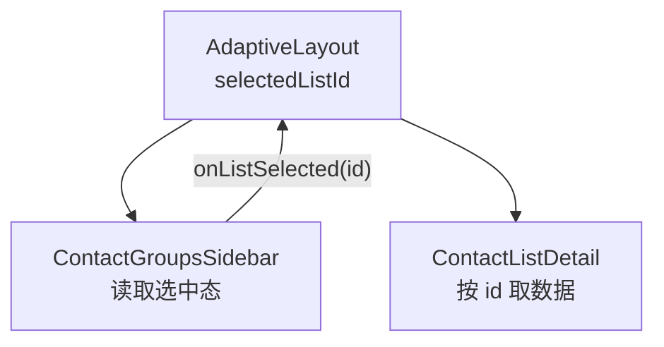

同一套代码在手机与平板上需要不同的界面结构：手机靠页面跳转，平板靠并排分栏。判断依据不是设备类型，而是当前可用的宽度。Flutter 用 `LayoutBuilder` 把宽度决策交给布局阶段，用 Cupertino 库提供 iOS 风格的基础组件。

## 两套设计系统

| 维度 | Material | Cupertino |
| --- | --- | --- |
| 根组件 | `MaterialApp` | `CupertinoApp` |
| 页面骨架 | `Scaffold` | `CupertinoPageScaffold` |
| 主题类 | `ThemeData` | `CupertinoThemeData` |
| 视觉风格 | Material Design | iOS 原生风格 |
| 交互惯例 | 波纹反馈、浮动按钮 | 无波纹、滑动返回、大标题 |

`CupertinoApp` 与 `MaterialApp` 是同级选择，不是平台限制。用 `CupertinoApp` 构建的应用可以在 Android、Web、桌面正常运行，只是视觉与交互遵循 iOS 惯例。选择依据是目标用户的平台习惯，而非运行平台。

两者的根组件都内置 `Navigator`、`MediaQuery`、`Directionality` 等基础设施，因此页面跳转、屏幕信息读取在两套体系下行为一致。

## 主题与动态颜色

```dart
CupertinoApp(
  title: 'Rolodex',
  theme: CupertinoThemeData(
    barBackgroundColor: CupertinoDynamicColor.withBrightness(
      color: Color(0xFFF9F9F9),
      darkColor: Color(0xFF1D1D1D),
    ),
  ),
  home: CupertinoPageScaffold(child: Center(child: Text('Hello Rolodex!'))),
)
```

`CupertinoThemeData` 的主要字段：

| 字段 | 作用 |
| --- | --- |
| `primaryColor` | 主色，影响按钮、光标、选中态 |
| `barBackgroundColor` | 导航栏与标签栏背景 |
| `scaffoldBackgroundColor` | 页面背景 |
| `textTheme` | 文本样式集合 |
| `brightness` | 整体明暗 |

`CupertinoDynamicColor` 是 Cupertino 特有的颜色类型：它携带多套取值，在渲染时按当前环境解析。

```dart
CupertinoDynamicColor.withBrightness(
  color: Color(0xFFF9F9F9),
  darkColor: Color(0xFF1D1D1D),
)
```

同一对象在浅色模式下解析为 `0xFFF9F9F9`，深色模式下解析为 `0xFF1D1D1D`，系统切换外观时自动生效，不需要重建主题或监听回调。`CupertinoDynamicColor` 还支持按对比度（`highContrastColor`）与按层级（`elevatedColor`）提供不同取值。

`CupertinoColors` 提供语义化颜色常量：`systemBackground`、`separator`、`systemGrey`、`systemGrey3`、`extraLightBackgroundGray`。语义色的价值在于同一名称在深浅模式下有不同的实际色值，业务代码无需关心具体数值。

## 项目结构

```bash
flutter create rolodex --empty
cd rolodex
flutter pub add cupertino_icons
mkdir lib/data lib/screens lib/theme
```

命令在 Android Studio 的内置 Terminal（`Alt`+`F12`）中执行；新建的目录在项目视图中右键 `lib` 后选择 `New` > `Directory` 也可完成。

| 目录 | 职责 |
| --- | --- |
| `lib/data/` | 数据模型、示例数据、状态容器 |
| `lib/screens/` | 页面级 widget |
| `lib/theme/` | 主题配置 |

按"数据 / 页面 / 主题"分层的收益在文件数量增长后显现：定位一个改动时，先按职责缩小范围，再按名称查找。

## 数据模型

`Contact` 是纯数据类，字段全部 `final`：

```dart
class Contact {
  Contact({
    required this.id,
    required this.firstName,
    this.middleName,
    required this.lastName,
    this.suffix,
  });

  final int id;
  final String firstName;
  final String lastName;
  final String? middleName;
  final String? suffix;
}
```

`middleName` 与 `suffix` 可空，对应"无中间名""无称谓"两种现实情况。用可空类型而非空字符串表达，语义更明确：空字符串是合法值，`null` 是"不存在"。

`ContactGroup` 表示一个分组，并在构造时完成排序：

```dart
class ContactGroup {
  factory ContactGroup({
    required int id,
    required String label,
    bool permanent = false,
    String? title,
    List<Contact>? contacts,
  }) {
    final contactsCopy = contacts ?? <Contact>[];
    _sortContacts(contactsCopy);
    return ContactGroup._internal(...);
  }
}
```

使用 `factory` 构造是为了在返回实例前插入排序逻辑。普通构造函数体只能初始化字段，无法在返回前对入参做变换；`factory` 构造没有这个限制，且可以返回私有构造的结果。

排序规则按优先级逐级比较：姓氏 → 名字 → 中间名 → `id`。最后一级用 `id` 兜底，保证同名联系人的顺序稳定——缺少这一级时，排序结果依赖输入顺序，同一份数据在不同运行中可能呈现不同次序。

`alphabetizedContacts` 把平铺列表转成按首字母分组的有序映射：

```dart
typedef AlphabetizedContactMap = SplayTreeMap<String, List<Contact>>;
```

`SplayTreeMap` 是按键有序的 `Map` 实现，遍历 `keys` 时按字典序输出，因此不需要额外排序即可实现"按 A-Z 分区"的展示顺序。普通 `Map`（`LinkedHashMap`）保持插入顺序，无法满足这一需求。

`ContactGroupsModel` 用 `ValueNotifier` 承载分组列表：

```dart
class ContactGroupsModel {
  ContactGroupsModel() : _listsNotifier = ValueNotifier(generateSeedData());

  final ValueNotifier<List<ContactGroup>> _listsNotifier;

  ValueNotifier<List<ContactGroup>> get listsNotifier => _listsNotifier;
  List<ContactGroup> get lists => _listsNotifier.value;

  ContactGroup findContactList(int id) => lists[id];

  void dispose() {
    _listsNotifier.dispose();
  }
}
```

示例代码把实例声明为顶层变量（`final contactGroupsModel = ContactGroupsModel();`），通过 `import '../main.dart'` 直接引用。这是教程为压缩篇幅做的简化，代价是全局可变状态、无法替换、测试需依赖全局。正式项目应通过构造函数注入或依赖注入容器传递。

## 自适应布局的判断依据

```dart
const largeScreenMinWidth = 600;

class _AdaptiveLayoutState extends State<AdaptiveLayout> {
  int selectedListId = 0;

  void _onContactListSelected(int listId) {
    setState(() {
      selectedListId = listId;
    });
  }

  @override
  Widget build(BuildContext context) {
    return LayoutBuilder(
      builder: (context, constraints) {
        final isLargeScreen = constraints.maxWidth > largeScreenMinWidth;

        if (isLargeScreen) {
          return _buildLargeScreenLayout();
        }
        return const ContactGroupsPage();
      },
    );
  }
}
```

`LayoutBuilder` 的 `builder` 回调接收两个参数：`context` 与 `BoxConstraints`。约束来自父级，代表"当前这块区域最多能有多宽/多高"。

与 `MediaQuery.sizeOf(context)` 的差异：

| 维度 | `LayoutBuilder` | `MediaQuery.sizeOf` |
| --- | --- | --- |
| 数据来源 | 父级传入的约束 | 整个屏幕尺寸 |
| 是否受嵌套影响 | 是，可响应局部区域宽度 | 否，始终是屏幕尺寸 |
| 是否触发布局 | 约束变化时重新布局子树 | 屏幕尺寸变化时重建依赖者 |
| 适用场景 | 分栏、局部自适应 | 全局方向、安全区 |

窗口被分割成多块（侧边栏 + 主区、分屏、可拖拽面板）时，判断依据必须是"这一块有多宽"，而非"屏幕有多宽"。`LayoutBuilder` 是唯一能拿到局部约束的方式。

600 是 Material 断点体系中的常用阈值，区分手机尺寸与平板尺寸。断点的实际取值应由内容的最小可用宽度决定：一个包含五列信息的面板在 500 宽度下无法阅读，则断点不能低于 500。

## 与 Android 自适应方案的对应

| Android / Compose | Flutter |
| --- | --- |
| `WindowSizeClass`（Compact < 600，Medium 600–839，Expanded 从 840 起） | 自定义断点常量 |
| `BoxWithConstraints` | `LayoutBuilder` |
| `ListDetailPaneScaffold` / `SlidingPaneLayout` | `Row` + `SizedBox` + `Expanded` + 选中态 |
| `Scaffold` | `CupertinoPageScaffold` |
| Material 3 主题 | `CupertinoThemeData`（另一套设计系统） |
| `configuration.screenWidthDp` | `MediaQuery.sizeOf(context).width` |

Material 3 用三档宽度类别区分手机、折叠屏与平板，本节只用一个 600 断点区分单栏与双栏，覆盖的是 Compact 与 Medium 的分界。需要三档以上时，把断点写成常量列表并集中判断，避免散落在各页面。

`WindowSizeClass` 基于窗口而非物理屏幕，`LayoutBuilder` 基于父级约束，两者都适用于分屏与自由窗口；`MediaQuery.sizeOf` 拿到的是屏幕尺寸，在多窗口场景下不反映可用宽度。

## 大屏结构：侧边栏与详情

```dart
Widget _buildLargeScreenLayout() {
  return CupertinoPageScaffold(
    backgroundColor: CupertinoColors.extraLightBackgroundGray,
    child: SafeArea(
      child: Row(
        children: [
          SizedBox(
            width: 320,
            child: ContactGroupsSidebar(
              selectedListId: selectedListId,
              onListSelected: _onContactListSelected,
            ),
          ),
          Container(width: 1, color: CupertinoColors.separator),
          Expanded(child: ContactListDetail(listId: selectedListId)),
        ],
      ),
    ),
  );
}
```

结构分解：

| 元素 | 作用 |
| --- | --- |
| `SafeArea` | 避开刘海、状态栏、圆角等系统占用区域 |
| `SizedBox(width: 320)` | 侧边栏固定宽度，主从布局中列表区不需随窗口伸缩 |
| `Container(width: 1)` | 1 像素分隔线，用 `separator` 语义色 |
| `Expanded` | 详情区占满剩余宽度 |

固定宽度 + 弹性宽度的组合是主从布局的标准形式：左侧导航的宽度由内容决定（列表项文本长度有限），右侧详情的宽度由窗口决定。

`SafeArea` 在移动端避让状态栏与 Home Indicator，在桌面端通常无额外内边距。它的开销是一次 `MediaQuery` 读取与一层 `Padding`，应当放在页面最外层而非每个子组件上。

## 状态提升与回调

`selectedListId` 保存在 `AdaptiveLayout` 的 `State` 中，而不是侧边栏内部。原因是详情区也需要读取它：



这是"状态提升"的标准形态：两个兄弟组件需要共享同一份状态，把它放到最近的共同祖先。回调向下传递，数据向下传递，修改请求向上传递。

`ContactGroupsSidebar` 的职责只是把 `ContactGroup` 转成 `int`：

```dart
class ContactGroupsSidebar extends StatelessWidget {
  const ContactGroupsSidebar({
    super.key,
    required this.selectedListId,
    required this.onListSelected,
  });

  final int selectedListId;
  final void Function(int) onListSelected;

  @override
  Widget build(BuildContext context) {
    return _ContactGroupsView(
      selectedListId: selectedListId,
      onListSelected: (list) => onListSelected(list.id),
    );
  }
}
```

转换发生在这一层，使内层视图只依赖 `int`，不关心"选中一个分组"在导航场景与分栏场景下的不同后果。

## 视图复用的两种形态

同一个 `_ContactGroupsView` 服务两个场景：

| 场景 | 传入的回调 | 结果 |
| --- | --- | --- |
| 小屏页面 | `Navigator.push` | 跳转到新页面 |
| 大屏侧边栏 | 更新 `selectedListId` | 原地替换详情区 |

差异被收敛到回调实现中，视图本身完全一致。这是把"行为"与"结构"分离的直接收益：新增一种呈现方式（例如三栏布局）时，只需再提供一个回调实现。

## 本节小结

Cupertino 是与 Material 同级的设计系统，提供 iOS 惯例的组件与语义化动态颜色，`CupertinoDynamicColor` 在渲染时按环境解析，深浅模式切换无需额外代码。数据层用 `factory` 构造在返回前完成排序，`SplayTreeMap` 保证按键有序。自适应布局的判断依据是父级约束而非屏幕尺寸，`LayoutBuilder` 是获取局部宽度的唯一途径，600 是常用断点但应由内容最小宽度决定。主从布局采用固定宽度侧边栏 + `Expanded` 详情区，共享状态提升到共同祖先，视图通过回调解耦具体行为。
