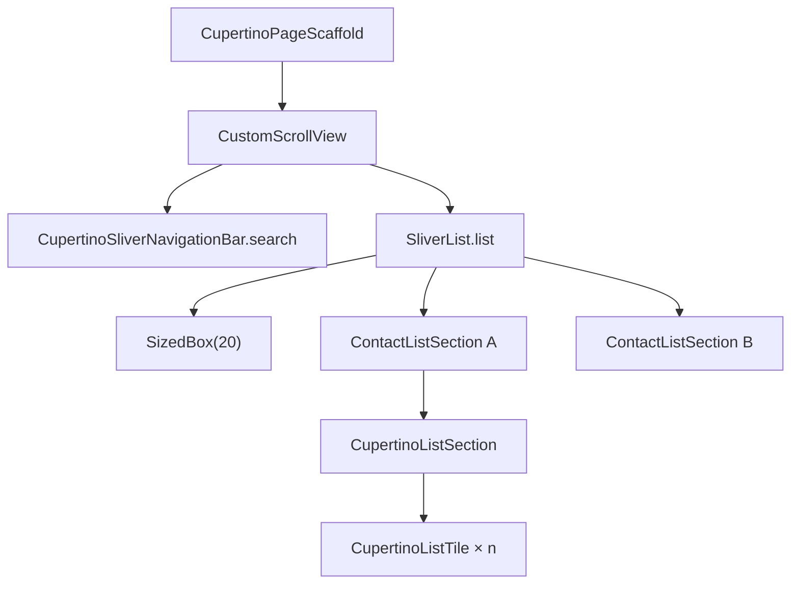

普通 widget 与 sliver 是两套布局协议。前者在二维平面上确定尺寸与位置，后者只处理"滚动方向上的长度"与"交叉方向的宽度"。混用两者的代价是异常，理解两者的边界是使用 `CustomScrollView` 的前提。

## 两套布局协议

| 维度 | Box 协议 | Sliver 协议 |
| --- | --- | --- |
| 基类 | `RenderBox` | `RenderSliver` |
| 输入 | `BoxConstraints` | `SliverConstraints` |
| 输出 | `Size` | `SliverGeometry` |
| 子级数量 | 由 widget 自身决定 | 由 `childManager` 按需创建 |
| 坐标 | 二维笛卡尔 | 一维滚动偏移 + 交叉轴范围 |

`SliverConstraints` 的关键字段：

| 字段 | 含义 |
| --- | --- |
| `scrollOffset` | 当前视口顶部相对该 sliver 起始位置的偏移 |
| `remainingPaintExtent` | 还可用于绘制的长度 |
| `crossAxisExtent` | 交叉方向可用宽度 |
| `axisDirection` | 滚动方向（向下、向上、向左、向右） |
| `overlap` | 与前一个 sliver 的重叠长度（用于吸顶效果） |

`SliverGeometry` 回报三项核心数据：`scrollExtent`（占用的滚动总长度）、`paintExtent`（实际绘制的长度）、`visible`（是否可见）。视口据此决定哪些 sliver 需要构建、哪些可以跳过。

## 硬性约束

sliver 只能作为滚动视图的直接子级，具体限制分三条：

1. 只能放在 `CustomScrollView.slivers`、`NestedScrollView` 等接受 sliver 的槽位。
2. `CustomScrollView.slivers` 只接受 sliver，传入普通 widget 会抛类型错误。
3. 普通 widget 要进入 sliver 上下文，必须用适配器包裹：`SliverToBoxAdapter`（单子，按子级自身尺寸）、`SliverFillRemaining`（填满剩余视口）、`SliverPadding`（给 sliver 加内边距）。

这条约束的根源是协议不同：视口在布局时按 sliver 协议询问其占用的滚动长度，普通 widget 无法回答这个问题。

## CustomScrollView 的结构

```dart
CustomScrollView(
  slivers: [
    CupertinoSliverNavigationBar(largeTitle: Text('Lists')),
    SliverFillRemaining(
      child: ValueListenableBuilder<List<ContactGroup>>(/* ... */),
    ),
  ],
)
```

`CustomScrollView` 本身不做布局，只做三件事：创建视口、按 `slivers` 顺序排列、把滚动偏移分发给各 sliver。滚动行为的组合能力来自"多个 sliver 共享同一个偏移"——导航栏、列表、页脚可以各自响应滚动位置，产生折叠、吸顶、视差等效果。

## 可折叠的大标题导航栏

`CupertinoSliverNavigationBar` 是 iOS 风格的大标题导航栏，滚动时大标题上移并收进小标题栏。

| 参数 | 作用 |
| --- | --- |
| `largeTitle` | 展开态的大标题 |
| `automaticallyImplyLeading` | 是否自动生成返回按钮 |
| `border` | 底部分隔线 |
| `stretch` | 下拉回弹时是否拉伸 |

`automaticallyImplyLeading: false` 用于隐藏返回按钮，适用于"页面由外部导航控制"的场景（如大屏详情区）。

### 集成搜索框

```dart
CupertinoSliverNavigationBar.search(
  largeTitle: Text(contactList.title),
  automaticallyImplyLeading: automaticallyImplyLeading,
  searchField: const CupertinoSearchTextField(
    suffixIcon: Icon(CupertinoIcons.mic_fill),
    suffixMode: OverlayVisibilityMode.always,
  ),
)
```

`.search` 命名构造把搜索框嵌入导航栏：导航栏展开时搜索框位于大标题下方，折叠后搜索框上移并与小标题同排，滚动过程连续过渡，不是两个独立状态的切换。

`CupertinoSearchTextField` 的参数：

| 参数 | 作用 |
| --- | --- |
| `placeholder` | 空值提示 |
| `prefixIcon` / `suffixIcon` | 前置/后置图标 |
| `suffixMode` | 后置图标的显示时机：`always`、`whileEditing`、`whileNotEditing`、`never` |
| `onChanged` / `onSubmitted` | 文本变化与提交回调 |

## SliverList：按需布局的列表

```dart
SliverList.list(
  children: [
    const SizedBox(height: 20),
    ...contacts.keys.map(
      (initial) => ContactListSection(
        lastInitial: initial,
        contacts: contacts[initial]!,
      ),
    ),
  ],
)
```

三个构造的差异：

| 构造 | widget 创建 | 布局 | 适用 |
| --- | --- | --- | --- |
| `SliverList.list(children:)` | 一次性全部创建 | 仅可见项参与布局与绘制 | 子项数量确定且不多 |
| `SliverList.builder(itemBuilder:, itemCount:)` | 按需创建 | 仅可见项 | 长列表、动态数据 |
| `SliverList(delegate: SliverChildBuilderDelegate(...))` | 按需创建 | 仅可见项 | 需要自定义 delegate |

`SliverList.list` 已优于 `Column`：`Column` 会为全部子项执行布局并计算总高度，而 `SliverList` 只布局视口附近的子项，滚动时增量计算。widget 对象仍然全部存在，内存占用与 `Column` 相近；`SliverList.builder` 进一步把 widget 的创建也推迟到需要时，长列表应优先使用。

`...` 展开运算符把 `Iterable<Widget>` 摊平进列表字面量，与 `for` 元素等价。此处配合 `map` 使用是因为需要先取 `contacts[initial]!`——键与值成对处理，`for` 元素需要额外声明中间变量。

## 与 LazyColumn 的对应

| Compose | Flutter |
| --- | --- |
| `LazyColumn` | `CustomScrollView` + `SliverList` |
| `LazyListScope.items()` | `SliverList.builder` |
| `item {}` | `SliverToBoxAdapter` |
| `stickyHeader {}` | `SliverPersistentHeader` / `CupertinoSliverNavigationBar` |
| `TopAppBar` + `scrollBehavior` | `SliverAppBar` / `CupertinoSliverNavigationBar` |
| `rememberLazyListState()` | `ScrollController` |
| `MutableState<T>` | `ValueNotifier<T>` |

`LazyColumn` 把"滚动容器"与"可滚动片段"收敛为一个 DSL，Flutter 把两者拆成两种类型：`CustomScrollView` 是视口，sliver 是片段。同样的"列表 + 吸顶标题"在 Compose 中写在一个 `LazyColumn` 内，在 Flutter 中则需要在 `slivers` 列表里组合多个 sliver。

拆分带来的能力是任意组合：导航栏、列表、页脚共享同一个滚动偏移，折叠、视差等效果由组合方式直接产生，不需要自定义 `NestedScrollConnection` 或 `LayoutModifier`。

## 分组列表

```dart
CupertinoListSection.insetGrouped(
  header: const Text('iPhone'),
  children: [
    for (final ContactGroup contactList in contactLists)
      CupertinoListTile(
        leading: contactList.id == 0 ? groupIcon : pairIcon,
        title: Text(contactList.label),
        trailing: _buildTrailing(contactList.contacts, context),
        onTap: () => onListSelected(contactList),
      ),
  ],
)
```

`CupertinoListSection.insetGrouped` 呈现 iOS 设置页风格的圆角分组卡片：分组之间留白，分组内部行贴边，行间有缩进分隔线。

| 参数 | 作用 |
| --- | --- |
| `header` / `footer` | 分组标题与脚注 |
| `children` | 行列表 |
| `backgroundColor` | 分组背景 |
| `dividerMargin` / `additionalDividerMargin` | 分隔线两侧缩进 |
| `topMargin` | 分组顶部外边距 |

`CupertinoListTile` 的参数：

| 参数 | 作用 |
| --- | --- |
| `leading` | 行首 widget（图标、头像） |
| `title` | 主文本 |
| `subtitle` | 副文本 |
| `trailing` | 行尾 widget（数值、箭头） |
| `onTap` | 点击回调 |

`trailing` 常用来放"数量 + 前进箭头"：

```dart
Widget _buildTrailing(List<Contact> contacts, BuildContext context) {
  final TextStyle style = CupertinoTheme.of(context).textTheme.textStyle
      .copyWith(color: CupertinoColors.systemGrey);

  return Row(
    mainAxisSize: MainAxisSize.min,
    children: [
      Text(contacts.length.toString(), style: style),
      const Icon(
        CupertinoIcons.forward,
        color: CupertinoColors.systemGrey3,
        size: 18,
      ),
    ],
  );
}
```

`mainAxisSize: MainAxisSize.min` 让 `Row` 只占内容宽度，否则它会尝试填满 `trailing` 给的空间，把标题挤到左侧。`copyWith` 在主题文本样式基础上只改颜色，保留字号与字重。

## ValueNotifier 与局部监听

`ValueNotifier<T>` 是只包装单个值的 `ChangeNotifier`，在值变化时通知监听者。`ValueListenableBuilder` 只监听一个 `ValueListenable`：

```dart
ValueListenableBuilder<List<ContactGroup>>(
  valueListenable: contactGroupsModel.listsNotifier,
  builder: (context, contactLists, child) {
    return CupertinoListSection.insetGrouped(/* 使用 contactLists */);
  },
)
```

`builder` 的第二个参数是当前值，第三个是可选的不重建子树。与 `ListenableBuilder` 的差异：

| 维度 | `ListenableBuilder` | `ValueListenableBuilder` |
| --- | --- | --- |
| 监听对象 | 任意 `Listenable` | `ValueListenable<T>` |
| 回调参数 | 只有 `child` | 当前值 + `child` |
| 通知条件 | 由对象自行决定 | 值不相等时（`==` 比较） |

`ValueNotifier` 在赋新值时比较 `==`，相等则不通知。因此对 `List` 这类引用类型，修改列表内部元素不会触发通知，必须赋一个新列表对象。这是使用 `ValueNotifier<List<T>>` 时最常见的失效原因。

## 页面结构



从视口到内容共四层，每层只承担一项职责：页面骨架、滚动组合、列表布局、行样式。改动某层时不需要触碰其他层，这是 sliver 组合模型的直接收益。

## 本节小结

sliver 与普通 widget 使用不同的布局协议，前者回答"占多长滚动距离"，后者回答"多大尺寸"，因此不能互换，必须通过适配器转换。`CustomScrollView` 的价值在于多个 sliver 共享同一滚动偏移，从而组合出折叠导航栏、分组列表等效果。`SliverList` 只布局可见项，性能优于 `Column`；长列表应使用 `.builder` 把 widget 创建也推迟。`CupertinoListSection.insetGrouped` 与 `CupertinoListTile` 提供 iOS 风格的分组行样式。`ValueNotifier` 按 `==` 比较决定是否通知，替换集合内容时必须赋新对象。
