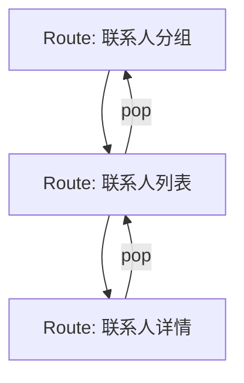

页面切换的本质是"屏幕上显示哪一个路由"。Flutter 用栈描述这件事：新页面入栈并覆盖旧页面，返回时出栈。栈模型同时决定了转场动画、返回按钮与系统返回键的行为。

## 栈模型

`Navigator` 维护一个 `Route` 栈，栈顶路由占据屏幕，下层路由保留在内存中但不可见。



| 操作 | 效果 | 栈深度 |
| --- | --- | --- |
| `push(route)` | 新路由入栈，覆盖当前页面 | +1 |
| `pop()` | 栈顶路由出栈，露出下层 | -1 |
| `pushReplacement(route)` | 新路由替换栈顶 | 不变 |
| `popUntil(predicate)` | 连续出栈直到满足条件 | 减少 |
| `pushAndRemoveUntil(route, predicate)` | 入栈并清空其下所有路由 | 重置 |

栈中的路由对象持有各自页面的 `State`。入栈时下层页面不会被销毁，出栈时上层页面的 `State` 被 `dispose`。因此"返回后页面状态是否保留"取决于被覆盖的层，而非返回动作本身。

## Navigator.of(context)

```dart
Navigator.of(context).push(
  CupertinoPageRoute<void>(
    title: list.title,
    builder: (context) => ContactListsPage(listId: list.id),
  ),
);
```

`Navigator.of(context)` 沿 widget 树向上查找最近的 `NavigatorState`。`MaterialApp` 与 `CupertinoApp` 都在根部创建了一个 `Navigator`，因此应用内通常能直接找到。

两条边界：

- `context` 必须位于该 `Navigator` 之下。在 `MaterialApp` 之上（例如 `main` 中直接使用根 context）调用会抛 `No Navigator found`。
- 嵌套 `Navigator` 时，`of` 返回最近的那个。需要访问外层导航器时使用 `Navigator.of(context, rootNavigator: true)`。

`Navigator.of(context)` 返回的是 `NavigatorState`，它同时是 `BuildContext` 的持有者，因此 `push` 后无需手动刷新界面——路由变化会触发导航器重建。

## 路由对象

`Route` 描述一个页面及其转场行为。常用子类：

| 类 | 转场 | 适用 |
| --- | --- | --- |
| `MaterialPageRoute` | Material 转场（Android 为上升+淡入，iOS 为右滑） | Material 应用 |
| `CupertinoPageRoute` | iOS 风格右滑入 | Cupertino 应用 |
| `PageRouteBuilder` | 自定义转场 | 特殊动效 |
| `DialogRoute` / `ModalBottomSheetRoute` | 对话框、底部面板 | 浮层 |

`CupertinoPageRoute` 提供四项行为：

- 从右侧滑入的转场动画，返回时向右滑出。
- 自动在导航栏左侧生成返回按钮。
- 把 `title` 传给目标页面的导航栏。
- 支持从屏幕左缘右滑返回的手势。

`builder` 是延迟执行的：页面 widget 在 `push` 时才构建，而不是在创建 `Route` 对象时。因此可以在 `builder` 中读取最新的 context 数据，也可以把构造参数直接闭包捕获。

泛型参数 `CupertinoPageRoute<void>` 声明该路由不返回结果。需要返回值时改为具体类型。

## 返回与结果传递

```dart
// 入栈并等待结果
final result = await Navigator.of(context).push<String>(
  CupertinoPageRoute<String>(
    builder: (context) => const PickPage(),
  ),
);

// 出栈并返回结果
Navigator.of(context).pop('selected');
```

`push` 返回 `Future<T?>`，在路由出栈时完成。未传结果的 `pop()` 返回 `null`，因此结果类型始终可空。

调用方通常不需要 `await`，除非确实要消费返回值。忽略返回值的 `push` 会产生一个未被等待的 `Future`，这在 Dart 中不构成错误。

系统返回键与左缘滑动返回由导航器统一处理，效果等同于 `pop()`。需要拦截返回行为（例如提示"内容未保存"）时，使用 `PopScope` 包裹页面。

## 与 Navigation Compose 的对应

| Compose | Flutter |
| --- | --- |
| `NavHost` + `NavController` | `Navigator` + `Route` 栈 |
| `composable("route") { }` | `CupertinoPageRoute(builder: ...)` |
| `navController.navigate("route")` | `Navigator.push(route)` |
| `popBackStack()` | `Navigator.pop()` |
| 返回按钮由 `TopAppBar` 提供 | `automaticallyImplyLeading` |
| `BackHandler` / 系统返回 | `PopScope` |
| 路由参数（字符串或类型安全路由） | 构造函数闭包捕获 |

Navigation Compose 用字符串或序列化对象描述目的地，由 `NavController` 维护返回栈；Flutter 直接操作 `Route` 对象栈，页面参数通过闭包捕获。后者的参数在编译期检查，前者在运行期解析路由，类型错误只能在运行时暴露。

两者都支持深层链接，接入点不同：Compose 通过 `navDeepLink` 声明在导航图上，Flutter 通过 `onGenerateRoute` 或平台侧的 intent 过滤转发。

## 两种导航模式的对照

同一份列表视图，在两种屏幕尺寸下承担不同角色：

| 维度 | 小屏 | 大屏 |
| --- | --- | --- |
| 触发 | 点击分组 | 点击侧边栏项 |
| 行为 | `Navigator.push` 新页面 | 更新 `selectedListId` |
| 返回按钮 | 需要 | 不需要 |
| 栈深度 | 递增 | 恒定 |
| 布局 | 单栏 | 双栏并排 |

差异通过两个参数收敛：

```dart
// 小屏：页面，push 新路由
class ContactGroupsPage extends StatelessWidget {
  const ContactGroupsPage({super.key});

  @override
  Widget build(BuildContext context) {
    return _ContactGroupsView(
      onListSelected: (list) => Navigator.of(context).push(
        CupertinoPageRoute<void>(
          title: list.title,
          builder: (context) => ContactListsPage(listId: list.id),
        ),
      ),
    );
  }
}
```

```dart
// 大屏：详情区，隐藏返回按钮
class ContactListDetail extends StatelessWidget {
  const ContactListDetail({super.key, required this.listId});

  final int listId;

  @override
  Widget build(BuildContext context) {
    return _ContactListView(listId: listId, automaticallyImplyLeading: false);
  }
}
```

`automaticallyImplyLeading: false` 关闭自动返回按钮。这一参数最终传给 `CupertinoSliverNavigationBar`，决定导航栏左侧是否留出返回位。

`_ContactGroupsView` 与 `_ContactListView` 因此完全复用，仅靠回调与导航栏参数区分场景。复用得以成立的前提是：视图内部不直接调用 `Navigator`，导航决策由外层注入。

## 边界：跨断点切换时的路由残留

小屏上 push 了详情页后，把窗口拉宽到超过断点，会出现一条异常：

```
There are multiple heroes that share the same tag within a subtree.
```

成因是两种导航模式短暂共存：

1. `push` 的路由仍在栈中，其页面尚未出栈。
2. 布局切换为大屏后，`_buildLargeScreenLayout` 直接渲染详情视图。
3. 两个详情页同时存在于 widget 树中，导航栏内部的 `Hero`（用于共享元素转场）出现重复 tag，框架检测到冲突。

这是"栈式导航"与"响应式布局"叠加时的固有冲突，不属于实现错误。可选处理方式：

| 方式 | 做法 | 代价 |
| --- | --- | --- |
| 忽略 | 接受该场景下的异常提示 | 窗口尺寸变化时不健壮 |
| 切换时清栈 | 断点变化时 `popUntil((route) => route.isFirst)` | 丢失已打开页面 |
| 详情页按断点分流 | 大屏不为详情页建路由，直接渲染详情视图 | 需要重构导航层 |

教程场景选择忽略，因为桌面窗口自由缩放属于开发调试行为，移动端不会出现该路径。生产应用若需支持平板分屏与自由窗口，必须显式处理。

## 本节小结

导航由栈描述，`push` 入栈、`pop` 出栈，下层页面的 `State` 在覆盖期间保留，出栈时才释放。`Navigator.of(context)` 向上查找最近的导航器，context 必须位于其下。`CupertinoPageRoute` 提供 iOS 转场、返回按钮与滑动返回，`builder` 延迟到入栈时执行。`push` 返回 `Future<T?>`，与 `pop(result)` 构成结果传递机制。自适应场景下，栈式导航与主从布局通过回调分流，视图本身不感知导航；跨断点切换会导致两个详情页共存并触发 `Hero` tag 冲突，属于两种模式叠加的边界，需要按产品要求选择处理策略。
