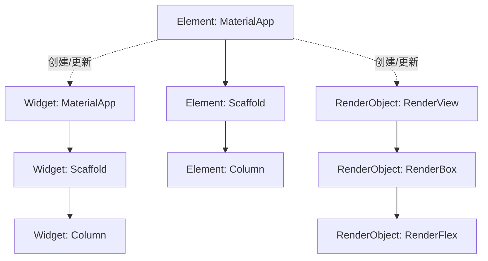

前十三节处理"如何写"，本节处理"写完之后发生了什么"。从 `runApp` 到屏幕上的像素，中间经过三棵树、四个阶段、三层架构。理解这条链路，才能解释 `const` 为什么有用、`build` 为什么必须轻量、状态为什么不能随意放置。

## 分层架构

Flutter 自上而下分为四层，上层依赖下层，下层不感知上层。

| 层 | 语言 | 职责 |
| --- | --- | --- |
| Dart 应用 | Dart | 业务逻辑与 widget 组合 |
| Framework | Dart | 布局、绘制、手势、动画、文本输入、无障碍 |
| Engine | C++ | 图形、文本排版、文件与网络 IO、Dart 运行时、场景栅格化 |
| Embedder | 平台语言 | 入口、渲染表面、输入事件、生命周期、线程管理 |

Framework 内部还有明确的分层，从下到上：

| 层 | 内容 |
| --- | --- |
| `foundation` | 基础类、`ChangeNotifier`、`Key`、诊断 |
| `animation` / `painting` / `gestures` | 动画曲线、画布与绘制、手势识别 |
| `rendering` | 布局协议、`RenderObject` 树 |
| `widgets` | 组合模型、`StatelessWidget` / `StatefulWidget` |
| Material / Cupertino | 两套设计系统的组件实现 |

Engine 通过 `dart:ui` 把底层能力暴露给 Framework。`Canvas`、`Picture`、`Scene`、`Window` 等类都来自这一层，`package:flutter` 中的 widget 最终都落到这些原语上。

Embedder 的职责与平台强相关：Android 用 Java + C++，iOS / macOS 用 Swift 与 Objective-C，Windows / Linux 用 C++。它负责创建渲染表面（Android 的 `FlutterView`、iOS 的 `CAMetalLayer`）、转发输入事件、传递生命周期回调。

## 三棵树

Flutter 中有三棵并行的树，各自承担不同职责。

| 树 | 节点 | 生命周期 | 是否可变 | 职责 |
| --- | --- | --- | --- | --- |
| Widget 树 | `Widget` | 极短，每次重建新建 | 不可变 | 描述配置 |
| Element 树 | `Element` | 与树中位置绑定，跨帧存活 | 内部可变 | 持有状态、连接上下层 |
| RenderObject 树 | `RenderObject` | 与 element 对应 | 可变 | 布局、绘制、命中测试 |



三者的关系：

- **Widget 是配置**。每次 `build` 返回新的 widget 实例，描述"这一帧应该长什么样"。创建成本低，可以大量产生。
- **Element 是位置的持有者**。它记录 widget 在树中的位置、持有 `State` 对象、保存子 element 的引用。`BuildContext` 由 `Element` 实现，因此 `context` 本质上是"当前 element 的句柄"。
- **RenderObject 是执行者**。由 `RenderObjectElement` 在挂载时创建，负责测量、布局、绘制、命中测试。

Element 分两类：

| 类型 | 对应 widget | 行为 |
| --- | --- | --- |
| `ComponentElement` | `StatelessWidget`、`StatefulWidget` 等组合 widget | 不产生 render object，只调用 `build` 产生子 element |
| `RenderObjectElement` | `RenderObjectWidget`（`Container` 展开后的 `Padding`、`RichText` 等） | 创建并更新 render object |

`RenderObjectWidget` 是唯一真正创建可见内容的 widget 类型。`StatelessWidget` 与 `StatefulWidget` 只负责组织，不产生像素——这一区分解释了为什么 widget 树可以有几十层，而 render object 树通常浅得多。

## 从代码到 element 树

`runApp` 的执行路径：

1. 创建 `RenderView`，作为 render 树的根。
2. 把传入的 widget 包装为根 element，挂载到 `RenderView`。
3. 触发首帧构建，递归调用各 widget 的 `build`。

`build` 返回的 widget 会被转换为 element。若新旧 widget 的 `runtimeType` 与 `key` 相同，复用已有 element 并更新其配置；否则销毁旧 element（含其 `State`），创建新 element。

组合器在展开时会产生额外层级。`Container` 的 `build` 内部按参数组合出 `Padding`、`DecoratedBox`、`ConstrainedBox`、`SizedBox` 等，因此源码中一个 `Container` 在 element 树中对应多个节点。这是 widget 检查器中树深度大于源码层级的原因。

```dart
// 源码
Container(color: Colors.blue, child: Text('A'))

// 展开后（简化）
ColoredBox(color: Colors.blue, child: Text('A'))
```

`Image` 展开为 `RawImage`，`Text` 展开为 `RichText`。展开是组合模型的必然结果，也是"组合优于继承"的具体体现：`Container` 没有继承任何东西，它只是把若干单一职责的 widget 串起来。

## 布局：约束向下，尺寸向上

布局阶段遍历 render 树，顺序为深度优先。

三条规则构成完整的布局协议：

1. 父级把 `BoxConstraints` 传给子级。
2. 子级在约束内选定 `Size` 并上报。
3. 父级据此确定子级的位置。

`RenderBox` 是二维笛卡尔空间中的 render object，绝大多数 widget 对应它的子类。约束模型允许父级只限定一个维度：例如文本在给定宽度下自动换行，高度由内容决定——父级传下紧的 `maxWidth` 与松的 `maxHeight`，子级上报实际高度。

复杂度为 O(n)：每个节点只访问一次，不做回溯。这一上界来自约束的单向传递——子级不需要知道父级的尺寸，父级也不需要知道子级的内部结构。

`LayoutBuilder` 是唯一能在布局阶段读取约束并返回不同子树的 widget。它的 `builder` 在布局过程中执行，返回的子树会用同一份约束重新布局。这也意味着 `LayoutBuilder` 内部不应再触发布局，否则会导致重复布局。

约束不变时，子树可以跳过布局。`RelayoutBoundary` 标记了"约束不会从父级变化"的节点，其子树在父级重新布局时可复用上次结果。

## 绘制与合成

布局完成后，render 树进入绘制阶段：

1. `paint` 把绘制指令写入 `Canvas`，形成 `Picture`。
2. 多个 `Picture` 组织为图层（`Layer`）。
3. `RenderView.compositeFrame` 创建 `SceneBuilder`，把图层合成一个 `Scene`。
4. `Scene` 交给 `dart:ui` 的 `Window.render`，由引擎栅格化为纹理，最终提交 GPU。

`RepaintBoundary` 把子树隔离为独立图层，其重绘不影响父级。代价是额外的图层与显存占用，因此不应无差别包裹——只在"频繁重绘且与周围无关"的位置使用，例如进度指示器、动画元素。

UI 线程负责构建、布局、绘制；光栅线程负责把图层转为纹理。两者并行，因此复杂绘制不一定阻塞交互，但布局阶段的耗时无法转移到光栅线程。

## State 与重建的精确范围

`setState` 的完整链路：

1. 同步执行闭包，字段更新。
2. 调用 `markNeedsBuild`，把当前 element 加入脏列表。
3. 本帧结束时，`buildScope` 遍历脏列表，逐个调用 `rebuild`。
4. `rebuild` 执行 `build`，得到新 widget，与旧 widget 比较后更新子 element。

关键在于第 3 步的"批量"性质：一帧内多次 `setState` 只触发一次重建，重建发生在帧末而非调用点。这也是 `setState` 闭包必须同步的原因——异步代码会在帧结束后才修改变量，届时脏标记已处理完毕，新值不会反映到界面。

`const` 构造的作用在第 4 步体现：

| 场景 | 比较结果 | 行为 |
| --- | --- | --- |
| 新旧 widget 为同一实例（`const` 规范化） | 相等 | 跳过该子树更新 |
| 新旧 widget 类型与 key 相同，字段不同 | 不等 | 更新 element，继续向下 |
| 类型或 key 不同 | — | 销毁旧 element，创建新 element |

`const` widget 在编译期被规范化：相同参数只存在一个实例，因此父级重建时传入的是同一个对象，比较阶段直接命中"跳过"。这不是语法糖，而是实实在在的子树剪枝。

## 与 Android 渲染体系的对应

| Flutter | Compose | View 体系 |
| --- | --- | --- |
| Widget | `@Composable` 调用 | XML 布局 / `View` 构造 |
| Element | SlotTable 中的 group | 无对应 |
| RenderObject | `LayoutNode` + `RenderNode` | `View` + `RenderNode` |
| `BoxConstraints` | `Constraints` | `MeasureSpec` |
| `paint` → `Layer` | `DrawScope` → `RenderNode` | `onDraw(Canvas)` → HWUI |
| `Scene` → 表面 | RenderThread 合成 | RenderThread / SurfaceFlinger |

Android View 体系的绘制最终也落在 Skia 上，链路是 `onDraw` → HWUI → `RenderNode` → `SurfaceFlinger`。Flutter 在引擎内部完成布局、绘制与图层合成，把结果作为单个表面交给系统，平台只负责该表面与其他窗口的合成。

Compose 位于两者之间：UI 结构由 Compose 运行时生成 `LayoutNode` 树，绘制仍通过 Android 的 `Canvas` 与 `RenderNode` 完成。因此 Compose 应用的 Layout Inspector 仍能看到视图层级，而 Flutter 应用只有一个渲染表面，这也是 Flutter Inspector 必须自建树查看器的原因。

这一差异同时解释了跨版本一致性：Flutter 的控件不依赖平台实现，平台只提供一块可写入的表面，系统控件样式的变化不会影响应用外观。

## 引擎与平台互操作

Engine 以 C++ 实现，历史可追溯到 Chrome 的图形栈。它负责三件事：

| 职责 | 内容 |
| --- | --- |
| 渲染 | 通过 Skia 或 Impeller 把 `Scene` 栅格化 |
| 运行时 | 提供 Dart VM、JIT / AOT 编译产物加载、GC |
| 平台集成 | 通过 `dart:ui` 暴露画布、文本、输入、无障碍接口 |

渲染后端经历了一次迁移：

| 后端 | 状态 |
| --- | --- |
| Skia | 早期默认，Web 端仍在使用 |
| Impeller | iOS 与 Android 默认；3.47 起 Windows 与 Linux 桌面默认启用 |

Impeller 的设计目标是消除着色器编译带来的首帧卡顿：预编译着色器、按管线状态对象组织渲染，避免运行期编译。

线程模型：

| 线程 | 职责 |
| --- | --- |
| 平台线程 | 原生事件循环、生命周期、输入分发 |
| UI 线程 | Dart 代码执行、构建、布局、绘制 |
| 光栅线程 | 图层栅格化 |
| IO 线程 | 异步文件与网络任务 |

Flutter 3.29 起，iOS 与 Android 上的 UI 线程与平台线程合并，Dart 代码直接运行在平台线程上，减少了线程间同步开销。桌面端仍保持独立线程。

跨平台能力通过 platform channel 传递：

| 通道 | 方向 | 典型用途 |
| --- | --- | --- |
| `MethodChannel` | 双向请求-响应 | 调用原生方法 |
| `EventChannel` | 原生 → Dart 流 | 传感器、状态监听 |
| `BasicMessageChannel` | 双向消息 | 自定义编码协议 |

通道的消息经过序列化后跨线程传递，每次调用有固定开销。频繁调用的场景应改用 `Pigeon` 生成类型安全的样板代码，或把多次调用合并为一次批量调用。通道的另一侧是插件，插件即为"用平台语言实现、通过通道暴露给 Dart"的包。

## 编译模式

| 模式 | 编译方式 | 断言 | 热重载 | 用途 |
| --- | --- | --- | --- | --- |
| debug | JIT | 开启 | 支持 | 日常开发 |
| profile | AOT | 关闭 | 不支持 | 性能分析 |
| release | AOT | 关闭 | 不支持 | 发布 |

JIT 模式下代码以 kernel 形式加载，VM 可以替换类定义，这是热重载的基础。AOT 模式在构建时把 Dart 编译为目标平台机器码，启动更快、体积更小，但代码结构固化。

Web 平台不区分这三种模式的产物：代码编译为 JavaScript，或编译为 WebAssembly（CanvasKit / Skwasm 渲染后端）。Web 端没有 `dart:io`，涉及文件与网络的代码需要按平台条件导入。

## 本节小结

Flutter 的四层架构把"描述界面"与"绘制界面"彻底分开：widget 是不可变配置，element 是位置的持有者并承载状态，render object 执行布局与绘制。布局遵循约束向下、尺寸向上、父级定位置，一次遍历完成，复杂度 O(n)。重建从脏 element 开始，按帧批量处理，`const` 构造通过实例规范化剪掉整棵子树。引擎负责栅格化与 Dart 运行时，Impeller 已取代 Skia 成为移动端与桌面端默认后端。跨平台调用经 platform channel 序列化传递，有固定开销，频繁调用需要合并或改用 Pigeon。
