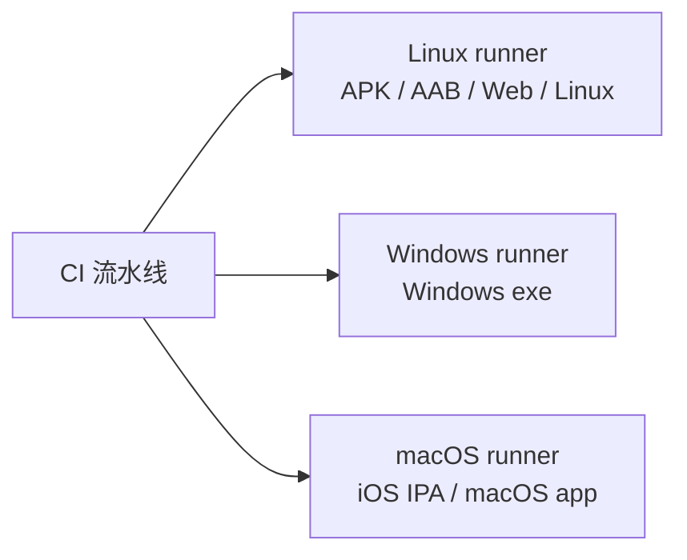
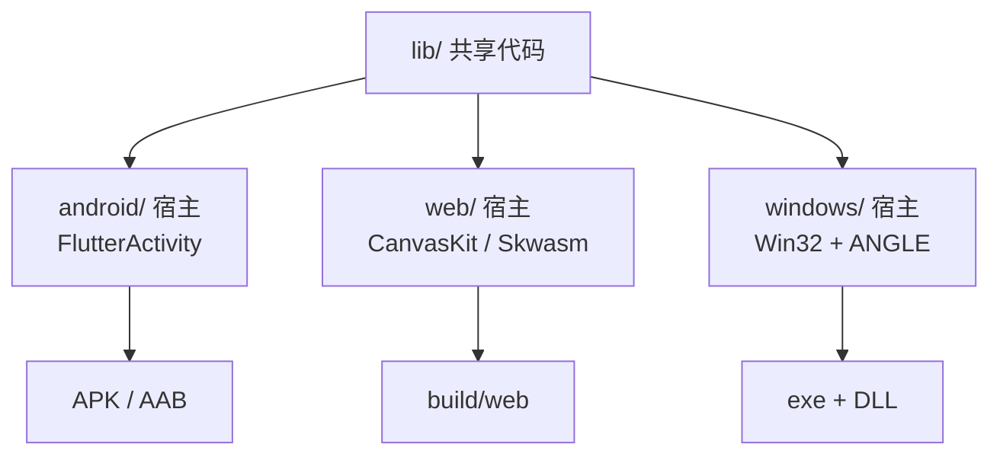

前 14 篇以 Android 端为主线：工程模型、widget、布局、状态、数据层、滚动与导航，最后落到三棵树。本篇把视角扩到 Android 之外，回答三个工程问题：一套代码真正能共享到什么程度、其他目标如何运行与出包、iOS 对 Xcode 的依赖有多深。这三个问题与 CMP 的评估框架一致，结论可以互相对照。

## 一、共享边界：跨平台到底共享了什么

跨平台的目标不是消灭原生代码，而是把原生代码压缩到三处：宿主工程、插件、少量平台通道。衡量一个 Flutter 项目的跨平台程度，看的是这三处的体积，而不是 Dart 代码的占比。

| 内容 | 是否共享 | 落点 |
| --- | --- | --- |
| UI、业务逻辑、状态 | 共享 | `lib/` 下的 Dart 代码 |
| 网络、JSON、本地存储抽象 | 共享 | 纯 Dart 包 |
| 相机、蓝牙、定位、传感器 | 插件或通道 | pub.dev 插件，或 `MethodChannel` |
| 清单、权限、后台任务 | 分平台 | `AndroidManifest.xml` / `Info.plist` / 平台代码 |
| 厂商 SDK | 不共享 | platform channel + Kotlin / Swift 封装 |
| 设计惯例 | 部分共享 | Material 与 Cupertino 两套组件 |

Android 侧的原生代码集中在 `android/`，其中的 `MainActivity` 只托管 `FlutterEngine`；iOS 侧对应 `ios/Runner`，桌面端对应 `windows/`、`macos/`、`linux/` 下的宿主。这些目录由 `flutter create` 生成，日常不改，只有接入平台能力时才触碰。

## 二、多端宿主与产物

### 2.1 宿主目录与构建命令

| 平台 | 宿主目录 | 构建命令 | 产物 | 本机前提 |
| --- | --- | --- | --- | --- |
| Android | `android/` | `flutter build apk` / `appbundle` | APK / AAB | Android SDK |
| iOS | `ios/` | `flutter build ipa` | IPA | macOS + Xcode |
| Web | `web/` | `flutter build web` | `build/web/`（JS 或 Wasm + 资源） | 浏览器 |
| Windows | `windows/` | `flutter build windows` | exe + DLL | Visual Studio C++ 工具链 |
| macOS | `macos/` | `flutter build macos` | `.app` | macOS + Xcode |
| Linux | `linux/` | `flutter build linux` | 可执行文件 + 依赖库 | clang、GTK 开发库 |

每个目录是一个独立的宿主工程，Flutter 只替换其中的 UI 层。`android/` 是 Gradle 工程，`windows/` 是 CMake + Win32，`web/` 只有一个 `index.html` 与启动脚本。宿主工程负责创建渲染表面、转发输入事件与生命周期，不承载业务逻辑。

### 2.2 Android 产物

| 产物 | 命令 | 输出路径 | 适用 |
| --- | --- | --- | --- |
| 通用 APK | `flutter build apk` | `build/app/outputs/flutter-apk/app-release.apk` | 直接分发、国内渠道 |
| 分 ABI 的 APK | `flutter build apk --split-per-abi` | 同目录下按 ABI 拆分的三个 APK | 减小单包体积 |
| AAB | `flutter build appbundle` | `build/app/outputs/bundle/release/app-release.aab` | Google Play 上架 |

发布构建默认开启 AOT 与图标裁剪。调试符号通过 `--split-debug-info=<dir>` 单独导出，配合 `--obfuscate` 可隐藏符号名——这一组合对应 Android 原生构建中的 R8 与 mapping 文件，崩溃还原依赖同一份符号表。

与 Android 原生工程的差异只在命令入口：产物结构一致，APK 仍是 zip，AAB 仍由 bundletool 处理，签名仍由 `android/app/build.gradle.kts` 中的 `signingConfigs` 决定。

### 2.3 交叉构建限制与 CI

Flutter 不支持跨平台构建：Windows 上只能出 Android、Web、Windows 三端，Linux 与 macOS 的产物必须在对应系统上构建，iOS 与 macOS 还要求 Xcode。这一限制来自各平台的工具链，与 Flutter 本身无关。



工程上的常规做法是"一套流水线、三类 runner"，各跑各的目标。iOS 还需要签名证书与描述文件，配置落在 Xcode 工程中，Flutter 侧通过 `ios/Runner.xcodeproj` 读取。

## 三、在 Android Studio 中运行到其他平台

### 3.1 目标设备

设备下拉列出当前可运行的目标：Android 模拟器、USB 真机、`Chrome`、`Windows`；在 macOS 上还会出现 iOS 模拟器。选择后点击 `Run`，同一份 `lib/` 代码部署到对应宿主。



Web 与桌面目标同样支持热重载，改 UI 后不必切换到 Android 设备验证。调试布局时，桌面端窗口可自由缩放，是验证断点行为最方便的目标。

### 3.2 平台判断的三种方式

| 方式 | 适用 | 说明 |
| --- | --- | --- |
| `kIsWeb` | 仅区分 Web 与非 Web | 来自 `package:flutter/foundation.dart` |
| `defaultTargetPlatform` | 区分 Android / iOS / 桌面 | 同上，不依赖 `dart:io` |
| 条件导入 | 平台专属实现 | `import 'a.dart' if (dart.library.io) 'b.dart'` |

```dart
import 'package:flutter/foundation.dart';

if (kIsWeb) {
  // Web 专属逻辑
} else if (defaultTargetPlatform == TargetPlatform.android) {
  // Android 专属逻辑
}
```

`dart:io` 的 `Platform` 在 Web 上不可用，直接导入会让 Web 构建失败。跨 Web 的代码应使用 `defaultTargetPlatform`，或把平台实现拆到不同文件用条件导入隔离。

### 3.3 插件的平台支持

pub.dev 的包页面列出平台支持矩阵。插件在未实现的平台上不会编译报错，而是在运行期抛 `MissingPluginException`，因此选型时要先看矩阵，再看最近更新时间与未决 issue。

插件在宿主侧注册：Android 由 `GeneratedPluginRegistrant` 在 `MainActivity` 启动时调用，iOS 在 `AppDelegate` 中注册，桌面端同样有各自的注册入口。这一层由 Flutter 工具自动生成，只有手写插件时才需要关心。

## 四、平台差异的落点

### 4.1 设计系统

`MaterialApp` 与 `CupertinoApp` 是同级选择，不是平台限制。用 `CupertinoApp` 构建的应用可以在 Android 上运行，只是视觉与交互遵循 iOS 惯例。

| 维度 | Material | Cupertino |
| --- | --- | --- |
| 根组件 | `MaterialApp` | `CupertinoApp` |
| 页面骨架 | `Scaffold` | `CupertinoPageScaffold` |
| 主题 | `ThemeData` | `CupertinoThemeData` |
| 交互反馈 | 波纹、浮动按钮 | 无波纹、大标题、滑动返回 |

两种混用是常见做法：整体用 Material，个别页面用 Cupertino 组件贴合 iOS 习惯。混用的代价是两套主题体系并存，颜色与字体需要分别配置。

系统动态取色（Android 12 的 Material You）不会自动作用于 Flutter 应用，需要借助插件或自行读取主题色。

### 4.2 输入方式

| 输入 | 触控 | 鼠标 | 键盘 |
| --- | --- | --- | --- |
| 点击目标 | 48dp / 44pt 下限 | 可更小 | — |
| 悬停反馈 | 无 | `MouseRegion`、`InkWell.onHover` | — |
| 滚动 | 拖拽 | 滚轮；默认不响应拖拽 | 方向键、PageUp/PageDown |
| 焦点 | 软键盘 | 点击获取 | `Tab` 遍历、`FocusTraversalGroup` |

桌面端默认不允许鼠标拖拽滚动，需要自定义 `ScrollBehavior` 把 `PointerDeviceKind.mouse` 加入 `dragDevices`。这类差异不会在 Android 调试时暴露，只有跑到桌面目标才会显现。

### 4.3 导航惯例

| 平台 | 返回方式 | Flutter 对应 |
| --- | --- | --- |
| Android | 系统返回键、返回手势 | `PopScope` 拦截，默认由 `Navigator.pop` 处理 |
| iOS | 左缘右滑 | `CupertinoPageRoute` 内置 |
| 桌面 | 无系统返回 | 需自行绑定 `Esc` 或提供显式入口 |
| Web | 浏览器前进/后退 | 需使用 `Router` / `RouterDelegate` 同步历史 |

Navigator 1.0 不自动同步浏览器地址栏与历史记录。需要 Web 端前进/后退可用时，改用 Router API（Navigator 2.0）声明式地映射 URL 与路由栈。

### 4.4 权限与清单

| 平台 | 声明位置 | 运行时处理 |
| --- | --- | --- |
| Android | `AndroidManifest.xml` | 运行时请求（`permission_handler` 等） |
| iOS | `Info.plist` 的用途描述 | 首次调用时弹窗 |
| 桌面 | 各系统权限模型 | 文件访问、通知等分别处理 |
| Web | 浏览器权限提示 | 部分 API 不可用 |

两侧的权限模型并不对应：同一个能力在 Android 是运行时权限，在 iOS 是用途描述字符串，在 Web 可能根本不存在。插件通常封装了请求逻辑，但声明部分必须手工补齐，漏写会导致调用被系统直接拒绝。

### 4.5 文本与字体

Flutter 使用逻辑像素，与 Android 的 dp 对应；文本缩放通过 `MediaQuery.textScalerOf(context)` 获取，等价于 Android 的 `fontScale`。

各平台的默认字体不同：Android 为 Roboto，iOS 与 macOS 为 San Francisco，Windows 为 Segoe UI。只使用主题默认样式时，应用会呈现各平台的原生观感；要求三端完全一致时，需要把字体文件打进 `pubspec.yaml` 的 `fonts` 并显式指定，代价是包体增加与字形覆盖范围受限。

## 五、iOS 与 Xcode 的依赖边界

这是跨平台评估中最容易被误解的一点，结论与 CMP 一致：**iOS 的编译、签名、上架，Xcode 是硬依赖；日常写共享 UI、改布局、调逻辑，可以完全不碰 Xcode。**

| 环节 | 需要 macOS + Xcode | 说明 |
| --- | --- | --- |
| 编写共享 Dart 代码 | 否 | 任意平台 |
| Android 调试 | 否 | Android Studio |
| Web、桌面调试 | 否 | 同一套代码 |
| iOS 模拟器运行 | 是 | iOS SDK 与模拟器由 Xcode 提供 |
| iOS 真机调试 | 是 | 需要签名证书与描述文件 |
| 上架 App Store | 是 | Xcode / Transporter + 证书 |

与 CMP 的差别在于集成方式：CMP 需要把 Kotlin 编译为 framework 交由 Xcode 工程消费，多一层集成环节；Flutter 的 iOS 宿主工程直接由 Flutter 工具生成并驱动，日常运行只需 `flutter run`，Xcode 主要在签名与上架时打开。

工程上的做法是把 iOS 验证放在流程末端：UI 与逻辑在 Android、Chrome、桌面目标上迭代，只在里程碑节点回到 iOS 验证平台差异（滚动惯性、字体度量、返回手势）。

## 六、与 Compose Multiplatform 的取舍

| 维度 | Flutter | Compose Multiplatform |
| --- | --- | --- |
| 语言 | Dart | Kotlin |
| UI 体系 | 自有 widget 库 | Compose，与 Jetpack Compose 同源 |
| 目标平台 | Android、iOS、Web、Windows、macOS、Linux | Android、iOS、桌面（JVM）；Web 为 Wasm |
| 与现有 Android 代码复用 | 需以 Dart 重写 | 可直接复用 Kotlin 与 Compose 代码 |
| 渲染 | Skia / Impeller | Skia（经 Skiko 绑定） |
| 生态 | pub.dev | Maven 与 Compose 生态 |
| iOS 构建 | 需要 Xcode | 需要 Xcode |

判断依据是两项权重：现有 Kotlin 代码的复用价值，与多端外观一致性的要求。业务逻辑庞大、UI 可以接受各平台原生风格时，CMP 的迁移成本更低；需要 Web 与桌面端外观完全一致、或团队愿意接受一门新语言时，Flutter 的覆盖面更完整。CMP 的桌面出包与 Xcode 边界见 [[8. CMP快速入门]]。

## 七、常见误区

1. **以为一条命令能出全平台**：构建必须在对应操作系统上执行，Windows 出不了 iOS 与 macOS 产物。
2. **以为 iOS 能彻底脱离 Xcode**：模拟器运行、真机调试、上架都依赖 Xcode 工具链与签名。
3. **以为 Web 与移动端行为一致**：`dart:io` 不可用、滚动与字体度量不同、部分插件无 Web 实现。
4. **直接用 `Platform.isAndroid` 做平台判断**：`dart:io` 在 Web 构建期即失败，应改用 `defaultTargetPlatform` 或条件导入。
5. **忽略插件的平台支持矩阵**：不支持的平台在运行期抛 `MissingPluginException`，编译期不会提示。
6. **以为热重载能覆盖所有改动**：Kotlin / Swift 代码、`AndroidManifest.xml`、`pubspec.yaml` 的改动需要完全重启。
7. **忽略包体增量**：引擎随应用分发，Android 侧比同功能原生应用多出数 MB，低端设备与渠道包需要评估。
8. **只按 Android 的交互习惯设计**：桌面端没有返回键、鼠标需要悬停反馈、键盘需要焦点遍历，这些在 Android 调试时不会暴露。

## 小结

跨平台共享的是 UI 与业务逻辑，原生代码被压缩到宿主、插件、平台通道三处；这三处的体积决定项目的实际跨平台程度。产物按平台拆分，构建按操作系统拆分，CI 需要多类 runner，iOS 与 macOS 还要求 Xcode。平台差异集中在设计系统、输入方式、导航惯例、权限与文本五处，且多数只在跑到对应目标时才暴露，桌面与 Chrome 目标因此是低成本的验证手段。Xcode 在 Flutter 与 CMP 中同样是"发布工具"而非"日常工具"，两者的取舍取决于 Kotlin 代码复用价值与多端外观一致性的权重。
