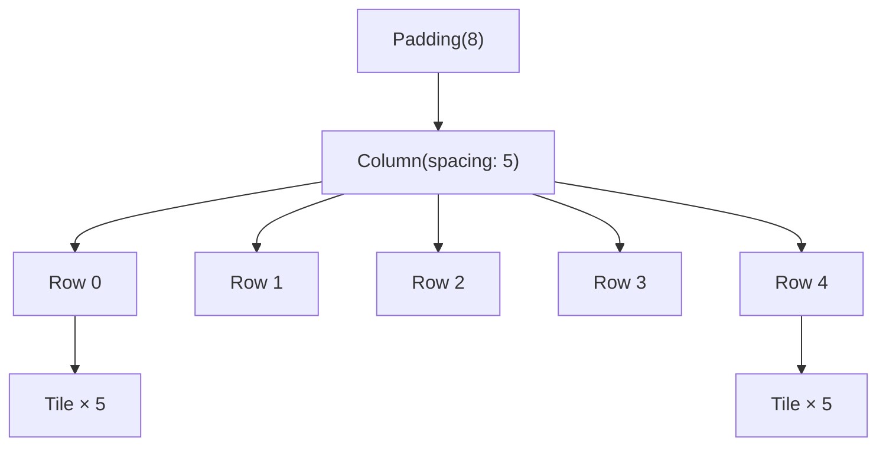

widget 只描述"想画什么"，位置与尺寸由布局系统分配。Flutter 的布局建立在一条固定规则上：父级向子级传递约束，子级在约束内决定自身尺寸，父级再决定子级的位置。理解这条规则，才能解释 `Column` 为什么有时撑满屏幕、有时只有内容高度。

## 布局模型：约束、尺寸、位置

三条规则按顺序执行，缺一不可：

1. **约束向下传递**。父级把 `BoxConstraints`（最小/最大宽高）交给子级。
2. **尺寸向上返回**。子级在约束允许的范围内选定一个 `Size` 上报。
3. **位置由父级决定**。子级不持有自己的坐标，父级在布局阶段设定其偏移。

`BoxConstraints` 有四个字段：`minWidth`、`maxWidth`、`minHeight`、`maxHeight`。常见组合对应不同语义：

| 约束形态 | 含义 | 典型来源 |
| --- | --- | --- |
| 紧约束（min == max） | 尺寸被完全指定 | `SizedBox(width: 60, height: 60)` |
| 松约束（min == 0） | 尺寸可在上限内自选 | `Center`、`Align` |
| 无界（max == infinity） | 该方向没有上限 | 可滚动方向的视口、`Row` 中的横向子级 |

无界约束是布局异常的主要成因：一个"想尽可能大"的子级在无限空间里无法确定尺寸，只能在调试模式下抛异常（第 4 节详述）。

## 与 Android 布局体系的对应

| Android | Flutter | 语义 |
| --- | --- | --- |
| `MeasureSpec`（模式 + 尺寸） | `BoxConstraints`（min/max 宽高） | 父级给子级的限制 |
| `LinearLayout` + `orientation` | `Column` / `Row` | 单轴排列 |
| `layout_weight` | `Expanded` / `Flexible(flex:)` | 主轴剩余空间分配 |
| `gravity` / `layout_gravity` | `mainAxisAlignment` / `crossAxisAlignment` | 对齐 |
| `padding` / `margin` | `Padding` / `Container.margin` | 内外间距 |
| `FrameLayout` + `layout_gravity` | `Stack` + `Positioned` | 层叠与定位 |
| `BoxWithConstraints` | `LayoutBuilder` | 读取父级约束 |
| `ConstraintLayout` | 无直接对应 | 用嵌套行列与 `Align` 组合 |

`MeasureSpec` 把"模式（`EXACTLY` / `AT_MOST` / `UNSPECIFIED`）+ 尺寸"打包成一个 int，`BoxConstraints` 用四个 `double` 表达上下限。两者语义一致：父级限定范围，子级在其中决定尺寸。`UNSPECIFIED` 对应 `maxWidth` 或 `maxHeight` 为 `infinity` 的情形，也正是无界约束异常的来源。

Flutter SDK 没有约束求解器，`ConstraintLayout` 的相对定位与比例约束需要拆成嵌套的 `Column`、`Row`、`Align`、`Stack`。代价是树更深，收益是布局过程只有一次自顶向下的遍历，没有二次求解。

## Scaffold：页面骨架

`Scaffold` 是 Material 风格的页面骨架，本身不绘制内容，只提供一组具名插槽，把页面元素放到约定位置。

| 插槽 | 位置 | 典型内容 |
| --- | --- | --- |
| `appBar` | 顶部 | `AppBar` |
| `body` | 主体区域 | 页面主内容 |
| `floatingActionButton` | 右下角悬浮 | `FloatingActionButton` |
| `drawer` | 左侧抽屉 | 导航菜单 |
| `bottomNavigationBar` | 底部 | 标签栏 |
| `bottomSheet` | 底部可拖拽面板 | 操作面板 |

`body` 收到的约束是"屏幕尺寸减去 appBar 等占位后的剩余区域"，且为紧约束——`Scaffold` 要求主体填满可用空间，因此 `body` 中的 `Center` 能占满整块区域并把子级居中。

## AppBar 与 title 槽位

`AppBar` 的 `title` 接受任意 widget，而不只是 `Text`。这一设计使标题区域可以放置自定义组合，例如带图标的标题、可点击的搜索框。

```dart
appBar: AppBar(
  title: const Align(
    alignment: Alignment.centerLeft,
    child: Text('Birdle'),
  ),
),
```

`Align` 在父级给定的空间内按 `alignment` 放置子级，此处把文本固定到左侧。`Alignment.centerLeft` 是静态常量，属于常量表达式，因此整棵 `Align` 可以标注 `const`。

标题的水平位置也可由 `AppBar.centerTitle` 控制：为 `true` 时居中，为 `false` 时靠起始边，未设置时由 `AppBarTheme` 与平台默认值决定。直接包裹 `Align` 的好处是不依赖主题配置，行为确定。

## Column 与 Row

两个最基础的布局 widget，沿单一轴排列子级。

| widget | 主轴 | 交叉轴 |
| --- | --- | --- |
| `Column` | 垂直（自上而下） | 水平 |
| `Row` | 水平（自左向右，受文字方向影响） | 垂直 |

主轴方向的排布由三个参数控制：

| 参数 | 作用 | 常用取值 |
| --- | --- | --- |
| `mainAxisAlignment` | 主轴上的对齐与剩余空间分配 | `start`、`center`、`end`、`spaceBetween`、`spaceAround`、`spaceEvenly` |
| `mainAxisSize` | 主轴方向占用的尺寸 | `max`（默认，占满约束）、`min`（仅包裹内容） |
| `spacing` | 相邻子级之间的固定间距 | 任意 `double` |

交叉轴方向由 `crossAxisAlignment` 控制：`start`、`center`、`end`、`stretch`（拉伸至主轴方向的满宽/满高）、`baseline`（按文字基线对齐，仅 `Row` 有效）。

`spacing` 替代了早期用 `SizedBox` 或 `Padding` 手工分隔子级的写法：

```dart
Column(
  spacing: 5.0,
  children: [ /* ... */ ],
)
```

它只作用于主轴，且不作用于首尾两端——首个子级之前与最后一个子级之后不会插入间距。

`mainAxisSize` 的默认值 `max` 解释了常见现象：`Column` 放在 `Scaffold.body` 中会占满整个高度，内容按 `mainAxisAlignment.start` 排在顶部，即使内容只有两行。若希望 `Column` 只包裹内容，需显式设为 `MainAxisSize.min`。

## 从数据生成子级

`children` 接受 `List<Widget>`，可以在列表字面量中直接使用 `for` 元素：

```dart
Column(
  spacing: 5.0,
  children: [
    for (final guess in _game.guesses)
      Row(
        spacing: 5.0,
        children: [
          for (final letter in guess) Tile(letter.char, letter.type),
        ],
      ),
  ],
)
```

`collection for` 是 Dart 的集合语法，在构建集合时迭代添加元素。它与下面两种写法等价：

```dart
// map + 展开运算符
children: [..._game.guesses.map((guess) => Row(/* ... */))],

// 先建列表再传入
final rows = <Widget>[];
for (final guess in _game.guesses) {
  rows.add(Row(/* ... */));
}
// children: rows
```

相比 `map` + 展开，`for` 元素省去一层闭包与展开，嵌套时层级更直观；相比命令式建表，它把构建过程留在声明位置，不需要中间变量。

内层 `for (final letter in guess)` 直接遍历 `guess`。`guess` 的元素类型是 record `({String char, HitType type})`，遍历时按字段访问 `letter.char` 与 `letter.type`。record 的字段名在类型中声明，取值是编译期检查的，不存在拼写错误的运行期风险。

数据源 `_game.guesses` 是固定长度列表，长度等于最大猜测次数（5），未填的槽位以空 `Word` 占位。因此外层循环恒定产生 5 行，不需要额外判断"是否已有猜测"，网格形状在游戏开始时就确定。

## 网格：嵌套的行列

5×5 棋盘的结构是 `Column` 包含 5 个 `Row`，每个 `Row` 包含 5 个 `Tile`：



选择这种结构的原因是可预测：行数与列数固定，每个格子尺寸固定（60×60），总宽度与总高度可以手工算出，不需要测量或滚动。

代价是树深度。5 行 × 5 列 = 25 个 `Tile`，加上容器节点，实际 element 树超过 60 个节点。布局阶段对渲染树做一次深度优先遍历，复杂度为 O(n)，25 个格子的规模不构成性能问题；当子项数量达到数百且不确定时，应改用 `ListView` 或 `SliverList`（第 12 节），由视口按需布局。

## Expanded 与 Flexible

`Row` 与 `Column` 在主轴上分配空间时，若子级总尺寸小于可用空间，剩余空间如何处理取决于 `mainAxisAlignment`；若希望某个子级**吃掉**剩余空间，需要 `Expanded`。

```dart
Row(
  children: [
    Expanded(child: TextField(/* ... */)),
    IconButton(/* ... */),
  ],
)
```

`Expanded` 是 `Flexible` 的固定填充版本：

| widget | fit | 行为 |
| --- | --- | --- |
| `Expanded` | `FlexFit.tight` | 强制占满分配到的空间 |
| `Flexible` | `FlexFit.loose` | 最多占用分配空间，可更小 |

分配比例由 `flex` 决定，默认 1。两个 `Expanded(flex: 2)` 与 `Expanded(flex: 1)` 的子级，宽度比为 2:1。

两条使用约束：

- `Expanded` / `Flexible` 必须是 `Row`、`Column`、`Flex` 的**直接子级**，其父数据由 Flex 读取。放在其他位置会抛 `Incorrect use of ParentDataWidget`。
- 在无界主轴上使用会失效。例如 `Column` 位于可滚动视图中时主轴高度无界，`Expanded` 无法确定分配基准。

## 三种间距手段的分工

| 手段 | 语义 | 适用 |
| --- | --- | --- |
| `spacing` | 同级子项之间的均匀间隔 | `Column` / `Row` 的批量间隔 |
| `Padding` | 容器内边距，隔离内容与边界 | 页面留白、卡片内边距 |
| `SizedBox` | 固定尺寸占位 | 单个空隙、固定宽高的子级 |
| `EdgeInsets` | 四边独立的间距值 | `Padding`、`Container.margin` 的参数 |

`EdgeInsets.all(8)` 四边等距；`EdgeInsets.symmetric(horizontal: 2.5, vertical: 2.5)` 按轴设置；`EdgeInsets.only(left: 20)` 单独设置某一边；`EdgeInsetsDirectional.fromSTEB` 按起始/结束边设置，适配从右到左的语言。

## 本节小结

布局系统遵循"约束向下、尺寸向上、父级定位置"。`Scaffold` 提供具名插槽，`AppBar` 的 `title` 接受任意 widget。`Column` / `Row` 沿主轴排列，`mainAxisSize` 默认为 `max`，`spacing` 提供同级间隔。子级由 `collection for` 从数据生成，record 字段访问受编译期检查。嵌套行列适合数量确定的网格，数量不定时应换成按需布局的滚动组件。`Expanded` 占据主轴剩余空间，且必须是 Flex 的直接子级。
