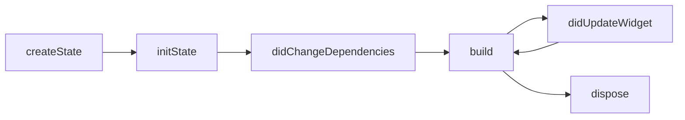

前几节的 widget 全部是不可变配置：给定参数，界面就确定。一旦数据需要在使用过程中变化——猜测被提交、颜色被判定、计数增加——就必须引入 `State`。这是 Flutter 状态模型的入口，也是理解重建机制的关键。

## 可变数据该放在哪里

`Widget` 的字段都是 `final`，实例创建后不可修改。数据结构上无法承载"会变的值"，因此需要一个生命周期长于 widget 实例的对象来保存。

| 对象 | 生命周期 | 是否可变 | 职责 |
| --- | --- | --- | --- |
| `Widget` | 极短，每次重建可能新建 | 否 | 描述界面配置 |
| `State` | 与 element 绑定，跨重建存活 | 是 | 保存可变数据、触发重建 |
| `Element` | 与树中位置绑定 | 内部可变 | 连接 widget 与 render object |

判断标准只有一条：**该数据是否在 widget 存活期间需要变化**。需要变化则放入 `State`，否则作为 `StatelessWidget` 的字段即可。

## 基本结构

```dart
class GamePage extends StatefulWidget {
  const GamePage({super.key});

  @override
  State<GamePage> createState() => _GamePageState();
}

class _GamePageState extends State<GamePage> {
  final Game _game = Game();

  @override
  Widget build(BuildContext context) {
    return Padding(
      padding: const EdgeInsets.all(8.0),
      child: Column(
        spacing: 5.0,
        children: [/* ... */],
      ),
    );
  }
}
```

四个固定要素：

1. `StatefulWidget` 子类本身仍不可变，只声明构造参数。
2. `createState()` 返回 `State` 实例，返回类型标注为 `State<GamePage>`，框架据此建立 widget 与 state 的对应关系。
3. `State` 子类的泛型参数是**对应的 widget 类型**，通过 `widget` 属性访问该 widget 的字段。
4. `build` 方法从 widget 移到 state 中，因为它需要读取 state 的可变数据。

`State` 子类命名为 `_GamePageState`（下划线前缀 + widget 名 + State），这是 Flutter 的命名约定，下划线使其对库外私有。

`createState()` 只被调用一次，发生在 element 首次挂载时。后续重建复用同一个 `State` 实例，不会再次调用。

## 从 StatelessWidget 迁移

迁移步骤固定为四步：

1. 基类由 `StatelessWidget` 改为 `StatefulWidget`。
2. 新建 `_XxxState extends State<Xxx>`。
3. 把 `build` 与所有**在 widget 上实例化的字段**移入 state。
4. 在 widget 中实现 `createState()`。

"在 widget 上实例化的字段"指 `final Game _game = Game();` 这类带初始化的字段，它们在每次重建时都会重新构造，无法保存跨重建的状态，必须移入 state。仅由构造函数注入、不随之变化的字段可以留在 widget 上，通过 `widget.字段名` 访问。

Android Studio 的 Flutter 插件提供 `Convert to StatefulWidget` 意图动作：把光标置于类名，按 `Alt`+`Enter`（macOS 为 `Option`+`Return`）或点击行号旁的黄色灯泡，即可自动完成上述改写。从零编写时，输入 `stful` 实时模板可直接生成 widget 与 `State` 的配对结构。

## setState 的语义

`setState` 接受一个无参闭包，执行流程分两段：

1. **同步执行闭包**。闭包内的赋值立即生效，字段立刻是新值。
2. **标记重建**。把当前 element 标记为 dirty，框架在下一帧统一处理所有 dirty element，重新执行其 `build`。

由此得到三条性质：

- **不是立即重建**。闭包执行完不会马上去调用 `build`，界面在本帧结束后才更新。
- **闭包必须同步**。`setState` 不接受异步闭包，也不应在 `await` 之后继续往同一个闭包里写代码。正确写法是先 `await` 取回数据，再单独调用一次 `setState` 赋值。

```dart
onSubmitGuess: (String guess) {
  setState(() {
    _game.guess(guess);
  });
},
```

- **不调用 `setState` 的修改不会反映到界面**。直接执行 `_game.guess(guess)` 会改变游戏数据，但框架不知道需要重绘，用户看到的网格保持不变。数据正确而界面不更新，是这类 bug 的典型表现。

`setState` 内部有对"已 dispose"的检查：在 `State` 被移除后调用会抛异常。异步回调中调用 `setState` 前应确认 `mounted` 为 `true`。

## 重建范围

`setState` 标记的是当前 element，重建范围限于其子树中受影响的节点，而不是整棵树。

需要区分两种情形：

| 情形 | 行为 |
| --- | --- |
| 本节点 `setState` | 本节点的 `build` 重新执行，返回新的子 widget 树 |
| 父节点 `setState` | 子 widget 以新实例重建；子 element 收到新 widget 后比较配置，决定是否继续向下重建 |

第二点是关键：父级重建会为子级**创建新的 widget 实例**，即使子级的参数完全没变。框架通过比较新旧 widget 决定是否更新对应 element；若新旧实例相同（`identical`），则整棵子树跳过。

这正是 `const` 构造有价值的原因：`const Tile(...)` 在编译期规范化，父级重建时拿到的是同一个实例，比较阶段直接相等，子树不再更新。

`build` 方法应保持轻量，因为它在每次状态变化、每次父级重建时都可能执行。耗时计算放在事件回调或异步任务中完成，结果存入 state。

## 为什么子组件也需要状态

一个容易忽略的连锁反应：`GamePage` 改为有状态后，每次 `setState` 会重建 `GuessInput`。若 `GuessInput` 仍是 `StatelessWidget`，它内部的控制器与焦点对象声明为字段并直接初始化：

```dart
final TextEditingController _textEditingController = TextEditingController();
final FocusNode _focusNode = FocusNode();
```

每次重建都会执行字段初始化，产生新的控制器与焦点对象。后果有两层：

1. **焦点丢失**。`TextField` 绑定的是新 `FocusNode`，旧的焦点状态不再被引用，软键盘收起，输入中断。
2. **资源泄漏**。旧控制器与旧焦点对象失去引用但从未 `dispose()`，其内部监听与原生资源不会释放。

根因是 `StatelessWidget` 的字段生命周期等同于 widget 实例，而 widget 实例在每次重建时都会替换。把 `GuessInput` 改为 `StatefulWidget` 后，控制器与焦点对象移入 `State`，`State` 跨重建存活，问题消失，同时获得释放时机：

```dart
class _GuessInputState extends State<GuessInput> {
  final TextEditingController _textEditingController = TextEditingController();
  final FocusNode _focusNode = FocusNode();

  @override
  void dispose() {
    _textEditingController.dispose();
    _focusNode.dispose();
    super.dispose();
  }

  void _onSubmit() {
    widget.onSubmitGuess(_textEditingController.text.trim());
    _textEditingController.clear();
    _focusNode.requestFocus();
  }

  @override
  Widget build(BuildContext context) {
    return Row(
      children: [
        Expanded(
          child: Padding(
            padding: const EdgeInsets.all(8.0),
            child: TextField(
              maxLength: 5,
              focusNode: _focusNode,
              autofocus: true,
              decoration: const InputDecoration(
                border: OutlineInputBorder(
                  borderRadius: BorderRadius.all(Radius.circular(35)),
                ),
              ),
              controller: _textEditingController,
              onSubmitted: (_) => _onSubmit(),
            ),
          ),
        ),
        IconButton(
          padding: EdgeInsets.zero,
          icon: const Icon(Icons.arrow_circle_up),
          onPressed: _onSubmit,
        ),
      ],
    );
  }
}
```

`widget.onSubmitGuess` 是 `State` 访问所属 widget 字段的方式。`widget` 属性指向当前挂载的 widget 实例，父级重建后它会更新为最新实例，因此回调始终是最新的那份。

判据可以归纳为一句话：**凡是有生命周期、需要释放、或需要跨重建保留的对象，都必须放在 `State` 中**。控制器、焦点节点、动画控制器、定时器、订阅均属此类。

## 与 Compose 状态模型的对应

| Compose | Flutter | 说明 |
| --- | --- | --- |
| `remember { mutableStateOf() }` | `State` 字段 | 跨重建的存储位 |
| 状态写入触发重组 | `setState` | 标记脏并安排重建 |
| `LaunchedEffect(Unit)` | `initState` 中的一次性逻辑 | 首次挂载执行 |
| `DisposableEffect` 的 `onDispose` | `dispose()` | 释放资源 |
| `rememberSaveable` / `SavedStateHandle` | `RestorationMixin` | 进程重建后的恢复 |
| `key(...)` | `Key` | 同位置子项的身份标识 |

`State` 对象与 Compose 的 `remember` 存储槽定位接近：都绑定到"该位置"，跨重建存活，位置消失即释放。差别是 Flutter 把这块存储显式成类，并把释放时机明确为 `dispose()`。

配置变化是 Android 开发者最关心的一处差异。Flutter 模板在 `AndroidManifest.xml` 中为 `MainActivity` 声明了 `configChanges`（含 `orientation`、`screenSize`、`uiMode` 等），旋转屏幕不会重建 Activity，`State` 自然保留；Compose 应用同样不会因旋转重建 Activity。真正会丢失状态的是进程被系统回收，此时 `State` 与 `remember` 一样失效，需要 `RestorationMixin` 一类机制显式恢复。

## 生命周期

`State` 的方法按固定顺序被调用：



| 方法 | 调用时机 | 典型用途 | 约束 |
| --- | --- | --- | --- |
| `createState` | element 首次挂载 | 构造 `State` 实例 | 只调用一次 |
| `initState` | `State` 插入树后 | 初始化控制器、发起首次加载 | 不能使用 `Theme.of` 一类依赖 `InheritedWidget` 的调用 |
| `didChangeDependencies` | 依赖的 `InheritedWidget` 变化后 | 读取依赖并据此初始化 | 可能多次调用 |
| `build` | 需要重建时 | 组合 UI | 无副作用、轻量 |
| `didUpdateWidget` | 父级传入新 widget 后 | 对比新旧配置、响应参数变化 | 需手动比较 `oldWidget` |
| `dispose` | `State` 从树中移除前 | 释放控制器、取消订阅、停定时器 | 必须调用 `super.dispose()` |

`initState` 中不可依赖 `InheritedWidget` 的原因：此时 element 尚未完成依赖注册，调用 `Theme.of(context)` 会触发断言。需要依赖数据的初始化应放到 `didChangeDependencies`，或使用 `WidgetsBinding.instance.addPostFrameCallback` 推迟到首帧之后。

`dispose` 是唯一的释放时机。漏掉 `dispose` 不会立即报错，但会在页面反复进出时累积泄漏；DevTools 的 Memory 面板可以观察到对象数量持续增长。

## 状态最小化

`State` 中只保存**无法从其他数据推导**的值。

| 数据 | 处理方式 |
| --- | --- |
| 用户输入、游戏进度、选中项 | 存入字段 |
| 由已有字段计算得出的值 | 用 getter 现算 |
| 可通过 `Theme`、`MediaQuery` 获取的环境数据 | 不保存，用时读取 |

例如"剩余猜测次数"由"当前空槽位索引"与"最大次数"推导，就不应单独存一个字段——两个字段同步维护会引入不一致的可能，而 getter 每次读取都保证正确。

## 本节小结

`StatefulWidget` 与 `State` 分离的设计解决了"不可变配置"与"可变数据"的矛盾：widget 保持轻量与可比较，state 承担持久数据与生命周期。`setState` 同步执行闭包并标记 dirty，重建发生在下一帧，闭包不能包含异步等待。父级重建会为子级创建新实例，`const` 构造使相同配置跳过更新。凡需跨重建存活或需要释放的对象必须放入 `State`，并在 `dispose` 中释放。生命周期中 `initState` 不依赖 `InheritedWidget`，`didChangeDependencies` 才是依赖初始化的位置。
