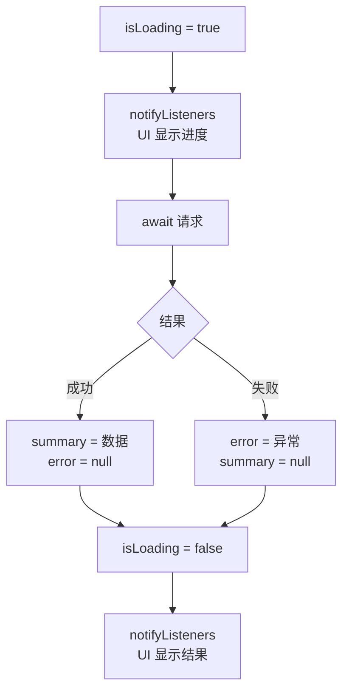

状态管理要回答三个问题：可变数据放在哪、变化后如何通知、通知后重建哪些部分。`ChangeNotifier` 给出前两个答案，第三个由使用它的监听组件决定。

## ChangeNotifier 的机制

`ChangeNotifier` 定义在 `package:flutter/foundation.dart`，不依赖 Material 或 Cupertino，因此可以放在纯逻辑层。

| 成员 | 作用 |
| --- | --- |
| `addListener(VoidCallback)` | 注册监听器 |
| `removeListener(VoidCallback)` | 注销监听器 |
| `notifyListeners()` | 同步调用全部已注册的监听器 |
| `hasListeners` | 是否存在监听器 |
| `dispose()` | 清空监听器列表并标记为已释放 |

`notifyListeners()` 是**同步**调用：注册的监听器在当次调用栈中依次执行。对 `ListenableBuilder` 而言，监听器内部只是把自身标记为需要重建，真正的 `build` 发生在下一帧，因此不会出现"通知导致递归重建"的栈溢出。

在 `notifyListeners()` 之后、下一帧之前多次修改字段，只会产生一次重建。这一特性使"连续赋值、末尾通知一次"成为合法且高效的写法。

## ViewModel 的结构

```dart
class ArticleViewModel extends ChangeNotifier {
  final ArticleModel model;
  Summary? summary;
  Exception? error;
  bool isLoading = false;

  ArticleViewModel(this.model) {
    fetchArticle();
  }

  Future<void> fetchArticle() async {
    isLoading = true;
    notifyListeners();
    try {
      summary = await model.getRandomArticleSummary();
      error = null;
    } on HttpException catch (e) {
      error = e;
      summary = null;
    }
    isLoading = false;
    notifyListeners();
  }
}
```

继承 `ChangeNotifier` 后，实例本身即是可被监听的 `Listenable`，可以直接传给监听组件，不需要额外的接口适配。

字段设计采用"三态并列"：

| 字段 | 类型 | 含义 |
| --- | --- | --- |
| `summary` | `Summary?` | 成功时携带数据，失败时为 `null` |
| `error` | `Exception?` | 失败时携带异常，成功时为 `null` |
| `isLoading` | `bool` | 请求进行中为 `true` |

三者构成互斥的状态组合：加载中（`isLoading == true`）、成功（`summary != null`）、失败（`error != null`）。互斥性不由类型系统保证，而是由赋值逻辑维护，因此每个分支都必须同时处理"设值"与"清除旧值"。

### 为什么构造函数里发起请求

构造函数不能是 `async`。Dart 的构造函数必须同步返回实例，若允许 `async`，`await` 之后的对象尚未完成初始化，调用方拿到的可能是半成品。

因此把首次加载委托给普通异步方法，在构造函数体内调用：

```dart
ArticleViewModel(this.model) {
  fetchArticle();
}
```

这一写法有一个边界：构造期间调用 `notifyListeners()` 时通常还没有监听者，通知被丢弃。由于 View 的首次 `build` 读取的是字段的最新值，而请求尚未返回，界面显示的是初始状态（`isLoading == false`、`summary == null`），因此不会出现"漏掉一次通知导致界面停在错误状态"的问题——后续状态变化仍会正常通知。

若首个通知必须被感知（例如需要在构造后立即显示加载态），应把初始值设为 `isLoading = true`，或改用显式的 `init()` 方法由调用方在挂载后触发。

### 状态迁移的完整性

`fetchArticle` 的执行顺序对应四次字段变化与两次通知：



两个细节值得单独说明：

- **成功时清 `error`，失败时清 `summary`**。若只设值不清旧值，一次失败后再成功会同时存在 `summary` 与 `error`，界面按分支顺序渲染时可能显示错误而隐藏新数据。清理旧值是维持互斥性的必要动作。
- **`isLoading = false` 放在 `try` 之外**。成功与失败都要结束加载态，放在 `catch` 之后统一执行可避免两条分支各写一遍。若 `catch` 内再次抛异常，这一行不会执行，但 `on HttpException` 只捕获特定类型，其他异常向上传播，属于预期行为。

### 只捕获预期异常

`on HttpException catch (e)` 只捕获 Model 显式抛出的 HTTP 状态错误。`SocketException`、`FormatException` 等未被捕获，会继续向上抛出。

这一取舍的含义是：ViewModel 明确声明"我能处理服务端返回错误"，其余异常属于未预期情况，应暴露出来而不是静默转成一条用户提示。生产环境中通常还需要在更外层统一捕获未预期异常并上报。

## 与 AndroidX ViewModel 的差异

| 维度 | AndroidX `ViewModel` | Flutter 的 ViewModel |
| --- | --- | --- |
| 基类 | `androidx.lifecycle.ViewModel` | `ChangeNotifier`（普通类） |
| 实例归属 | `ViewModelStoreOwner` 持有 | 页面 `State` 持有 |
| 配置变化 | 由 `ViewModelStore` 保留实例 | 页面不重建，无需保留 |
| 状态暴露 | `LiveData` / `StateFlow` | 可变字段 + `notifyListeners()` |
| 清理回调 | `onCleared()` | `dispose()` |
| 创建方式 | `viewModel()` / `ViewModelProvider` | 构造注入或直接实例化 |

两者同名但不同源。AndroidX `ViewModel` 的核心价值是"配置变化时实例不销毁"，这一职责在 Flutter 中由宿主 Activity 承担：`MainActivity` 声明了 `configChanges`，旋转不重建，页面 `State` 与其持有的对象都保留。Flutter 的 ViewModel 实际角色更接近"页面级状态容器 + 表现层逻辑"，对应 Compose 中承载 `UiState` 的那个 ViewModel。

`onCleared()` 与 `dispose()` 的调用时机也不同：前者在 `ViewModelStore` 清空时触发，后者在 `State` 从树中移除时触发。两者都应释放订阅与资源。

## 通知的粒度

`notifyListeners()` 没有参数，也不携带变化信息，所有监听者都会收到通知。因此粒度控制只能通过选择监听对象来实现：

| 监听对象 | 重建范围 | 适用 |
| --- | --- | --- |
| 整个 ViewModel | 监听它的整棵子树 | 状态少、变化频繁耦合 |
| 拆分的多个 `ChangeNotifier` | 各自的子树 | 状态独立、更新频繁 |
| `ValueNotifier<T>` | 只监听单个值 | 单一字段（第 12 节） |

页面级 ViewModel 通常只有一个，整体重建的开销与"拆分多个 notifier 再分别监听"相比并无明显劣势，因为 `build` 本身是轻量的组合操作。拆分带来的收益更多在可读性：每个 notifier 的职责边界清晰。

## 释放

`ChangeNotifier` 持有监听器列表，`dispose()` 会清空列表并置内部标记，调试模式下再调用 `notifyListeners()` 会触发断言。

释放责任在创建者。若 ViewModel 由 View 的 `State` 创建，应在 `State.dispose()` 中调用 `viewModel.dispose()`；若由依赖注入框架管理，则由框架按作用域释放。

## 先验证连接再写界面

在构建完整 UI 之前，先用日志确认 Model 与 ViewModel 已正确连接：

```dart
try {
  summary = await model.getRandomArticleSummary();
  print('Article loaded: ${summary!.titles.normalized}');
  error = null;
} on HttpException catch (e) {
  print('Error loading article: ${e.message}');
  error = e;
  summary = null;
}
```

```dart
class MainApp extends StatelessWidget {
  const MainApp({super.key});

  @override
  Widget build(BuildContext context) {
    final viewModel = ArticleViewModel(ArticleModel());

    return MaterialApp(
      home: Scaffold(
        appBar: AppBar(title: const Text('Wikipedia Flutter')),
        body: const Center(child: Text('Check console for article data')),
      ),
    );
  }
}
```

这一阶段的目的是把问题分层隔离：若日志能打印文章标题，说明网络与解析正常，后续若界面空白，问题必然在 View 层；若日志打印错误，问题在 Model 层。相比直接写完整界面再排查，定位成本低得多。

注意该写法把 ViewModel 创建在 `build` 中，每次重建都会新建一个实例并发起一次请求。它只适用于临时验证，正式实现必须把创建移到 `State` 的字段或 `initState` 中。

## 本节小结

`ChangeNotifier` 提供同步通知与监听注册，是把"数据变化"转换为"界面重建"的最小机制。ViewModel 继承它以成为可监听对象，用三个互斥字段表达加载、成功、失败，每次通知前必须维护字段间的一致性。构造函数不能异步，首次加载委托给普通方法，代价是首个通知可能无监听者，需由初始值兜底。异常处理只捕获预期类型，未预期异常向上传播。ViewModel 的生命周期由创建者负责，`dispose` 不可省略。
